# A direct exact solver for small local detector instances

**Implementation bridge, 25 October 2026.** This note removes a possible
small-instance ambiguity in [frozen-barrier-distance-detector.md](frozen-barrier-distance-detector.md).
The global master size is <code class="math">N=2^U</code>, while a recursive detector may
have only <code class="math">M\ll N</code> logical coordinates. It is unnecessary to force
the full raw hierarchy, or its parameter admissibility conditions, onto
every such tiny graph. A direct deterministic negative-cycle algorithm
already costs <code class="math">M E(N)^{O(1)}</code> whenever <code class="math">M\leq E(N)^C</code>, for any
fixed choice of the cutoff exponent <code class="math">C</code>.

This construction uses Bellman--Ford and elementary circulation
decomposition. It does not depend on a recent near-linear
negative-weight shortest-path theorem. It keeps the detector's
reporting bound proportional to its actual logical inventory <code class="math">M</code>.

## 1. Logical graph and exact state

Use exactly the active ordinary and auxiliary coordinates in the
frozen-detector note. Store each current flow <code class="math">f_e</code>, each ordinary
slack offset <code class="math">\delta_e</code>, and each frozen auxiliary value explicitly.
The number of logical vertices, coordinates, and externally born
records is <code class="math">O(M)</code>. No degree-three lift or flat forest is needed.

The full objective includes the frozen-cost offset:

<!-- math-display: 7828e3694090df6e03e7523c
P=\sum_{e\text{ active}}c_ef_e+
  \sum_{j\text{ frozen}}a_jz_j.
-->
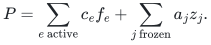

The active flow has the residual divergence after subtracting the
immutable frozen contributions. Every numerical increment is an exact
circulation on the active graph. A new auxiliary edge is explicitly
born at flow one and changes the external demand accordingly; a new
ordinary edge is born at zero.

After each complete step, birth batch, or retirement batch, recompute
all current logical weights and gradients exactly before rounding:

<!-- math-display: 5f77be9d8228d78ecaa46dfa
w_e=-\frac{\partial\text{barrier}_e}{\partial f_e}>0,
\qquad
g_e=\frac{AM}{P-(1-\alpha)F}c_e-w_e.
\tag{1}
-->
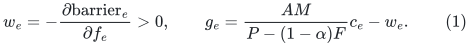

The potential argument in the companion note bounds all values and
their inverses where needed by fixed polynomials in <code class="math">N</code>. Evaluating
the power barrier with integer exponent <code class="math">p=\Theta(U)</code> uses
<code class="math">O(U^2)</code>-bit temporary rationals. The algorithm does not form a
common denominator for all such unrounded power evaluations.

## 2. A common integer price grid

Choose one fixed <code class="math">H=N^{C_H}</code> large enough for the polynomial bounds
in Section 1. With <code class="math">\zeta=1/4096</code>, set

<!-- math-display: 611d17872f9ff9545766fd34
\ell_e=\lceil Hw_e\rceil,
\qquad
\gamma_e=\mathrm{round}(Hg_e).
\tag{2}
-->
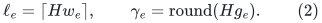

The fixed scale can ensure

<!-- math-display: ac993785b5bff898fe670c93
w_e\leq \ell_e/H\leq(1+\zeta)w_e,
\qquad
|\gamma_e/H-g_e|\leq\zeta w_e.
\tag{3}
-->
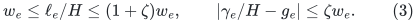

All exported values in (2) are integers of <code class="math">O(U)</code> bits. All graph
algorithms below operate on these integers, so neither sums of
unrelated rational denominators nor exact logarithms are involved.

Replace each oriented logical edge <code class="math">e=(u,v)</code> by two directed arcs:

<!-- math-display: cd256a51b16841355eac6c86
u\longrightarrow v:\quad 8\gamma_e+\ell_e,
\qquad
v\longrightarrow u:\quad -8\gamma_e+\ell_e.
\tag{4}
-->
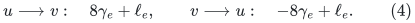

The maintained flow on a logical edge may increase or decrease; these
two arcs encode the two possible signs of a circulation coordinate.
They are not capacities or residual arcs of a capacitated optimization
problem.

## 3. No negative cycle gives the required LOW statement

Suppose the graph (4) has no negative directed cycle. For any logical
circulation <code class="math">z</code>, orient its nonzero coordinates according to their
signs and decompose the resulting nonnegative circulation into directed
cycles. There is no cancellation in this decomposition's length
accounting. Nonnegative cost in (4) gives

<!-- math-display: d5b057bef9692f3b0403caf5
\gamma^Tz\geq-\tfrac18\sum_e\ell_e|z_e|.
-->
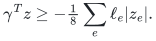

Using (3),

<!-- math-display: d2aa29a0f747257b41bcb4ca
g^Tz\geq-
 \left(\frac{1+\zeta}{8}+\zeta\right)\|Wz\|_1
 >-\tfrac14\|Wz\|_1.
\tag{5}
-->
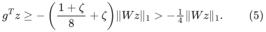

Thus the absence of a negative cycle certifies the exact true-weight
LOW condition required by the frozen detector. The generous threshold
margin avoids using a zero-gap comparison at a rounded price.

## 4. A negative cycle gives a constant-quality raw step

If (4) has a negative cycle, extract a simple directed cycle. Let <code class="math">z</code>
be its signed logical incidence vector and define the raw denominator

<!-- math-display: 2501456398c55ce3cf2a8470
V=\sum_{\text{arcs of the cycle}}\ell_e,
\qquad R=V/H.
\tag{6}
-->
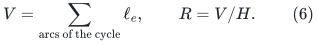

It has at most <code class="math">O(M)</code> arcs. The raw representation is the explicit
arc list; every absolute traversal is charged in (6). Projection
cannot increase weighted absolute length, so <code class="math">\&#124;Wz\&#124;_1\leq R</code>.
Negative cycle cost and (3) give

<!-- math-display: 069e5bbf251ce9c53488c586
g^Tz\leq-\left(\tfrac18-\zeta\right)R
 \leq-\tfrac1{64}R.
\tag{7}
-->
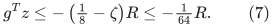

A cycle consisting of the forward and reverse copies of the *same*
logical edge has cost <code class="math">2\ell_e&gt;0</code>, so it cannot be a false
negative-cycle certificate. More generally, deleting a paired opposite
traversal preserves the signed numerator and removes positive raw
length; such cancellation cannot create a negative logical ratio from
a zero logical circulation. Parallel *distinct* logical edges may
form a genuine two-edge circulation and are handled normally.

Use the constant numerical parameter <code class="math">\beta=1/64</code>, or any smaller
fixed constant allowed by the detector's step lemma. Choose a dyadic
step <code class="math">\eta</code> satisfying

<!-- math-display: 2987dd0ad6627099b21f9e25
\eta R\in
 [\beta/(C_1p),2\beta/(C_1p)].
\tag{8}
-->
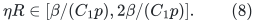

Every partial traversal changes a coordinate by at most the full raw
weighted movement. The individual barriers therefore stay positive.
Compute the cost of the complete proposed circulation before applying
it. If it crosses the detector's stopping threshold, use its complete
feasible flow as the stopping certificate. Otherwise apply the entire
circulation and only then query the affine gap or refresh prices.

## 5. Negative-cycle detection and finite arithmetic

Run Bellman--Ford with every initial distance zero, equivalently with
an implicit virtual source of zero-cost outgoing edges. This detects a
negative cycle in any component. Fixed edge-ID order gives a fully
deterministic implementation. The implicit source is not a logical
flow coordinate and cannot occur in an extracted cycle.

There are <code class="math">O(M)</code> vertices and arcs, so one query costs
<code class="math">O(M^2)</code> integer operations. Use synchronous relaxation rounds and
retain a predecessor **with its round index** for every layer. If the
graph has <code class="math">v_0</code> vertices and the <code class="math">v_0</code>-th round improves some
label over round <code class="math">v_0-1</code>, reconstruct that improved walk through
the layered predecessors. It has exactly <code class="math">v_0</code> edges. Decompose
it into a simple remaining path and simple cycles by a stack and an
exact prefix-cost accumulator. At least one removed cycle has negative
cost: otherwise removing all cycles would give a walk of at most
<code class="math">v_0-1</code> edges with no greater cost, contradicting the strict
improvement over that round's minimum. Return a negative removed cycle.

If that round has no improvement, the labels are a fixed point of
relaxation and certify every difference constraint. This implies that
there is no negative cycle. The initialization at zero accounts for
walks starting at any vertex.

Every represented walk has at most <code class="math">v_0</code> edges, so all labels,
prefix costs, and comparisons use <code class="math">O(U)</code>-bit integers. The layered
predecessor table uses <code class="math">O(M^2)</code> records, also within the direct
branch's <code class="math">M E(N)^{O(1)}</code> allowance. This explicit extraction avoids
mixing synchronous distance layers with an unqualified mutable
predecessor-pointer rule. The detector needs only the LOW conclusion
(5), although feasible difference-constraint labels are also available.

The integer denominator in (6) obeys
<code class="math">1\leq V\leq N^{C_V}</code> for a fixed constant. Equation (8) therefore
allows <code class="math">\eta\geq N^{-C_\eta}</code>. A fixed common dyadic flow grid
containing these powers of two, all initial values, and the ordinary
slack offsets contains every future accepted flow. Applying an
integer signed circulation needs no coordinatewise rounding.
Costs, <code class="math">F</code>, the fixed-cost offset, and the complete cost change then
have one fixed polynomial-bit grid as well.

At retirement, read the stored <code class="math">z_j=f_j</code>, add <code class="math">a_jz_j</code> to the
fixed-cost offset, record its fixed divergence, and remove the active
auxiliary coordinate. This is <code class="math">O(\mathrm{poly}(U))</code> local
arithmetic. No stale flat copies exist. Full weight recomputation
settles all heavy auxiliary coordinates and ordinary slack rearms
before returning LOW.

## 6. Lifetime complexity and the reporting bound

With constant <code class="math">\beta</code>, the same potential accounting bounds the
number of accepted numerical steps by

<!-- math-display: 044b888580502adc7b7ab4e3
T=O(MpU)=M\mathrm{poly}(U).
-->
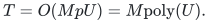

There are at most <code class="math">O(M)</code> external births and auxiliary retirements.
Ordinary rearms have one initial birth credit and then a constant
weighted-movement charge. LOW queries after external batches add at
most the number of actual external records, apart from a harmless
initial query. Thus there are <code class="math">M\mathrm{poly}(U)</code> total
full solver calls. Recomputing all prices, applying an explicit cycle,
and updating cost aggregates take <code class="math">M\mathrm{poly}(U)</code> per
step. Bellman--Ford dominates, giving total time

<!-- math-display: a58f057600474f45a992dad0
M^3\mathrm{poly}(U).
\tag{9}
-->
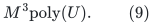

For <code class="math">M\leq E(N)^C</code>,

<!-- math-display: 2098a03803b0c06f705c2ed9
M^3\mathrm{poly}(U)
 \leq M E(N)^{2C}\mathrm{poly}(U)
 =M E(N)^{O(1)}\mathrm{poly}(U).
\tag{10}
-->
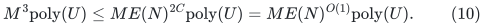

The barrier potential and the freeze threshold have not changed.
The number of frozen units is still
<code class="math">O(\alpha M U^2/\sigma)</code>, with no <code class="math">E</code> factor. In particular,
choosing a larger direct-solver cutoff does not enlarge the
reporting allowance or the local potential coefficient.

This direct branch can be combined with the main backend branch at a
fixed cutoff. Its purpose is to cover small local graphs under global
precision without unproved assumptions about a deep hierarchy on a
tiny instance. It is not a new large-graph negative-cycle algorithm.
