# Deterministic confluent rounding: implementation, moments, and load tails

<!-- review-status:start -->
**Ready for review.** Complete near-linear simulation and Parts B–D simultaneous completed-sink moment and tail bounds, including the budget proportional to actual demand. Part E proves the scoped local warm-start lemma.

**Dependencies and scope.** The precise published base-2 Conflt operations and deterministic dynamic-tree interface are identified. Reopening completed sinks needs separate dynamic replenishment accounting and is not used by the completed main matching theorem.

The [verification note](verify/README.md) identifies executable coverage. This status does not claim external peer review or proof-assistant verification.
<!-- review-status:end -->

**Results.** Starting from a supplied splittable flow with positive nonsink demands, deterministic confluent rounding chooses a single outgoing route at every nonsink. Part A implements the rounding in <code class="math">O((n+m) polylog(n+m+2))</code> exact arithmetic operations. Parts B–D give complete bounds that include sinks completed before the last step. In particular, if <code class="math">C</code> bounds every initial node congestion and <code class="math">W</code> is total actual demand, the final loads satisfy
<!-- math-display: 46169b924e3305146d5702ab
C\sum_j\frac{2^{W_j/C}-1}{(1+W_j/C)^3}=O(W).
-->
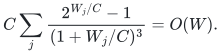
The left side dominates the total component weight up to an absolute constant. This stronger mass-sensitive bound does not require the number of sinks times <code class="math">C</code> to be near-linear in the represented weight.

The proof package was already established in the 24 October 2026 checkpoint. Its near-linear simulation, global moment, load-tail potential, mass-sensitive potential, and local rounding lemma are assembled here without dropping their arguments. A dynamic scheme that repeatedly reopens completed trees needs its own accounting; that separate research question is stated precisely in Parts C–E. It is not a premise of the current [four-fifths maximum-matching theorem](../../problems/general-matching/proof.md), which does not use this package.

## Theorem map and model

Let <code class="math">n,m</code> count vertices and physical arc records of the supplied graph, including parallel records. Zero arcs are removed in the input scan. Nonsink demands are strictly positive; sink demands may be zero. Node congestion means own demand plus incoming ordinary flow, equivalently outgoing flow at a nonsink. Original sinks have no ordinary outgoing arcs. A confluent output is a forest of original arc witnesses, one outgoing arc per original nonsink, reaching original sinks.

| Part | Proved conclusion | Initial assumptions |
|---|---|---|
| [A](#implementation) | Deterministic near-linear rounding; maximum sink load at most <code class="math">C(1+log_2 F)</code> | Supplied flow with all initial node loads at most <code class="math">C</code>; <code class="math">F≥1</code> sinks |
| [B](#exponential-moment) | Sum over **all** final sinks of <code class="math">2^x</code> is at most <code class="math">P(3+½log_2 P)</code> | Nonsink congestion at most <code class="math">C</code>; initial active potential <code class="math">P=Σ2^x</code> |
| [C](#load-tail) | Number of final loads at least <code class="math">τC</code> is at most <code class="math">F(τ+3)/2^(τ+1)</code> for <code class="math">τ≥1</code> | All initial node loads at most <code class="math">C</code> |
| [D](#mass-sensitive-tail) | Number is at most <code class="math">(τ+5)(W/C)/(7·2^(τ-1))</code> for <code class="math">τ≥4</code>; total weighted budget <code class="math">O(W)</code> | Exact total demand <code class="math">W</code>, after trimming if necessary |
| [E](#local-warm-start) | Round a chosen region while preserving exterior assignments, with load controlled by its actual initial potential | Dirty rows supplied; exterior trees represented as sink anchors with their actual demands |

Empty graphs are immediate. A nonempty valid flow with positive nonsink demand must have a sink; in Parts A–C the nonempty initial sink set gives <code class="math">P≥1</code>. If <code class="math">W=0</code>, Part D is the trivial all-zero statement. Section and equation numbers are local to each lettered part.

## Named dependencies and what is proved here

The rounding operations and the base congestion theorem are those of Chen, Kleinberg, Lovász, Rajaraman, Sundaram, and Vetta, [*(Almost) Tight Bounds and Existence Theorems for Single-Commodity Confluent Flows*](https://www.cs.cornell.edu/~rdk/papers/conflu.pdf), **Section 4.1, Theorem 3, Lemmas 4–6**. This page uses that section's base-2 algorithm, not the different refinement in Section 4.2. The original source gives a polynomial-time implementation; Part A proves the near-linear simulation of its permitted operations.

For data structures, use the deterministic dynamic-forest interface of Alstrup, Holm, de Lichtenberg, and Thorup, [*Maintaining Information in Fully-Dynamic Trees with Top Trees*](https://arxiv.org/abs/cs/0310065). The required summaries and update charges are specified in Part A. The trimming operation has a complete [local proof](exact-demand-flow-trimming.md), so no maximum-flow oracle is needed for that preprocessing.

Arithmetic costs are separate from operation counts. For integral data with every initial node congestion at most <code class="math">C</code>, ordinary arc values remain at most <code class="math">C</code> and stored demand sums are at most <code class="math">nC</code>; <code class="math">O(log(nC+2))</code>-bit values suffice. For the local version with large exterior demands, charge their actual input and sum bit lengths. The algorithm uses only integer/rational additions, subtractions, minima, and comparisons. Exponentials and logarithms occur only in the proof.

## Part A. Deterministic implementation of the rounding operations

### A.1. Flow model and permitted operations

Every nonsink has a strictly positive demand. The current graph has positive ordinary arc flows, and active sinks have no ordinary outgoing arcs. For each ordinary arc `u -> s` into an active sink, permit the reverse traversal `s -> u` as well. Regard the physical edge underlying this pair as bidirectional; all other ordinary edges remain one-way.

The Conflt operations are:

1. If a nonsink has all its ordinary outgoing edges directed into one sink, aggregate it into that sink, mark one genuine outgoing edge, and transfer its demand to the sink.
2. On a directed cycle in the augmented graph, decrease flows along ordinary forward traversals and increase flows along reverse sink-frontier traversals by the minimum flow on a forward traversal. Delete zero-flow ordinary edges and their reverse traversals. The selected cycle must not consist of going along and immediately back over the same physical edge.
3. Let sink <code class="math">s_j</code> have exactly one frontier neighbor <code class="math">v</code>, and let <code class="math">s_l</code> be another sink neighbor of <code class="math">v</code>. Write <code class="math">a=f(v,s_j)</code>, <code class="math">b=f(v,s_l)</code>, and let <code class="math">s,t</code> be the two sink loads. If <code class="math">s+2b&lt;t</code>, redirect the entire <code class="math">b</code> units from <code class="math">s_l</code> to <code class="math">s_j</code> and delete the former edge. Otherwise redirect the entire <code class="math">a</code> units from <code class="math">s_j</code> to <code class="math">s_l</code>, delete the former edge, and deactivate <code class="math">s_j</code>. Its completed load is <code class="math">s-a</code>, and the recipient load becomes <code class="math">t+a</code>. The comparison is exact and uses no exponential evaluation.

For completeness, the potential invariant follows directly from these rules. Normalize flows and loads by the bound <code class="math">C</code> on nonsink congestion. Aggregation preserves sink load, and cycle cancellation preserves sink load and never increases nonsink congestion. In the nondeactivating transfer, the inequality <code class="math">s+b&lt;t-b</code> makes the transfer from the larger load to the smaller load decrease the sum of any convex function of the two loads. In a deactivation, <code class="math">0&lt;a≤1</code>, <code class="math">a+b≤1</code>, and <code class="math">t≤s+2b</code>. With <code class="math">q=2^a</code> and <code class="math">r=2^(t-s)</code>,
<!-- math-display: 70972822312454d82d827dc6
r(q-1)\le \frac{4(q-1)}{q^2}\le1\qquad(1\le q\le2).
-->
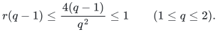
Consequently <code class="math">2^(t+a)-2^t≤2^s</code>, so the active exponential sum does not increase. A deactivated sink's final exponential is at most its pre-deactivation exponential, and hence at most the preceding active sum. Every marked route ends at an original sink, as proved in Section A.4. Thus initial sink loads at most <code class="math">C</code> and <code class="math">F≥1</code> sinks imply final congestion at most <code class="math">C(1+log_2 F)</code>. These are the source paper's Section 4.1 operations and guarantee, with their analysis included here; no stronger approximation guarantee is assumed. Ordinary directed cycles can also be canceled: the same flow update preserves conservation and decreases node congestion. Thus a separate initial acyclic-flow conversion can be used, but the local simulation below does not depend on choosing a globally cycle-free support at each iteration.

Self-loops can be canceled immediately. Parallel ordinary arcs may either be coalesced, retaining one original physical edge as the eventual marking witness, or be kept with distinct physical edge identifiers. In the latter implementation, a two-edge cycle using **different** physical edges is a valid cancellation: it redirects flow between those edges and permanently deletes at least one. Only the forward/reverse pair of the **same** physical edge is excluded. There are only linearly many initial arcs and retarget/coalescence events.

### A.2. A mixed selected forest

Maintain an undirected forest `F` consisting of a subset of the current physical edges. Each one-way selected edge points toward the root of its selected tree. A selected bidirectional edge may be traversed in either direction.

Equivalently, contract each connected component of the selected bidirectional edges. The selected one-way edges form a directed forest with outdegree at most one. Every full selected tree therefore has a unique terminal **root component**. Its vertices are connected using selected bidirectional edges only; all other selected edges point toward it.

Initially `F` is empty, so the invariant holds. Keep a designated full-tree root inside its root component.

Maintain a second dynamic forest containing only the selected bidirectional edges. At each vertex store its allowed outgoing arcs whose underlying physical edge is **not** selected in `F`. Aggregate the existence of such a candidate over each bidirectional component. Both directions of an already selected physical edge are excluded; this avoids a vacuous two-step cycle.

### A.3. A local simulation step

Choose a live selected tree and its root component `Q`.

#### Case A: an unselected outgoing arc exists at a vertex of Q

Take any allowed such traversal `u -> v`, and reroot the selected tree at `u`. This reroot uses only bidirectional selected edges, so no one-way edge is reversed.

If `u,v` are in different selected trees, insert their physical edge into `F`, directed from the former root component toward `v`. This preserves the mixed-forest invariant.

If they are already in one selected tree, the selected path from `v` to `u` respects all one-way orientations: it follows the directed component forest toward `Q`, then uses bidirectional edges within `Q`. The new traversal followed by that path is therefore a genuine directed augmented cycle. Cancel it by operation 2. At least one forward ordinary edge reaches zero. Delete every zero edge. If the new edge remains positive, put it into the selected forest after the zero edges have broken the cycle.

#### Case B: no unselected outgoing arc exists at Q

If `Q` is an isolated active sink with no incident edge, finish that sink's component.

A singleton nonsink with no outgoing edge is impossible while its positive demand is conserved. Otherwise `Q` contains sinks and their frontier neighbors, with selected bidirectional edges forming a tree. Every incoming ordinary edge of a sink in `Q` must already be selected in this tree: otherwise its reverse would be an eligible unselected outgoing traversal. Every outgoing ordinary edge of a frontier in `Q` is likewise selected inside `Q`: otherwise it would be eligible. Therefore `Q` is the entire local sink/frontier incidence tree, although nonsink frontier nodes may have incoming arcs from outside `Q`.

If this tree has a leaf frontier, that frontier has only one ordinary outgoing neighbor, so perform operation 1. If it has no leaf frontier, it has a leaf sink. That sink has one frontier neighbor, and that frontier has another sink neighbor; perform operation 3. These are exactly valid source-paper operations.

Thus every processed root component yields a selected link, a positive-flow edge deletion, an aggregation, a sink deactivation, or completion of an isolated sink. There is no unsuccessful global search.

### A.4. Dynamic-tree primitives

Use a full dynamic forest for connectivity, roots, link/cut, and path flow operations, and an Euler-tour or top-tree representation of the selected bidirectional subforest for component aggregates and candidate retrieval.

For a directed augmented cycle, the ordinary flow value decreases on forward traversals and increases on reverse traversals. A link-cut path aggregate stores the minimum ordinary flow among forward-oriented edges, and separate forward/reverse summaries. Lazy signed path additions and path reversals update these summaries. Reverse traversals have no saturation upper bound. The bottleneck is the minimum among the forward ordinary traversals, including the newly proposed nonforest traversal when it is forward. After the update, expose the affected path and enumerate all zero-flow forward edge identifiers before making any cut. Temporarily exclude each already reported edge from the minimum summary, then cut the recorded edges. Each extraction and deletion is charged to an original edge's permanent removal; no later search assumes that the cut path is still connected.

An edge that becomes incident into a sink acquires its reverse traversal once. If that edge is selected, insert it into the bidirectional subforest. The former two bidirectional components were joined by a directed selected edge, so their union still has at most one outgoing selected one-way edge.

On aggregation of a frontier `v` into a sink `s`, contract the selected edge `v-s`, retarget incoming arcs of `v` to `s`, and delete its outgoing arcs to `s`. Incoming selected edges can be cut and relinked individually. Every original arc is retargeted at its head at most once: its head changes from an ordinary vertex to a sink, and active sinks are never aggregated into other sinks. A sink deactivated later has no remaining incoming arc. Thus these adjacency scans sum to `O(m)`.

The source-paper sink-deactivation comparison reads two sink congestions and two arc flows, performs one flow transfer, and removes an edge. All needed quantities support point access. Cycle cancellations leave the congestion of every active sink unchanged, so they do not require enumerating all touched sink vertices. No exponential is evaluated by the algorithm: the exponential potential is only an analysis device, while the deactivation decision uses ordinary exact additions and a comparison. Integer supplied flows and demands remain integral throughout.

Every marked aggregation edge retains its **original head vertex**, rather than only the current contracted sink representative. That original head was either an original sink or a vertex aggregated earlier. Hence the marked edges form a genuine forest in the original graph, and routing them reaches the correct original sink. Selected bidirectional components containing actual sink vertices may occur in nonroot branches; the algorithmic root component means the unique terminal component after contracting selected bidirectional edges, not the set of all actual sinks in a selected tree.

### A.5. Amortized count

There are `O(n+m)` permanent ordinary-edge removals, vertex aggregations and sink completions. A cycle cancellation permanently removes at least one positive-flow edge, so there are `O(m)` such cancellations.

A selected link between different trees reduces the number of selected forest components by one. Apart from these links, the number of components can increase only when selected edges are cut because of a permanent edge deletion or the linearly many explicit retarget/coalescence operations. Hence the number of pure selected links is also `O(n+m)`. Insertion of a surviving cycle edge is charged to its cycle cancellation.

For leaf selection in Case B, maintain a component minimum over the selected bidirectional degrees and the sink/frontier type: a tree with at least one edge has a marked leaf of one of the required types. Degree and candidate marks change only at endpoints of the linearly many membership or retarget operations. Completed isolated sinks need no further scheduling, but are kept in the analysis potential until termination unless the explicit deactivation rule removed them. This distinction prevents an uncharged disappearance of completed mass.

Each forest membership change affects only the two endpoint candidate lists. Edge retargeting, reverse activation and degree changes also occur linearly many times. With logarithmic dynamic-tree overhead, the total bound is `O((n+m) polylog n)` arithmetic operations, plus the bit complexity of the supplied flow values.

#### Integer word bounds

For the matching-state application, the initial ordinary flows and demands are nonnegative integers, the nonsink demands are positive, and every initial node congestion is at most the integer `L`. All subsequent changes use additions, subtractions, minimum operations and the exact linear sink comparison. Consequently integrality is preserved. An ordinary arc's flow is at most the total outgoing flow of its nonsink tail, whose congestion never increases and is therefore at most `L`. Sink demand is a sum of original demands; even the crude bound `nL` suffices for intermediate stored quantities. Thus `O(log(nL))` bits per stored arithmetic value are enough. When `L` is polynomial in the input size, these fit the logarithmic-word RAM used by the matching-state framework. No irrational exponential or logarithm is evaluated during execution.

### A.6. Application to a bottom allocation ledger

Fix an injection `mu`. For each assigned bin `v`, its assigned row has total allocation `L`; send that allocation from `v` to the row's bin neighbors. Remove self-loops. Before self-loop removal, the supply at an assigned bin is `L-inflow(v)`, at least its weight. A free bin is a sink; give it its own weight as local demand. Its total demand plus incoming flow is at most `L`. The supplied flow therefore has node congestion at most `L` and routes at least the original bin weights.

The confluent rounding selects one genuine outgoing row-neighbor edge for the row assigned to each assigned bin, reaches the original free bins, and forms a row-labelled witness forest. The original assignment of each row to its tail bin is retained; only its other selected neighbor is chosen by rounding. Its tree weights are at most `L(1+log_2 |F_free|)`. This is a deterministic static balanced-forest construction in near-linear time under the dynamic-tree interface proved above.

This does not solve the dynamic matching task. After a gain, a locally repaired affected tree can attach mass to surviving trees and increase their weight. A charged scheme maintaining the balance bound throughout expansions, contractions, gains and peels remains necessary.

## Part B. An exponential moment including every completed sink

### B.1. Statement

Suppose Conflt starts from a splittable flow with nonsink congestion at
most `C>0` and nonnegative sink loads. Let

<!-- math-display: 49959c4f00f750a9c8943450
P=\sum_{\mathrm{initial\ sinks}\ s}2^{b_s/C}.
-->
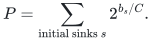

Then every final confluent tree load `B_s` satisfies the published maximum
bound `B_s<=C log_2 P`. In addition,

<!-- math-display: 78235d074affba90432364fc
\sum_{\mathrm{final\ sinks}\ s}2^{B_s/C}\le P+\frac P2(4+\log_2P)=P\left(3+\frac{\log_2P}{2}\right).\tag{1}
-->
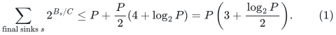

It is harmless to include original sinks whose final tree contains only
their own demand. In the usual case `b_s<=C` initially and there are `F`
sinks, `P<=2F`, so (1) is `O(F log(F+2))`.

### B.2. A potential that also pays for completed sinks

Normalize loads by `C`, writing `x_s=b_s/C`. The published active-sink
potential is

<!-- math-display: 3868097b90240ad1372f427b
\Phi=\sum_{\mathrm{active\ sinks}}2^x\le P.
-->
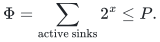

Put `D=4+log_2 P` and introduce

<!-- math-display: a7c944ead1788ebfa4e7968b
\Psi=\sum_{\mathrm{active\ sinks}}H(x),\qquad H(x)=(D-x)2^x.
-->
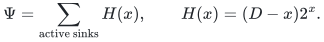

All active loads lie in `[0,log_2 P]`. On that interval,

<!-- math-display: a79203ca233d7b31bc886612
\begin{aligned}H'(x)&=2^x[(D-x)\ln2-1]>0,\\H''(x)&=2^x[(D-x)(\ln2)^2-2\ln2]>0.\end{aligned}
-->
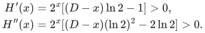

Thus `H` is increasing and convex throughout the range used by Conflt.
Cycle cancellations and node aggregations preserve active sink loads.
In the nondeactivating balancing case, flow moves from the higher sink
load to the lower without crossing; convexity makes `Psi` nonincreasing.

It remains to charge a deactivation. Denote the two current normalized
sink loads by `s,t`, and the normalized frontier flows to them by `a,b`.
Then `a>0`, `a+b<=1`, and the deactivation case satisfies

<!-- math-display: 3f6bcb7dba37cc89d80b4419
s+b\ge t-b.
-->
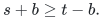

The frontier's `a` units are moved from sink `s` to sink `t`; the former
sink is deactivated with final load `s-a`, and the surviving sink load
becomes `t+a`.

Define

<!-- math-display: 6ef793f3b3db428e97a017de
A=2^s,\qquad q=2^a,\qquad r=2^{t-s},\qquad u=r(q-1).
-->
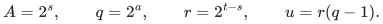

Here `1<q<=2`. The source's active-potential inequality gives `u<=1`.
For completeness, it follows directly from

<!-- math-display: 32a8a82d829f1f131ca5bfcb
r\le2^{2b}\le2^{2(1-a)},\qquad r(q-1)\le4(2^{-a}-2^{-2a})\le1.
-->
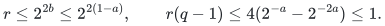

The decrease in `Psi`, divided by `A`, is exactly

<!-- math-display: b136b13aa35adc8a4c2cd270
(D-s)(1-u)+u\log_2r+arq.
-->
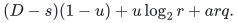

Since `D-s>=4`, this is at least

<!-- math-display: 9cf82db6684b3bf4108d7d6d
4+u[\log_2u+z(a)-4],\qquad z(a)=-\log_2(q-1)+\frac{aq}{q-1}.
-->
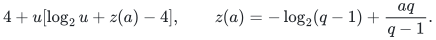

As a function of `q`,

<!-- math-display: 05c047ab35726e9191697c07
z(q)=\frac{q\log_2q}{q-1}-\log_2(q-1),\qquad z'(q)=-\frac{\log_2q}{(q-1)^2}<0.
-->
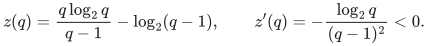

Therefore `z(q)>=z(2)=2`. We obtain

<!-- math-display: 554835b0e468cc5520efa998
\frac{\Psi_{\mathrm{before}}-\Psi_{\mathrm{after}}}{A}\ge4+u\log_2u-2u\ge2,\qquad0\le u\le1.\tag{2}
-->
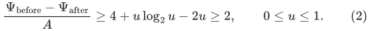

The final inequality holds because the displayed function is decreasing
on `(0,1]`: its derivative is
`log_2 u+1/ln 2-2<0`, and its value at one is two.

The deactivated sink's final exponential contribution is

<!-- math-display: 2c1577a49de025f121564e85
2^{s-a}=\frac Aq\le A.
-->
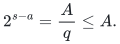

Thus (2) pays at least twice that contribution. Completion of an isolated
active sink can either remain in the final active sum or be removed and
charged directly, since its `H(x)>=4*2^x`.

### B.3. Summing the charges

The initial `Psi` is at most `(4+log_2 P)P`, since normalized initial
loads are nonnegative. The potential is nonnegative. Consequently all
deactivated final sinks together contribute at most `Psi_initial/2`.
The sinks remaining active at termination contribute at most `P` by
the original potential. This proves (1).

If final component weights are only lower bounds on the routed demands,
as in the matching-state bottom-ledger construction, replacing `B_s` by those
weights preserves (1).

### B.4. Consequence for balanced row forests

In the bottom-ledger application `C=L`, initial sink loads are at most
`L`, and a component's actual bin weight `W_T` is at most its rounded
guide-flow demand. Hence

<!-- math-display: 966a19fd8b6fcc20533d0374
\sum_T2^{W_T/L}=O(F\log(F+2)).\tag{3}
-->
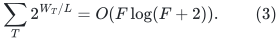

The physical carrier of a selected row tree has size `2W_T-1`.
Because `W<=O(L(2^(W/L)-1))`, the budget

<!-- math-display: 581a2c21725e3fa67f8d93de
L\sum_T(2^{W_T/L}-1)=O(LF\log(F+2)).
-->
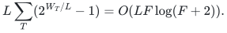

dominates total carrier mass up to an absolute constant. This is not a
claim about `sum_T W_T 2^(W_T/L)`. If a phase additionally guarantees <code class="math">F=O(K)</code> and <code class="math">LK=O_a(N)</code>, this budget is <code class="math">O_a(N log N)</code>. A general optimum-gap phase need not have <code class="math">F=O(K)</code>: many bins may remain unmatched in every maximum matching. Part D removes that extra assumption by using total actual demand.

This is a genuine initial budget for an overflow/recruitment argument.
It does not yet prove a dynamic budget: local rounding can rebuild
potential at newly enlarged cores. A faster multilevel epoch theorem
still needs to charge that replenishment explicitly.

### B.5. Source and attribution

The Conflt operations and original active-sink potential are from
Chen, Kleinberg, Lovasz, Rajaraman, Sundaram and Vetta,
*(Almost) Tight Bounds and Existence Theorems for Single-Commodity
Confluent Flows*, Section 4.1, especially Lemma 6:
<https://www.cs.cornell.edu/~rdk/papers/conflu.pdf>.

The auxiliary potential `Psi` and the simultaneous bound (1) are
deductions already developed in the 24 October 2026 checkpoint. This restoration makes no new literature-priority claim.

## Part C. A tail bound in terms of the initial number of sinks

### C.1. The lemma

Suppose Conflt starts from a flow whose nonsink and sink congestions
are at most `C`, with `F` sinks. Let `W_j` denote the final demand at
sink `j`, including the sinks deactivated before termination. For
every real threshold `tau >= 1`,

<!-- math-display: 626228edbd815fe68eddf616
\#\{j:W_j\ge \tau C\}
\le {F(\tau+3)\over 2^{\tau+1}}.                 \tag{1}
-->
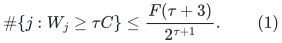

In particular,

<!-- math-display: ba61694467248fc8634465f8
\sum_{j:W_j\ge\tau C}W_j
=O\!\left({CF(\tau+1)^2\over2^\tau}\right).       \tag{2}
-->
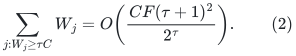

The same bounds hold for actual selected-tree weights when the
guide-flow demands dominate the bin weights. If the flow has first
been trimmed to exact bin demand, the two quantities coincide.

### C.2. A capped-slope potential

Normalize loads by `C`. Set `E=2^tau` and

<!-- math-display: 8d3a1b6bda1e64154560de2b
\gamma=4\ln 2-1\in(0,4).
-->
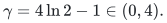

Use the continuously differentiable function

<!-- math-display: bff15bfb3cf5f4f87ff89c3c
H_\tau(x)=
\begin{cases}
 (\tau+4-x)2^x,&0\le x\le\tau,\\
 E\,[4+\gamma(x-\tau)],&x\ge\tau.
\end{cases}                                      \tag{3}
-->
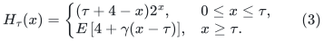

It is nonnegative, increasing, and convex. Below `tau`, its second
derivative has the sign of

<!-- math-display: ef5d539deb1f63ac8b2d36ed
(\tau+4-x)(\ln2)^2-2\ln2.
-->
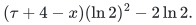

which is positive because `tau+4-x >= 4`. Above `tau`, the function
is linear, with the matching derivative `gamma E`. Its derivative
is everywhere at most `gamma E`.

Let `Psi` be the sum of (3) over the currently active sinks. Node
aggregation and cycle cancellation preserve sink congestions. The
nondeactivating transfer in Conflt moves flow from a larger load to
a smaller load without reversing their order; convexity therefore
makes `Psi` nonincreasing.

### C.3. The deactivation calculation

Write `s,t` for the two preoperation normalized sink loads, and
`a,b` for the flows from the common frontier into these sinks.
The deactivation branch has

<!-- math-display: 393706c332ea3ee71f88813d
0<a\le1,\qquad a+b\le1,\qquad t\le s+2b.
-->
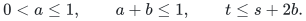

It completes the first sink at load `s-a`, and changes the surviving
sink from `t` to `t+a`. The active-potential drop is

<!-- math-display: 229b82c97fcca0a23f898f8d
\Delta=H_\tau(s)-[H_\tau(t+a)-H_\tau(t)].          \tag{4}
-->
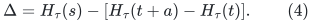

This drop is always nonnegative.

If `s >= tau`, the first term is at least `4E` while the bracket
is at most `a gamma E <= gamma E < 4E`.

Now suppose `s < tau`. If `t+a <= tau`, every value in (4) uses
the exponential part of (3). The calculation in
[Part B](#exponential-moment), with `D=tau+4`, applies because
`D-s >= 4`. It gives `Delta >= 2*2^s > 0`.

Finally, suppose `s < tau < t+a`. Since

<!-- math-display: 9239fdc46078d6e28cbefd96
t+a\le s+2-a.
-->
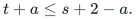

we have `s > tau-2+a`. If the comparison point `tau-2+a` is negative,
extend the exponential formula to that point solely for this inequality;
it is still increasing there. Monotonicity and the derivative bound give

<!-- math-display: 5fc0846760c2df3d0a5588f6
{\Delta\over E}
> (6-a)2^{a-2}-a\gamma.                           \tag{5}
-->
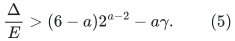

The right side is decreasing on `0 <= a <= 1`. Indeed the derivative
of its first term is increasing on that interval, and even its value
at `a=1`, after subtracting `gamma`, is

<!-- math-display: 3366158c784b5ebc34b4b0b6
\frac{5\ln2-1}{2}-(4\ln2-1)=\frac12-\frac32\ln2<0.
-->
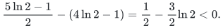

Thus (5) is at least its value at one,

<!-- math-display: 72a606695b4e5d3ca68872c2
\frac52-\gamma=\frac72-4\ln2>0.
-->
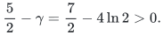

This proves the nonincrease for every deactivation.

There is a stronger charge when the completed load is at least
`tau`. In that case `s-a >= tau`, and linearity on the tail gives

<!-- math-display: 8b1bc91824d243567dc22347
\Delta\ge H_\tau(s)-a\gamma E
         =H_\tau(s-a)\ge4E.                       \tag{6}
-->
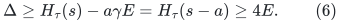

### C.4. Charge all completed heavy sinks

Initially every normalized load is at most one. Because `tau >= 1`,

<!-- math-display: 3c129ba2c446443acaaed37b
\Psi_{\rm initial}\le2F(\tau+3).                 \tag{7}
-->
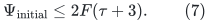

Charge `H_tau(final load)` for a deactivated sink only if that final
load is at least `tau`. Equation (6) pays each such charge using an
irreversible active-potential drop. At termination, every remaining
heavy active sink is already present in the residual potential.
Therefore

<!-- math-display: ebb53fb7f3d65184a4af7860
\sum_{j:W_j/C\ge\tau}H_\tau(W_j/C)
\le 2F(\tau+3).                                  \tag{8}
-->
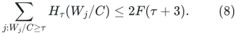

Equation (1) follows from `H_tau(x)>=4E` on the tail. Since for
`x>=tau`

<!-- math-display: b33715b3ba4462ec1a3e5497
x\le \max\{\tau/4,1/\gamma\}
            [4+\gamma(x-\tau)],
-->
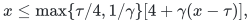

equation (2) follows as well.

#### A near-linear weighted exponential budget

A useful consequence is

<!-- math-display: 452d6b983a33c70983683b42
\sum_j {2^{W_j/C}\over(1+W_j/C)^3}=O(F).          \tag{9}
-->
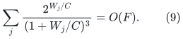

To see this, write `x_j=W_j/C` and
`f(x)=2^x/(1+x)^3`. On the bounded interval `[0,4]`, this function
is bounded by an absolute constant. On `[4,infinity)` it is increasing,
and

<!-- math-display: 261e5f7bc46ee73d79c079ed
0\le f'(t)\le {\ln2\,2^t\over(1+t)^3}.
-->
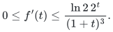

Using the tail integral and (1),

<!-- math-display: 546ce5de22f46b591b6c38c5
\begin{aligned}
\sum_{j:x_j\ge4}f(x_j)
&\le F f(4)+\int_4^\infty f'(t)\#\{j:x_j\ge t\}\,dt\\
&\le F f(4)+{F\ln2\over2}
                 \int_4^\infty {t+3\over(t+1)^3}\,dt
=O(F).
\end{aligned}
-->
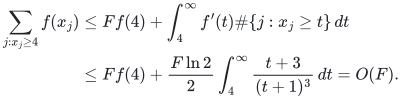

The omitted loads below four contribute another `O(F)`. Multiplying
(9) by `C` supplies an `O(CF)` initial credit budget. Also
`x <= C_0 2^x/(1+x)^3` for all `x>=0` with an absolute constant
`C_0`: the ratio is continuous, bounded on compact intervals, and
tends to zero as `x` tends to infinity. Thus this credit dominates
the total selected-tree weight up to an absolute factor. For matching
phases in which `LF=O_a(N)`, this budget is near-linear without an
additional logarithmic factor. A generalized-gap phase may have
`F` much larger than its target `K`, so that inequality must not be
assumed there. The stronger mass-sensitive potential in
[Part D](#mass-sensitive-tail) resolves this issue and gives an
`O(W)` initial budget in terms of total actual demand alone.

As with (8), (9) is a statement about an actual static Conflt output.
It is not a claim that this credit is preserved by dynamic repairs.

### C.5. Consequence for the previous chain example

The whole-component repair example in
the historical note `warm_start_whole_component_obstruction.md` (identified in the checkpoint recovery inventory) is a valid ledger with a
balanced selected forest. However, even its weakened version need
not be an output of Conflt. In that family, there are
`Theta(L/k)` heavy cores of normalized load approximately `k`, while
the number of free roots is `Theta(L)`. Bound (1) permits only
`O(L k/2^k)` such Conflt output cores.

For `k=ceil((log_2 log_2 L)/4)`, the ratio

<!-- math-display: df67906df144689f13bb36ff
\frac{2^k}{k^2}.
-->
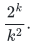

tends to infinity. Thus, for sufficiently large parameters, this
particular forest provably cannot be a Conflt output, although it
satisfies the earlier maximum-load and total-moment inequalities.
This is why the chain is not an obstruction to a scheme that retains
the actual Conflt history.

### C.6. What remains open dynamically

The capped derivative also gives a useful warm-start fact: adding
total normalized mass `p` to arbitrary old sink loads increases the
initial `H_tau` potential by at most `gamma 2^tau p`. No exponential
factor depending on the old maximum load is needed.

Nevertheless, (8) accounts only for heavy completed sinks. A later
repair that reactivates many previously completed light sinks must
restore their full `H_tau` contributions, which were not paid by
the previous heavy-tail certificate. Repeated recruitment can
therefore replenish the same potential. A dynamic proof must bound
that replenishment through irreversible history credits, new dirty
mass, or erasure charges. No such bound is established here.

## Part D. A tail and initial budget proportional to actual demand

### D.1. Setup and conclusions

Start from a splittable flow with all nonsink and initial sink
congestions at most `C`. Trim it first to exact demands if necessary,
using [exact demand trimming](exact-demand-flow-trimming.md). Let the total demand be `W`,
write `p=W/C`, and let `x_j=W_j/C` be the final normalized sink loads,
including deactivated sinks. Thus `sum_j x_j=p`.

For every real `tau>=4`, the Conflt output obeys

<!-- math-display: c618cb8c8b9b33f15cd19525
\#\{j:x_j\ge\tau\}
\le { (\tau+5)p\over 7\,2^{\tau-1}}.             \tag{1}
-->
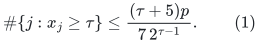

Consequently

<!-- math-display: d2b0cb666d786591a684e9af
\sum_{j:x_j\ge\tau}x_j
=O\!\left({p(\tau+1)^2\over2^\tau}\right),       \tag{2}
-->
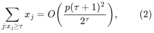

and

<!-- math-display: 6256856c1d453693dfb99a94
\sum_j {2^{x_j}-1\over(1+x_j)^3}=O(p).           \tag{3}
-->
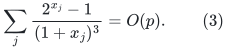

The credit

<!-- math-display: 2f2e8190484cf0eb2f224ee8
C\sum_j {2^{W_j/C}-1\over(1+W_j/C)^3}=O(W)       \tag{4}
-->
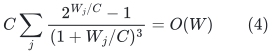

dominates the total component weight up to an absolute constant.
Unlike a bound `O(CF)`, this is near-linear in represented weight even
when the number `F` of free bins is much larger than the phase's
target improvement.

All conclusions also apply to actual component weights dominated by
the guide demands, using an increasing upper envelope for the bounded
small-load portion of (3). Exact trimming makes the quantities equal
and is the cleanest formulation.

### D.2. A preliminary active potential with no per-sink baseline

Define the increasing convex function

<!-- math-display: a1eaffb00d145ba5d2ea65e1
f(x)=\begin{cases}x,&0\le x\le2,\\2^{x-1},&x\ge2.
\end{cases}                                     \tag{5}
-->
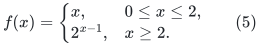

Its right derivative at two is `2 ln 2>1`, so the join is convex.
The sum of (5) over active sinks never increases under Conflt.

Only deactivation needs proof. Normalize the common frontier's flows
as `a,b`, let `s,t` be the donor and recipient loads, and use the
source conditions

<!-- math-display: 017366784680507b6a2d76c7
0<a\le\min\{1,s\},\qquad a+b\le1,\qquad t\le s+2b.
-->
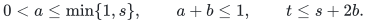

The donor completes at `s-a`, and the recipient rises to `t+a`.
Convexity makes `f(t+a)-f(t)` increasing in `t`, so it suffices to
show

<!-- math-display: 441c9e2d29106ff41e8fe794
f(s+2-a)-f(s+2-2a)\le f(s).                      \tag{6}
-->
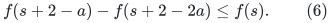

If `s>=2`, both terms are exponential, and the left side divided by
`f(s)` is `4(2^{-a}-2^{-2a})<=1`.

Suppose `s<2`. If the recipient interval lies below two, its increase
is `a<=s`. If its lower endpoint is at least two, then `a<=s/2`.
The expression `2^{-a}-2^{-2a}` is increasing for `0<=a<=1`, so
the increase is at most

<!-- math-display: ece658c8c8d21827ca31ae13
2(2^{s/2}-1)\le s.
-->
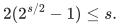

The last inequality is the chord bound `2^z<=1+z` for `z` in `[0,1]`.
In the remaining crossing case put `z=s-a`, where `0<z<1`. Equation
(6) becomes exactly `2^z<=1+z` after rearrangement.

The initial active sum is `p`, because all initial loads are at most
one. Thus every final load satisfies `f(x_j)<=p`. In particular,

<!-- math-display: 7ea5847d20083f0e0208a58d
\max_jx_j\le\begin{cases}p,&p\le2,\\1+\log_2p,&p\ge2.\end{cases}\tag{7}
-->
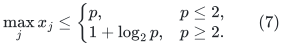

This maximum-load refinement alone does not control all completed
loads simultaneously; the next potential does.

### D.3. The mass-sensitive capped-slope potential

Fix `tau>=4`, and write

<!-- math-display: cfc48b1dccc60572076238be
q=\tau+5,\quad D=\tau+7,\quad E=2^{\tau-1},\quad\gamma=7\ln2-1.
-->
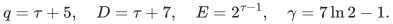

Define

<!-- math-display: baae949b3a640fa2eb0caa9a
H(x)=\begin{cases}
qx,&0\le x\le2,\\
(D-x)2^{x-1},&2\le x\le\tau,\\
E[7+\gamma(x-\tau)],&x\ge\tau.
\end{cases}                                     \tag{8}
-->
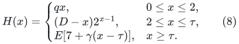

This is continuous, increasing, and convex. At two the right
derivative is `2(q ln2-1)>=q`, because `q>=9`. On `[2,tau]`, the
second derivative is positive since `D-x>=7`. At `tau`, the value
and derivative match its tangent-line continuation. Its derivative
is everywhere at most `gamma E`.

Let `Psi` be the sum of (8) over active sinks. Aggregation and cycle
cancellation preserve sink loads. A nondeactivating balancing move
decreases `Psi` by convexity. We next show the same for deactivation.

### D.4. Every deactivation is paid

Use the notation of Section D.2. The active-potential drop is

<!-- math-display: 9c9841629306a344a713694a
\Delta=H(s)-[H(t+a)-H(t)].                        \tag{9}
-->
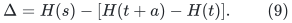

By convexity, replace `t` in the bracket by its upper bound
`T=s+2-2a`. Write `T+a=s+2-a`.

#### D.4.1 Donor load below two

Suppose `s<2`. Since `a<=s`, the recipient's largest possible
upper endpoint is below four, and hence below `tau`.

On this entire range write

<!-- math-display: 266fa1486e3f0770f1e98467
H(x)=qf(x)-g(x),\qquad
g(x)=\begin{cases}0,&x\le2,\\
                   (x-2)2^{x-1},&2\le x\le\tau.
      \end{cases}                               \tag{10}
-->
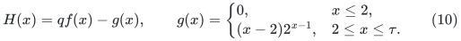

The function `g` is increasing and `g(s)=0`. The already proved
nonincrease of the `f` potential therefore gives

<!-- math-display: 59f0156baa3d650f1dc6d29c
\Delta\ge q\{f(s)-[f(T+a)-f(T)]\}
                     +g(T+a)-g(T)\ge0.          \tag{11}
-->
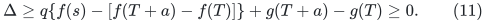

This treats the wholly linear, crossing-two, and wholly exponential
recipient intervals together.

#### D.4.2 Donor load at least two

If `s>=tau`, global bounded slope gives

<!-- math-display: b2c8b2a9a32e6535ee0bb0d6
\Delta\ge H(s)-a\gamma E\ge(7-\gamma)E>0.
-->

If `2<=s<tau` and `T+a<=tau`, all three values after replacing `t`
by `T` use the exponential part. The calculation in
[Part B](#exponential-moment) applies, with exponent scaled by
one half and `D-s>=7>=4`; it gives `Delta>=2*2^(s-1)>0`.

If `2<=s<tau<T+a`, then `s>tau-2+a>=2`. Monotonicity and the
bounded derivative give

<!-- math-display: 081774d62093a37a491eb602
{\Delta\over E}
>(9-a)2^{a-2}-a\gamma.                           \tag{12}
-->

The right side is decreasing on `[0,1]`. Its derivative is increasing
before the constant `gamma` is subtracted, but even its value at one
is

<!-- math-display: b46958f7e95698cfd6944a59
\frac{8\ln2-1}{2}-(7\ln2-1)=\frac12-3\ln2<0.
-->

Thus (12) is at least its value at one,

<!-- math-display: 2011c93be6e2feb3224d161a
4-\gamma=5-7\ln2>0.
-->

This proves nonincrease in every case.

#### D.4.3 Completed heavy sinks pay their entire receipt

If the donor's completed load `s-a` is at least `tau`, both `s`
and `s-a` lie on the linear tail. Therefore

<!-- math-display: 2098fe3cd875cc6603add6b5
\Delta\ge H(s)-a\gamma E=H(s-a)\ge7E.            \tag{13}
-->

This charge is stronger than mere nonincrease.

### D.5. Summing the heavy-load receipts

Every initial load is at most one, where (8) is linear. Hence

<!-- math-display: c1c981ee4371c5036be744ca
\Psi_{\rm initial}=q\sum_j x_j^{\rm initial}
                   =(\tau+5)p.                  \tag{14}
-->

Use (13) to charge all deactivated sinks whose completed loads are
at least `tau`. The remaining heavy active sinks are still present
in the final active potential. Thus

<!-- math-display: eef1059fcad2df9f5068a107
\sum_{j:x_j\ge\tau}H(x_j)\le(\tau+5)p.          \tag{15}
-->

Equations (1) and (2) follow from the linear expression for `H` on
the tail, exactly as in [Part C](#load-tail).

### D.6. A budget proportional to actual mass

Let `g(x)=(2^x-1)/(1+x)^3`. On `[0,4]`, `g(x)<=c x` for an
absolute constant `c`, so these loads contribute `O(p)`. On
`[4,infinity)`, `g` is increasing and

<!-- math-display: 8ba4838c64f2d45810336323
0\le g'(t)\le {\ln2\,2^t\over(1+t)^3}.
-->

The tail integral and (1) give

<!-- math-display: 5f34ba94350e03c52021a771
\begin{aligned}
\sum_{j:x_j\ge4}g(x_j)
&\le g(4)\#\{j:x_j\ge4\}
      +\int_4^\infty g'(t)\#\{j:x_j\ge t\}\,dt\\
&\le O(p)+{2p\ln2\over7}
              \int_4^\infty{t+5\over(t+1)^3}\,dt
=O(p).
\end{aligned}
-->

This proves (3). The ratio `x/g(x)` extends continuously at zero,
with limit `1/ln2`, is bounded on compact intervals, and tends to
zero at infinity. Consequently the credit in (4) also dominates
the total component mass up to an absolute constant.

### D.7. Dynamic status

The proof gives an `O(W)` initial credit budget for an actual static
Conflt execution. It avoids an incorrect assumption that `LF=O(N)`
in a generalized-gap phase. However, reactivating previously completed
light sinks can still reintroduce potential that was not retained in
the heavy receipts (15). The existence of this mass-sensitive budget
does not by itself bound how often the same mass can be reprocessed.
A dynamic replenishment invariant remains necessary before any lower
matching exponent can be claimed.

## Part E. Local rounding with fixed exterior trees

### E.1. Rejected strengthening: the potential only covers active sinks

Write `W_T` for the sum of bin weights in a selected tree produced by
the deterministic confluent rounding, and let `F` be the number of free
bins at the start of that rounding.

The usual consequence is only the maximum-load statement

<!-- math-display: c625acba1d9cfed3256c6e5f
W_T\le L(1+\log_2F).
-->

An initially proposed stronger simultaneous inequality was

<!-- math-display: fa224a9039aa9d0ef7bbc991
\sum_T2^{W_T/L}\le2F.\qquad\text{Unsupported proposed strengthening}
-->

This does NOT follow from the published argument. Every initial free
sink has demand plus incoming guide flow at most `L`, and the sum over
ACTIVE sinks is at most `2F`. But a deactivated sink is removed from
that sum. Source Lemma 6 separately bounds its final potential by the
preceding active potential. This gives an individual maximum-load bound;
it does not preserve a sum including all completed sinks.

Therefore an `O_a(N)` global exponential recruitment budget cannot be
claimed from Conflt without a new theorem. The proposed inference was
caught by checking the source's precise definition of its potential and
is excluded from all matching bounds.

The earlier chain obstruction in
the historical note `warm_start_whole_component_obstruction.md` (identified in the checkpoint recovery inventory) remains a valid obstruction
to its stated rule. Any stronger restriction on allowable snapshot
forests would itself require proof.

**Subsequent positive result.** The companion
[Part B](#exponential-moment) supplies such a proved weaker global
bound, `sum_final 2^(W_T/L)=O(F log(F+2))`, using a second potential that
explicitly pays for deactivated sinks. It does not reinstate the unsupported
`2F` bound and does not yet establish dynamic replenishment accounting.

### E.2. Route exactly the dirty weights using only dirty rows

Consider any settled bottom ledger and a region `Q` of bins whose
assignments may be repaired. All selected trees outside `Q` are fixed
cores. A bin still carrying an untouched core tag can be treated as
outside, even when it also contains some separately credited dirty mass.

For each assigned bin `v` in `Q`, use its assigned row's allocation
as capacities on arcs from `v` to the row's neighbors. Delete self-loops
and treat every neighbor outside `Q` as a sink anchor. Free bins in
`Q` are also sinks. The graph has `O(|Q|)` arcs because each assigned
row has at most three neighbors.

The restricted original guide flow has supply

<!-- math-display: d733f25f265556311290782e
d_v=L-\mathrm{incoming}_{\mathrm{rows\ assigned\ in}\ Q}(v)\ge w_v.
-->

There exists a subflow of this restricted flow that routes EXACTLY
`w_v` units from every assigned bin `v` in `Q` to the sink anchors and
free bins, and has no greater arc flow. One proof decomposes the original
flow into source-to-sink paths and cycles, discards cycles, and deletes
excess paths from each source. An algorithmic construction uses a single
exact integral maximum flow with source arcs of capacity `w_v`, original
arc capacities equal to the restricted allocations, and unrestricted
sink arcs. Feasibility follows from the displayed supplies, or directly
from the cut inequalities. Its graph has linear size in `Q`; large
integral capacities can use the source framework's capacity-scaling
wrapper.

The stronger algorithm in [exact demand trimming](exact-demand-flow-trimming.md) removes the
need for that maximum-flow call. A directed selected forest performs
monotone cycle cancellations and source-to-sink excess removal, with
`O(|Q|)` substantive operations and dynamic-tree overhead. Thus exact
dirty demands are obtained in `O(|Q| polylog N)` work.

At a nonsink, own demand plus incoming flow equals outgoing flow and is
at most `L`, since the new flow is coordinatewise bounded by the old
row allocation. At a free bin of `Q`, its own weight plus incoming flow
is likewise at most `L`. Thus this is a supplied flow with nonsink
congestion `C=L` routing the ACTUAL dirty weights, not the potentially
larger artificial supplies `d_v`.

Identify exterior anchors belonging to the same fixed core as one sink.
Give that sink initial local demand equal to the core's current total
weight. The original endpoint of each incoming dirty arc is retained as
a witness. The sink may now have arbitrarily large initial demand; this
does not invalidate Conflt's nonincreasing exponential-potential proof,
whose parameter `C` bounds nonsink congestion. The resulting attachments
follow their stored original anchor bins and the unchanged exterior
selected tree to its free root.

Consequently a dirty region can be rounded locally, preserving every
exterior assignment. If `Phi_initial` is the sum of
`2^((old_core_load+fractional_inflow)/L)` before rounding, every output
core load is at most `L log_2 Phi_initial`. The active-sink potential
never increases; a completed sink is only bounded individually. The
work is `O(|Q| polylog N)` with the trimming construction and the
near-linear Conflt implementation, at the stated exact integer bit
cost.

### E.3. What remains open

The local lemma does not bound the exponential potential BEFORE
rounding: a feasible fractional flow may direct most dirty mass into
already heavy exterior cores. The Conflt step cannot undo that initial
potential increase without opening additional cores as routing
vertices. The old core's internal guide rows may export allocation, so
it cannot be replaced by a fictitious capacity-`L` sink.

A useful continuation would recruit overflowing cores and prove an
amortized bound in terms of a genuine global potential, or a bounded
replenishment of that potential per gain. Charging a recruited
core to its exponential weight is insufficient on its own: later local
rounding may recreate that potential at another core, permitting the
same mass to be charged repeatedly.

No such decrease or replenishment theorem has been established here.
In particular, a three-level cost expression such as
`N b1 + N b2/b1 + N K/b2` is only exponent arithmetic until this local
recruitment/repair amortization is proved.

## Source and restoration record

These results were already present in the 24 October 2026 uniform checkpoint. This page restores their full arguments in a semantic location; it does not claim that they were discovered during the repository reorganization. The original UTF-8 bytes were recovered and checked against the archive inventory. See the [checkpoint restoration record](../../provenance/checkpoint-restoration.md).

| Original note | SHA-256 of recovered source |
|---|---|
| `confluent_rounding_acceleration.md` | `1a7daa21a9560431438d57a21ad0bc24aedecc3f7dc46a7c53e25089c35d4f86` |
| `confluent_exponential_mass.md` | `e729d94faed0113e28ba0291804050f1d4c6417b2594697d64fc157e70d4cda3` |
| `confluent_load_tail.md` | `9e89aca010eb5f02395c60c12fde089ed3ae7b2b1a45ef77dc8a9e30fcb9fe41` |
| `confluent_mass_sensitive_tail.md` | `88ff5e7a7b10ebe02f42e266f891ac590090b149b55ff5833c62e0a5eb25b151` |
| `warm_start_potential_extension.md` | `53516c069d953f29d03cd6c080aa4a60dcee2aa2648b483399c22dc777c0f72e` |
