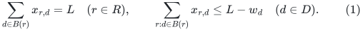
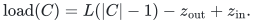
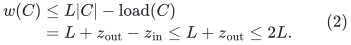
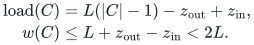

# A selected-pair forest of weight below twice the row total

<!-- review-status:start -->
**Ready for review.** Complete arbitrary-row-rank static selected-pair forest theorem, private transportation-cycle cancellation, strict component bound below twice the row total and construction of a new physical row-covering injection.

**Dependencies and scope.** The old injection may change. The near-linear operation bound uses named dynamic-tree operations; dynamically maintaining the private support is a separate problem.

The [verification note](verify/README.md) identifies executable coverage. This status does not claim external peer review or proof-assistant verification.
<!-- review-status:end -->

**Result.** A feasible transportation allocation yields a deterministic forest with one genuine selected pair per row, a new injection covering every row, and total bin weight strictly below <code class="math">2L</code> in every component. The theorem allows arbitrary row rank. Preserving a particular old injection is not part of the output requirement.

**Theorem (general row rank).** Let bins have positive weights <code class="math">w_d</code>, let each row have a finite set of incident bins, and let a nonnegative allocation have row sums <code class="math">L</code> and bin loads at most <code class="math">L-w_d</code>. Let <code class="math">I</code> count all physical incidence records, including zero and parallel records. In <code class="math">O((&#124;D&#124;+&#124;R&#124;+I) polylog(&#124;D&#124;+&#124;R&#124;+I+2))</code> exact arithmetic operations, one can select two distinct incident bins for each row such that the resulting row-labelled bin graph is a forest and every component has total bin weight less than <code class="math">2L</code>. Orienting each tree toward one chosen root gives an injection from rows to bins. Integral input is preserved by the private allocation changes, and component weights are then at most <code class="math">2L-1</code>.

Sections 1–5 give the original rank-three proof and physical matching witness; Section 7 proves the arbitrary-rank extension using the same exact accounting. Both are static theorems. They were already proved in the 24 October 2026 checkpoint and are independent of the current [four-fifths matching proof](../../problems/general-matching/proof.md).

The only data-structure import used by the direct proof is the deterministic dynamic-forest interface of Alstrup, Holm, de Lichtenberg, and Thorup, [*Maintaining Information in Fully-Dynamic Trees with Top Trees*](https://arxiv.org/abs/cs/0310065). Signed path updates store two orientation classes, exchange them under reversal, and maintain their minima. The forest-support operation is also explicitly available in Assadi, Jambulapati, Jin, Sidford, and Tian, [*Semi-Streaming Bipartite Matching in Fewer Passes and Optimal Space*](https://arxiv.org/abs/2011.03495), version 4, Proposition 3 and Appendix C, Lemma 15. The argument below supplies the relevant cycle cancellation itself; it makes no novelty claim for that standard operation.

All running times count exact arithmetic. With integral allocation coordinates at most <code class="math">L</code>, coordinates remain at most <code class="math">L</code>, and initial margin sums have their actual input bit cost. More general rational encodings must charge their common-denominator and arithmetic bit lengths.

## 1. Rank-three input and exact output

There is a set `D` of bins with positive integer weights `w_d`, and
a set `R` of rows. Every row has at most three distinct physical bin
neighbors. We are given a nonnegative allocation `x` satisfying

<!-- math-display: 279dbd5fcda6c7e2740894be
\sum_{d\in B(r)}x_{r,d}=L\quad(r\in R),\qquad
\sum_{r:d\in B(r)}x_{r,d}\le L-w_d\quad(d\in D). \tag{1}
-->

Parallel physical incidences to the same bin can first be coalesced
for this private computation; retain one original physical edge as a
witness. Sorting by the row/bin endpoint pair gives deterministic coalescing in <code class="math">O(I log(I+2))</code> work, already within the stated bound. All coordinates are integral in the matching application.

We deterministically construct:

* one unordered pair of distinct physical neighbors for every row;
* an acyclic graph on bins with one row-labelled edge per pair;
* one chosen free root per selected tree, and a row-covering injection
  obtained by orienting its edges toward that root;
* total bin weight strictly smaller than `2L` in every selected tree.

The complete input scan is charged. If <code class="math">I</code> is the number of physical incidence records, the time is <code class="math">O((&#124;D&#124;+&#124;R&#124;+I) polylog(&#124;D&#124;+&#124;R&#124;+I+2))</code>, and space is near-linear. In the rank-three representation with bounded record multiplicity this is near-linear in the vertex count. If parallel records are supplied explicitly, their full count is retained in the scan cost.
The input ledger itself need not change: all allocation transformations
are performed on a private copy.

## 2. Remove cycles from the positive allocation support

Form the bipartite graph whose vertices are bins and rows and whose
edges are the positive coordinates `x_(r,d)`. Cancel support cycles
while preserving every row sum and every column load. On a bipartite
cycle, add an amount to alternating coordinates and subtract it from
the others, choosing the amount as the minimum coordinate to be
decreased. At least one coordinate vanishes, and no coordinate becomes
negative. Delete zero coordinates permanently from this private
support; they are never used in a later cancellation.

The resulting support is a bipartite forest. Its allocation `z`
still satisfies exactly the same row sums and column loads as `x`.
Every row has support degree at least two: a support-degree-one row
would put its entire mass `L` into one bin, contradicting that bin's
load bound `L-w_d<L`. Every row therefore has support degree two or
three. Isolated bins are harmless components by themselves.

### Near-linear cycle cancellation

Process the initially positive incidence edges one at a time,
maintaining a dynamic forest of the processed positive edges.

If the next edge `e=(r,d)` joins different components, link it.
Otherwise it forms a unique fundamental cycle. Orient the tree path
from `r` to `d`, and add the circulation `theta*(e-path(r,d))`:
increase the new coordinate by `theta`, decrease the tree-path
coordinates whose permanent row-to-bin orientation agrees with the
path, and increase the others. Choose `theta` as the minimum among
the decreasing tree coordinates. This set is nonempty, since the
path starts at a row vertex. Find and remove every coordinate driven
to zero, then link the still-positive new edge. At least one old
selected edge is removed, so this last link is acyclic. All previously
processed positive edges remain selected; zero edges are discarded.
Induction proves that after the final input edge, the entire surviving
positive support is the maintained forest.

Orient every incidence permanently from its row endpoint to its bin
endpoint. A link-cut tree stores the current flow and separate path
minima for edges agreeing and disagreeing with the path orientation.
The fundamental-cycle circulation is a signed path update plus the
one new edge. Its limiting value is the minimum among decreasing
coordinates. Lazy signed additions, path reversal, and repeated
zero-minimum extraction support each cycle and each deleted edge in
polylogarithmic time. Expose the affected path, enumerate all its
zero edge nodes before making the cuts, and then cut those recorded
edges. Thus no later zero search incorrectly assumes that the
original path is still connected after its first deletion.

There is at most one insertion attempt for each initially positive
edge. Every zero removal is permanent, so there are at most that
many removals and at most that many cycle operations. The operation
count is linear, proving the claimed near-linear implementation.
This argument does not assume that a long cycle is explicitly listed.

Row and column totals stay fixed. In particular each coordinate is
always at most `L`, so integral input uses `O(log L)` bits throughout.

If parallel physical incidences have not been coalesced, the same
operation also handles their two-edge cycle: increase the new
parallel coordinate and decrease the old one until the old one
vanishes. The edges have distinct physical identifiers, so this is
a valid transportation circulation. Coalescing them in advance is
equivalent for the private computation and is simpler.

## 3. A simple trimming rule

Root every bipartite support tree at an arbitrary bin. This gives each
row one parent bin. A support-degree-two row has one child bin, and
a support-degree-three row has two child bins.

At every support-degree-three row, delete its parent incidence from
the selected incidence forest. Keep its two child incidences. At every
support-degree-two row, keep both incidences. This is a combinatorial
selection only; the private allocation `z` is retained for the proof,
including its allocation on the omitted parent incidence.

Every row now has degree exactly two, and the selected incidence graph
remains a forest. Suppress each row vertex into a labelled edge between
its two selected bin neighbors. The resulting bin graph is therefore
an acyclic selected-row forest with one edge per row.

## 4. Why every component has weight strictly below 2L

Consider a connected component of the selected incidence forest, and
let `C` be its bins. Its internal rows number exactly `|C|-1`.

There are two possible types of components.

1. The component containing the original support-tree root bin has
   no internal row whose allocation leaves `C`.
2. Every other component starts immediately below one deleted parent
   incidence. Its top vertex is a unique support-degree-three row.
   That row is the only internal row with an allocation outside `C`:
   its omitted parent incidence carries some amount `z_out<L`.

The uniqueness is essential. Every other degree-three row below this
top row has its own parent incidence deleted, so it starts a different
selected component. All remaining internal rows have support degree
two and keep both of their positive incidences inside `C`.

External rows may allocate mass into `C`; denote their total incoming
mass by `z_in>=0`. Put `z_out=0` for the root-bin component. Summing
column loads exactly gives

<!-- math-display: 35442f19b3f6972ff8b8887b
\mathrm{load}(C)=L(|C|-1)-z_{\rm out}+z_{\rm in}.
-->

Consequently

<!-- math-display: c4b99daa6210a2dbfb0c95a6
\begin{aligned}
 w(C)
 &\le L|C|-\mathrm{load}(C)\\
 &=L+z_{\rm out}-z_{\rm in}
 \le L+z_{\rm out}\le2L.
\end{aligned}
\tag{2}
-->

The root-bin component has the stronger bound `w(C)<=L`. If an
omitted parent incidence exists, its amount is strictly smaller than
`L` because the row has two other positive coordinates. Thus the bound
is strictly smaller than `2L`; for integral data it is at most <code class="math">2L-1</code> in every component. A component whose top row has an omitted incidence has the sharper bound <code class="math">2L-2</code>, since its two retained coordinates are positive integers. Root-bin components retain the separate bound <code class="math">w(C)≤L</code>.

## 5. Constructing the new injection and physical matching witness

Choose an arbitrary bin as root in each selected bin tree. Assign the
row labelling each selected edge to that edge's child endpoint. Every
nonroot bin has exactly one parent edge, so this assignment is
injective and covers all rows. Every selected pair consists of genuine
physical row/bin incidences; retain their original physical witnesses.

There is one free bin per component, so the number of free bins stays
`|D|-|R|`, exactly as for any row-covering injection. Changing the
injection does not change the cardinality of the represented matching.
The existing factor-critical bin exposure records reconstruct the
corresponding physical matching in the usual way.

This construction does **not** promise to preserve a supplied old
injection `mu`. An omitted parent incidence can be precisely the old
assigned incidence. The selected pairs must therefore be oriented to
a newly constructed injection, as above.

In a global epoch rebuild this is allowed: finish the old structural
transaction, read a private copy of the feasible bottom ledger, build
the new forest and injection, and start the next epoch from these
cores. Row-assignment changes alone do not alter any ledger allocation
or top numerical coordinate. They are charged to the rebuild's
near-linear structural work.

## 6. Limits and the next dynamic problem

The component bound in (2) is independent of the number of free bins,
of a perfect-matching promise, and of the current optimum gap. The
rank-three row condition is already ensured for arbitrary input graphs
by the standard degree reduction used in the main construction.

The support forest in this static formulation is a private transportation
basis. Maintaining it after gains, expansions, contractions, and peels
is a separate task.
Column-load debt can be repaired along positive-support tree paths
using signed dynamic-tree operations, but when a support component
has no available column slack, finding and activating useful zero
incidences can require exploration of other components. Neither the
static cancellation proof nor (2) bounds how many such incidence
births and explorations occur dynamically. The epoch proof pays for
rebuilding; no smaller matching exponent follows from this static
simplification alone. The later [persistent integral-ledger carrier](persistent-integral-ledger-carrier.md) takes a different route: it normalizes the actual integral ledgers and uses persistent carrier forests with implicit canonical assignments. Its separate dynamic analysis must be read on its own terms. The static theorem on this page neither proves nor assumes that analysis.

## 7. General-rank extension of the static construction

The static balancing statement itself does not need rank three.
Suppose rows have arbitrary finite neighbor sets, still with row
sum `L` and column load at most `L-w_d`. Let `m_support` be the
number of positive incidences after coalescing parallel row/bin
coordinates. After the initial vertex/physical-incidence scan and deterministic coalescing, cycle cancellation gives a support forest in <code class="math">O(m_support polylog(&#124;D&#124;+&#124;R&#124;+2))</code> arithmetic work, and every row still has support
degree at least two.

Root each support tree at a bin. Keep both incidences of a
support-degree-two row. For every row of support degree at least
three, keep any two of its child incidences, and delete its parent
incidence and all its other child incidences from the selected graph.
Again every retained row has degree two and the selected graph is
acyclic.

Each resulting component has either a bin as its top vertex, or one
high-degree row as its top vertex. A descendant high-degree row is
never internal to the same component, because its parent incidence
was deleted. A deleted high-row/child-bin incidence merely starts a
new component with that child bin at its top.

Thus all internal rows except possibly the single top row have
their full allocation inside the component. The top row can send
mass through several omitted incidences, but their **total** is
strictly less than `L`, because two positive incidences were retained.
With this total as `z_out`, the exact accounting in (2) is unchanged:

<!-- math-display: c0f280029e69036eb94b6508
\begin{aligned}\mathrm{load}(C)&=L(|C|-1)-z_{\mathrm{out}}+z_{\mathrm{in}},\\ w(C)&\le L+z_{\mathrm{out}}-z_{\mathrm{in}}<2L.\end{aligned}
-->

The same selected-pair forest and new injection therefore exist in
near-linear time in the incidence input size for arbitrary row rank.
The general-graph matching algorithm still uses its degree reduction
for the other state, local-search, physical-volume, and numerical
modules. This static corollary does not bypass those requirements.

## Finite executable evidence

The [independent static-allocation checker](verify/check_static_allocations.py)
recomputes original input invariants and the output contract on small integer
instances. Its [evidence note](verify/README.md#independent-flow-and-transportation-checks)
states the exact domains and counts. These explicit polynomial routines do
not implement or certify the near-linear dynamic-tree runtime.

## Source and restoration record

These results were already present in the 24 October 2026 uniform checkpoint. This page restores their full arguments in a semantic location; it does not claim that they were discovered during the repository reorganization. The original UTF-8 bytes were recovered and checked against the archive inventory. See the [checkpoint restoration record](../../provenance/checkpoint-restoration.md).

| Original note | SHA-256 of recovered source |
|---|---|
| `transportation_support_balanced_forest.md` | `d9e9280f085258360d8c58cfd80ed978dd8b9478114a882116d4a3c0d73ffdbf` |
