# Compressed Steiner cores and colored full-forest pools

**Research candidate, 25 October 2026. Not yet approved as a complete
new strong-SSSP or Gomory--Hu theorem.**

This note proposes a new local metric representation and flat-forest
lift. The intended improvement is a strong decremental SSSP forest
with total work

<!-- math-display: 804998218e9d670361127836
(m+n)\exp O(U^{6/7}h^{1/7}),\qquad
 U=\log_2(N+4),\quad h=\lceil\log_2(U+4)\rceil.            \tag{1}
-->
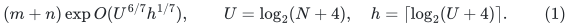

Here <code class="math">N</code> is a polynomial bound on the actual input and update
history. The input lengths are positive polynomially bounded
integers. Requested accuracy is constant or inverse polynomial in
<code class="math">U</code>. The new construction is a candidate until its local pool
interface and the recursion below receive independent audits.

The main distinction is between **selected-record recourse** and
**geometric overlap**. A local update can still create
<code class="math">P=\exp O(U/K+g+h)</code> child records. Nevertheless the representation
of the entire current child graph will overlap each physical parent
vertex or edge only <code class="math">\mathrm{poly}(U)</code> times. Full forest
copies are charged in the overlap count, even when unused.

## 1. Existing ingredients retained

The static provider and dynamic repair remain the established ones
from the checkpoint. Write

<!-- math-display: 9b5bc610d025c916605c8248
g=\log\Gamma=O((p+r)h),\qquad
 f=\log F=O(U/p+U/r+r^2h+(p+r)h),                         \tag{2}
-->
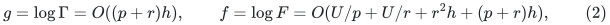

using [linear-parameter-static-sparsifier.md](linear-parameter-static-sparsifier.md).
The logarithm of the selected-record allowance is

<!-- math-display: 5e422e2a9f5ff945f6ba5bab
z=\log P=O(U/K+g+h).                                   \tag{3}
-->
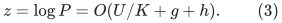

We conservatively allow the old <code class="math">K^2g</code> repair-work term. The
available normalized <code class="math">Kg</code> term is also valid, but is not needed
for the exponent in (1). In particular, this proposal does not
depend on simultaneously changing the selected-degree cleanup.
Keep that cleanup and its complete accounting unchanged. It can
cause additional cuts to the stable core forests and additional
selected-edge/root records; these changes are already charged to
<code class="math">P</code> and to the existing local work budget.

The native parent graph <code class="math">G</code> has maximum degree at most a fixed
constant, say three after a constant-factor initial adapter. Each
local period supplies the following data:

1. A family <code class="math">F_1,\ldots,F_b</code> of stable forests, with
   <code class="math">b\le Q_0=\mathrm{poly}(U)</code>. Each is a subforest of
   the physical parent graph. Within the period its edges only
   disappear; a new vertex is initially isolated. Every living
   physical edge has a fixed positive length.
2. Current core roots, logical pivots, and a selected subgraph of
   the union of core graphs. Every selected nonloop real core
   edge has the identity of one original parent edge and its core
   index. Repeated ownership by repair layers is deduplicated by
   reference counts before publication.
3. A projected core edge of physical preimage <code class="math">e=uv</code> has endpoints
   <code class="math">\mathrm{root}_{F_i}(u), \mathrm{root}_{F_i}(v)</code>. Its stored core length bounds
   the physical route consisting of the first root leg, <code class="math">e</code>,
   and the second root leg. Logical pivots are roots in every
   relevant stable forest.
4. The selected graph preserves distances between logical pivots
   within a factor <code class="math">\rho</code>, where
   <code class="math">\log\rho=O(Kg+h)</code>. All selected real edges retain their
   literal physical preimages and lifetimes.
5. Initialization and any chronological prefix of local edits
   supply an output-record bound of the form
   <code class="math">O(m_0P/k+Pq)</code>, where <code class="math">m_0</code> is actual initial parent
   size and <code class="math">q</code> counts actual local input edits. Core cuts,
   active-root births, selected-membership changes and local
   source bookkeeping use the previously proved local work
   bound <code class="math">\exp O(x+f+K^2g+h)</code>, for <code class="math">k=2^x</code>.

The total private provider universe is not identified with the
active root inventory in item 5. An inactive loop-only or isolated
provider slot may remain private. It is not, solely by existing,
a marked terminal of the exposed compressed graph. The exact active
root convention is specified in Section 3.

The public source for the stable forests and selected physical
provenance is KMG23, [arXiv:2311.06402v1](https://arxiv.org/pdf/2311.06402v1),
Lemmas 3.5--3.7 and Algorithms 2--4. The source's selected graph is
a subgraph of its native core graph. The constructive source
interfaces and actual-inventory wrappers are recorded in
[uniform-source-interfaces-for-4-5.md](uniform-source-interfaces-for-4-5.md) and
[disconnected-component-backend-wrapper.md](disconnected-component-backend-wrapper.md).

## 2. The proposed one-level output contract

Let <code class="math">Q=U^{C_0}</code>, for one sufficiently large fixed absolute
constant <code class="math">C_0</code>. The exponent may include all forest, bucket,
indexing, and positive-degree-reduction polynomials. It does not
contain <code class="math">P</code>, <code class="math">F</code>, <code class="math">k</code>, or an exponential in hierarchy depth.

The output is a bounded-degree positive-length graph <code class="math">B</code> with:

* a stable canonical child vertex <code class="math">q(a)</code> for each active logical
  pivot <code class="math">a</code>, throughout that pivot's physical lifetime in the
  current parent period; untouched initial small components are
  resolved locally rather than exposed merely for being private
  logical pivots;
* a fixed physical image <code class="math">\pi_B(v)\in V(G)</code> for every living
  child vertex, with at most <code class="math">Q</code> child vertices at one physical
  parent vertex;
* every child edge designated either as a true-null connector or
  as a physical parent path; the simultaneous paths use each
  physical edge and vertex at most <code class="math">Q</code> times;
* child size and encoded elementary child edits bounded by
  <code class="math">O(m_0PQ/k+PQq)</code>;
* metric comparison, for logical pivots,
  <!-- math-display: f03a8a26bcb0240d69210148
  d_G(a,a')\le H^{-1}d_B(q(a),q(a'))
         \le 2\rho\,d_G(a,a'),                              \tag{4}
  -->
  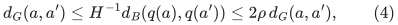
  where <code class="math">H</code> is a polynomial-size positive integer scale.

The path descriptors need not be expanded when created. A flat
forest on <code class="math">B</code> is lifted separately by Sections 5--9. That lift
must not charge the entire length of a compressed path to every
child edge edit.

## 3. Uncontract selected edges and mark their physical endpoints

For each core <code class="math">i</code>, let <code class="math">S_i</code> be its current deduplicated
selected real nonloop edge IDs. Put the physical edge <code class="math">uv</code> of
every <code class="math">e\in S_i</code> back at its original parent endpoints. Give
this edge its actual parent length <code class="math">\ell_G(e)</code>, rather than its
inflated root-to-root core length.

The mark set <code class="math">Z_i</code> contains:

1. physical endpoints of edges in <code class="math">S_i</code>;
2. every active stable root whose initial inventory and subsequent
   births are covered by item 5 of Section 1;
3. every active logical pivot required as an exposed child query
   handle.

Marks use reference counts. Active roots stay marked until their
native lifetime or the local period ends. Each stable-forest cut
introduces at most a constant number of new roots, whose births
are explicitly reported. Thus a cut does not require scanning
selected endpoints or recomputing which root serves each one.
It is not safe to include an uncharged private root merely because
the provider stores it. Private isolated and loop-only slots that
do not belong to the proved active inventory are not exposed.
This active-inventory distinction must be checked against the
retained provider implementation.

Within each component of <code class="math">F_i</code>, take the minimal subtree spanning
its marks. Keep marked vertices and unmarked branching vertices;
suppress unmarked degree-two vertices. A resulting virtual edge
represents the unique positive-length path in <code class="math">F_i</code> between its
endpoints, with length equal to that path's physical length.
Its physical path and endpoints are immutable during its virtual
edge lifetime. A change of either retires the old edge ID and
creates a new one.

The dynamic compression lemma is independently proved in
[marked-steiner-compression-root-audit.md](marked-steiner-compression-root-audit.md). It supports a physical
forest cut, a marked-status change, or a new isolated vertex with
polynomial-logarithmic work and <code class="math">O(1)</code> virtual record changes.
It uses path aggregates on the full cut-only forest and does not
relabel an Euler order after a cut. In particular a cut affects
at most one current virtual path. Mark insertion finds the first
point of the current marked subtree on a path to any existing mark;
mark deletion prunes one virtual leaf edge or suppresses one
degree-two vertex.

The number of virtual records is <code class="math">O(&#124;Z_i&#124;)</code>. Distinct virtual
edges of one core have disjoint physical edge interiors and have
no common internal vertex; they can meet only at a common retained
endpoint. Each virtual vertex's degree is bounded by its degree
in the physical forest, hence by three.

The graph <code class="math">J</code> consists of all these virtual forest edges and all
uncontracted selected real edges. Identify exposed vertices from
different cores with the same physical parent identity. An
unexposed internal coincidence is not added as a vertex in another
core: no cross-core mark closure is performed.

### Degree, size, and overlap

One parent vertex has at most three virtual incidences and at most
three selected real incidences in one core. The latter uses the
fact that there is at most one selected membership for a fixed
core/original-edge pair. There are only <code class="math">b\le Q_0</code> cores and
buckets. Thus the maximum degree of <code class="math">J</code> is at most <code class="math">6Q_0</code>,
independent of <code class="math">P</code>.

The number of records in <code class="math">J</code> is a fixed polynomial in <code class="math">U</code>
times the active selected/root inventory. A physical edge occurs
in at most one virtual path and one selected-real copy per core.
A physical vertex occurs in at most constantly many virtual
path endpoint/interior positions per core, plus its bounded-degree
selected incidences. All edge and vertex overlap bounds are
therefore polynomial in <code class="math">U</code>, before degree reduction.

### Metric domination

Every edge of <code class="math">J</code> is a genuine physical parent path. Identifying
equal physical endpoints cannot create a path shorter than its
physical projection. Conversely, every selected core edge can be
replaced by its two root legs and uncontracted real edge in <code class="math">J</code>.
Both roots and both real endpoints are marked; their whole root
legs are contained in the compressed marked subtree. The total
length is at most the stored selected core length. A path in the
selected core graph therefore expands to a path in <code class="math">J</code> no longer
than that core path. Together with the existing pivot-pair metric
guarantee, this proves
<code class="math">d_G(a,a')\le d_J(a,a')\le\rho d_G(a,a')</code>.

## 4. Only polynomial-size positive port fibers are needed

For each current exposed physical vertex of <code class="math">J</code>, use a binary
port tree with a fixed polynomial-in-<code class="math">U</code> number of leaves,
large enough for the bound <code class="math">6Q_0</code>. Assign each live incident
edge a distinct slot. The canonical vertex is the port-tree root.
Connector lengths are one. Multiply lengths of real and virtual
edges by a power of two <code class="math">H\ge4(\log_2(6Q_0)+2)</code>.

The resulting graph <code class="math">B</code> has maximum degree three, with a
constant-size adjustment at a root when necessary. Every nonzero
path edge of <code class="math">J</code> has integer length at least one, so replacing
a simple <code class="math">J</code>-path by its port route adds at most its scaled
length. Dropping connectors from a <code class="math">B</code>-path gives a physical
walk of length at most its <code class="math">B</code>-length divided by <code class="math">H</code>. This
proves (4). Equal-endpoint distances are zero by convention.

All vertices in one port fiber have the same fixed parent image.
There are only <code class="math">\mathrm{poly}(U)</code> of them, not <code class="math">P</code> of
them. Each currently exposed physical parent vertex has at most
one such fiber. A fiber that is no longer needed may be retired
after its incident records; a subsequent fiber uses a fresh
native lifetime. Logical-pivot fibers remain throughout their
pivot lifetime. No sequence of old retired fibers remains in the
exposed graph or in the lifted pools.

Slot insertions/deletions, point births/deaths, and virtual-edge
changes cause a fixed polynomial in <code class="math">U</code> elementary child edits.
Every virtual record update is charged to the explicit selected,
root, or stable-forest transcript that caused it. This gives the
claimed prefix inventory and recourse in Section 2.

## 5. Input forest and explicit vertex occurrence parameter

Let <code class="math">\mathcal F</code> be an arbitrary dynamic typed forest over the
current child graph <code class="math">B</code>. An input node <code class="math">y</code> has a fixed child
vertex image during its lifetime. An input edge is either mapped
to one currently living child edge ID, or is a typed true-null
edge whose two endpoints have the same child-vertex image.
The latter has no native child edge ID and has zero physical
length. Designated input terminal
nodes have fixed identities while alive. Terminal lifetimes may
end; monotone terminal membership is not assumed.

Let <code class="math">C\ge1</code> bound the number of living input forest nodes with
any one child-vertex image. This is a **vertex occurrence bound**;
it is not inferred by discarding isolated nodes. All input nodes,
including isolated designated nodes, count toward <code class="math">C</code>.

For each input node create a distinct canonical output node
<code class="math">\eta(y)</code>, with physical parent image
<code class="math">\pi_B(\pi_{\mathcal F}(y))</code>. Its identity remains fixed for
the lifetime of <code class="math">y</code>. At most <code class="math">CQ</code> of these output nodes
have any one physical parent image.

An input typed-null edge is forwarded as a true-null edge between
its two canonical output nodes, using its own input lifetime log.
It does not enter any virtual-edge palette. For an input edge
mapped to a port connector, likewise add a true-null edge
between its two canonical output nodes. For an input edge mapped
to an uncontracted selected real edge, add one real parent-edge
copy between those nodes. The difficult third type is a virtual
forest edge, whose physical path can be long. It is handled next.

## 6. Two-level colors at physical junctions

First color the virtual edges of each single core's compressed
forest, before port splitting. That forest has maximum degree
three. Maintain an ordinary proper edge coloring with five
colors: insert a new virtual edge with a color absent from its
two physical endpoints, and free its color on deletion. At most
four colors are forbidden, so no old edge is recolored. A path
replacement retires old virtual edges before inserting new ones;
all intermediate insertion degrees are bounded by the final
degree. The colors refer to physical compressed junctions, not
child port-leaf identities.

For each virtual edge, separately assign distinct slots to its
living input-forest occurrences. Its child graph edge has two
endpoint vertices. There are at most <code class="math">C</code> input forest nodes at
each endpoint image. The subgraph formed by occurrences of this
child edge is a forest on at most <code class="math">2C</code> vertices, so it has at
most <code class="math">2C-1</code> edges. Use <code class="math">2C</code> slots. This factor of two is
necessary: an alternating tree between two endpoint fibers can
have more than <code class="math">C</code> edges. Typed-null input edges are not part
of this subgraph and do not change the upper bound.

A pool color is a pair `(base color, occurrence slot)`. There
are <code class="math">10C</code> colors per core. Slot insertion/deletion uses a
free-slot dictionary in <code class="math">O(\log(C+2))</code> time and does not alter
any existing assignment. Base colors and slots are fixed during
their respective virtual-edge and input-occurrence lifetimes.
No recoloring cascade or <code class="math">C</code>-sized search is needed.

For one pool color, at most one occurrence of each virtual edge
is assigned to it, and distinct virtual edges assigned to it
have the same base color. They form a matching in the compressed
forest. Their physical paths are vertex-disjoint: distinct virtual
paths have disjoint interiors, and sharing a physical endpoint
would violate the base edge coloring. Coloring only at port leaves
would not have supplied this property.

The palette is fixed from the recursively declared upper bound
on <code class="math">C</code>. It is linear in <code class="math">C</code>, not <code class="math">C^2</code>. Allocation and
storage of every color's full forest are paid explicitly below.

## 7. The full-forest pool and its mask invariant

For every core <code class="math">i</code> and every color <code class="math">j</code>, allocate a copy of
the **entire live physical forest** <code class="math">F_i</code>. It includes every
living native parent vertex, including all unmarked vertices and
all unused branches. Denote it <code class="math">T_{i,j}</code>.

For each live virtual edge <code class="math">b</code> in core <code class="math">i</code>, choose and store
one physical key edge <code class="math">e_b</code> on its path, for example the first
edge from the endpoint with smaller stable ID. A dynamic-tree
first-edge query obtains this without expanding the path.
Distinct virtual edges have distinct key edges because their
paths are edge-disjoint.

The pool for color <code class="math">j</code> is obtained from <code class="math">T_{i,j}</code> by cutting
exactly the key edges <code class="math">e_b</code> of virtual edges that have no input
occurrence assigned color <code class="math">j</code>. If a virtual edge has an
occurrence of color <code class="math">j</code>, keep its key edge. Proper coloring
ensures that there is at most one such occurrence.

An input occurrence assigned color <code class="math">j</code> is represented by its
full physical path in this pool. Join its two pool endpoint nodes
to the corresponding canonical nodes <code class="math">\eta(y),\eta(y')</code>
using two typed true-null edges. The real edges of the path are
already present in the full pool; their insertion is not repeated
for this occurrence.

### Exact connectivity invariant

The minimal marked subtree is divided into its compressed virtual
paths. Cutting one edge of every unused virtual path disconnects
its two retained endpoints. A branch outside the minimal marked
subtree attaches to at most one retained subtree component; it
cannot connect two such components in a forest.

Consequently, a pool component contains either no used virtual
path or exactly one used virtual path. The second assertion uses
the matching property from Section 6: two used virtual edges do
not share a retained endpoint, and any connection between them
would traverse an unused virtual edge, whose key is cut. A used
component can contain additional hanging branches, but its only
canonical attachment nodes are the two endpoints of its one
input edge occurrence.

After suppressing unused hanging branches and contracting each
used route to one abstract edge, the union of all pools, the real
selected-edge copies, and the null port connectors recovers the
input forest <code class="math">\mathcal F</code>, with extra disjoint forest components.
It is therefore a forest. Its path between designated canonical
nodes projects to exactly the corresponding input-forest path
with each virtual edge replaced by its physical path. This path
has physical length at most the child length divided by <code class="math">H</code>.

## 8. All vertices, including unused copies, are charged

There are <code class="math">b=\mathrm{poly}(U)</code> cores and <code class="math">10C</code>
colors per core. Each full pool has exactly one node for each
current live native parent vertex. Hence all pool nodes with
one given physical image number

<!-- math-display: b0596558d53c4ac132c8d640
10bC\le C Q_2.                              \tag{5}
-->
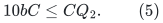

This count includes every unused branch and isolated pool node.
Canonical nodes <code class="math">\eta(y)</code> add at most <code class="math">CQ</code>. Null gluing adds
edges, not extra uncounted vertices. All physical parent edges
have at most one copy in each pool, plus the selected-real edge
occurrences. A forest on at most <code class="math">C</code> nodes per child endpoint
cannot contain more than <code class="math">2C</code> occurrences of one child edge.
The same polynomial bound therefore applies to edge congestion.

Choose one fixed polynomial <code class="math">Q_3(U)</code> that absorbs (5), the
canonical nodes, all cores and port fibers. The one-level lift
has vertex and edge occurrence bound

<!-- math-display: d32e5aa0b0282e95c6ef1cdd
C'\le Q_3(C+1).                     \tag{6}
-->
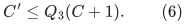

The dependence on the previous occurrence capacity is linear.
No recurrence of the form <code class="math">C'\le C^{1+\Omega(1)}</code> is used.

### Retirement of native vertices and port lifetimes

The word "live" in (5) is essential. If a native parent vertex
is retired, its incident native edges must already have been
deleted. All child fibers and input forest nodes using that
native lifetime are retired first. Then its now-isolated node is
deleted from every pool. The cost is <code class="math">O(CQ_3)</code>, charged to the
actual native vertex-deletion record.

A provider may keep a private isolated slot for an ended lifetime.
That slot is not copied into the exposed pool and has no exposed
canonical mark. New port lifetimes with the same lower physical
image do not accumulate on top of old exposed copies. This is
an explicit change of contract from source lemmas that retain a
monotone terminal set for an entire period: this lift supports
terminal and node death.

Initial allocation costs actual parent size times <code class="math">CQ_3</code>.
New isolated native vertices cost <code class="math">CQ_3</code> when born. A period
replacement retires its old pools before publishing the new
ones; only actual old and new inventories are charged. Stable
root canonical nodes belonging to surviving original vertices
are retained while their private edges and pools are replaced.

## 9. Dynamic mask maintenance and update order

There are two distinct kinds of work.

**An incoming input-forest edge edit.** For a virtual occurrence,
an insertion finds a free slot with <code class="math">O(\log(C+2))</code> computation, restores
one key edge in that color's pool, and adds two null links. A
deletion cuts that key edge and removes those links. A real or
port-null edge edit changes one output edge. A node edit changes
one canonical node after its incidences. Thus each incoming
forest edge/node edit causes only <code class="math">O(1)</code> output forest records.
No work or recourse proportional to the length of its physical
virtual path is incurred.

**A parent/native/virtual-graph edit.** A physical cut affects its
copy in every color pool. A virtual edge birth or death changes
one key mask per color. A native vertex birth/death changes one
node per pool. These cost <code class="math">O(CQ_3)</code> work and forest records per
source-sized event. The marked-Steiner compression lemma ensures
that a physical cut or mark edit creates only constantly many
virtual events, before the already charged provider transcript
is multiplied by this copy factor.

Virtual-edge paths and their key IDs are immutable until
retirement. Old metadata remains available to retire occurrences
and masks. The update is a settled transaction, with no query
during the replacement. Use this order:

1. obtain/retain the child forest's old-record retirement log and
   remove all affected input occurrences and null attachments;
2. compute the old and new key-mask sets for the affected virtual
   records, and apply all newly required physical cuts, including
   actual native deletions;
3. restore old masked edges that are present in the new physical
   forest and are not masked in the new virtual representation;
4. add new canonical records, selected-real copies, colored virtual
   occurrences and their null attachments.

Steps 2--3 are cuts before links. The unchanged attachments plus
the intermediate pool are a subforest of the final construction,
so restoring mask edges does not require a transient cycle.
In particular one must not unmask every old virtual edge first
and only later install the replacement masks: that could briefly
connect two input edge occurrences in one pool component.

Underlying stable forests have no edge insertions during a period.
If a native deleted edge was already masked, its pool copy is
already absent; retire its availability record without inserting
it. An old path handle is never queried after its forest version
has been discarded. The physical key ID and the pool's retained
old state suffice for deletion processing.

If the input forest and its provider are maintained by a recursive
algorithm, graph edits are first settled in the numerical/structural
child instance and their forest logs are buffered with old IDs.
No pool query is used to compute those logs. The lift then applies
the above retire/cut/restore/insert transaction. It does not call
the child solver again while forwarding one of its own output
edges.

## 10. Stable maps and final root quotient

Every canonical output node <code class="math">\eta(y)</code> keeps its physical image
and identity for the lifetime of the input node <code class="math">y</code>. A pool
node's physical image is fixed for its own lifetime. New colors
or periods never rename existing nodes to different physical
vertices.

Internal null edges are typed and are not contracted in recursive
lifts. Several different child nodes can have one eventual
physical image while retaining distinct fixed handles. At the
outer root, the actual original vertices have one permanent
canonical node each. Contract true-null components only there,
retaining that permanent node whenever its component contains it.
Every such component has one physical image and contains at most
one permanent root canonical node.

The vertex bound (6) bounds all vertices of a null component.
The physical root graph has bounded degree, and its real-edge
congestion is also bounded by (6) iterated over the hierarchy.
A null split/join can therefore rebuild its affected quotient
fiber in a fixed polynomial of the occurrence bound, preserving
the marked survivor. This does not introduce the selected-record
factor <code class="math">P</code> into the occurrence count. Its work is charged
separately in the common time envelope.

After this final quotient every exposed edge is an original
physical edge; the result is an ordinary flat forest with stable
original canonical nodes. We require no leaf property for those
canonical nodes.

## 11. Recursive occurrence and work envelopes

Let <code class="math">d=O(U/x)</code> be the hierarchy depth. Native nearest-pivot
forests, and exact shortest-path spanning forests at the base,
start with one node per native vertex. Their union adds only a
factor polynomial in <code class="math">d</code>. Adding the native forest at a level
and lifting the higher families gives

<!-- math-display: 8bfdacc17302055542d248a1
G_j\le Q_4(G_{j-1}+1),\qquad Q_4=\mathrm{poly}(U).
                                                                  \tag{7}
-->
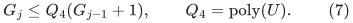

Thus logarithmic edge/vertex occurrence is <code class="math">O(dh)</code>. We may
use the looser <code class="math">c=O(d^2h+h)</code> below without affecting the
candidate exponent. Full unused pools are included in <code class="math">G_j</code>.

The child graph still emits <code class="math">P\mathrm{poly}(U)</code> edits
per parent edit, with the initial selected credit from Section 1.
Each incoming forest edit is forwarded with constant output
recourse and polynomial-logarithmic work. Source forest and
virtual-graph edits separately affect all declared pools, and
therefore pay <code class="math">G_j\mathrm{poly}(U)</code>. Even a conservative
recurrence that overpays these copy charges multiplicatively
over levels adds at most
<code class="math">\prod_{j\le d}Q_4^{O(j)}=\exp O(d^2h)</code>. It never multiplies
the previous vertex occurrence capacity by itself.

Initialize every pool at its actual parent size and declared
color capacity. Retain the initialization allowance and the
initial child-record credit in the usual short-period rebuild
recurrence; do not discard the term corresponding to child
updates emitted after initialization. The resulting conservative
logarithmic work and explicit-recouse bound is

<!-- math-display: 396aae93e38836725c261432
B=O\left(x+f+K^2g+d\log P+d^2h+h\right).                 \tag{8}
-->
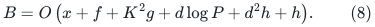

The logarithmic metric stretch remains

<!-- math-display: 5a2aab55e61803a07a1d9479
a=O(dKg+dh).                   \tag{9}
-->
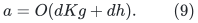

Indeed, force an anchor into each pivot set, use (4) only between
pivots, and concatenate the exact nearest-pivot legs and the
anchor component of the exact base spanning forest. This is the
anchored argument in [separated-metric-forest-and-strong-sssp.md](separated-metric-forest-and-strong-sssp.md),
with the new one-level representation in place of its old port
lift. The other components, including isolated native ghosts
that still have a live parent lifetime, receive their own base
trees. Canonical paths relevant to a finite-diameter requirement
stay in the anchor component.

The outer copy recurrence of KMG Claims 5.15--5.17 uses vertex
congestion <code class="math">e^c</code>, not all work or explicit recourse <code class="math">e^B</code>.
The source distinction is proved in
[strong-forest-mechanism-comparison.md](strong-forest-mechanism-comparison.md), Section 3. Therefore,
subject to the cover constraint

<!-- math-display: 300fdc7a21f2a50e653f6935
K_{\rm cov}\Lambda(a+O(h))\le c_0U,    \tag{10}
-->
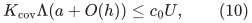

the strong-forest logarithmic work is

<!-- math-display: 6e5c18f816ccfab5d416be20
B+O\left(U/\Lambda+U/K_{\rm cov}
            +\Lambda U/K_{\rm cov}+\Lambda c+h\right).   \tag{11}
-->
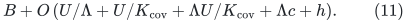

## 12. Candidate parameter balance and exact remaining checks

Set

<!-- math-display: 98b497f068bbf30fa8eff6bc
t=(U/h)^{1/7},\quad p=r=\Theta(t),\quad d=\Theta(t),
 \quad x=\Theta(U/t),\quad K=\Theta(t^2),
 \quad K_{\rm cov}=\Theta(t^2),\quad\Lambda=\Theta(t).
                                                                  \tag{12}
-->
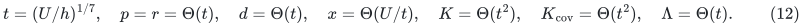

Writing <code class="math">U=t^7h</code>, the charged quantities are

| Quantity | Logarithmic bound |
|---|---:|
| Static output quality <code class="math">g</code> | <code class="math">O(th)</code> |
| Static work <code class="math">f</code> | <code class="math">O(t^6h)</code> |
| Local selected factor <code class="math">\log P</code> | <code class="math">O(t^5h)</code> |
| Conservative old repair cost <code class="math">K^2g</code> | <code class="math">O(t^5h)</code> |
| Metric distortion <code class="math">a</code> | <code class="math">O(t^4h)</code> |
| Flat vertex/edge overlap <code class="math">c</code> | <code class="math">O(t^2h)</code>, conservatively |
| Work and explicit recourse <code class="math">B</code> | <code class="math">O(t^6h)</code> |

The cover product is <code class="math">O(t^7h)=O(U)</code>, with sufficiently
small fixed constants in the outer parameters. The outer work
terms <code class="math">U/\Lambda</code> and <code class="math">\Lambda U/K_{\rm cov}</code> are
<code class="math">O(t^6h)</code>, and <code class="math">\Lambda c=O(t^3h)</code> is smaller. Equations
(8)--(11) therefore give the candidate exponent in (1).

With the public path provider, use <code class="math">g=O(qrh)</code>,
<code class="math">f=O(U/q+U/r+r^2h+q^2rh)</code>, and
<code class="math">t=(U/h)^{1/8}</code>, <code class="math">q=r=d=\Lambda=\Theta(t)</code>,
<code class="math">K=K_{\rm cov}=\Theta(t^2)</code>. The same new wrapper would
give <code class="math">7/8</code>. This is an ablation with a **new pool construction**,
not a previously available public baseline.

Before promoting this note, the independent audit must check:

1. the active root/endpoint mark inventory and its notifications
   in Section 3, without exposing every private provider ghost;
2. the metric and physical-degree arguments, including deduplicated
   core-edge provenance and no cross-core closure of marks;
3. the forest connectivity invariant for the full pools and the
   endpoint-based occurrence coloring;
4. the retirement transaction and vertex count, including every
   unused pool vertex, retired port fiber, and canonical mark;
5. the initialization-credit and forwarding recurrence leading
   to (8), without multiplying a large static factor once per
   hierarchy level or hiding expansion of a long virtual path.

No <code class="math">6/7</code> theorem is asserted solely from the parameter table.
