# Independent audit of the Steiner pool: metric, inventory, and recursion

**25 October 2026.** This audits
[steiner-colored-pool-strong-forest-candidate.md](steiner-colored-pool-strong-forest-candidate.md), particularly its
selected-core provenance, active-root inventory, static metric domination,
vertex multiplicity, and the distinction between local work and outer
copy capacity. The mask connectivity proof receives a separate audit.

The static core transformation passes. A particularly direct complete
native-graph interface uses the uncontracted compressed graph itself at
the next level, **without a fresh port tree at every level**. Its degrees
grow only by a polynomial logarithmic factor per level. This variant
retains the source's monotone native-vertex convention and still gives
the candidate <code class="math">6/7</code> parameter point. The independent checks below
support that interface; they do not replace the checkpoint's separate
uniform-provider, sparse-cover, or Gomory--Hu dependency proofs.

## 1. Provenance and the root notification transcript

The relevant primary source is [KMG, arXiv:2311.06402v1](https://arxiv.org/pdf/2311.06402v1),
Definition 3.6, Algorithms 2--4, Claim 3.16, and the paragraphs following
Algorithm 4 on pages 20--21. The source selected graph is a subgraph of
the union of native core graphs. Each selected real edge retains its
core index and its original physical edge identity. Its stored length
dominates the physical root-leg/real-edge/root-leg route.

For a fixed core and fixed physical edge identity there is only one
core edge. Different parallel physical edges retain different identities.
Multiple ownership by repair routines can be deduplicated by reference
counts; alternatively a polynomial number of explicitly indexed core or
bucket aliases is harmless. Manufacturing a separate exposed copy for
every repair work operation would not satisfy the claimed degree bound.

The root notifications needed by the compressed representation are
already available in the explicit selected-edge transcript. The source
explains how to emulate a core split in the final selected graph: delete
each migrated selected incidence from its old endpoint, create the new
root if needed, and reinsert the incidence at that root. These are the
very incidences whose physical selected endpoint has changed its stable
root. For each insertion, deletion, or such retargeting, query the
retained forest's root and update the two endpoint and root reference
counts. No scan of unselected native edges is needed.

In a simultaneous batch, store the old endpoint/root annotations until
their reference counts have been removed. Then install the new
annotations. A selected edge that becomes a discarded core loop is a
deletion from the exposed set; a newly nonloop selected edge is an
insertion. Both cases are covered by the same explicit transcript.

Every physical forest cut is also explicit. By the separate marked
Steiner compression lemma, it changes only constantly many virtual
records before the mark changes caused by the selected transcript are
processed. Extra degree-cleanup cuts use this same interface.

## 2. The active pivot inventory must exclude private loop-only slots

Let <code class="math">S_i</code> be the deduplicated selected nonloop identities in core
<code class="math">i</code>. Mark their physical endpoints and their current stable roots.
Also mark each exposed logical pivot in every core where it must be
available as a query handle. It is enough to expose the logical pivots
incident to the selected nonloop graph, together with the forced
anchor. In particular one may use

<!-- math-display: 7885865e8572034a10ed37ca
|A_{\rm exp}|\le 2\sum_i|S_i|+1.                         \tag{1}
-->
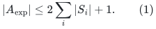

A logical pivot connected to a distinct logical pivot in the native
graph must be connected in the old selected graph, by its existing
pivot-pair metric guarantee. It therefore has a selected nonloop
incidence. A pivot omitted by (1) has no such required nontrivial
recursive connection. Its isolated or loop-only component is handled
by the already established disconnected-component wrapper, or its
nearest-pivot branch terminates locally. The anchor has its explicit
constant-size singleton handle when necessary.

Thus the marks, including marks copied into the polynomial family of
cores, have inventory polynomial in <code class="math">U</code> times the actual selected
inventory, plus the explicit anchor credit. This avoids exposing every
private provider root or every center of an initially small component.
Doing the latter would incorrectly destroy the initial <code class="math">m/k</code>
reduction.

Within a period, a previously exposed child vertex may remain as an
isolated ghost after its last exposed incidence disappears. It need
not remain a mark in every physical forest. Its persistent identifier
is paid from the actual birth inventory. Reappearance uses that same
identifier, not another alias of the same physical point.

## 3. Static metric domination is exact before any optional ports

For each core, take the minimal forest subtree spanning its marks and
suppress unmarked degree-two vertices. Retain marked vertices and
unmarked branching vertices. A virtual edge is the unique physical
forest path between its retained endpoints, with exactly the sum of
its native lengths. Also uncontract every selected real edge to its
literal physical endpoints with its literal native length.

Let <code class="math">J</code> be their union, identifying exposed vertices from different
cores when they have the same physical parent identity. Every edge
of <code class="math">J</code> represents a genuine positive physical path. Concatenating
the paths representing any <code class="math">J</code>-walk gives a native walk of the
same length. Consequently

<!-- math-display: 61c833673cfa8a08ba0e1745
d_G(a,a')\le d_J(a,a').                 \tag{2}
-->
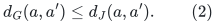

Conversely, consider one selected core edge. Both physical endpoints
and both current stable roots are marked in that core. Each root leg
is therefore entirely contained in its minimal marked subtree and
can be traversed through virtual edges. The uncontracted physical
edge completes the route. Its total length is at most the stored
selected core length. Replace the edges of a selected-graph path
one by one to obtain

<!-- math-display: 601adc198c8b35bb53df07f5
d_J(a,a')\le d_H(a,a')\le\rho\,d_G(a,a')
 \quad\text{for exposed logical pivots}.                   \tag{3}
-->
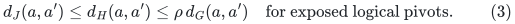

No upper comparison for arbitrary Steiner vertices is asserted.
No cross-core mark closure is needed: if a vertex is internal to
a virtual path in one core and exposed in another, omitting a new
junction in the first core can only omit extra connections. It does
not invalidate the root-leg routes used for (3).

All lengths are positive integers. A newly computed virtual length
is a sum of at most the actual native number of edge lengths, so it
adds <code class="math">O(U)</code> bits to the local maximum. Over <code class="math">d</code> levels the
existing generous <code class="math">O(Ud)</code>-bit bound remains valid. Length changes
retire the old virtual edge identity and insert a new one.

## 4. Degree and physical overlap are independent of selected recourse

Let the current native parent maximum degree be <code class="math">\Delta_j</code>, and
let <code class="math">b_j=\mathrm{poly}(U)</code> be the number of cores and
buckets. Within one core, a physical vertex has at most
<code class="math">\Delta_j</code> virtual incidences and <code class="math">\Delta_j</code> selected-real
incidences. Selected membership is by physical edge identity. Thus

<!-- math-display: 1352d294debd7a42e67fc2fd
\Delta(J)\le 2b_j\Delta_j.                \tag{4}
-->
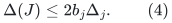

A physical edge is in at most one compressed virtual path per core
and in at most one selected-real copy per core. Virtual paths in one
core have disjoint interiors and meet only at retained endpoints.
The number of path endpoint occurrences at a vertex is at most its
native degree per core. Thus all physical edge and vertex overlap is
<code class="math">\mathrm{poly}(U,\Delta_j)</code>, independent of the selected
update multiplier <code class="math">P</code>.

For a degree-three parent this justifies the construction's polynomial-size
port fibers: their capacity is polynomial in <code class="math">U</code>, not <code class="math">P</code>.
The earlier obstruction in which a high-degree selected root is
replaced directly by <code class="math">P</code> port aliases does not apply. The
uncontracted representation has removed that high-degree root before
any port construction.

## 5. A source-compatible implementation without recursive port trees

Use <code class="math">J</code> itself as the next native graph. Give each physical parent
vertex at most one child native identifier during the whole private
period. When its last incidence disappears, retain it as an isolated
ghost until the period ends. Its next incidence reuses this existing
identifier. An unmarked internal vertex of a virtual path need not
be a child vertex until it is actually exposed.

This yields

<!-- math-display: 7fd6ae8ad0bf6afe77a49682
\Delta_{j+1}\le 2b_j\Delta_j,\qquad
 \log\Delta_j=O(jh)                                      \tag{5}
-->
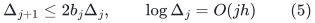

after the ordinary initial bounded-degree adapter. The recursive
native vertex sets are monotone within a period, as required by the
retained stable-forest and canonical-map source interfaces. There
is no immediate native-vertex-deletion operation to implement.

The center, stable-forest, native-split, and degree-cleanup source
proofs have fixed polynomial dependence on the native degree.
Conservatively multiply their initial selected credit, local work,
and output edit allowance by <code class="math">\Delta_j^{O(1)}</code>. With

<!-- math-display: 4a66d114484f92bb340c2894
P_0=\exp O(U/K+g+h),
-->
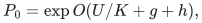

one may use a local allowance
<code class="math">P_j=P_0\mathrm{poly}(U,\Delta_j)</code>.
The added logarithmic charge across all levels is <code class="math">O(d^2h)</code>.
At the proposed parameters, <code class="math">\log P_j=o(x)</code>, so actual
initial child size still decreases by a factor at least
<code class="math">e^{x/2}</code> outside the exact base cases.

This variant is simpler than retiring and recreating recursive port
fibers. The latter is also a plausible implementation, but its
immediate native-vertex-death contract must be supplied explicitly;
it is not an operation printed in the retained stable-forest source.

## 6. Vertex capacity and stable canonical maps in the lift

Let <code class="math">C</code> count **all** incoming forest nodes at any one child
native vertex. There is at most one such child vertex at a physical
parent point in the implementation of Section 5. The canonical nodes
<code class="math">\eta(y)</code> therefore contribute at most <code class="math">C</code> occurrences there.

The incoming forest can also contain typed true-null edges whose
endpoints have the same child native image, in addition to edges
mapped to native child edges. Copy such an edge directly as a
true-null edge between its two canonical nodes. This fourth input
type is required when the lift is composed recursively.

For a fixed child virtual edge, there are at most <code class="math">2C-1</code> incoming
occurrences: its endpoint fibers contain at most <code class="math">2C</code> nodes and
the incoming graph is a forest. Properly color the current virtual
forest of one core using a fixed palette of
<code class="math">2\Delta_j-1</code> base colors. A new edge has at most
<code class="math">2\Delta_j-2</code> forbidden colors, so greedy insertion with no
recoloring is sufficient. Give the occurrences of one virtual edge
distinct slots from a fixed range of <code class="math">2C</code>. Use the pair
`(base color, occurrence slot)` as the pool color.

Virtual paths assigned one such pair are vertex-disjoint: distinct
edges of the same base color do not share endpoints, and compressed
paths have disjoint interiors. Occurrences of the same edge have
different slots. A free-slot list for each current virtual identity
finds a slot in constant time; the slot inventory costs <code class="math">O(C)</code>
when that virtual identity is created and is charged to that native
event. This avoids scanning all <code class="math">C</code> slots on each incoming edit.

There are <code class="math">O(b_j\Delta_jC)</code> full physical forest pools. Every
one contains every live native vertex, including unused branches
and isolated ghosts. The total node and edge occurrence bound,
including canonical nodes and selected-real copies, is therefore

<!-- math-display: 7b25bf802e89e9ca0254af6c
C'\le Q_j(C+1),\qquad
              Q_j=\mathrm{poly}(U,\Delta_j).         \tag{6}
-->
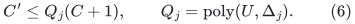

The pool mask cuts one key edge of each unused virtual path. A pool
component with an attached input occurrence has exactly that one
used virtual route; all other branches are unused hanging trees.
Replacing each used route by an abstract input edge recovers the
incoming forest. The additional full unused components are forests
too. This confirms the required forest and length properties.

Each canonical node keeps its identifier and physical image for its
incoming node's lifetime. Native ghost identities are fixed within
a private period; newly allocated pool nodes also have fixed images.
Keep true-null edges explicit during recursive lifts. Only at the
outer physical root contract null components, retaining the original
canonical identifier when present. Every null component has one
physical image and at most one original canonical node. The bounded
root degree and (6) pay for rebuilding its incident quotient edges.
Full private rebuilds retain the surviving original canonical nodes
and pay for the actual old and new private inventory.

## 7. Recourse, work, and late initialization credit

An incoming forest edge edit changes only constantly many output
records: one real edge, one inherited null edge, or one pool key
and two null attachments. A native forest cut, virtual edge change,
or native birth can change <code class="math">O(Q_j(C+1))</code> pool records. Both are
explicit charges. A long virtual path is never expanded for every
incoming edge edit.

Use the following atomic order: retire affected incoming occurrences
and attachments; install all newly necessary mask cuts and physical
deletions; restore previously masked edges that are available and
unmasked in the final state; insert new occurrences and attachments.
The intermediate pool has all final cuts and may have extra cuts,
so unchanged attachments cannot form a transient cycle. The child
numerical instance produces its retirement/insertion log before this
lift processes the log. A lift output edge is not fed back as a new
native update to the same numerical instance.

Consequently one can use the already established coupled
initialization/update recurrence with local record factor <code class="math">P_j</code>,
with (6) replacing its old occurrence recurrence. In particular the
initial selected credit <code class="math">m_0P_j/k</code> can be spent after child
initialization; the child update allowance must remain in the
initialization recurrence. It cannot be replaced by child
initialization size alone.

Taking global upper envelopes over the at most <code class="math">d</code> levels,
<code class="math">\log P_j\le\log P_0+O(dh)</code> and
<code class="math">\log Q_j=O(dh)</code>. The native nearest-pivot and exact base forests
start at node capacity one. Thus

<!-- math-display: 03f307886aad4dfdd70f511b
\begin{aligned}
 c&=O(d^2h+h),\\
 B&=O\bigl(x+f+K^2g+d\log P_0+d^2h+h\bigr),\\
 a&=O(dKg+dh).
\end{aligned}
\tag{7}
-->
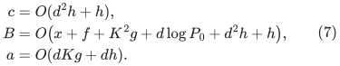

Here <code class="math">B</code> includes explicit recourse and color/mask work;
<code class="math">c</code> counts simultaneous vertices and edges. The direct public
<code class="math">C</code>-slot lift already gives small <code class="math">c</code> without changing its
large-degree work. The new representation improves the latter by
(5), which is why these two analyses must be distinguished.

## 8. Outer copies and the 6/7 substitution

The outer KMG construction allocates copies according to vertex
occurrences, so its recurrence is

<!-- math-display: 3e28694102c9bdd5dbfa653c
A_i\le(1+\Delta_{\rm cov}^2+
                \Delta_{\rm cov}e^c)A_{i+1}.
-->
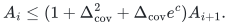

The maintenance work <code class="math">e^B</code> is paid for the local instances and
their explicit logs, then those logs are forwarded to the allocated
copies. It is not substituted for <code class="math">e^c</code> in this inventory.
This is the source accounting separately established from
Algorithm 10 and Claims 5.15--5.17 in
[strong-forest-mechanism-comparison.md](strong-forest-mechanism-comparison.md).

With the research provider

<!-- math-display: 40ae9b9e5523f31e1b8b1c13
g=O((p+r)h),\qquad
 f=O(U/p+U/r+r^2h+(p+r)h),
-->
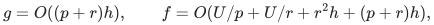

take <code class="math">U=t^7h</code>, <code class="math">p=r=d=\Lambda=\Theta(t)</code>,
<code class="math">x=\Theta(U/t)</code>, and
<code class="math">K=K_{\rm cov}=\Theta(t^2)</code>. Then

<!-- math-display: 57edd4af896e941ebbcd04d1
a=O(t^4h),\qquad c=O(t^2h),\qquad B=O(t^6h).
-->
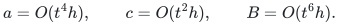

The cover product <code class="math">K_{\rm cov}\Lambda(a+O(h))</code> is
<code class="math">O(t^7h)=O(U)</code>, and fixed constants in the cover parameters
can meet its required small upper constant. The outer work

<!-- math-display: 6fc18652ae90326e47d24585
B+O(U/\Lambda+U/K_{\rm cov}
      +\Lambda U/K_{\rm cov}+\Lambda c+h)
-->
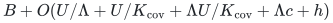

is <code class="math">O(t^6h)=O(U^{6/7}h^{1/7})</code>. The finite-bit and
small-instance conditions are compatible with this choice.

This verifies the local pool's proposed quantitative transfer once
the explicit conventions above are adopted. The final Gomory--Hu
claim continues to depend on its separately audited packing,
fixed-<code class="math">k</code> tree-mincut, and sparsifier adapters. The relevant public
comparison is now the derived <code class="math">8/9</code> bound in
[public-forest-direct-vertex-inventory.md](public-forest-direct-vertex-inventory.md); comparing only against
the older <code class="math">10/11</code> reconstruction would be incomplete.

## 9. Final comparison with the no-reset implementation

I independently reread Sections 3, 11, and 13 of
[decremental strong forest proof](../../problems/decremental-strong-forest/proof.md) against the retained source
and component wrapper. These final conventions pass the focused audit.

The small-component activation rule is sufficient. Before its first
native edit or forced promotion, an initially small component has
its entire initial spanning tree in each stable forest, with the
common root prescribed in
[disconnected-component-backend-wrapper.md](disconnected-component-backend-wrapper.md),
Section 2. These trees may differ between weighted calls; their
common root and componentwise fixed-label construction are what
matter. Every core edge there is a loop. Activating the component
therefore exposes one old root per core, followed only by the
charged new-root transcript. An anchor promotion is explicitly an
activation even when its anchor equals that existing root. This
avoids a missing child handle without forwarding all initially
isolated private roots. Untouched small components use their exact
local tables; their vertices remain present in full pool accounting.

For cover ghosts I checked the literal primary text of KMG
Definition 5.2, printed pages 46--47 (local source lines 2725--2740).
Its first condition says that a cover only loses vertices after
birth. Its third condition bounds, over all times, the number of
cover identities whose expanded ball contains a given vertex.
Every member of a cover's birth vertex set was in that expanded
ball at birth. Hence retaining its one isolated native identity
after it leaves the active cover is charged to a historically
counted cover owner. This argument genuinely uses historical
overlap; a bound only on current memberships would not suffice.
The final implementation retains at most one native name per
parent physical vertex in a private period, and retires the old
private period before publishing its replacement. Thus neither
reactivation nor rebuilding creates an unbounded simultaneous
ghost multiplicity. Finite diameter is required only for active
canonical vertices, which are in the anchor component.

The recurrence also retains the late initialization credit in the
form <code class="math">(P_j/k)(J_{j+1}+T_{j+1})</code>. The full pools use the actual
parent vertex inventory, including ghosts; virtual-key inventory
per core is bounded by the parent forest size. No additional
factor of the selected-output allowance is needed to initialize
every virtual key. The bounds <code class="math">c=O(d^2h+h)</code>, the displayed
<code class="math">B</code>, and the <code class="math">6/7</code> substitution therefore agree with the
complete no-reset manuscript under its named source interfaces.
