# Which mechanisms improve the strong-forest exponent?

**Root source and parameter reconstruction, 25 October 2026.**
This note strengthens the public comparison to the research strong
decremental SSSP forest. It separates the static provider, local repair
loss, growth of recursive graph degrees, and the outer copy analysis.
It records attainable bounds for specified constructions, rather than
a claim to have optimized every public algorithm.

**Subsequent direct-inventory improvement.** The strongest reconstruction
now using only public provider and forest constructions has total work
<!-- math-display: f23e480e55e16f8ae6a6ad5b
(m+n)\exp O(U^{8/9}h^{1/9}),
 \qquad U=\log(N+4),\quad h=\log(U+4).                       \tag{1}
-->
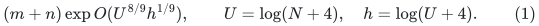
It is a new parameter analysis of public ingredients, not a printed
theorem. The checkpoint E research <code class="math">6/7</code> construction is faster;
the earlier <code class="math">7/8</code> construction is retained below for comparison.
The complete source reconstruction and independent review are in
[public-forest-direct-vertex-inventory.md](public-forest-direct-vertex-inventory.md). Sections 2 and 4 below
retain the valid but weaker intermediate <code class="math">10/11</code> calculation so that
the provenance of earlier comparisons is explicit. Section 7 gives
the stronger current accounting; comparisons must use it.

## 1. Source and interface status

[public-strong-forest-joint-retuning-audit.md](public-strong-forest-joint-retuning-audit.md) and its two focused
audits establish the public local ingredients: selected-degree
control distinct from split-edit count, actual copy initialization,
fixed canonical marks through cuts and rebuilds, and the forced-anchor
diameter proof. The source is
[KMG23](https://arxiv.org/pdf/2311.06402v1), Sections 3--5.
The joint static-provider reconstruction is in
[public-apsp-joint-retuning-audit.md](public-apsp-joint-retuning-audit.md).

This note uses those completed interfaces with a separated reading
of KMG's outer construction. It does not require the new sequential
router, normalized ambient repair, typed-null port lift, or any
proposed compressed-Steiner pool lift.

The intended output is an explicit flat forest with fixed canonical
nodes, original-edge embeddings, bounded vertex and edge congestion,
and <code class="math">(1+\varepsilon)</code> source distances. The input is an arbitrary
undirected graph with positive polynomial-range integer lengths.
Constant or inverse-polylogarithmic accuracy is allowed. The
maintenance bound is amortized total work, not a new worst-case
update guarantee.

## 2. Public local accounting

Let <code class="math">q,r</code> be the public path and cut-player parameters and <code class="math">K</code>
the local repair depth. Put
<!-- math-display: cd9f0559e631df5e78ba7c74
g=O(qrh),\qquad
 f=O(U/q+U/r+r^2h+q^2rh),\qquad
 z=O(U/K+g+h).                                             \tag{2}
-->
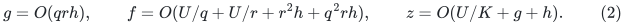
Here <code class="math">e^g</code> is the local output quality, <code class="math">e^f</code> is static work,
and <code class="math">e^z</code> bounds selected records. The public ambient-length
loss is retained, so local repair work can contain <code class="math">e^{O(K^2g)}</code>.

Let <code class="math">k=e^x</code>, and let <code class="math">d=O(U/x)</code> be the vertex-reduction depth.
Using the original hierarchy, whose recursive graph degrees grow,
the checked conservative envelopes are
<!-- math-display: f60a08ad0d2c8051cb42b6e9
\begin{aligned}
 a&=O(dKg+dh),\\
 c&=O(d^2z+dh),\\
 B&=O(x+f+K^2g+d^2z+h).
 \end{aligned}                                             \tag{3}
-->
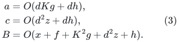
They bound, respectively, logarithmic metric distortion,
logarithmic flat-forest vertex congestion, and logarithmic work
including explicit recourse. The fixed-map completion is essential
to use them separately.

## 3. Why outer copies depend on congestion, not all local work

Write <code class="math">K_{\rm cov}</code> for the cover parameter and <code class="math">\Lambda</code> for
the hopset scale depth. KMG's cover and ball constructions require
<!-- math-display: 7130fc781d96a057ce502f9e
K_{\rm cov}\Lambda(a+O(h))\le c_0U.        \tag{4}
-->
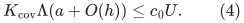
Their cover overlap has logarithm <code class="math">O(U/K_{\rm cov}+h)</code>.

The relevant source locations are Algorithm 10 and Claims
5.15--5.17. The copy capacity at one flattening level obeys
<!-- math-display: 256c0e8d69d3ea9ed8719377
A_i\le(1+\Delta^2+\Delta e^c)A_{i+1}.                     \tag{5}
-->
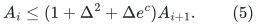
The terms count already present vertices, approximate-ball copies,
and low-diameter forest copies. They count vertex occurrences.
They do not count the arithmetic work used to construct one copy.

The maintenance paragraph preceding Claim 5.15 states that each
explicit change to a local ball or low-diameter forest becomes one
change in the stitched object. It is then forwarded to its
preallocated copies and through the lower levels. A local forest's
whole update algorithm is not restarted at each flattening level.
Its stable canonical maps are what make this forwarding valid.

Consequently the total logarithmic work and final explicit recourse
are bounded by
<!-- math-display: b21f5ef6de5e04af968d615d
Z=O\!\left(
 B+U/\Lambda+U/K_{\rm cov}
   +\Lambda U/K_{\rm cov}+\Lambda c+h\right).               \tag{6}
-->
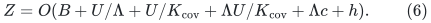
This is the same separated source accounting proved in Section 8
of [separated-metric-forest-and-strong-sssp.md](separated-metric-forest-and-strong-sssp.md), now applied to
the public local factors (3). In particular, (6) does not assume
that the low-diameter forest's own recourse is as small as <code class="math">e^c</code>.
That recourse is paid in <code class="math">e^B</code> before multiplication by (5).

## 4. The fully public <code class="math">10/11</code> point

Choose rounded parameters with sufficiently small or large fixed
constants where required:
<!-- math-display: 8d9a2e3d7fc30512ecf2a4c3
\begin{gathered}
 t=(U/h)^{1/11},\quad q=r=\Theta(t),\quad
 x=\Theta(U/t),\quad d=O(t),\\
 K=\Theta(t^4),\quad
 K_{\rm cov}=\Theta(t^2),\quad \Lambda=\Theta(t).
 \end{gathered}                                             \tag{7}
-->
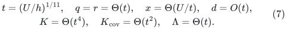
Writing <code class="math">U=t^{11}h</code> for the exponent calculation gives
<!-- math-display: bc8dd0f183c95b17e5d58325
\begin{array}{c|c}
 \text{charged factor} & \text{logarithmic bound}\\ \hline
 g & O(t^2h)\\
 f & O(t^{10}h+t^3h)\\
 z & O(t^7h)\\
 K^2g & O(t^{10}h)\\
 a & O(t^7h)\\
 c & O(t^9h)\\
 B & O(t^{10}h)\\
 U/\Lambda,\ \Lambda U/K_{\rm cov},\ \Lambda c
       & O(t^{10}h)
 \end{array}
-->
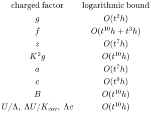
The cover product in (4) is <code class="math">O(t^{10}h)=o(U)</code>, so it has
slack. Formula (6) gives the displayed <code class="math">O(t^{10}h)</code> work envelope.

This calculation proves the weaker
<code class="math">(m+n)\exp O(U^{10/11}h^{1/11})</code> bound. The direct-inventory
improvement to (1) is in Section 7.

The small-instance provider cutoff <code class="math">q^2rh=O(t^3h)</code> is below
the nonbase scale <code class="math">x=\Theta(t^{10}h)</code>. The local repair is
justified by its rederived recurrence, not by substituting into
the old fixed-parameter packaged theorem. At the last nonbase
level, choose the fixed constant in <code class="math">x</code> large enough to cover
the fixed constants multiplying <code class="math">K^2g</code>. The exact smaller base
then costs <code class="math">e^{O(x)}</code>, which is already charged.

The earlier common-factor reconstruction yields <code class="math">26/27</code> because
it puts <code class="math">B</code> in place of both <code class="math">a</code> and <code class="math">c</code>. It remains a valid
but weaker comparison. The source distinctions above explain
why its further improvement is legitimate.

## 5. Other established combinations

The research static provider has
<!-- math-display: 3e5549360be3af8601af5b9f
g_{\rm new}=O((p+r)h),\qquad
       f_{\rm new}=O(U/p+U/r+r^2h+(p+r)h).                  \tag{8}
-->
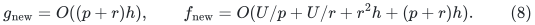
Its normalized repair permits <code class="math">Kg</code> instead of <code class="math">K^2g</code> in
local work. The already proved degree-reset and flat-lift
construction changes <code class="math">d^2z</code> in (3) to <code class="math">dz</code>.

The following parameter choices give useful mechanism comparisons.
Only the first row uses public constructions throughout.

| Static provider | Repair work term | Forest degree treatment | Leading power of <code class="math">U</code> in <code class="math">Z</code> |
|---|---|---|---:|
| Public <code class="math">g=O(qrh)</code> | <code class="math">K^2g</code> | Original degree growth | <code class="math">10/11</code> |
| Research <code class="math">g=O((p+r)h)</code> | Conservative <code class="math">K^2g</code> | Original degree growth | <code class="math">9/10</code> |
| Research | Normalized <code class="math">Kg</code> | Original degree growth | <code class="math">8/9</code> |
| Public | <code class="math">K^2g</code> | Research degree reset and flat lift | <code class="math">8/9</code> |
| Research | Conservative <code class="math">K^2g</code> | Research degree reset and flat lift | <code class="math">7/8</code> |
| Research | Normalized <code class="math">Kg</code> | Research degree reset and flat lift | <code class="math">7/8</code> |

Each listed power <code class="math">b</code> has the factor <code class="math">h^{1-b}</code> in the
balanced logarithmic envelope. For original degree growth take
<code class="math">d=\Lambda=p=r=q=t</code>, as applicable, <code class="math">K=t^4</code>, and
<code class="math">K_{\rm cov}=t^2</code>. For the reset rows take <code class="math">K=t^3</code>
instead. Set <code class="math">U=t^{1/(1-b)}h</code> and <code class="math">x=\Theta(U/t)</code>.
Direct substitution into (2)--(6), or their checked reset
versions, gives every row.

The conservative repair rows merely weaken an available stronger
interface; they do not require a new primitive. The normalized
repair is important for other results, including the best
unrestricted matching bound. This table only shows that it is
not the binding charge at the displayed reset strong-forest point.

## 6. A limited algebraic obstruction

For orientation, <code class="math">10/11</code> cannot be improved just by changing
uniform parameters in the positive budget used in the first row.
This is an accounting statement, not an algorithmic lower bound.

If all positive terms in (6) are bounded by <code class="math">Z</code>, then
<code class="math">q,r,d,\Lambda\gtrsim U/Z</code>. The term
<code class="math">\Lambda d^2U/K</code> forces <code class="math">K\gtrsim U^4/Z^4</code>.
The local repair charge then gives
<!-- math-display: be2d87a9d5a249769a65ef6d
Z\gtrsim K^2qrh\gtrsim U^{10}h/Z^{10},
 \qquad\text{hence}\qquad Z^{11}\gtrsim U^{10}h.
-->
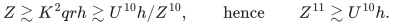
An improvement needs a change to a charged interface or analysis.
Section 7 supplies such a change to the public occurrence analysis.
A proposed new pool lift is being investigated separately; no
unproved pool-lift exponent is included in the table above.

## 7. The stronger public direct-vertex inventory

Algorithm 5 allocates a separate root-tree copy for each incoming
forest node. Its printed edge-congestion-times-degree factor is used
only to upper-bound the number of those nodes. Instead maintain their
number directly: at most <code class="math">C</code> incoming nodes per child-native vertex,
including isolated nodes and unused copies.

Every physical parent vertex belongs to exactly one component of
each stable core forest. Thus <code class="math">C</code> root-tree slots contain at most
<code class="math">C\mathrm{poly}(U)</code> copies of that vertex. For a fixed
child edge, its occurrences lie between two fibers containing at
most <code class="math">2C</code> nodes altogether. They are a subgraph of a forest and
therefore number at most <code class="math">2C-1</code>. A native physical edge has only
polynomially many distinct core aliases. Its edge occurrence is
also <code class="math">C\mathrm{poly}(U)</code>.

This is the existing public copy construction. High native degree
still affects local work and explicit recourse, but it no longer
multiplies simultaneous node inventory. The full root-split,
identifier, unused-copy, and parallel-edge proof is in
[public-forest-direct-vertex-inventory.md](public-forest-direct-vertex-inventory.md).

Consequently the improved public envelopes are
<!-- math-display: a59d89309d793190c027307e
a=O(dKg+dh),\qquad c=O(dh),\qquad
 B=O(x+f+K^2g+d^2z+d^2h+h).                              \tag{9}
-->
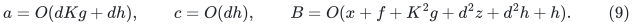
Use the unchanged outer formulas (4)--(6). Set
<!-- math-display: 70a7e10ad9aad355080a8014
q=r=d=\Lambda=\Theta(t),\quad K=\Theta(t^3),\quad
 K_{\rm cov}=\Theta(t^2),\quad x=\Theta(U/t),\quad
 U=t^9h.
-->
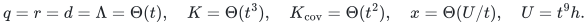
Then <code class="math">g=O(t^2h)</code>, <code class="math">z=O(t^6h)</code>, <code class="math">a=O(t^6h)</code>,
<code class="math">c=O(th)</code>, and <code class="math">B=O(t^8h)</code>. The cover product is
<code class="math">O(t^9h)</code>; fixed constants make it at most <code class="math">c_0U</code>.
The outer work is <code class="math">O(t^8h)</code>, proving (1).

With the research static provider but the same unreset public
forest-copy construction, put <code class="math">U=t^8h</code>, <code class="math">p=r=d=\Lambda=t</code>,
<code class="math">K=t^3</code>, and <code class="math">K_{\rm cov}=t^2</code>. Then <code class="math">g=O(th)</code>,
<code class="math">a=O(t^5h)</code>, <code class="math">B=O(t^7h)</code>, and the cover product is
<code class="math">O(t^8h)</code>. This recovers <code class="math">7/8</code> even without the previous
degree-reset forest lift; either conservative or normalized repair
fits the same envelope.

| Static provider | Child and lift construction | Current established power |
|---|---|---:|
| Public | Original core graph, direct vertex-copy inventory | <code class="math">8/9</code> |
| Research | Original core graph, direct vertex-copy inventory | <code class="math">7/8</code> |
| Research | Earlier degree-reset flat lift | <code class="math">7/8</code> |
| Public | New uncontracted compressed child and colored pools | <code class="math">7/8</code> |
| Research | New uncontracted compressed child and colored pools | <code class="math">6/7</code> |

The compressed-core colored-pool construction changes the child graph
as well as occurrence accounting. Its preferred implementation uses no
recursive port reset. Its complete proof and two independent reviews
are now recorded in [decremental strong forest proof](../../problems/decremental-strong-forest/proof.md),
[compressed-steiner-pool-independent-audit.md](compressed-steiner-pool-independent-audit.md), and
[steiner-pool-metric-inventory-focused-audit.md](steiner-pool-metric-inventory-focused-audit.md). The public-provider
row with that new wrapper is an ablation, not a pure public baseline.

### Restricted uniform budget obstruction for the public row

In (9), bounding every positive work term by <code class="math">Z</code> implies
<code class="math">q,r,d\gtrsim U/Z</code>. The old degree-growth term
<code class="math">d^2U/K</code> forces <code class="math">K\gtrsim U^3/Z^3</code>. Its conservative repair
term gives
<!-- math-display: 80f17d951087e8a3bde618c3
Z\gtrsim K^2qrh\gtrsim U^8h/Z^8,
 \qquad Z^9\gtrsim U^8h.
-->
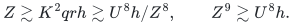
This explains the <code class="math">8/9</code> balance within this uniform positive-budget
model. It is not a lower bound for public algorithms or for matching.
