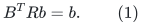
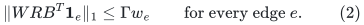
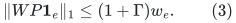
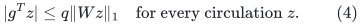
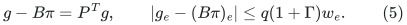
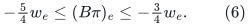
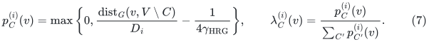

# Topological ordering: a valid transpose reduction and its missing interface

**Exploration boundary, 25 October 2026.** The logarithmic SCC client
gives a clean existential topological certificate at LOW. It does not
yet give a maintained topological order. This note isolates one
sufficient constructive interface and explains why it cannot simply
be imported from the public oblivious-routing analysis.

## 1. The distinction in the public baseline

CKLMP24, arXiv:2311.18295v1, Section 1.2 explicitly separates its
almost-linear incremental SCC result from incremental topological
ordering, which its techniques do not provide. The later
prediction-based ordering paper, arXiv:2402.11028v1, Section 1, makes
the same distinction. The 2026 SCC prediction paper,
arXiv:2604.26062v1, Section 1.1, still describes the IPM SCC guarantee
as not maintaining a topological order. Predictions and offline
reversal do not establish an unrestricted online ordering bound.

Primary sources:

* <https://arxiv.org/html/2311.18295v1>
* <https://arxiv.org/html/2402.11028v1>
* <https://arxiv.org/html/2604.26062v1>
* <https://arxiv.org/abs/1112.0784>

The source comparison identifies the randomized sparse bound
<code class="math">\widetilde O(m^{4/3})</code> and deterministic dense bound
<code class="math">O(n^2\log n)</code> for ordering. Bender--Fineman--Gilbert--Tarjan,
arXiv:1112.0784, also gives the deterministic sparse bound
<code class="math">O(m\min\{m^{1/2},n^{2/3}\})</code>. This note does not claim a new
ordering algorithm or an exhaustive new optimization of those older
ordering-specific tradeoffs.

## 2. A sufficient oblivious-routing interface

Let <code class="math">B\in\mathbb R^{E\times V}</code> be the head-minus-tail incidence
matrix of the current quotient. Let <code class="math">W</code> be the positive edge-weight
diagonal matrix, and let <code class="math">R\in\mathbb R^{E\times V}</code> be an
oblivious routing operator. On balanced demands within each connected
component, require

<!-- math-display: f7a87571689d2f42fd1c4c9a
B^T Rb=b.
\tag{1}
-->

Assume the edge-demand routing bound

<!-- math-display: 3e12afd24b91036373395577
\|W R B^T\mathbf1_e\|_1\leq\Gamma w_e
\qquad\text{for every edge }e.
\tag{2}
-->

The cycle projection is <code class="math">P=I-RB^T</code>. Equation (1) implies that
<code class="math">P\mathbf1_e</code> is an exact circulation, while (2) gives

<!-- math-display: f68f6a4b18f715db41c8dad5
\|WP\mathbf1_e\|_1\leq(1+\Gamma)w_e.
\tag{3}
-->

Suppose a strengthened LOW statement guarantees

<!-- math-display: 16828a28474556854a33a129
|g^Tz|\leq q\|Wz\|_1
\quad\text{for every circulation }z.
\tag{4}
-->

Set <code class="math">\pi=R^Tg</code>. Then

<!-- math-display: 5eea7916fa36af18e4c2e392
g-B\pi=P^Tg,
\qquad
|g_e-(B\pi)_e|
 \leq q(1+\Gamma)w_e.
\tag{5}
-->

For the SCC/logarithmic client, <code class="math">g=-w</code>. Taking
<code class="math">q\leq1/[4(1+\Gamma)]</code> yields

<!-- math-display: d6a8d613b91f5a00df36ad17
-\tfrac54w_e\leq(B\pi)_e\leq-\tfrac34w_e.
\tag{6}
-->

Therefore the scalar key <code class="math">-\pi(v)</code> strictly increases along every
quotient edge. Ties between incomparable vertices can be broken by
vertex identity. This is a correct topological ordering certificate.

If a dynamic structure supplied both (1)--(2) with
<code class="math">\Gamma=E(N)^{O(1)}</code>, and point queries for <code class="math">R^Tg</code> after gradient
or graph changes at the same fixed-power overhead, the stronger
accuracy in (4) would be affordable. It would shrink the SCC client's
per-step progress parameter by at most another fixed power of <code class="math">E</code>,
so its total time would remain <code class="math">(n+m)E^{O(1)}\mathrm{polylog}N</code>.
This would give an **implicit** order: comparison would evaluate two
current scalar keys. Maintaining an explicit sorted list with all
key-change notifications would require a further argument.

## 3. Why the public HRG theorem does not supply that interface

The obstacle is concrete, not a defect in (5). CKLMP24 Section 4.2
maintains the *support* hierarchical routing graph (HRG), while
explicitly omitting the routing-path distribution. Its Section 4.3
defines that distribution for analysis using

<!-- math-display: 51501ba7f3f34a20866cc1fd
p_C^{(i)}(v)=
\max\left\{0,
 \frac{\mathrm{dist}_G(v,V\setminus C)}{D_i}
 -\frac1{4\gamma_{\rm HRG}}\right\},
\qquad
\lambda_C^{(i)}(v)=
 \frac{p_C^{(i)}(v)}{\sum_{C'}p_{C'}^{(i)}(v)}.
\tag{7}
-->

See its Definition 4.12. Definition 4.13 then uses products of these
vertex-dependent coefficients for monotone routing paths. The relevant
distances to cluster complements are not maintained by the exposed
dynamic HRG interface. The min-ratio-cycle algorithm bypasses the need
to compute them by proving that a small maintained tree family captures
a suitable cycle.

Consequently, maintaining all HRG trees and root gradient path sums
does not by itself make <code class="math">R^Tg</code> evaluable. The missing coefficients
can depend on many current graph distances. Neither an existential
oblivious routing nor a support graph of its paths is an executable
transpose oracle.

The current four-fifths distance-oracle raw backend likewise exposes
minimum-ratio-cycle and raw-lift operations, rather than the operator
<code class="math">R</code> required in (1)--(2). A proof of such an additional operator
interface would be new work. It cannot be treated as an already paid
side effect of the raw-cycle engine.

The earlier checkpoint's own
[hrg-routing-from-rounded-covers.md](hrg-routing-from-rounded-covers.md) makes the same
boundary explicit: its clipped routing distributions prove an
analytical operator-norm bound, but are not computed by the maintained
algorithm. Its Section 5 therefore cannot be used as a hidden
transpose implementation either.

## 4. Two shortcuts that do not close the gap

First, choose a spanning tree and assign vertex values by integrating
<code class="math">g</code> along its paths. For an edge <code class="math">e</code>, the resulting residual is
the gradient of its fundamental cycle. Equation (4) then bounds that
residual by <code class="math">q</code> times the entire weighted tree-cycle length. A
single arbitrary spanning tree may have polynomial worst-case stretch.
Making <code class="math">q</code> inversely polynomial to compensate would lose the
almost-linear total bound. A low average stretch guarantee does not
give the per-edge sign in (6).

Second, recover a feasible potential by static negative-cycle or
shortest-path computation at each LOW state. This does produce a
valid order, but an explicit scan of the current graph after every
insertion can cost quadratic total time. A static constructive duality
proof is therefore not the needed dynamic implementation.

Approximate distances to complements also require care. Replacing the
weights in (7) by arbitrary factor approximations need not retain the
Lipschitz variation across a short edge that proves oblivious-routing
quality. A compressed undirected subset-distance gadget with a large
additive offset cannot be used with a coarse multiplicative distance
oracle by subtracting that offset: its approximation error may exceed
the entire desired boundary distance.

## 5. Current status

The one-sided logarithmic SCC client is fully formulated separately.
The transpose implication (1)--(6) is algebraically sound and gives a
precise sufficient next target. The dynamic coefficient/transpose
interface remains unproved. No incremental topological-order theorem
is included in the current checkpoint on the basis of this argument.
