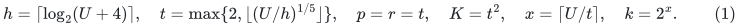
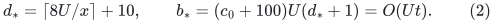
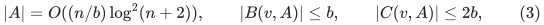
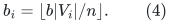
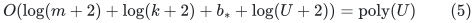
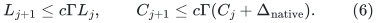
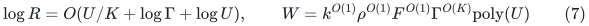
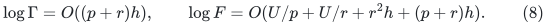
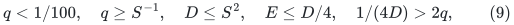

# Uniform source interfaces for the 4/5 composition

**Mathematical interface note, 24 October 2026.** This note specifies the
source algorithms used by the current
[4/5 composition](quantitative-matching-4-5-composition.md), with growing
parameters and finite arithmetic. It does not infer running time from the
final matching verifier. The construction remains a research proof assembly;
the named constructive source primitives and the linked replacement proofs
are its dependencies.

The main distinction is between the elementary forest and projection
interfaces that are retained from the distance sources and their complete
dynamic-spanner theorems, which are replaced. Substituting the new parameters
directly into those complete old theorems would be invalid.

## 1. Parameters and the scope of a local invocation

Use the notation of the main composition:

<!-- math-display: 7e14035c725db1937ea773de
h=\lceil\log_2(U+4)\rceil,\quad
 t=\max\{2,\lfloor(U/h)^{1/5}\rfloor\},\quad
 p=r=t,\quad K=t^2,\quad x=\lceil U/t\rceil,\quad k=2^x.
 \tag{1}
-->

Here p controls the explicit sequential routing construction, r controls
the deterministic balanced-cut primitive, K is the number of touched-set
repair layers, and k is the recursive size-reduction factor. They are
different algorithmic parameters. Every use below allows the actual
integer supplied to the algorithm to grow; its constant polynomial degrees
are not selected after observing that integer.

At a nonbase numerical level the parent graph has maximum degree three.
An actual local graph has resident size m, including its counted isolated
slots and within-period history, and positive integral lengths of at most
b_* bits. With the declared depth bound d_*,

<!-- math-display: b234e4413684c801219f8d2e
d_*=\lceil8U/x\rceil+10,
 \qquad b_*=(c_0+100)U(d_*+1)=O(Ut).
 \tag{2}
-->

The master bound U is used for counters, caps and integer arithmetic. It
does not authorize initializing a graph with 2^U vertices when its actual
input is smaller. Tiny active instances use the explicit small-graph ratio
solver. Retained inactive child port trees are actual resident records;
private, never-inserted activation records are not graph vertices.

The local constants may depend on a fixed implementation choice and a
fixed portfolio index. They must not depend on p, r, K, d_* or U.

## 2. A safe deterministic center interface

KMPG [1, Theorem 3.2 and Appendix A.1] uses a deterministic hitting-set
construction for centers. The final count actually derived in that appendix
is sufficient here, without relying on its tighter displayed logarithmic
factor. On a constant-degree graph, for an integer b, the safe interface is

<!-- math-display: 45901cd405f029efe1d2383b
|A|=O((n/b)\log^2(n+2)),\qquad
 |B(v,A)|\le b,\qquad |C(v,A)|\le2b,
 \tag{3}
-->

with actual work O(nb polylog(n+2)). Components smaller than b receive one
local center, as specified in the disconnected-component wrapper.

Here is the construction underlying (3). For every vertex form its b nearest
vertices, with deterministic consistent tie handling. A greedy hitting set
of these lists has size O((n/b)log(n+2)); each resulting strict ball is
contained in its initial list. The sum of inverse-cluster sizes is at most
nb. If V_i consists of vertices whose clusters are still larger than 2b,
and |V_i|>n/b, put

<!-- math-display: 945e10a4515206ee2e421ce6
b_i=\lfloor b|V_i|/n\rfloor.
 \tag{4}
-->

For each initial nearest-vertex list retain its first b_i members in V_i,
when there are that many, and hit all these sublists. This adds at most
O((n/b)log(n+2)) centers. The sum of new cluster sizes over V_i is at most
nb_i, so at least half of V_i now has cluster size at most 2b. If
|V_i|<=n/b, add V_i itself and terminate. Balls and clusters shrink when
centers are added, so previously settled vertices stay settled. There are
O(log(n+2)) rounds, proving (3).

Take b=k in the local backend. The resulting center count is
O(m poly(U)/k), and the ball and inverse-cluster sizes are
k poly(U). These are the bounds actually used by the path inventory and
selected-size accounting. The extra logarithms therefore change only the
common polynomial factor A=poly(U). There is no hidden k power in the
number of centers.

The KMPG appendix prints some inclusion directions opposite to the
monotonicity used in its proof; the required direction is simply
B(v,A union A') subseteq B(v,A), and likewise for inverse clusters. The
argument above uses that direction explicitly.

Every initial small component has a genuine common local center. Newborn
isolated vertices are their own centers. Before an edge update, promote its
endpoints. Positive lengths imply that a shortest strict-ball path or
nearest-center leg cannot use a newly inserted edge: it would first reach
an already promoted endpoint. The corresponding surviving paths are drawn
from the initial inventory. The direct generating middle edge is treated
separately, including all initial singleton edges and label-one new edges.

## 3. Deterministic stable forests and length precision

The imported stable forest is KMPG [1, Lemma 3.5], constructed from CKL
[2, Lemma 6.5 and Appendix B.3]. It is a deterministic forest procedure.
It is not CKL's later randomized sampling of trees in Lemma 7.5.

For a degree-three parent, its cost per native update is
k poly(log m, b_*), its root/forest-cut recourse is poly(log m), and a
surviving component has k poly(U) incident parent records. The operations
used are edge insertion, edge deletion, isolated-vertex insertion, and
explicit deletion of a forest edge. Forest edges only disappear; roots
only become more numerous. A parent price replacement is deletion followed
by insertion, so no unsupported length-decrease operation is assumed.

The initial component-count statement needs the separate
[disconnected-component wrapper](disconnected-component-backend-wrapper.md).
Many small connected components cannot share O(m/k) roots. Their whole-tree
initializations and common roots are retained in parent storage and physical
pool counts, while only endpoints of selected nonloop child edges become
recursive input vertices. Empty logical loop routes keep endpoint annotations
and their native IDs. A forest cut can awaken many loops, but remains a native
split in the local repair construction. It is not converted into k newly born
input IDs.

The weighted low-stretch primitive has no p, r or K parameter. CKL's static
tree interface is based on Abraham--Neiman [3], whose weighted construction
uses contracted scales and event-based shortest paths, rather than expanding
a length-L edge into L unit edges. Its deterministic algorithmic use is
also explicitly identified in CGLNPS [4, Section 6.5, the discussion
following Lemma 6.18].

For an explicit finite-bit implementation, use
[the AN petal-tree adapter](an-weighted-finite-bit-adapter.md).
It retains the weighted radius/highway geometry, omits short-edge
contractions, and accepts stretch poly(B), where B=b_*+log(m+2).
Its coarse region-growth test has an integer logarithmic bound; its
private Dijkstra metric is fixed throughout each petal. Geodesic portals
use a common dyadic grid with only a fixed number of new denominator
bits per recursion depth. The depth is O(B), and the actual work is
(m+n) poly(B) BIT operations. Original-edge capacities, compressed
pendant extensions and the explicit portal inventory exclude both
numeric-length stepping and a factor 2^{b_*}.

Only the resulting original-edge tree is exported. The temporary grids
never become numerical edge labels. In this version gamma_eff may be
poly(B), rather than polylog(m) independent of b_*. Since B=poly(U), this
changes only fixed polynomial factors in the current envelopes.

[The stable-forest integration lemma](polynomial-bit-stretch-stable-forest-integration.md)
proves the required acyclic bit induction explicitly. An exported core
label is bounded by O(n log^2(n+2)) times the largest original parent
length, independently of the tree's stretch factor. Thus stored bits
grow additively by O(U) per distance level, while poly(B) is charged
only as fixed polynomial work and comparison factors. Frozen gradients
use lifetime magnitude bounds, not just their current smaller values.

For completeness, the actual finite-bit forest implementation uses the
following conventions, proved in the disconnected wrapper.

* The initial path weights are integer occurrence counts times integer
  lengths. For a component with e edges and positive total W, use the
  positive integer weights v_f=e w_f+W. Their sum is 2eW, and the replica
  counts ceil(e v_f/sum v) create at most 2e copies. If W=0 use a uniform
  positive call; an edgeless component is a singleton tree.
* CKL's reciprocal-congestion ordering is computed with
  2^{-ceil(log_2 ell_f)}. It has one common power-of-two denominator of
  b_* bits and differs from the true reciprocal by at most a factor two.
  CKL's fixed-label domination uses any fixed total order; its weighted-sum
  bound changes only by a fixed constant under this proxy.
* Store the product ell_f times the fixed stretch label directly. CKL's
  equation (56) expresses it as twice a sum of integer edge and tree-path
  lengths. No least common multiple of all lengths is formed.
* Positive-weight smoothing and the approximate ordering are incorporated
  into one effective polynomial-in-B stretch envelope gamma_eff. The
  weighted path-halving threshold is 2 gamma_eff, not the unmodified source
  constant.

Let P be the complete initial future-path inventory, including singleton
paths. Its cardinality and explicitly enumerated total edge count are
m k^{O(1)} poly(U); every path length is at most
k^{O(1)} poly(U) 2^{b_*}. Weighted halving therefore needs

<!-- math-display: 412c6721e00d9b52d52f9894
O(\log(m+2)+\log(k+2)+b_*+\log(U+2))
                       =\mathrm{poly}(U)
 \tag{5}
-->

forests. KMPG's original O(log m) display uses polynomial aspect ratio;
(5) is the actual bound used here. It remains a fixed polynomial, so it
does not become exponential in a growing parameter.

KMPG explicitly invokes deterministic tie handling for its unique-path
convention [1, Section 3, citing DI04]. The named deterministic forest
interface includes this convention. Random infinitesimal tie breaking is
not an executable step of this construction, and no long binary expansion
of independent random perturbations is supplied to the numerical client.
An explicit common-grid implementation is provided by
[the symbolic shortest-path tie lemma](deterministic-symbolic-shortest-path-ties.md),
including its sparse truncated-search interface. In the AN adapter a
frozen parent tree is subdivided in place, and a fresh root tree explicitly
fixes predecessors along its prescribed shortest highway; fresh ranks are
not assumed to preserve that inherited choice automatically.

## 4. What is and is not imported from the dynamic distance sources

The complete KMPG Theorem 3.1 imposes a restriction of the form
K=o(log(m)^{1/6}/log log(m)). The current K=t^2 in (1) generally violates
that restriction. Consequently neither that theorem nor its full
worst-case dynamic-spanner subroutine is invoked with the current K.
The specialized hierarchy depth of the complete DO26 theorem [5] is
likewise not a black box for the present growing-depth construction.

Instead, the retained ingredients are the center/path inventory, stable
forest, native core projection, elementary tree partitioning, and geometric
cycle comparisons. The following pieces are independently supplied by the
linked current constructions:

1. [The static-base repair](amortized-static-base-distance-sparsifier.md)
   maintains a sparse selected union using an integer touched-set clock,
   direct identity routes for current true edge births, and the new static
   provider. Its schedule universe is a counter, not a padded graph.
2. [Normalized projected routes](normalized-projected-route-composition.md)
   prove the actual recurrence for current route owners, including current
   endpoints of old empty routes and separately indexed central IDs.
3. Selected-incidence feedback and endpoint publication operate on the
   deduplicated selected graph. KMPG's FindSets [1, Theorem 3.8] is an
   elementary tree partition. Its scan costs a fixed polynomial in the
   local component size and selected degree, with no exponential K term.
4. [Degree-three resets](distance-degree-reset-candidate.md), exact frozen
   retained-edge gauges, and explicit root pools provide the recursive
   input and raw forest representation.

This replacement is essential: citing only the old final-spanner theorem
would not justify removing its K range or separating local route-maintenance
work from selected recourse.

Write Delta_native=k poly(U). At a repair, projected degree and preliminary
ambient congestion are both O(C_old+Delta_native). The normalized static
provider gives

<!-- math-display: 052fce60b2f3e60fc47b77e3
L_{j+1}\le c\Gamma L_j,\qquad
 C_{j+1}\le c\Gamma(C_j+\Delta_{\rm native}).
 \tag{6}
-->

Thus L_K<=Gamma^{O(K)} and
C_K<=k poly(U) Gamma^{O(K)}. Full route lists, inverse occurrence lists,
physical forest-leg inspections and score replacement are local work. Their
number of records and list lengths are bounded by fixed powers of these
quantities, giving Gamma^{O(K)}, not an unspecified exponential in K.
Only selected central native IDs and their true provenance changes are
published recursively. A changed correction route e-R(e) does not itself
change a selected edge's gradient or create a recursive input edge.

The integer scheduling ratio is rho=2^{ceil(8U/K)}. The elementary repair
proof yields selected degree/encoded recourse with

<!-- math-display: 6ed940e7d8836c8cac8ec043
\log R=O(U/K+\log\Gamma+\log U),
 \qquad
 W=k^{O(1)}\rho^{O(1)}F^{O(1)}\Gamma^{O(K)}\mathrm{poly}(U)
 \tag{7}
-->

for local work. Fixed powers in W include possible moved-incidence scans.
They do not multiply the child-update recurrence. Late spending of initial
selected-update credit is paid by the explicit J_child+T_child recurrence
in the main composition, rather than being declared free initialization.

## 5. Dependency and finite-work table

In this table all unqualified polynomial powers are fixed absolute powers.
The table concerns the current 4/5 path, not every historical alternative.

| Interface | Literal input and parameter scope | Work and inventory dependence used here | Arithmetic and randomness |
|---|---|---|---|
| Deterministic centers, KMPG Appendix A.1 | Actual constant-degree parent; integer b=k; small components handled separately | O(m k poly(U)) work; O(m poly(U)/k) large-component centers; balls/clusters k poly(U) | Integer-distance comparisons and deterministic ties; greedy hitting sets, no sampling |
| Stable forest, KMPG Lemma 3.5 / CKL Lemma 6.5 | Positive lengths, degree-three parent, explicit forest cuts and isolated births | Initialization m poly(U); per native edit k poly(U); poly(U) forest-cut recourse and forest count | Positive integer replicas, dyadic reciprocal proxy, fixed labels with poly(U) bits; no CKL Lemma 7.5 tree sampling |
| Degree-band decomposition, CGLNPS Theorem 5.1 plus loopless pruning construction | Unweighted actual multigraph after the stated loopless adapters; integer r clipped to the source's actual-size range | Work m exp O(U/r+r^2 h+r h); inverse conductance exp O(r h) | Deterministic cut algorithm and deterministic pruning; no randomized expander decomposition |
| Sequential expander router | Actual degree-split host; integer p; explicit leaf threshold and retained hierarchy | Preprocessing m exp O(U/p+p h+log(phi^{-1})); query mD exp O(p h+log(phi^{-1})) | Exact local spectral/moment work charged at fixed polynomial degree; random walks are analytical distributions, not sampled executions |
| Weighted ambient path selection | Supplied explicit candidate lists with immediate native IDs | Linear in occurrence inventory up to poly(U), with fixed powers of structural quality | Deterministic conditional expectations with certified positive arithmetic; no probability of success premise |
| Touched-set repair and feedback | Current native degree k poly(U); integer K and rho schedule; actual native splits | Equations (6)--(7); selected support O(Gamma times touched vertices); no old K^7 restriction | Explicit dictionaries and finite counters; no full old dynamic-spanner theorem at inadmissible K |
| Flat raw lift and degree reset | Degree-controlled selected graph; one stable port fiber per physical lifetime | Child size/recourse multiplied by a fixed power of R; occurrence pools multiplied by poly(U) times child occurrences | Frozen integer potentials; genuine-edge versus null-edge types; complete signed and absolute retirement |
| Priced numerical client | Master S=2^s, U=2s, backend cap E; D=pow2ceil(max(16,4E)), q=1/(16D) | MD+QD+D^2J, up to poly(s); local exact projection (P+1)D^4 poly(s) | Exact dyadic grids and integer prices; one mutable amortized tree history, separate persistent integral carrier |

The current static provider has

<!-- math-display: e872b97ad0f71a450040223f
\log\Gamma=O((p+r)h),\qquad
 \log F=O(U/p+U/r+r^2h+(p+r)h).
 \tag{8}
-->

The r^2 term is construction work. It is not inserted into selected size,
congestion or per-level quality. Conversely the complete quality loss
d_* K log Gamma is retained by the main proof. Omitting it would be a
different and unsupported composition.

For small actual decomposition calls, choose the largest legal r'<=r,
with a fixed-size deterministic base case. Since the source restriction is
linear in the actual logarithmic size, either r'=r or its polynomial input
factor has a constant exponent. Both fit the master work envelope, while
the smaller r' only improves the output's logarithmic conductance loss.
No hidden input-sized padding is used to satisfy a parameter inequality.

## 6. Numerical uniformity is a direct contract

[The decoupled numerical proof](decoupled-numerical-client.md) does not
evaluate an old fixed-a asymptotic theorem at a growing value of a. It proves
the priced-step inequalities using the directly supplied master cap E.
The actual assumptions are

<!-- math-display: e9c6466a4a5af9f0d245bd23
q<1/100,\quad q\ge S^{-1},\quad D\le S^2,
 \quad E\le D/4,\quad 1/(4D)>2q,
 \tag{9}
-->

plus the stated argument, precision, history and lifetime guards. With
D and q from the table, these hold eventually for every favorable fixed
constant tuple because E=S^{o(1)}. Failing a guard suspends that branch;
it does not return LOW.

Root prices depend on delta=S^{-1000}, epsilon=S^{-3000}, the fixed
argument envelope, and H_price=S^{100}; they are bounded by S^{1200}.
They do not depend on first choosing q. The structural root size is fixed
before selecting E,D,q, and repricing reuses endpoint ports. Thus the cap
does not feed back into its own root-size or price inputs.

The actual nominal size is pow2ceil(16(R+2)), using the local lifetime
allowance R. The old R+B<=S^{1+2/a}, M^{10/a} and divisibility-by-2a^2
conditions served only the superseded parameter packaging. The binary
ledger proof separately establishes its reset sum at a=s, B_ledger=2.

Every exposed dormant occurrence is still present in the coordinate's
signed and absolute motion lists. Retirement transfers both counters
before its old map expires. A backend query and the consumption or discard
of its returned path list form one atomic transaction; refresh flags raised
by representation churn are queued until afterward. The imported dynamic
tree's amortized history is never forked. The persistent allocation carrier
is a different structure with its own worst-case persistence argument.

Only external owner queries are Q in the displayed work bound. Failed and
LOW queries count. Internal refreshes contribute O(DJ) separately. This
gives MD+QD+D^2J and, after exact projection's step and service counts,
(P+1)D^4 poly(s). Exact near-feasible circulation rounding and residual
searches replace the older static-flow call; the 4/5 chain has no hidden
randomized or m^{1+o(1)} black-box max-flow dependency at that point.

Stored numerical labels satisfy (2). Local spectral tests and moment
computations may use larger temporary multiword integers; their fixed
polynomial bit work is explicitly in F. They are not exported as numerical
edge labels. Ordinary identifiers and route occurrence counters use their
actual finite record inventory, which is checked against the master guards.

## 7. Randomized source components that are excluded

The following replacements are part of the construction, not optional
derandomizations left to the implementation.

* CKL's sampled distribution of low-stretch trees is replaced by the
  deterministic weighted future-path halving family. Only its deterministic
  single-forest construction is imported.
* The randomized expander decomposition and sampled sparsifier in CKL's
  complete static routine are not imported. Degree bands use the deterministic
  balanced-cut and pruning route, and support selection uses explicit
  deterministic weighted path selection.
* The sequential router does not run a distributed randomized process or
  infer work from rounds. Its moment and walk distributions are evaluated
  by deterministic conditional expectations. Full temporary arithmetic and
  explicit path reconstruction are charged.
* The source half-matching entropy calculation at cut threshold 1/2 is
  replaced by the explicit threshold-at-most-1/8 lemma. The corrected weak
  success coverage is supplied by the separate cut-balance wrapper.
* The old full dynamic distance and spanner theorems are not invoked outside
  their parameter ranges. Native repair, feedback and selected recourse are
  established by the current static-base proof.

All canonical choices use fixed ID orders. No stage is justified only by
the existence of a favorable random seed. The final verifier has the
separate role of refusing incorrect proposed matchings; it supplies none of
these work, quality, precision or recourse bounds.

## 8. Consequence and exact boundary

With the constructive interfaces just stated, the retained source
dependencies introduce fixed polynomial factors in U, k, native degree
and route inventory, together with the explicitly displayed F, Gamma,
Gamma^{O(K)}, and recursive factors. They do not introduce a new hidden
exponent depending on p,r,K. This is the parameter-uniform implication
needed by the 4/5 calculation.

The claim remains conditional on executing the named deterministic
low-stretch and balanced-cut/pruning algorithms and on the linked new
router, normalization, dynamic repair and numerical proofs. It is not a
claim that the unmodified public distance theorem already proves the new
matching theorem. In particular, replacing the current static-base proof
by the old KMPG black box at K=t^2, dropping real-loop annotations, or
forgetting the aspect-dependent forest count (5) would invalidate this
interface statement.

## Primary sources

1. R. Kyng, S. Meierhans and M. Probst Gutenberg,
   [A Dynamic Shortest Paths Toolbox: Low-Congestion Vertex Sparsifiers
   and their Applications](https://arxiv.org/pdf/2311.06402v1).
   Section 2; Theorems 3.2 and 3.8; Lemmas 3.5 and 3.12; Appendix A.1.
2. L. Chen et al.,
   [Maximum Flow and Minimum-Cost Flow in Almost-Linear Time](https://arxiv.org/pdf/2203.00671v1).
   Theorem 3.2; Lemmas 6.5 and 6.6; Appendix B.3, especially equations
   (55)--(57) and Lemma B.9. Lemma 7.5 is the explicitly excluded sampling
   step.
3. I. Abraham and O. Neiman,
   [Using Petal-Decompositions to Build a Low Stretch Spanning Tree](https://www.microsoft.com/en-us/research/wp-content/uploads/2012/01/spanning-full1.pdf).
   Theorem 1 and Sections 6--7; journal version SIAM Journal on Computing
   48(2), 2019, DOI 10.1137/17M1115575.
4. J. Chuzhoy et al.,
   [A Deterministic Algorithm for Balanced Cut with Applications to
   Dynamic Connectivity, Flows, and Beyond](https://arxiv.org/pdf/1910.08025v2).
   Theorems 1.6 and 5.1, deterministic pruning interface in Theorem 2.6,
   and the deterministic low-stretch-tree discussion in Section 6.5.
5. [Distance-oracle cycle construction, arXiv:2609.23852v1](https://arxiv.org/pdf/2609.23852v1).
   The local forest/spanner alternatives and raw cycle comparison are
   reconstructed in the linked distance notes; its specialized complete
   hierarchy is not the growing-parameter black box used here.
6. [OpenAI matching source, Section 5](https://github.com/openai/math/tree/main/preprints/Almost-Linear-Time-Maximum-Cardinality-Matching-in-Sparse-General-Graphs-September-24-2026),
   with the explicit priced-step and decoupled-parameter proofs linked above.
