# A virtual-expander hierarchy with explicit terminal sets

**Separate reconstruction candidate, 24 October 2026.** This note addresses
one interface in the hierarchy discussed by Chang--Huang--Su,
[arXiv:2405.03908v1](https://arxiv.org/pdf/2405.03908), Appendix A.
It is independent of the threshold-routing construction and of the
5/6 matching composition.

The underlying source is Chang--Saranurak,
[arXiv:2007.14898v1](https://arxiv.org/pdf/2007.14898), Sections 4.1--4.3,
Appendix E.2, and Lemma C.9. That source distinguishes the union of
terminal sets from all vertices on their embedding paths. Its Lemma
C.9 proves expansion of the induced graph on the latter, larger set.
Expansion of the induced graph on the terminal union alone does not
follow. For example, two terminal vertices can be joined by an embedded
edge whose interior is outside the terminal set, while the induced
terminal graph has no edge.

The replacement below exports the explicit virtual graph used at the
start of the proof of Lemma C.9. It changes the ROOT type of the proposed
hierarchy. The root graph is a virtual expander with an explicit
embedding into the original graph, rather than an asserted induced
subgraph of that graph. Child graphs and the covering matchings are
literal subgraphs of their parent virtual graph.

This note proves the cut, balance, degree, and geometric-embedding
interfaces. It does not prove the complete CHS query algorithm or its
Task-2-to-Task-3 load reduction. It also does not by itself turn arbitrary
CONGEST round bounds into sequential work bounds. The source matching
and recursive cut procedures still require the separately audited
sequential implementation. The new local coarse-cut work here is
explicitly polynomial in the number of blocks.

## 1. A polynomial-work weighted coarse-cut primitive

Let a graph <code class="math">B</code> have <code class="math">b</code> vertices, positive integer vertex masses
<code class="math">w_i</code>, and nonnegative rational edge weights <code class="math">a_{ij}</code>. Parallel
weights may be summed. Assume

<!-- math-display: fdcbdf31979fa7e6dcc0bfcd
\sum_j a_{ij}\leq\Delta w_i,
                   \qquad \Delta\geq1.
 \tag{1}
-->
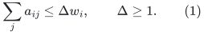

For a nontrivial cut define its mass sparsity by

<!-- math-display: f23b7e454b142b78bbf2bea4
\Psi_w(S)=
 \frac{a(S,\overline S)}{\min\{w(S),w(\overline S)\}}.
 \tag{2}
-->
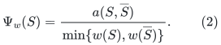

Given a rational <code class="math">0&lt;\eta\leq1</code>, there is a deterministic algorithm,
polynomial in <code class="math">b</code> and the input bit size, which returns either:

* a nonempty cut <code class="math">S</code> of mass at most half the total, with
  <code class="math">a(S,\overline S)\leq\eta w(S)</code>; or
* the certificate that every cut has mass sparsity at least
  <code class="math">\eta^2/(16\Delta)</code>.

The certificate can be a positive-semidefiniteness result; no
transcendental calculation or enumeration of all block subsets occurs.
For one vertex the second alternative is vacuous.

### 1.1 Exact rational spectral test

Let <code class="math">L</code> be the weighted Laplacian and <code class="math">W=\mathrm{diag}(w_i)</code>.
Set

<!-- math-display: 83ab4fa0dde061045d81dcfe
\theta=\eta^2/(8\Delta).
 \tag{3}
-->
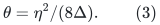

Construct a rational basis for the subspace
<code class="math">\sum_iw_i x_i=0</code>; for example eliminate the last coordinate
using its positive mass. Test positive semidefiniteness of
<code class="math">L-\theta W</code> on that subspace by exact symmetric elimination.
If it is positive semidefinite, every centered nonzero vector has
Rayleigh quotient at least <code class="math">\theta</code>.

For a cut <code class="math">S</code>, its centered indicator has Rayleigh quotient

<!-- math-display: 0a2d54e40e7416509eeaca70
a(S,\overline S)
       \left(\frac1{w(S)}+\frac1{w(\overline S)}\right)
 \leq 2\Psi_w(S).
 \tag{4}
-->
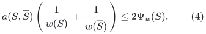

Therefore positive semidefiniteness implies
<code class="math">\Psi_w(S)\geq\theta/2</code> for all cuts, as required.

Otherwise exact symmetric elimination gives a rational centered vector
<code class="math">x\neq0</code> with

<!-- math-display: b2c166ab0a5dfbc37fc9199b
x^{\mathsf T}Lx<\theta x^{\mathsf T}Wx.
 \tag{5}
-->
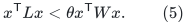

One implementation successively eliminates positive diagonal pivots.
A negative pivot supplies a negative vector. A zero diagonal with a
nonzero off-diagonal entry supplies a negative vector on those two
coordinates; a zero row can be removed. Back substitution produces
the full vector. Thus this is a finite rational algorithm. Fraction-free
elimination, or ordinary elimination with numerator/denominator reduction,
has polynomial bit complexity: all relevant values are ratios of minors
of a rational matrix whose dimension is <code class="math">b-1</code>, and determinant-size
bounds are polynomial in that dimension and its input bit size.

These are TEMPORARY LOCAL rational numbers. They can have
<code class="math">\mathrm{poly}(k,\log n,\log\psi^{-1})</code> bits, much more
than the numerical backend's length/gradient-label cap. Their full
multiword arithmetic is charged to the polynomial-block preprocessing
work. They are not exported as edge weights, gradients, route
coefficients, or numerical labels. The exported result of this step
is only a block subset or a Boolean expansion certificate; graph
edge IDs, vertex IDs, and explicit unweighted path lists retain
<code class="math">O(\mathrm{poly}(\log n+\log\psi^{-1}))</code>-bit records.

### 1.2 A weighted-median sweep

Choose a weighted median <code class="math">m</code> of the coordinates of <code class="math">x</code>. Put
<code class="math">y^+_i=\max\{x_i-m,0\}</code> and
<code class="math">y^-_i=\max\{m-x_i,0\}</code>. Each support has mass at most half
the total. Centering gives

<!-- math-display: e6fd9d4fdce1fe4843f216b2
\|x-m\mathbf1\|_W^2\geq\|x\|_W^2,
 \qquad
 (y^+)^{\mathsf T}Ly^+ +(y^-)^{\mathsf T}Ly^-
       \leq x^{\mathsf T}Lx.
 \tag{6}
-->
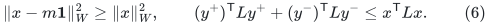

Hence one nonzero part <code class="math">y</code> has Rayleigh quotient below
<code class="math">\theta</code>. For its level sets <code class="math">S_z=\{i:y_i^2&gt;z\}</code>,

<!-- math-display: 42d0ea13f3d4416dc50f9196
\begin{aligned}
 \int_0^\infty a(S_z,\overline S_z)\,dz
 &=\sum_{ij\in E(B)}a_{ij}|y_i^2-y_j^2|\\
 &\leq
 \sqrt{y^{\mathsf T}Ly}
 \sqrt{\sum_{ij\in E(B)}a_{ij}(y_i+y_j)^2}\\
 &\leq\sqrt{2\Delta\,y^{\mathsf T}Ly\,\|y\|_W^2}.
 \end{aligned}
 \tag{7}
-->
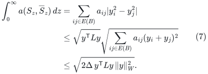

Also <code class="math">\int_0^\infty w(S_z)\,dz=\&#124;y\&#124;_W^2</code>. A nonempty
level set therefore has boundary-to-mass ratio at most
<code class="math">\sqrt{2\Delta\theta}=\eta/2</code>. Examine the at most <code class="math">b</code>
distinct level sets and choose the best exact rational ratio.
This proves the first alternative, with slack. This argument also
handles disconnected graphs and unequal block masses.

### 1.3 Removing coarse cuts until a large core remains

Starting with total mass <code class="math">W_0</code>, repeatedly apply this primitive
to the remaining coarse graph, removing the returned smaller-side
cut. Stop if the removed union <code class="math">C_2</code> has mass at least <code class="math">W_0/4</code>,
or if the remaining graph is certified.

The boundary of the removed union in the INITIAL coarse graph is
at most <code class="math">\eta w(C_2)</code>: sum the boundaries at the moments of
removal, and observe that edges between removed pieces no longer
cross the final union. Before the last removal its mass is below
<code class="math">W_0/4</code>, and a removed cut is at most half the remaining mass.
Thus the final union has mass below <code class="math">5W_0/8</code>.

If the first stopping condition occurs, the smaller side of this
cut has mass at least <code class="math">W_0/4</code> and sparsity at most <code class="math">2\eta</code>.
If the second occurs, the removed union has mass below <code class="math">W_0/4</code>,
and the remaining coarse graph has sparsity at least
<code class="math">\eta^2/(16\Delta)</code>. At most <code class="math">b-1</code> nonempty removals occur.
The entire procedure is polynomial in <code class="math">b</code> and the input bit size.

More generally, its stopping mass can be any fixed
<code class="math">0&lt;\beta\leq1/4</code> times <code class="math">W_0</code>. At the first crossing, the
removed union has mass in
<code class="math">[\beta W_0,(1+\beta)W_0/2)</code>. After possible complementation,
the smaller side has mass at least <code class="math">\beta W_0</code> and sparsity
at most <code class="math">2\eta</code>. If certification occurs first, the remaining
mass is at least <code class="math">(1-\beta)W_0</code>. The weak spectral leaf below
uses this variant with <code class="math">\beta=1/1000</code>.

## 2. Virtual merging of internally expanding blocks

Let <code class="math">U_1^*,\ldots,U_t^*</code> be disjoint sets. On each block there
is a virtual graph <code class="math">H_i^*</code> of edge sparsity at least
<code class="math">0&lt;\psi_{\rm in}\leq1</code>. Let <code class="math">G</code> be an actual host of maximum
degree at most <code class="math">\Delta</code>, and assume its interblock edges have
outer sparsity at least <code class="math">0&lt;\psi_{\rm out}\leq1</code>: every cut
respecting the blocks has boundary at least <code class="math">\psi_{\rm out}</code>
times its smaller vertex-side cardinality.

Define the EXPLICIT virtual graph

<!-- math-display: 6d74819e388c4652d7376593
G_0=
 \left(\bigcup_i H_i^*\right)
 \cup\{e\in E(G):\text{the ends of }e\text{ lie in different blocks}\}.
 \tag{8}
-->
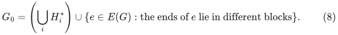

No internal path vertex is added to its vertex set. Its degree satisfies

<!-- math-display: 0805de02cb269fece1eeb0e5
\Delta(G_0)\leq\max_i\Delta(H_i^*)+\Delta.
 \tag{9}
-->
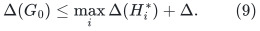

It has sparsity

<!-- math-display: d978a483b27ccd2af44184e6
\Psi(G_0)\geq
          \frac{\psi_{\rm in}\psi_{\rm out}}{4(\Delta+1)}.
 \tag{10}
-->
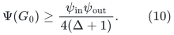

Here is a direct proof, which does not use induced expansion of the
terminal union. For a cut <code class="math">S</code>, round each block to its majority
side and call the resulting union <code class="math">T</code>. Let <code class="math">z</code> be the sum
of the minority cardinalities in the blocks, and let
<code class="math">w=\min\{&#124;S&#124;,&#124;\overline S&#124;\}</code>. The internal block graphs
contribute at least <code class="math">\psi_{\rm in}z</code> crossing edges. The
interblock host edges contribute at least

<!-- math-display: eaac45ed8d1cba64745774f0
\psi_{\rm out}(w-z)-\Delta z.
 \tag{11}
-->
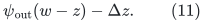

Indeed the rounded cut has smaller side at least <code class="math">w-z</code>, and
changing the side of <code class="math">z</code> vertices alters at most <code class="math">\Delta z</code>
host edge crossings. If
<code class="math">z\geq\psi_{\rm out}w/(2(\Delta+\psi_{\rm out}))</code>, use
the internal contribution. Otherwise use (11). Both cases imply
(10).

If the <code class="math">H_i^*</code> already have simultaneous embeddings into <code class="math">G</code>
of congestion at most <code class="math">c</code> and dilation at most <code class="math">d</code>, then
<code class="math">G_0</code> has an explicit embedding into <code class="math">G</code> with congestion
at most <code class="math">c+1</code> and dilation at most <code class="math">\max\{d,1\}</code>.
Its interblock host edges use their own singleton paths. The graph
<code class="math">G_0</code> is precisely the virtual graph at the start of the proof
of CS20 Lemma C.9; we export it rather than replace it by an induced
graph on an incorrectly smaller vertex set.

## 3. Modified success type for the recursive cut player

Replace the success alternative of the recursive cut routine by:

> Return a terminal set <code class="math">X</code>, an explicit virtual expander <code class="math">H_X</code>
> with vertex set exactly <code class="math">X</code>, and an explicit embedding into the
> current host. Return the same actual sparse-cut certificate as before
> whenever the cut alternative occurs.

Use a balanced-cut sparsity threshold of AT MOST <code class="math">1/8</code> in every
NONROOT recursive cut-player call. This is necessary when the
matching player saturates only half the requested sources.
The corrected entropy argument in
[half-matching-entropy-progress.md](half-matching-entropy-progress.md)
proves an <code class="math">\Omega(n)</code> increase per continuing round at that
threshold, and hence <code class="math">O(\log n)</code> rounds. The printed CS20
threshold-<code class="math">1/2</code> half-matching calculation is not imported.

A virtual-expander success ends the game instead of requesting
another matching, so the corrected entropy proof needs only the
actual balanced cut and half-matching on continuing rounds.
The intermediate game graph is the MULTIGRAPH union of those
matchings, with a fresh edge ID for every round occurrence.
Parallel repetitions are not deduplicated: the entropy cut-mass
bound counts all previous crossing matching occurrences.
This graph has degree <code class="math">O(\log n)</code>. The returned virtual graph
is NOT inserted back into an unfinished game graph.

Suppose the current actual host has <code class="math">N</code> vertices and maximum
degree <code class="math">\Delta</code>, and partition its vertices, in ID order, into
<code class="math">k</code> blocks <code class="math">V_i</code> of sizes <code class="math">\lfloor N/k\rfloor</code> or
<code class="math">\lceil N/k\rceil</code>. Run the simultaneous cut-matching construction
with the explicit
[fresh-cut matching adapter](sequential-fresh-cut-matching-adapter.md).
Every matching request is made on the full current host with EMPTY
initial cut; old failed cuts are bookkeeping only. The cutoff in
outer round <code class="math">j</code> is <code class="math">\psi/(16j^2)</code>, so overlapping cut unions
retain the required sparsity. This replaces the source's general
nonempty-<code class="math">C_{\rm in}</code> implementation. On a successful block, the recursive routine now
returns a virtual graph <code class="math">H_i</code> on <code class="math">U_i\subseteq V_i</code>, with
<code class="math">&#124;U_i&#124;\geq2&#124;V_i&#124;/3</code>, rather than requiring an induced subgraph of
the intermediate matching graph.

The exact sequential covering-matching step in Section 5 of the
same adapter, with the structural role of CS20 Lemma 4.6, produces disjoint
<code class="math">U_i^*=U_i\cup U_i'</code>, with a matching from <code class="math">U_i'</code> into <code class="math">U_i</code>
saturating <code class="math">U_i'</code>. Put <code class="math">H_i^*=H_i\cup M_i^*</code>. Then

<!-- math-display: dc41c593f240878f12928d7e
|U_i'|\leq|U_i|,\quad
 \Delta(H_i^*)\leq\Delta(H_i)+1,\quad
 \Psi(H_i^*)\geq c\min\{\Psi(H_i),1\}
 \tag{12}
-->
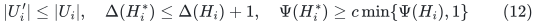

for an absolute constant <code class="math">c&gt;0</code>. The last assertion follows
directly as follows. For a cut with smaller side <code class="math">w</code>, let <code class="math">b</code>
be the number of separated matched pairs. If <code class="math">b\geq w/2</code>,
the matching itself supplies the bound. Otherwise move each separated
bad vertex to its good partner's side. This changes at most <code class="math">b</code>
vertices, so the rounded cut has smaller side at least <code class="math">w-b</code>.
Every good vertex has at most one bad partner; hence each side has
at least <code class="math">(w-b)/2</code> good vertices. The internal graph supplies
at least <code class="math">\Psi(H_i)(w-b)/2\geq\Psi(H_i)w/4</code> crossing edges.
Taking <code class="math">c=1/4</code> after truncating expansion at one suffices. This
does not require paths of the matching embedding to stay within
<code class="math">U_i^*</code>.

All cut certificates up to this point are cuts of the current
host. They depend on the sets, matchings, and their failed flow
requests, not on whether a successful child is an induced subgraph.
They are retained with fixed constant slack in their sparsity
thresholds.

### 3.1 An explicit coarse merge with constant slack

The source merge has the following two possibilities before its final
coarse-cut step. Either an actual sparse cut of fixed positive balance
has already been returned, or:

* fewer than a fixed small fraction of the <code class="math">V_i</code> failed;
* <code class="math">V'=\bigcup_iU_i^*</code> covers all but a small cut <code class="math">C_1</code>, or
  all but a set <code class="math">B</code> of cardinality at most
  <code class="math">\psi\lfloor N/k\rfloor/(1000\Delta)</code>;
* in the first case <code class="math">V\setminus V'\subseteq C_1</code> and
  <code class="math">&#124;\partial C_1&#124;\leq(\psi/100)&#124;C_1&#124;</code>.

The PRIMARY exact sequential covering routine supplies the first
case with no uncovered set outside <code class="math">C_1</code>, so <code class="math">B=\varnothing</code>.
The small-<code class="math">B</code> alternative below is only a harmless weaker
compatibility case; the reconstruction does not need a tiny-leftover
parameter or its running-time dependence.

Use sufficiently smaller fixed thresholds in the source matching
calls to obtain these displayed constants. This changes no parameter
exponent. Return any cut of size at least <code class="math">\beta N</code>, with
<code class="math">\beta=1/1000</code>, as a cut-only answer; do not also retain its
candidate expander.

At a recursion leaf with at most
<code class="math">C k^5\lambda_{\rm cap}^2</code> actual vertices, where
<code class="math">\lambda_{\rm cap}</code> is the explicit polylogarithmic shuffler cap
defined in Section 4 and <code class="math">C</code> is one fixed constant, the
same spectral procedure gives an explicit polynomial-work WEAK cut
player without further recursion. Give every vertex mass one, use a
sufficiently small fixed multiple of the weak requested cut threshold
for <code class="math">\eta</code>, and run the Section 1.3 variant that stops at removed
mass <code class="math">\beta N</code>, NOT <code class="math">N/4</code>. After possible complementation a
returned cut has smaller side between <code class="math">\beta N</code> and <code class="math">N/2</code>.
Otherwise the remaining induced subgraph has at least
<code class="math">(1-\beta)N</code> vertices and sparsity
<code class="math">\Omega(\psi_{\rm cut}^2/(\Delta+1))</code>. It is a valid successful
virtual graph with the identity embedding. Its work is polynomial
in <code class="math">k</code> and the input bit size. This is only a base cut player;
routing queries in a successful leaf are the separate leaf-router
obligation.
Use this fixed polynomial leaf threshold in the reconstruction instead
of relying on the source's separate leaf-trimming description. Every
remaining internal part has at least a fixed multiple of
<code class="math">k^4\lambda_{\rm cap}^2</code> vertices, so the shuffler's later
token-error inequalities have their required slack even if <code class="math">k</code>
is constant. The larger fixed polynomial does not alter the allowed
<code class="math">k^{O(1)}\mathrm{polylog}n</code> preprocessing envelope.

Contract each <code class="math">U_i^*</code> to a coarse vertex of mass <code class="math">&#124;U_i^*&#124;</code>,
keeping only actual host edges between blocks. Condition (1) holds
with the actual host degree <code class="math">\Delta</code>. Apply Section 1.3 with
<code class="math">\eta=\psi/1000</code>. If it returns a balanced coarse cut, or if
its removed union together with <code class="math">C_1</code> or <code class="math">B</code> has size at least
<code class="math">\beta N</code>, return a cut-only answer. Otherwise keep all the
remaining blocks and use (8) as the successful virtual graph.

For clarity, the conversion from a coarse cut to a host cut has no
hidden boundary assumption. If <code class="math">V\setminus V'\subseteq C_1</code>,
then

<!-- math-display: db944a3348cab4e50c8fad94
|\partial_G(C_1\cup C_2)|
       \leq|\partial_G C_1|+|\partial_{G[V']}C_2|.
 \tag{13}
-->
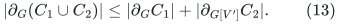

If instead <code class="math">C_1=\varnothing</code> and the uncovered set is <code class="math">B</code>,
use <code class="math">B\cup C_2</code>. For nonempty <code class="math">C_2</code>, at least one block
has been removed. When <code class="math">N/k&gt;7</code>, its size is at least
<code class="math">\lfloor N/k\rfloor/3</code>, and therefore

<!-- math-display: 1f3af11302b405e52c095057
\Delta|B|\leq (3\psi/1000)|C_2|.
 \tag{14}
-->
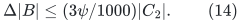

Together with the accumulated coarse boundary bound, (13)--(14)
give host sparsity strictly below <code class="math">\psi</code>. If the union exceeds
half the host, use its complement; its size is still below
<code class="math">2N/3</code> before complementation, so at most a fixed factor is
lost. If <code class="math">C_1=C_2=\varnothing</code>, return the virtual core without
a cut; the uncovered <code class="math">B</code> is the allowed small leftover.

On a successful answer, the remaining coarse graph has outer
sparsity at least

<!-- math-display: 58fa76ea0df0e53a2c19218d
\Omega(\psi^2/\Delta).
 \tag{15}
-->
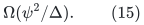

Consequently (10) multiplies the child expansion by only
<code class="math">\psi^2/\mathrm{poly}(\Delta+1)</code>. The source's
<code class="math">2^{O(k)}</code> search for a maximum coarse cut is not used. There
are at most <code class="math">k</code> exact spectral sweeps on <code class="math">k</code>-vertex graphs,
with <code class="math">O(\log N+\log\psi^{-1})</code>-bit input coefficients.

Every successful internal weak call has the same
<code class="math">(1-\beta)</code>-coverage guarantee as the corrected weak leaf:
all uncovered vertices are in <code class="math">C_1\cup C_2</code>, and its cardinality
is below <code class="math">\beta N</code> on success. This remains true when <code class="math">C_1</code>
overlaps the retained terminal set. The primary construction
uses exact covering and requires no optional leftover <code class="math">B</code>.

### 3.2 Balance improvement retains one successful hierarchy

Use the complete proof in
[explicit-virtual-cut-balance-wrapper.md](explicit-virtual-cut-balance-wrapper.md).
For an original <code class="math">N_0</code>-vertex host and target threshold <code class="math">\psi</code>,
call the weak procedure with <code class="math">\psi_{\rm w}=\psi/2</code> on the
CURRENT induced host outside the accumulated disjoint cut pieces.
Stop when their union reaches <code class="math">N_0/4</code>, or on a weak success.

Before the last cut addition the union has size below <code class="math">N_0/4</code>.
The added smaller side is at most half the current remaining host,
so the union at its first crossing has size below <code class="math">5N_0/8</code>.
After possible complementation, the returned cut has smaller side
in <code class="math">[N_0/4,N_0/2]</code>. Its original boundary is at most
<code class="math">\psi_{\rm w}</code> times the uncomplemented union size, by summing
boundaries in the successive CURRENT induced hosts.
Complementation loses less than <code class="math">5/3</code>, so its sparsity is below
<code class="math">\psi</code>.

Otherwise the final active host has more than <code class="math">3N_0/4</code>
vertices. Both weak internal successes and weak spectral leaves
cover at least a <code class="math">(1-\beta)</code> fraction, hence their terminal set
has more than <code class="math">(1-\beta)3N_0/4&gt;2N_0/3</code> vertices.
There are only <code class="math">O(1/\beta)</code> weak calls, a fixed constant.
Retain only the hierarchy from the ONE final successful call;
its embedding already lies in an induced subgraph of the original
wrapper host. This adds no geometric composition.

This explicit wrapper replaces reliance on the source's leftover
notation. In particular a weak leaf reached after prior removals
must use the <code class="math">(1-\beta)</code>-coverage variant above; a bare
three-quarter-coverage leaf would not suffice for this composition.

At a promised-expander ROOT, the wrapper's exact-coverage proof
uses the first proposed removal. Every fresh matching or covering
failure cut is certified in the unchanged full root host and is
impossible below its expansion. Exact covering therefore gives
<code class="math">V'=V</code> and <code class="math">C_1=\varnothing</code>. The first coarse cut is then
exactly a true-host cut respecting a full partition and is likewise
impossible. Thus <code class="math">C_2=\varnothing</code>, not just small. A root
spectral leaf cannot make its first removal either. The detailed
argument is in the wrapper's Section 4; it uses no optional
leftover <code class="math">B</code>. Nonroot abstract cut-player calls may still return
proper-subset successes, whose omitted root vertices are recovered
by the root's exact covering step.

## 4. The hierarchy's sets and local graph degrees

For an actual root graph with <code class="math">n</code> vertices and an integer parameter
<code class="math">p\geq1</code>, put
<!-- math-display: 312d56502fddd3fc400d8abb
u=\lceil\log_2(n+2)\rceil,\qquad
 k=2^{\max\{5,\lceil u/p\rceil\}},\qquad
 \lambda_{\rm cap}=10^7(u+1)^2.
 \tag{15a}
-->
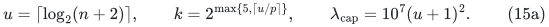
All recursion calls use this same <code class="math">k</code> and this same cap. The cap
dominates the explicitly proved <code class="math">O(\log(k+2)\log(n+2))</code> energy
shuffler length after fixing its absolute constants; its finite
stopping condition is also checked. Use the actual-size leaf test
<code class="math">N\leq Ck^5\lambda_{\rm cap}^2</code>, never an allocation of that many
vertices. The constant <code class="math">C</code> can be chosen once so that every
internal node satisfies
<!-- math-display: d5cc01c29cfd19de4f3864b6
\min_i|U_i^*|\geq8\lambda_{\rm cap}t^2,\qquad
 6|X|/k\geq\lambda_{\rm cap}t^2.
 \tag{15b}
-->
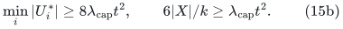
These are the size conditions used by the explicit sequential
scatter router. They replace the old sufficient conditions
<code class="math">k\geq c\lambda</code> and the CHS range restriction on <code class="math">\epsilon</code>.
The present reconstruction is sequential and does not use that
distributed parameter clipping.

In a successful weak call write <code class="math">\tau=N/k</code>. Its good children
are the selected sets <code class="math">U_i</code>, and its bad children are <code class="math">U_i'</code>.
The parent terminal set is exactly

<!-- math-display: 0fdab9d67bcbc93422e57179
X=\bigcup_{i\text{ selected}}(U_i\cup U_i').
 \tag{16}
-->
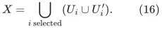

Thus children really partition the parent; embedding interiors do
not silently enlarge it. The children obey

<!-- math-display: f2f23857195779d122b432a0
\frac23(\tau-1)\leq|U_i^*|\leq2(\tau+1),
 \qquad
 \frac{|X|}{3k}\leq|U_i^*|\leq\frac{6|X|}{k},
 \tag{17}
-->
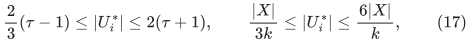

for the stated internal-node size threshold. The order of the good
children follows the original ID-ordered <code class="math">V_i</code>, since
<code class="math">U_i\subseteq V_i</code>. Bad-child IDs need not be ordered.

Here are explicit counts for the number of children. Before a
successful answer, the failed-part cut has size below <code class="math">\beta N</code>.
Each failed part has at least <code class="math">&#124;V_i&#124;/8</code> vertices in that cut.
For <code class="math">\tau&gt;7</code>, fewer than <code class="math">16\beta k</code> parts failed.
Every whole block removed by the coarse procedure has size at least
<code class="math">\tau/3</code>. Its removed union lies in the final small cut, so
fewer than <code class="math">3\beta k</code> further blocks are removed. With
<code class="math">\beta=1/1000</code>, the number <code class="math">t</code> of good children satisfies

<!-- math-display: d84655001b922db2e503f817
2k/3\leq t\leq k.
 \tag{18}
-->
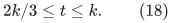

If no coarse block is removed and only a tiny uncovered <code class="math">B</code>
remains, the same count follows from the failed-part count alone.
The final successful host used by the balance wrapper can be smaller
than its original input, but it still has a constant fraction of that
input. Formula (17) uses that successful host's <code class="math">\tau</code>, and remains
<code class="math">\Theta(&#124;X&#124;/k)</code>.

Each recursive child input has at most <code class="math">\lceil N/k\rceil</code>
vertices, while its successful parent terminal set has a fixed
fraction of <code class="math">N</code>. For <code class="math">k\geq24</code>, recursion therefore has
depth <code class="math">O(\log n/\log k)</code>. The choice (15a) gives depth <code class="math">O(p)</code>
even when its fixed minimum <code class="math">k=32</code> is active. All size
rounding and small-host thresholds are explicit integer tests.

At a nonroot recursive cut-player call, the actual host is a union
of <code class="math">O(\log n)</code> matchings, regardless of the degrees of successful
virtual outputs. Thus its host degree is <code class="math">O(\log n)</code>.
Writing <code class="math">d</code> for the number of recursive cut-player levels left,
(9) and (12) give

<!-- math-display: e677d5f8840bb5b0d2e40fee
\Delta(H_X)\leq O((d+1)\log n).
 \tag{19}
-->
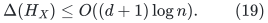

This is a polylogarithmic degree bound, not the literal
<code class="math">O(\log n)</code> bound claimed for an induced matching subgraph.
All subsequent uses must allow this explicit larger degree. For
<code class="math">d\leq\mathrm{polylog}n</code>, it changes a fixed polynomial
degree factor only by a polylogarithm. A port-splitting wrapper is
also available if a downstream primitive needs constant degree.

Most importantly, every child virtual graph <code class="math">H_{U_i}</code> and every
covering matching <code class="math">M_i^*</code> is a literal subgraph of its parent
graph <code class="math">H_X</code>. Their child-to-parent embedding is the identity.
Do not instead lift each child's graph afresh through all older
hosts when servicing a query.

In fact <code class="math">H_X[U_i]=H_{U_i}</code> as a graph with edge IDs. Parent-level
host edges are added only BETWEEN the blocks <code class="math">U_j^*</code>, while a
covering-matching edge has one endpoint outside <code class="math">U_i</code>. Thus no
new parent-level edge has both endpoints in the good child <code class="math">U_i</code>.
Inductively, every good-node graph is induced in the ROOT VIRTUAL
graph. This is a statement about (8), not about the original physical
graph. It permits shared edge records and ordinary vertex-subset
views without recursively duplicating physical path lists.

## 5. Expansion and ONE root embedding

Let <code class="math">u=\log(n+2)</code>. Use sparse-cut threshold <code class="math">1/8</code> in
every nonroot recursive cut-player call, with smaller fixed
thresholds inside its balance/merge wrappers. At the original root use a threshold a fixed factor
below the original graph's sparsity <code class="math">\psi</code>.

Let <code class="math">\sigma_d</code> be a lower bound for nonroot virtual expansion
with at most <code class="math">d</code> remaining recursive levels. Equations
(10), (12), and (15) yield

<!-- math-display: a7946c7cfa8965a42a8b7af8
\sigma_d\geq u^{-c}\sigma_{d-1}
 \tag{20}
-->
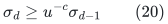

for an absolute constant <code class="math">c</code>. The spectral base just described
has expansion at least <code class="math">u^{-O(1)}</code> on a nonroot matching-graph
host, so the same recurrence starts with that bound. Therefore

<!-- math-display: 0bdb55d820fb9b1695e22f69
\Psi(H_X)\geq u^{-O(d)}
 \quad\hbox{off the root},\qquad
 \Psi(H_{\rm root})\geq
              \mathrm{poly}(\psi)\,u^{-O(d)}.
 \tag{21}
-->
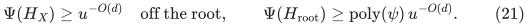

The degree in the loss (10) is the degree of the CURRENT HOST's
interblock edges, not an uncontrolled degree of the entire recursively
flattened graph. This is why (20) uses a fixed polynomial per level.

Let <code class="math">E_d</code> bound the simultaneous edge congestion and dilation
of the successful virtual output into its current host. At one
level, child virtual graphs first embed into their disjoint
intermediate matching graphs with quality <code class="math">E_{d-1}</code>. The
union of those matching graphs embeds into the current host with
quality

<!-- math-display: 9fc81fde256e1399e5bb5735
B=\mathrm{poly}(\Delta,\psi_{\rm cut}^{-1},u),
 \tag{22}
-->
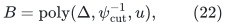

by the source matching construction, including its
<code class="math">O(\log n)</code> matching rounds. The covering matching costs at
most another <code class="math">B</code>, while new interblock host edges are singleton
paths. Hence

<!-- math-display: 5922eb48e3d0623645b3e0d9
E_d\leq cB(E_{d-1}+1).
 \tag{23}
-->
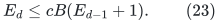

Every nonroot <code class="math">B</code> is a fixed polynomial in <code class="math">u</code>. The root
has the only original <code class="math">\psi^{-1}</code> factor. The resulting ONE
embedding

<!-- math-display: da8ee77ac2bb3506d2b10b7b
f_0:H_{\rm root}\longrightarrow G
 \tag{24}
-->
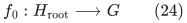

has quality

<!-- math-display: 9d09f5f9c61bb0876e91ea19
\mathrm{poly}(\psi^{-1})\,
                                         u^{O(d)}.
 \tag{25}
-->
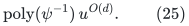

This can be constructed with explicit route lists by postorder
substitution. Each output edge has at most the length in (25),
and all occurrences are charged to those lists. One need not
materialize a separate original-graph expansion for every ancestor
copy of the same edge.

Because all hierarchy graphs are literal subgraphs of the root
virtual graph, a collection of paths in any of them can first be
viewed as paths in <code class="math">H_{\rm root}</code> without any geometric expansion.
Only then is <code class="math">f_0</code> applied. Thus the root embedding is charged
ONCE. Repeatedly multiplying <code class="math">E_d,E_{d-1},\ldots</code> during query
flattening would be a different, unnecessarily expensive algorithm
and would lose the desired depth dependence.

An original expander cannot return any nonempty root cut below its
sparsity. With the PRIMARY exact covering routine, all root games
succeed, the covering matching leaves no uncovered vertex, and a
nonempty respecting coarse cut would itself be an impossible sparse
cut of the original host. Consequently the primary root terminal
set is actually ALL of <code class="math">V(G)</code>. No outside-root token delegation
is needed. The root graph is still the virtual graph <code class="math">G_0</code>, not
an assertion about an induced physical graph.

If a compatible weaker covering routine with a tiny leftover is
used instead, the earlier <code class="math">2&#124;V(G)&#124;/3</code> root bound still suffices,
and an additional covering matching in the original graph handles
the outside vertices. This weaker variant is not required by the
primary sequential reconstruction.

### 5.1 Provider for the full router's flattened-family hypothesis

Combine this hierarchy with
[the polynomial energy cut player](polynomial-energy-cut-player.md),
the exact saturation routine in
[the fresh-cut adapter](sequential-fresh-cut-matching-adapter.md),
and
[the explicit leaf circuits](sequential-leaf-routing-and-chs-work.md).
At each internal <code class="math">X</code>, the energy cut produces physical terminal
sets of unequal sizes with the smaller side able to be saturated.
Call exact saturation in the CURRENT virtual graph <code class="math">H_X</code>, using
a cutoff below its certified sparsity. Thus each shuffler matching
has explicit virtual paths with length and congestion bounded by
<!-- math-display: 48f907af7617e31f91227816
\mathrm{poly}(\Delta(H_X),\Psi(H_X)^{-1},u).
 \tag{26}
-->
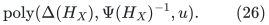
There are at most <code class="math">\lambda_{\rm cap}=\mathrm{poly}(u)</code>
such matchings per node. Every covering-matching edge already is
an edge of its parent virtual graph. Leaf circuit paths have the
separately proved fixed-polynomial dependence on leaf inverse
expansion and <code class="math">\log n</code>.

Good-node vertex sets at ONE depth are disjoint. Since their graphs
are induced subgraphs of <code class="math">H_{\rm root}</code>, their virtual host edge
sets are disjoint too. Therefore taking the union of all primitive
paths at one depth uses the maximum of their individual congestion
bounds, not their number. Unioning the <code class="math">O(p)</code> depths and the
polynomially many circuit/shuffler layers gives virtual congestion
and maximum virtual path length at most
<!-- math-display: 8cf453c5dfb9376eca5b59c2
\mathrm{poly}(\psi^{-1})u^{O(p)}.
 \tag{27}
-->
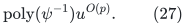
The original <code class="math">\psi^{-1}</code> appears only at the root; all nonroot
expansion certificates use constant cut thresholds.

Apply the ONE map <code class="math">f_0</code> to this union of virtual paths.
Multiplying (27) by (25) still gives
<!-- math-display: 19efbbf09cbb975d871aa90d
A=\mathrm{poly}(\psi^{-1})u^{O(p)}
 \tag{28}
-->
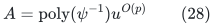
for both physical edge congestion and maximum physical path length.
The exponents hidden in <code class="math">O(p)</code> are fixed constants. No node's
entire ancestor embedding is applied a second time.

Equation (28) is precisely the flattened primitive-family condition
in
[conditional-full-router-from-shufflers.md](conditional-full-router-from-shufflers.md).
Its partition, injective folding, normalization, mixing, and size
conditions follow respectively from (16)--(18), (12), the literal
<code class="math">n'_X=6&#124;X&#124;/k</code>, the energy lemma, and (15b). With the primary exact
root coverage, this router's root already contains every original
vertex.

Preprocessing uses the ACTUAL virtual records. At any depth their
total edge count is at most the root virtual edge count
<code class="math">O(np\log n)</code>. Exact shuffler saturation and path output have
the fixed-polynomial work bound corresponding to (26); the energy
and leaf arithmetic have the local multiword bounds already stated.
Together with the hierarchy construction recurrence, all work fits
<!-- math-display: b986b9365e875c11a62ffe57
n^{1+O(1/p)}
                 \mathrm{poly}(\psi^{-1})\log^{O(p)}n.
 \tag{29}
-->
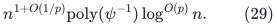
For the actual-size rule (15a), <code class="math">k^{O(1)}</code> is
<code class="math">n^{O(1/p)}</code> times a fixed constant, even when <code class="math">k=32</code>.
No leaf is padded to <code class="math">Ck^5\lambda_{\rm cap}^2</code>.

These are provider and accounting statements. Correctness of the
subsequent scatter/meeting/reversal QUERY is the separate induction
in the full-router note; (28) is not a substitute for that induction.

## 6. What this resolves, and what it does not

The construction resolves the terminal/interior mismatch by changing
the exported object explicitly. It gives:

* exact partitioning of every parent terminal set by good/bad children;
* actual sparse-cut certificates and the source balance guarantees;
* an explicit polynomial-block-work coarse merge;
* polylogarithmic virtual degrees and the expansion recurrence (21);
* identity child and covering-matching embeddings;
* one root embedding of quality
  <code class="math">\mathrm{poly}(\psi^{-1})\log^{O(d)}n</code>.

The explicit sequential replacement for inherited short-path packing,
and the resulting hierarchy work recurrence, are supplied in
[sequential-short-path-matching.md](sequential-short-path-matching.md).
The corresponding
[fresh-cut matching adapter](sequential-fresh-cut-matching-adapter.md)
proves the repeated half-matching, failure-cut union, and covering
interfaces using only the fully proved empty-cut primitive.
The source's general nonempty-initial-cut proof is not used.
Temporary rational matrix work here is
charged there as local multiword preprocessing. It never changes the
numeric-label word guard of a recursive matching backend.

The direct query induction and explicit route extraction are proved
separately in
[conditional-full-router-from-shufflers.md](conditional-full-router-from-shufflers.md),
using the provider conditions established in Section 5.1. That
induction deliberately avoids the source's Task-2-to-Task-3 load
reduction and its best-leaf density parameter. The polynomial energy
cut player and constructive leaf router supply their own stated
interfaces; the query proof must use those exact interfaces rather
than follow from the hierarchy geometry alone.

In particular this is not a reinterpretation that silently declares
the original terminal union to induce an expander. The exported root
graph and its map (24) are part of the new interface and must be passed
to every downstream caller that uses them.
