# An implicit minimal-bundle oracle for the current-blocker transversal algorithm

**25 October 2026. Complete proof assembly; root mathematical review completed.**

This note implements the current-blocker independent-transversal algorithm
on an exponentially large configuration graph without enumerating its
vertices. The main construction retains **inclusion-minimal bundles**,
returns the full domination/constellation certificate, and never needs an
oracle for finding a neighbour of an arbitrary minimal bundle.

The latter neighbour problem is genuinely difficult. The implementation
avoids it by an integer consequence of choosing the claw parameter from
the number of players. It also uses finitely many same-class twins to
avoid requiring a second, third, or lexicographically next distinct
minimal bundle.

The combinatorial iteration bound is imported from
[independent transversal proof](../../problems/independent-transversal/proof.md). The public operations
are Graf--Haxell, [*Finding Independent Transversals Efficiently*,
arXiv:1811.02687v2](https://arxiv.org/html/1811.02687v2), Definitions 8--12
and the BuildLayer, SuperposedBuild and GrowTransversal algorithms. The
new proof below supplies their implicit implementation and replaces the
isolated-vertex preprocessing and arbitrary-neighbour completion that
would be problematic for minimal configurations.

No restricted Santa Claus approximation factor below four follows from
this note alone. In particular, its constellation can belong to a class
set strictly larger than the dominated class set. That distinction is
retained in the output contract.

## 1. Input and the precise oracle theorem

There are <code class="math">q</code> players, a resource set <code class="math">E</code>, positive intrinsic values
<code class="math">v_e</code>, and eligibility sets <code class="math">A_p\subseteq E</code>. Fix a positive target
<code class="math">B</code>, which may be written <code class="math">B=\alpha T</code> in an application. A
configuration for player <code class="math">p</code> is an inclusion-minimal set

<!-- math-display: 2f707e81a96c1fe0d36927e4
C\subseteq A_p,\qquad \sum_{e\in C}v_e\ge B.       \tag{C1}
-->
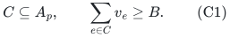

Configurations of different players conflict exactly when they share a
resource. Edges within a player's class are deleted. In particular,
selected configurations in the same class are allowed to share resources.

Put

<!-- math-display: 41f11a2ef1191308c7ac56b3
P=|E|+\sum_p|A_p|+q+2.
-->
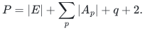

For a concrete finite-word bound, take positive integer resource values
and a rational <code class="math">B</code>, with at most <code class="math">b</code> bits in their encodings. Let
<code class="math">0&lt;\varepsilon&lt;1</code> be rational, of encoding length <code class="math">b_\varepsilon</code>.
The same proof works for values with a supplied common denominator.
For unrelated rational denominators, clearing them gives a polynomial
bit-cost bound in their total encoding length; no fixed-word claim is
made for that different representation.

Check first whether each player has total eligible value at least <code class="math">B</code>.
If one does not, report that exact infeasibility witness. Otherwise every
configuration class is nonempty. For <code class="math">q\le1</code>, solve directly.

For <code class="math">q\ge2</code>, the deterministic algorithm returns either pairwise
resource-disjoint minimal configurations, one per player, or explicit
objects <code class="math">S,S_0,D,K</code> satisfying:

* <code class="math">\varnothing\ne S\subseteq S_0</code> are player sets;
* <code class="math">D</code> consists of actual minimal configurations and totally dominates
  every minimal configuration of every player in <code class="math">S</code>, using
  interplayer resource intersections;
* <code class="math">K</code> is an induced constellation in the interclass configuration graph
  on <code class="math">S_0</code>; its leaves represent every player of <code class="math">S_0</code> but one;
* <code class="math">D=V(K)</code>, and
  <!-- math-display: c57f422d18f0e3540936f3ea
  |D|<(2+\varepsilon)(|S|-1).                 \tag{C2}
  -->
  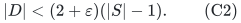

The running time is

<!-- math-display: 09bd94c773c78b0d32e7187b
\boxed{
 P\,(q+1)^{O(\varepsilon^{-1}\log(2+q/\varepsilon))}
       \mathrm{poly}(b+b_\varepsilon+\log P).
 }                                                               \tag{C3}
-->
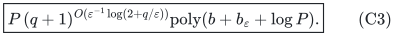

The output contains only <code class="math">O(q)</code> bundles. The bound is independent of
the number of minimal bundles in a class. A certificate does not imply
that an allocation at target <code class="math">B</code> is impossible.

## 2. Why an arbitrary minimal-bundle neighbour oracle is not assumed

Consider a SUBSET SUM instance with positive integer items
<code class="math">a_1,\ldots,a_m</code> and target <code class="math">T</code>. Set <code class="math">B=T+1</code>. There are two
players. Player 1 has a resource <code class="math">e</code> of value one and a private
resource <code class="math">h</code> of value <code class="math">T</code>, so

<!-- math-display: f563f619dd429789f25ee68e
C_1=\{e,h\}
-->
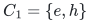

is its only minimal bundle. Player 2 has <code class="math">e</code>, resources with values
<code class="math">a_i</code>, and a further private resource of value <code class="math">T+1</code>. The last
resource guarantees that player 2's class is nonempty. The players share
only <code class="math">e</code>.

Player 2 has a minimal bundle containing <code class="math">e</code> exactly when some subset
of the <code class="math">a_i</code> sums to <code class="math">T</code>. Indeed, removing <code class="math">e</code> from such a
bundle must leave total value strictly below <code class="math">T+1</code>, while the full
bundle reaches <code class="math">T+1</code>. Integrality forces the remaining total to be
exactly <code class="math">T</code>. Conversely such a subset together with <code class="math">e</code> has an
inclusion-minimal subbundle that still contains <code class="math">e</code>.

Thus deciding whether the specified minimal configuration <code class="math">C_1</code> has
a neighbour is NP-hard even with two players and nonempty classes.
Detecting an isolated minimal bundle by a generic neighbourhood routine is
not a polynomial-time primitive supplied by the configuration model.
The algorithm below does not use that primitive.

## 3. A finite twin graph and the available-bundle primitive

Use the universally valid partition-relative claw parameter

<!-- math-display: 19ebb84f732d78d0bc85958b
r=q+1,\qquad
 \mu=\rho=\frac{\varepsilon}{100(q+1)},\qquad
 Q=\left\lceil\frac1\mu\right\rceil.                            \tag{C4}
-->
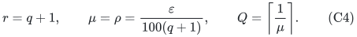

These are the feasible parameters already verified in the current-blocker
note. Give each minimal bundle a finite set of

<!-- math-display: 9fe97599d9e9ae35a3f92b89
R=(q+3)(Q+3)                            \tag{C5}
-->
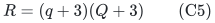

same-class twins. A vertex is a triple <code class="math">(p,C,j)</code>, with
<code class="math">1\le j\le R</code>. Twins have exactly the same interclass neighbours
and no edges to each other. An independent transversal in this finite
conceptual graph is equivalent to a disjoint bundle allocation. Its
partition-relative claw parameter is still at most <code class="math">q+1</code>.

The larger safe value (C5), instead of merely <code class="math">Q+2</code>, avoids relying
on an unstated unique-active-layer property for a class. There are at most
<code class="math">q+1</code> live layers, each holds at most <code class="math">Q</code> selected vertices in a
given class, and the current candidate adds at most another <code class="math">Q</code>.
There is at most one matching representative of that class. Consequently,
before a class is full, fewer than <code class="math">R</code> twin indices are occupied by
its currently excluded prefix, candidate and matching records.

When generating a bundle <code class="math">C</code>, choose an index not used by **any**
currently held vertex of its class. This conservative choice guarantees
that <code class="math">(p,C,j)</code> is a new eligible vertex without having to enumerate
other minimal bundles or compare it with all past configurations. Indices
may be reused after records leave the current exclusion sets. Historical
stored candidates do not forbid vertices that are no longer part of the
actual current exclusion set.

Let <code class="math">Z</code> be the selected and blocker vertices whose neighbours are
forbidden by the current BuildLayer call. For a player <code class="math">p</code>, define

<!-- math-display: 7fd0d0371b8c9e08a4fa6244
F_p(Z)=\bigcup_{(p',C,j)\in Z,\ p'\ne p}C,
 \qquad A_p^{\rm avail}=A_p\setminus F_p(Z).                       \tag{C6}
-->
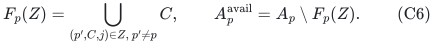

The exclusion of the player's **own** class is essential. Forbidding the
resources of its own selected twins would implement a different graph.

There is a minimal configuration avoiding all forbidden neighbours if
and only if

<!-- math-display: 7fb00701f7f92b1293461a9b
\sum_{e\in A_p^{\rm avail}}v_e\ge B.       \tag{C7}
-->
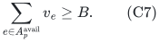

If the sum reaches <code class="math">B</code>, accumulate resources until the target is
reached, then delete each resource whose removal preserves it. A single
deletion pass is enough: once a resource is indispensable, subsequent
deletions cannot make it dispensable. The result is a minimal bundle in
the original full eligibility set, since minimality is a property of its
own subsets. It can be produced in <code class="math">O(&#124;A_p&#124;)</code> scalar work.

No prescribed resource is forced to belong to this bundle. This is why
(C7) avoids the subset-sum interval difficulty from Section 2.

## 4. One implicit BuildLayer call is exact

Maintain, for each resource, whether the classes using it in <code class="math">Z</code>
are empty, one specified class, or at least two different classes.
For player <code class="math">p</code>, a resource is available precisely when its tag is
empty or its sole class is <code class="math">p</code>. Tags are initialized from the actual
lower prefix and candidate. They only become more restrictive during
the call.

Process active players in a fixed order. Until a player's selected count
reaches <code class="math">Q</code>, apply (C7). If it fails, close that player for this call.
If it succeeds, generate the minimal bundle and choose an unused twin
index as above. This vertex satisfies the public addability definition.

The current partial transversal <code class="math">M</code> has disjoint resource bundles.
A resource-to-current-owner table therefore identifies all neighbours of
the new vertex in <code class="math">M</code> by scanning its resources, ignoring the player's
own class. Add those matching vertices to the candidate blocker set and
activate the new selected vertex and the newly added blockers in <code class="math">Z</code>.

Availability never increases during BuildLayer, including when a newly
activated vertex belongs to the player being tested. Consequently a failed
player need not be revisited. At termination, every active class is full
or fails (C7). Thus no conceptual vertex is addable, including any
unmaterialized minimal bundle or twin. This is exact greedy maximality in
the finite conceptual graph.

There are at most

<!-- math-display: b383893405367292167e016b
q(Q+1)                                \tag{C8}
-->
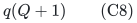

available-bundle calls per BuildLayer. Successful calls account for at
most <code class="math">qQ</code> selected vertices, and each active class can fail once.
Resource scans over repeated calls to a player cost at most
<code class="math">O(Q&#124;A_p&#124;)</code>. Newly discovered matching blockers are distinct, and
their bundles are disjoint, so their total resource volume in one call
is at most <code class="math">&#124;E&#124;</code>.

Initializing tags from all current prefix lists, finding free twin
indices, and retaining actual candidate bundles can conservatively be
charged to <code class="math">P\mathrm{poly}(q,1/\varepsilon)</code> per call. No
loop ranges over all graph vertices. Fresh actual candidates are retained
exactly as in the current-blocker proof; no unexecuted greedy rerun is
assumed to choose the same extension.

## 5. Integer counts remove all arbitrary-neighbour completions

This is the main reason no isolated-bundle preprocessing is required.

During an augmentation, <code class="math">&#124;M&#124;\le q-1</code>. In any noncollapsible layer
write <code class="math">U</code> for its number of currently unblocked selected vertices.
Every other selected vertex has at least one distinct matching blocker.
The layer invariant therefore gives

<!-- math-display: c689b7e5ca4cdf1d629a290c
|X|-U\le|Y|\le q-1,
 \qquad U\le\mu|X|.
-->
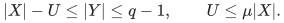

It follows that

<!-- math-display: 67753b1753b6b5127e5b5307
U\le\frac{\mu(q-1)}{1-\mu}<1.
-->
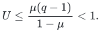

Since <code class="math">U</code> is an integer,

<!-- math-display: 4185dc6f019b853e4869c6e9
U=0,\qquad |X|\le|Y|\le q-1<Q.                            \tag{C9}
-->
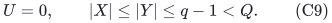

At every continuing main-loop boundary, all live layers are
noncollapsible. All their selected vertices therefore already have
neighbours in their current blocker sets. Blocker sets of different
layers are disjoint, so the same injection gives the stronger prefix
bound <code class="math">&#124;X_{\rm prefix}&#124;\le &#124;Y_{\rm prefix}&#124;\le q-1</code>. In particular,
no class is full even if fullness is checked in the union of the prefix.

The last executed SuperposedBuild candidate for such a surviving layer
is either the adopted current layer or a rejected extension. A rejected
extension has fewer than <code class="math">\mu&#124;X&#124;&lt;1</code> additional selected vertices.
Consequently its number of extras is zero. Freshness of the actually
stored candidate gives

<!-- math-display: 5e91e4f9f1dcacccc2fba5b7
\widehat X=X,\qquad \widehat Y=Y.           \tag{C10}
-->
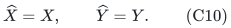

No class is full, and there are no extra-selected classes to remove in
the current-blocker certificate. There are also no unblocked selected
vertices requiring an arbitrary neighbour.

The greedy policy is deterministic in the explicitly stored resource and
player order. It need not find the first vertex in a fixed ordering of
all exponentially many minimal configurations. The current-blocker proof
uses the latest actual maximal candidate after a matching change, and
(C10) makes that current layer itself maximal. Thus the optional
fixed-global-vertex-order convention used for hypothetical reruns in the
public presentation is not needed here. The layer and signature updates
still satisfy the same actual size inequalities.

This argument permits isolated vertices in the conceptual graph.
BuildLayer may find one; if it survives into a layer, that layer is
collapsible until it is resolved. The isolated-vertex assumption of the
generic explicit-graph preprocessing is not used in the layer invariants,
collapse operations or signature descent. Its only relevant certificate
use was arbitrary-neighbour completion, which (C9) eliminates here.

### 5.1 The public small-birth exit does not create a missing case

The original GrowTransversal check occurs before collapse and is

<!-- math-display: 83b567d0b281617a86798dcf
|X_{\rm new}|\le\rho |Y_{\rm old}|.
-->
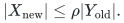

By (C4), <code class="math">\rho&#124;Y_{\rm old}&#124;\le\rho(q-1)&lt;1</code>. Thus this exit can
only occur with <code class="math">X_{\rm new}=Y_{\rm new}=\varnothing</code>. It can never
return early on a nonempty layer containing unblocked configurations.

All older layers satisfy (C9)--(C10). The empty new candidate gives exact
maximality for the final active classes. Taking their union with the
earlier active classes supplies a totally dominating constellation
<code class="math">D=V(K)</code> with

<!-- math-display: 4a33617506ed97cf5ebd8a32
|D|\le2(|S|-1),\qquad S_0=S.                 \tag{C11}
-->
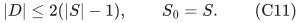

The case <code class="math">&#124;S&#124;=1</code> cannot occur here: an unmatched root class is nonempty,
and the first BuildLayer has empty prefix, so it can select a configuration.

This handles the original exit at exactly its original control-flow
location. No early collapse, altered signature rule, or postponed exit
is needed.

## 6. The current-blocker certificate projects to genuine minimal bundles

For a tested live prefix ending at layer <code class="math">i</code>, let

<!-- math-display: 603e7f2a8690929088a89141
W=1+|Y_{<i}|,\qquad Y=|Y_i|,\qquad T=|Y_{\le i}|=W-1+Y.
-->
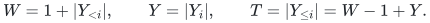

At the new stopping check, <code class="math">W\ge2</code> and
<code class="math">Y\le\varepsilon W/10</code>. Equations (C9)--(C10) mean that the set of
dominated classes is exactly the root class together with the classes
represented by <code class="math">Y_{&lt;i}</code>. Its cardinality is <code class="math">W</code>; no full or extra
class is discarded. The actual selected and blocker sets give

<!-- math-display: 90e50ffcfe5fd301cf66f0c2
D=X_{\le i}\cup Y_{\le i}=V(K),\qquad |D|\le2T
                                    <(2+\varepsilon)(W-1).        \tag{C12}
-->
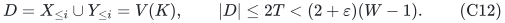

Every selected vertex is dominated by a matching blocker. Every blocker
is dominated by its selected owner. All other vertices in the retained
active classes are dominated by greedy maximality of their actual fresh
candidate. This proves total domination, including the vertices of <code class="math">D</code>
themselves, without an arbitrary-neighbour oracle.

The public layer invariant and prefix avoidance make the induced graph on
<code class="math">D</code> a disjoint union of nontrivial stars. Its matching leaves represent
all players of

<!-- math-display: a004d588e17c297641aff500
S_0=\{\text{root}\}\cup A(Y_{\le i})
-->
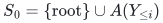

except the root, so it is the required constellation. Notice that
<code class="math">S_0</code> may strictly contain <code class="math">S</code> when <code class="math">Y_i\ne\varnothing</code>.

Twin labels can be removed from the final certificate without identifying
two of its vertices. Two selected twins of the same base bundle would
have the same matching blockers, contradicting the unique-blocker-owner
invariant when both are blocked. A selected twin of its own matching
representative would have no matching blocker at all, because <code class="math">M</code>
is independent; this contradicts (C9). Matching representatives already
occupy distinct classes. The same argument applies across the live prefix.
Thus projection is injective on <code class="math">D</code>, preserves every edge, and produces
the actual minimal-bundle constellation and domination certificate in
Section 1.

There is also a direct implicit check of total domination. For each
<code class="math">p\in S</code>, form <code class="math">F_p(D)</code> as in (C6). Then domination of **all**
minimal configurations of <code class="math">p</code> is equivalent to

<!-- math-display: 00a002b8ad8faf044e9adaf8
\sum_{e\in A_p\setminus F_p(D)}v_e<B.           \tag{C13}
-->
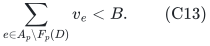

If the inequality fails, the greedy primitive supplies an undominated
minimal configuration. Thus the complete output is independently
checkable with resource scans and explicit bundle intersections, without
enumerating the configuration graph.

## 7. Runtime, precision and a common public fallback

All combinatorial operations occur in a finite graph, but every operation
has the implicit implementation above. One main-loop iteration makes only
polynomially many BuildLayer calls in <code class="math">q</code>: there are at most <code class="math">q+1</code>
live layers, at most that many collapses, and at most that many inspected
layers per SuperposedBuild. Each bundle list has length at most <code class="math">&#124;E&#124;</code>.
The per-iteration cost is therefore
<code class="math">P\mathrm{poly}(q,1/\varepsilon)</code>, times finite-word arithmetic.

The current-blocker signature proof uses the number of classes, the claw
parameter and the rational thresholds, not the number of unmaterialized
configurations. Substituting <code class="math">r=q+1</code> into that proved bound and absorbing
the per-iteration polynomial factors gives (C3). No graph-size exponent
is applied to <code class="math">2^{&#124;E&#124;}</code>.

After clearing the denominator of <code class="math">B</code>, sums, comparisons and greedy
pruning use <code class="math">O(b+\log P)</code>-bit integers. The rational class thresholds
use an additional <code class="math">O(b_\varepsilon+\log q)</code> bits. The algorithm does
not compute the logarithms used in its signature analysis.

The elementary single-vertex constellation procedure has an implicit
implementation using the same available-bundle test and fresh twins. It
resolves unblocked selections immediately, so it also needs no arbitrary
neighbour. Together with the composition-signature count already proved
in [independent-transversal-elementary-exponential-fallback.md](independent-transversal-elementary-exponential-fallback.md), this
gives the common public fallback

<!-- math-display: 85ef9de455f7444f43092cc4
P\exp(O(q))\mathrm{poly}(b+\log P),
-->
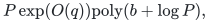

with the stronger failed certificate <code class="math">S_0=S</code> and
<code class="math">&#124;D&#124;\le2(&#124;S&#124;-1)</code>. The best available bound from these two named
interfaces is their minimum. The new quasipolynomial class dependence is
meaningful for the current-blocker certificate; it is not presented as a
new approximation constant for a resource-allocation problem.

## 8. An optional anchored-family extension

For parameters not small enough to force (C9), one can instead enlarge
the conceptual family to minimal bundles <code class="math">C</code> and sets <code class="math">C\cup\{e\}</code>
with one additional eligible resource. BuildLayer can still return only
minimal bundles: existence of any enlarged feasible bundle in the
available resources implies existence of a minimal one there. The
constellation and matching therefore remain minimal.

In this enlarged graph, an isolated bundle uses only resources eligible
to its own remaining player. A player with at least <code class="math">B</code> value in such
private resources can be selected and removed. Otherwise every bundle
contains a shared resource <code class="math">e</code>; a neighbour is obtained by taking any
cached minimal bundle of a second eligible player and adjoining <code class="math">e</code>.
This provides a polynomial neighbour-completion routine.

If values are capped at <code class="math">B</code>, which leaves minimal threshold bundles
unchanged, a minimal bundle has capped value less than <code class="math">2B</code>, and an
anchored bundle has capped value less than <code class="math">3B</code>. Only the small
neighbour-completion part of <code class="math">D\setminus V(K)</code> needs such nonminimal
vertices. This is a useful alternative interface, but is not needed for
the exact minimal-only theorem proved above. Whether its extra capped
value can be absorbed in a particular allocation theorem requires that
theorem's own dual or constellation analysis.

## 9. What this does and does not transfer

The construction closes the exponential-configuration **implementation**
gap for the stated current-blocker domination/constellation oracle. Its
two ingredients are ordinary threshold feasibility under resource
deletions and the integer no-unblocked-at-a-certificate property. A
prescribed-resource minimal-cover oracle, isolated-minimal-bundle oracle,
or exact configuration enumeration is unnecessary.

For a restricted Santa Claus application, a separate argument must show
that the returned certificate is inconsistent with the chosen target
promise. In particular, one cannot replace the <code class="math">&#124;S_0&#124;-1</code> matching
leaves of the constellation by <code class="math">&#124;S&#124;-1</code> merely because <code class="math">D=V(K)</code>.
No below-four guarantee is inferred before that missing application
inequality is proved.
