# Rank-sensitive counting for certified Haxell layers

**Further analysis, 25 October 2026.** This note strengthens the
weighted count from [strong haxell matching proof](../../problems/strong-haxell-matching/proof.md).
It applies both to the no-superposition algorithm and, through the
constant number of adopted-reset epochs, to the original BHHS
operations reanalyzed in
[public-hypergraph-algorithm-weighted-reanalysis.md](public-hypergraph-algorithm-weighted-reanalysis.md).
It does not alter the previously delivered checkpoint archive.

The improvement uses the cutoff at which a parent is still allowed
to create another child. The resulting number of children depends
on the hyperedge rank, rather than on the rank times the degree
cap. The root contributes a separate logarithmic factor, which
cannot be removed by a simple active-incidence accounting argument.

## 1. Statement

Use the common explicit-hypergraph convention: `q=|A|` left
vertices, at most `r` right vertices per edge, input volume
`p=sum_e |e|`, and degree cap `Delta>=4`. Write

<!-- math-display: 40840de0bfb05f560d351d69
U=\log(p+4),\quad h=\log(U+4),\quad s=\log\Delta,
 \qquad
 a=\min\{\log(2+s),\log(2+\log(r+2))\}.
 \tag{1}
-->
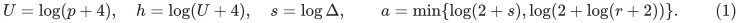

After the standard trivial checks, `Delta r^2<=p`, so
`s<=U`. Assume either the strong condition

<!-- math-display: 0b8a176b842b9bb722f92966
\tau(E_S)\ge\Delta r^2 |S|
                    \quad(S\subseteq A),
 \tag{2}
-->
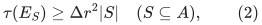

or use the explicit growth-test/certificate alternative of the
no-superposition algorithm. In the latter case the count applies
until a violation is returned.

The number of layer builds is at most

<!-- math-display: 0ef916daab2c8cf2dfa3a2be
O\!\left(\min\{\log(q+1),\,1+s/a\}\right)
        \exp O\!\left(\frac{a\log(q+1)}s\right).
 \tag{3}
-->
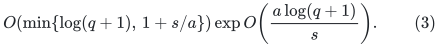

Consequently the explicit implementation takes

<!-- math-display: 815bfb78363a7352346b0a01
O(|A|+|B|)+p\exp O\!\left(
             h+\frac{a\log(q+1)}s\right)
 \tag{4}
-->
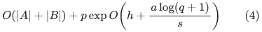

time. The original source's operations have the same bound under
(2); successful superpositions add only a constant number of
epochs. The faster no-promise certifying outcome is stated for
the explicitly tested implementation.

For constant rank, (3) specializes to

<!-- math-display: 66f82a05a61eb4f5b1eeacbe
O\!\left(\min\{\log(q+1),1+\log\Delta\}\right)
      \exp O\!\left(\frac{\log(q+1)}{\log\Delta}\right).
 \tag{5}
-->
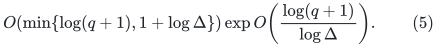

In particular, for `Delta>=p^epsilon`, this gives

<!-- math-display: 0400bc80a32c72dd652ba3db
O(|A|+|B|)+p\log(p+4)\exp O(1/\epsilon)
 \tag{6}
-->
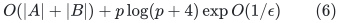

for constant `r`. The constants in this expression are uniform
in `epsilon`; its feasible parameter range is inherited from
`Delta r^2<=p`.

## 2. The child cutoff removes the factor Delta from the fanout

Fix a positive-index layer instance `i`, and let
`W=|Y_<i|>0`. This lower prefix remains fixed during the
layer's lifetime. The selected edges obey their cap, so

<!-- math-display: 23f48e5db011230b1046bea5
|X_i|\le\Delta|Y_{i-1}|\le\Delta W.
-->
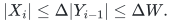

Every selected edge has at most `r` matching blockers, hence

<!-- math-display: 4bc07e06a5f83ec8363193f9
|Y_i|\le r\Delta W.
 \tag{7}
-->
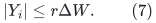

In the no-superposition algorithm, `Y_i` only decreases. In
the public algorithm, (7) holds at the start of each epoch and
throughout the epoch; an adopted superposition starts a new one.

A direct child is born only when the parent is noncollapsible.
The growth and noncollapse inequalities give

<!-- math-display: 3836f7c7f01e0879f42f099e
z=W+|Y_i|\ge\kappa W,
 \qquad\kappa=1+9\Delta/100.
 \tag{8}
-->
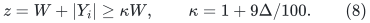

Within one epoch, the prefix sizes of successive children
satisfy `z_(j+1)<=rho z_j`, where `rho=.99`. This follows
from the child's swap: it removes at least one percent of
the then-current `W+|Y_i|`. Therefore all child birth sizes
in the epoch lie in the interval

<!-- math-display: 0b16009987b4cb5d1f32c0d0
[\kappa W,(1+r\Delta)W].
-->
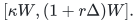

The ratio of its endpoints is bounded independently of `Delta`:

<!-- math-display: 6f1d62c0939465858fa8f015
\frac{1+r\Delta}{1+9\Delta/100}
                   \le\frac{100r}{9}<12r.
 \tag{9}
-->
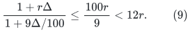

An epoch consequently has at most

<!-- math-display: 7944d55823a740e0fad79df3
L_r=2+\left\lceil\frac{\log(12r)}{-\log\rho}\right\rceil
        =O(\log(r+2))
 \tag{10}
-->
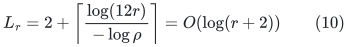

created children. The possible last living child is included:
the argument applies to the list of births already present in
any finite execution prefix, without assuming it will terminate.

For the no-superposition algorithm there is one epoch. For the
public algorithm there are at most `J=26`, because the selected
count starts above `Delta W/10`, is bounded by `Delta W`,
and each adopted superposition increases it by a factor at
least `1.1`. Thus a positive-index instance has at most
`J L_r` direct children.

## 3. Rank-sensitive contracting weights

Choose

<!-- math-display: d9f77d0617da2361371f6832
\lambda_r=\frac{\log(2J L_r)}{\log\kappa}.
 \tag{11}
-->
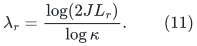

Give the parent instance weight `W^(-lambda_r)`. Every
child has prefix size at least `kappa W` by (8), so

<!-- math-display: f261d639e2dd71cc64bdf289
\sum_{child} W_{child}^{-\lambda_r}
       \le J L_r\kappa^{-\lambda_r} W^{-\lambda_r}
       =\tfrac12W^{-\lambda_r}.
 \tag{12}
-->
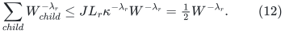

For `Delta>=4`, one has `log kappa=Theta(log Delta)`;
for example `kappa>=Delta^(1/5)`. Equation (10) therefore
implies

<!-- math-display: fff58966cecc882567598469
\lambda_r=\Theta\!\left(
                   \frac{\log(2+\log(r+2))}s\right).
-->
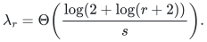

Independently, the rank-free geometric-series proof supplies
`lambda_u=C log(2+s)/s` with the same one-half child-weight
contraction, including `J=26` epochs, for an absolute constant
`C`. Take `lambda=min{lambda_r,lambda_u}` and use the
corresponding proof. Thus

<!-- math-display: d01f8dcf0241b5611ca499f2
\lambda=\Theta(a/s).
 \tag{13}
-->
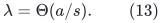

The weights are analysis objects only. No real arithmetic or
evaluation of powers is required by the algorithm.

## 4. The root factor must be retained

The root's children have prefix sizes equal to successive
positive unmatched counts. These counts decrease by a factor
at most `rho` between children. They are at least one, so
their weights sum to at most

<!-- math-display: 7e0a8874fe9f871b539f77d6
\min\left\{O(\log(q+1)),\frac1{1-\rho^\lambda}\right\}
       =O\!\left(\min\{\log(q+1),1+1/\lambda\}\right).
 \tag{14}
-->
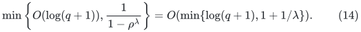

The first bound uses the number of root children and the fact
that every weight is at most one. The second reverses their
geometrically decreasing prefix-size sequence.

Summing (12) over the forest of positive-index layer instances
shows that total node weight is at most twice (14). Every
node weight is at least `q^(-lambda)`. Equations (13)--(14)
prove (3), in every finite execution prefix. They also prove
termination: another unmatched left vertex would require either
another finite build or a returned violation certificate.

When `r` is constant and `s` is comparable to `U`, the main
exponent `lambda log q` can be constant, but the prefactor
in (14) can grow like `log p`. It cannot generally be absorbed
into that constant exponent. Keeping `h` in (4) is essential
for this proof.

## 5. Concrete constant-rank regimes

The following table gives overheads multiplying `p`, with
the same strong promise (2). It omits the one-time unused
vertex-list reading cost.

| Strength parameter | Previous rank-free weighted bound | Rank-sensitive bound for constant `r` |
|---|---:|---:|
| `Delta>=p^epsilon` | `(log p)^{O(1/epsilon)}` | `log(p+4) exp O(1/epsilon)` |
| `Delta>=exp(U^beta)`, fixed `0<beta<1` | `exp O(U^(1-beta) log U)` | `U exp O(U^(1-beta))` |
| `Delta>=U^c`, fixed `c>0` | `exp O(U log log U/log U)` | `U exp O(U/log U)` |

These are bounds for the layer method, not lower bounds on the cost of
the task. Take their minimum with the elementary linear-time regimes
below. In particular the first row is not an improvement over elementary
greedy matching when `Delta>=sqrt(p)`; for fixed `epsilon>=1/2` that
entire parameter range is already linear after input reading.

For nonconstant rank, formula (1) selects the better of its
rank-sensitive and rank-free dependence. Both rates also follow
for the public BHHS operation sequence by the constant-epoch
argument. This is a further quantitative analysis, not an
exclusive advantage of a different explicit-hypergraph algorithm.

### An elementary linear-time regime

There is a useful separate endpoint that does not require layers. If

<!-- math-display: 91b6381991b1945002d6bcf0
\Delta r>q-1,
 \tag{14a}
-->
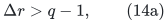

scan the incident edge lists of the left vertices one at a time, and
choose any edge avoiding the right resources already used by the
matching. Before the last choice, those resources number at most
<code class="math">r(q-1)&lt;\Delta r^2</code>. The singleton case of (2) guarantees a
permitted edge. Every edge list is scanned at most once, so this takes
<code class="math">O(&#124;A&#124;+&#124;B&#124;+p)</code> time. Without the promise, a failed left vertex and
the matching's current right resources are an immediate singleton
strong-Haxell violation certificate.

One should first test whether
<code class="math">&#124;B_{\rm used}&#124;&lt;\Delta r^2q</code>, in which case all left vertices
and all used right resources are a valid violation. If that test
passes and <code class="math">\Delta^2r^3\ge &#124;B_{\rm used}&#124;</code>, then

<!-- math-display: 36482d8f39dfaa8ec228de7c
q\le\frac{|B_{\rm used}|}{\Delta r^2}
   \le\Delta r,
-->
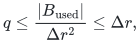

so (14a) holds. The direct input condition <code class="math">q\le\Delta r</code> already
suffices, without the resource-count inference. Since
<code class="math">&#124;B_{\rm used}&#124;\le p</code>, the more convenient condition
<code class="math">\Delta^2r^3\ge p</code>, and in particular
<code class="math">\Delta\ge\sqrt p</code>, also suffices for this elementary linear-time
certifying endpoint.

Another elementary preprocessing observation applies throughout the
parameter range. Scan all left vertices greedily once, producing a
maximal matching <code class="math">M</code> and the uncovered left set <code class="math">U_0</code>. Every edge
incident to <code class="math">U_0</code> meets <code class="math">B(M)</code>, because the matching only grew
after a failed scan. Under (2),

<!-- math-display: 7250ca0c23d8096ce7e2cf72
\Delta r^2|U_0|
   \le\tau(E_{U_0})\le |B(M)|\le r|M|,
 \qquad
 |U_0|\le\frac{q}{\Delta r+1}.
 \tag{14b}
-->
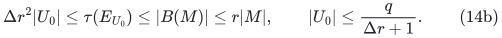

Without the promise, if <code class="math">&#124;B(M)&#124;&lt;\Delta r^2&#124;U_0&#124;</code>, then
<code class="math">(U_0,B(M))</code> is itself a valid strong-Haxell violation. This gives
a useful small uncovered set, but does not automatically solve that
set recursively: its available edges may still meet the existing
matching. An augmenting or reassignment argument is still needed.

These endpoints do not improve the root-prefactor proof itself. They
are separate elementary implementations or preprocessing observations.
The example below is explicitly an obstruction for the ordinary
layer-list scan. A preliminary greedy matching can avoid it, so the
example is not an obstruction for this or every other algorithm.

### Rank one already has a stronger classical phase bound

When `r=1`, the hypergraph is a bipartite graph, and (2) is simply
<code class="math">&#124;N(S)&#124;\ge\Delta&#124;S&#124;</code>. In this case use the classical
[Hopcroft--Karp algorithm](https://doi.org/10.1137/0202019) and its
linear-time phases of maximal collections of shortest augmenting paths.

For any nonperfect matching, start alternating BFS from an unmatched
left vertex. If the currently reachable left set <code class="math">S_j</code> has no free
right neighbor, every vertex of <code class="math">N(S_j)</code> is matched and its distinct
left mate is reachable in the next step. A matched edge incident to an
already reached left vertex only gives a mate that was already reached,
so it does not invalidate this counting. Therefore

<!-- math-display: 613f204d109f490318ad75af
|S_{j+1}|\ge|N(S_j)|\ge\Delta|S_j|.
-->
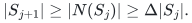

Since there are only <code class="math">q</code> left vertices, an augmenting path has length
<code class="math">O(1+\log(q+1)/\log\Delta)</code>. The shortest augmenting length
strictly increases after a Hopcroft--Karp phase, so the total time is

<!-- math-display: e7d76a5dadb537f15ccb440f
O(|A|+|B|)+O\!\left(p\left(1+
                       \frac{\log(q+1)}{\log\Delta}\right)\right).
 \tag{14c}
-->
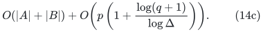

In particular this is <code class="math">O(p(1+1/\epsilon))</code>, plus input reading,
when <code class="math">\Delta\ge p^\epsilon</code>. The new layer analysis is not a
speed improvement in this graph case. Its nontrivial constant-rank
comparison concerns <code class="math">r\ge2</code> outside the elementary greedy regime.

## 6. Why scanning only active incidences does not eliminate the root logarithm

Here is an explicit family satisfying the strong promise, of
constant rank two, on which the direct edge-list implementation
spends `Omega(p log p)` time. The same lower estimate applies
if each build scans only edges incident to its active left
vertices. This is an implementation example, not a lower bound
for every possible algorithm or data structure.

### A 3-uniform example with large Delta

Take `q` left vertices `a_1,...,a_q`, let `Delta=q^3`, and
create original right resources
`x_1,...,x_(4Delta q)`. For every `j>=2` and
`1<=t<=4Delta j`, introduce a distinct private right resource
`b_(j,t)` and the hyperedge

<!-- math-display: 3c6bd86a331ae06783227597
\{a_j,x_t,b_{j,t}\}.
-->
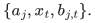

For `a_1`, include all hyperedges

<!-- math-display: dd9e7936192f324ef45d4fae
\{a_1,x_u,x_v\},
             \qquad1\le u<v\le4\Delta+1.
-->
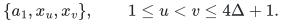

Every edge has exactly two right vertices and total size three.
There are no duplicate hyperedges. The input volume is

<!-- math-display: ad73c8bc3c3699898357d589
p=3\binom{4\Delta+1}{2}
       +3\sum_{j=2}^q4\Delta j
       =\Theta(\Delta^2+\Delta q^2)=\Theta(q^6).
 \tag{15}
-->
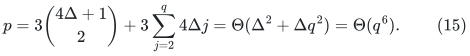

It is dominated by the edges incident to `a_1`.

For `S={a_1}`, the right-side hitting number is the vertex
cover number of a clique on `4Delta+1` resources, namely
`4Delta`. If `S` contains another left vertex and
`J=max{j:a_j in S}`, then its `a_J` edges form a matching
of size `4Delta J` in the right coordinates. Thus any hitting
set has at least that size. Taking all original resources
`x_1,...,x_(4Delta J)` hits every edge for `S`, proving

<!-- math-display: c571e046d746fff8bc570046
\tau(E_S)=4\Delta J
                         \ge4\Delta|S|.
-->
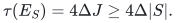

Hence (2) holds with `r=2`. Also `Delta` is a fixed
polynomial of `p`; for example `Delta>=p^(1/3)` for all
sufficiently large `q`.

### A persistent expensive unmatched left vertex

Use the legitimate deterministic greedy order
`a_q,a_(q-1),...,a_1`. Within `a_j` for `j>=2`, scan
resources by increasing `t`. Until `a_1` is matched, every
matching edge consists of one original resource and one private
resource owned by a different, already matched left vertex.

During a root-layer build, the currently forbidden original
resources therefore form an initial segment
`x_1,...,x_c`. A candidate for an unmatched `a_j`, `j>=2`,
is available exactly when its original resource is unmarked.
Its private resource belongs to that unmatched left vertex and
cannot occur in the current matching or in another left vertex's
selected edge. Deleting the full matching blocker of an accepted
edge adds no additional original resource, only an irrelevant
private resource of a matched vertex. Thus the initial-segment
description persists throughout the scan.

Suppose the unmatched set contains the entire prefix
`a_1,...,a_L`, with `L>=6`, and put `j_0=floor(L/6)`.
After processing the vertices `a_L,...,a_(j_0+1)`, one must
have `c>=4Delta j_0`. Otherwise, each of those `L-j_0`
vertices had more than `Delta` available original resources
and accepted its full quota. This would give

<!-- math-display: f5faddabc09c6ea7583782c4
c\ge(L-j_0)\Delta\ge5L\Delta/6
        >4j_0\Delta,
-->
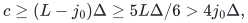

a contradiction. Any previously processed higher-index active
vertices only increase `c` and cannot invalidate this argument.

Consequently every `a_j` with `2<=j<=j_0` has all its
candidate original resources marked and accepts no edge.
For `a_1`, at most one of its `4Delta+1` clique resources
remains unmarked, so it too accepts no edge. The entire prefix
`a_1,...,a_(floor(L/6))` remains unmatched after this root
layer collapses.

There is no hidden deeper operation that matches these vertices.
The root layer contains at least `Delta` selected edges, while
at most `q` of them have a matching blocker. Since
`Delta=q^3`, more than one tenth are free and the root layer
collapses immediately. Lower-level swaps are not needed. Only
left vertices represented among its selected edges can become
newly matched in that collapse.

Starting from `L=q`, at least `Omega(log q)=Omega(log p)`
root builds occur before `a_1` can be matched. On every such
build, an ordinary edge-list scan visits all
`Theta(Delta^2)=Theta(p)` candidate edges of `a_1`, because
none is accepted and its quota never fills. The resulting work
is `Omega(p log p)`, even when edges of all inactive left
vertices are skipped.

### What would be required to improve this cost

The example rules out the claim that the sum of active-edge
incidences scanned by these builds is automatically `O(p)`.
It does not rule out a different implementation. For example,
a data structure might reuse a previously discovered hitting
certificate whenever the current forbidden resources still
contain it. Such reuse would need a separate correctness and
update-cost argument as the matching and forbidden sets change.
No such general amortized bound has been established here.
Accordingly the root factor in (3)--(6) is retained.
