# Current blocker growth and a rank-linear exponent for weak Haxell

**Research reanalysis, 25 October 2026. Root and independent
mathematical audits completed.**

This is a further quantitative reanalysis of Annamalai's public
augmenting algorithm. It strengthens
[weak-haxell-uniform-lifetime-analysis.md](weak-haxell-uniform-lifetime-analysis.md) by measuring the **current
matching blockers** of every surviving noncollapsible layer. The
earlier birth bound on selected edges is retained separately, since
it pays for collapses, including immediately collapsing new layers.

The resulting deterministic uniform running time is

<!-- math-display: c096de4aa61349914967278c
P\,(n+1)^{\,O((r/\epsilon)\log(2+r/\epsilon))}
       \mathrm{poly}(b_\epsilon+\log P),           \tag{1}
-->
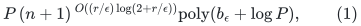

for an explicit `r`-uniform bipartite hypergraph, under the sufficient
condition

<!-- math-display: 0c5ae3c3e9161e62c7890db2
\tau(E_S)>(2r-3+\epsilon)(|S|-1),\qquad 0<\epsilon<1.
                                                               \tag{2}
-->
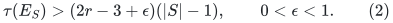

Here `r` is whole-edge size, `n` is the number of left vertices,
`P` is total explicit incidence and vertex-list volume plus two, and
`b_epsilon` is the rational input bit length. A certifying variant
returns either a left-perfect matching or an explicit violation of
(2). The qualitative matching theorem and certifying formulation
already belong to Annamalai. Equation (1) is the sharper
uniform analysis; it is not a general-graph matching result.

The source is [Annamalai, arXiv:1509.07007v2](https://arxiv.org/html/1509.07007v2),
Sections 3--5. The companion note specifies its operations and their
extension-prefix convention, and proves the persistent historical
certificates from actual executed attempts. The new algebra and count
are given in full below.

## 1. Two separate growth quantities

Keep the public parameters

<!-- math-display: 5232ae030d189b8709823623
\mu=\frac{\epsilon^2}{10r^2},\quad
 Q=\lceil1/\mu\rceil,\quad
 \delta_X=\frac{\epsilon}{5r^2}.
-->
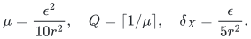

For a live layer `i`, let `W_i=|Y_<i|`, including the unmatched
dummy root in `Y_0`. Its lower prefix is fixed throughout its
lifetime. The companion proof establishes, at **every** birth,

<!-- math-display: 8b8b20243472eefb1c81b362
|X_i|>\delta_X W_i.                    \tag{3}
-->
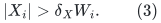

This includes a new layer that immediately collapses. Selected sets
only grow while their layer is alive, so (3) persists.

The new assertion concerns a different quantity and a different time:
at every main-loop boundary, every surviving positive layer obeys

<!-- math-display: 62df0f6be8ec62c2a4242b73
|Y_i|>\delta_Y W_i,
             \qquad \delta_Y=\frac{\epsilon}{10r}.      \tag{4}
-->
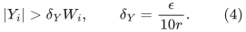

It is the **current** `Y_i`, after any previous collapse and extension,
not its birth value. Equation (4) will follow anew from current
noncollapsibility and the latest actual candidate; it is not inferred
by monotonicity of blocker sets.

## 2. What the latest actual candidate implies at the current time

For each live layer `j`, record the output
`(Xhat_j,Yhat_j)` of its latest actual greedy build or extension.
If adopted, it equals the current layer immediately after adoption.
If rejected, writing `E_j=Xhat_j minus X_j` gives

<!-- math-display: c536b41b60589fb8aa7ddc58
|E_j|<\mu|X_j|.                  \tag{5}
-->
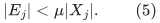

Until the next direct-child collapse, the selected set `X_j` and its
current matching blockers `Y_j` are unchanged. That next collapse
is immediately followed by a fresh actual attempt. The lower prefix
is unchanged while the layer survives. Swaps above this layer do not
touch its support, because the inserted matching edge belongs to a
higher layer disjoint from every lower support.

Thus, at the time under consideration, the recorded candidate
contains the current support `B(X_j union Y_j)`. Any additional
physical resources come from its at most `mu|X_j|` extra selected
edges and their then-blockers. Those then-blockers may no longer be
in the current matching, but their resource sets are retained as
fixed ghosts. Set

<!-- math-display: 11e38b917a3122eaea79a3b6
C_j=B(\widehat X_j\cup\widehat Y_j).
-->
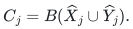

Each extra selected edge and its then-blockers contributes at most
`(r-1)^2` additional resources. Consequently

<!-- math-display: d9b7099e204c4e44920fe4df
|C_j|\le |B(X_j\cup Y_j)|+\mu(r-1)^2|X_j|.             \tag{6}
-->
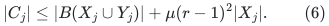

The current matching blockers are pairwise disjoint, and each meets
exactly one selected edge. Counting at least one distinct overlap
resource for each blocker gives

<!-- math-display: c695a91406c62df0351a8032
|B(X_j\cup Y_j)|\le(r-1)|X_j|+(r-2)|Y_j|.             \tag{7}
-->
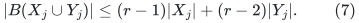

At a main-loop boundary, current noncollapsibility gives
`|X_j|<=|Y_j|/(1-mu)`. Combining (6)--(7) yields

<!-- math-display: 6180cafe9ae77ca3c27c80cf
|C_j|\le(a+\eta)|Y_j|,\qquad
 a=2r-3,\quad
 \eta=\frac{\mu r(r-1)}{1-\mu}.                         \tag{8}
-->
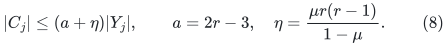

This is precisely the conversion from historical candidate size to
the **current** blocker count that the argument needs. Both terms
in (6) are paid using the same unchanged current selected set, whose
size is bounded by current noncollapsibility. No birth blocker count
appears in (6)--(8).

Let `F_j` be the active left vertices with degree `Q` in the
recorded candidate. Since `|Xhat_j|<=(1+mu)|X_j|` and
`1/Q<=mu`,

<!-- math-display: 9ccc4b66cd1f5f3f19b37eb2
|F_j|\le f|Y_j|,\qquad
                f=\frac{\mu(1+\mu)}{1-\mu}.            \tag{9}
-->
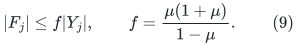

For an active left vertex outside `F_j`, every incident hyperedge
meets the lower forbidden prefix or `C_j`. This is the fixed
physical hitting certificate of the actual maximal greedy attempt.
Its own matching edge, if any, already meets the lower prefix, so
the statement includes all input edges.

## 3. Proof of current blocker growth

Fix any positive layer `i` at a main-loop boundary. Look only at
the prefix through `i`, and put

<!-- math-display: c35632bc66ce6f5c39c5fbac
W=|Y_{<i}|,\qquad Y=|Y_i|.
-->
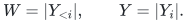

The `W` active left identities for this prefix are those represented
by the dummy root and the matching blockers below `i`. They are
distinct. Remove every candidate-full set `F_j` for `1<=j<=i`
from them and call the result `S`. Let

<!-- math-display: 9d9aff6c1d146c9a0c7893aa
C=\bigcup_{j=1}^i C_j.
-->
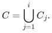

All lower forbidden supports are covered by earlier `C_j`, so `C`
hits all of `E_S`. Equations (8)--(9) give

<!-- math-display: 4405922b4c2ac5a536a87f4f
|C|\le(a+\eta)(W-1+Y),
 \qquad |S|\ge W-f(W-1+Y).                              \tag{10}
-->
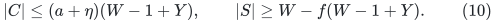

Here the `-1` removes only the dummy root, which has no right support.
All quantities `Y_j` in this sum are current matching-blocker counts.

Since `r>=2`, `epsilon<1`, and `mu<=1/40`,

<!-- math-display: e4492080d2294427840fe2ce
\eta\le\frac4{39}\epsilon^2,
 \qquad
 (a+\epsilon)f
     \le\frac{41}{780}\epsilon^2.
-->
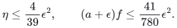

For the second bound use `(r-1)/r^2<=1/4`. Therefore

<!-- math-display: 8e53cf19885b1c9a7ef7f9bb
\eta+(a+\epsilon)f
          \le\frac{121}{780}\epsilon^2
          <\epsilon/5.                                 \tag{11}
-->
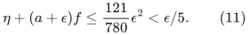

Suppose first `W>=2` and, contrary to (4),
`Y<=epsilon W/(10r)`. Then

<!-- math-display: 87991cc32a35533db5fba02d
\frac{Y}{W-1}\le\frac{\epsilon}{5r}.
-->
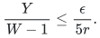

Using (10)--(11),

<!-- math-display: f81bd5eb71380844107dfdf5
\begin{split}
 |C|+(a+\epsilon)f(W-1+Y)
  &\le(a+\epsilon/5)(W-1+Y)\\
  &\le(a+\epsilon/5)(1+\epsilon/(5r))(W-1)\\
  &\le(a+31\epsilon/50)(W-1)\\
  &<(a+\epsilon)(W-1).
\end{split}                                               \tag{12}
-->
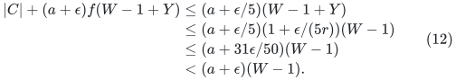

In the third line use `a<=2r` and
`epsilon^2/(25r)<=epsilon/50`. Combining (12) with the
lower bound for `|S|` proves

<!-- math-display: 9855df97746c7ed811f56894
|C|<(a+\epsilon)(|S|-1).          \tag{13}
-->
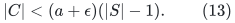

The set `S` is nonempty: from (9), `f<=41/1560`, and under
the assumed upper bound on `Y`, at most `(41/1560)(21/20)W`
active identities were removed. Thus (13) is a valid explicit
violation of (2).

If `W=1`, (3) implies `|X_i|>=1`. Noncollapsibility then
implies `|Y_i|>=1`. Since `epsilon/(10r)<1`, (4) follows
directly in this case. This handles the first positive layer without
subtracting a nonexistent matching edge from the dummy root.

Under (2), the failure case (13) is impossible. This proves (4) for
every current noncollapsible layer, including after rejected and
adopted extensions.

## 4. Lifetime count with the stronger parent growth

The birth-selected bound (3) still controls the number of adopted
resets. For a layer with fixed `W`, its selected count starts above
`delta_X W` and never exceeds `QW`. Each adoption increases it by
`1+mu`. Thus its children split into at most

<!-- math-display: c5db965d4b0025a367983f0b
J=1+O(\mu^{-1}\log(Q/\delta_X))
-->
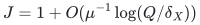

epochs. In each epoch, successive child prefix sizes decrease
geometrically with ratio at most `1-tau`, where

<!-- math-display: 29082138d9a3af18bf492bc8
\tau=\mu\delta_X/Q
               \ge\epsilon^5/(1000r^6).                \tag{14}
-->
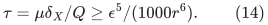

Indeed a collapsing child has more than `mu|X_child|` unblocked
selected edges and at most `Q` per active left identity. It swaps
at least `mu|X_child|/Q > tau W_child` distinct parent blockers.
Equation (3), rather than (4), is used here. It therefore includes
children that immediately collapse and never become a surviving
noncollapsible layer.

At every child birth, however, its parent is a current noncollapsible
layer at a main-loop boundary. The new (4) gives

<!-- math-display: d1550ba9ee28e09e80a96e99
W_{child}\ge(1+\delta_Y)W_{parent}.     \tag{15}
-->
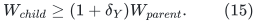

Set

<!-- math-display: 646507ae99999269c8762ab1
\lambda=C\delta_Y^{-1}\log(2+r/\epsilon)
                  =O((r/\epsilon)\log(2+r/\epsilon)).   \tag{16}
-->
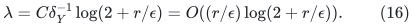

The logarithms of `J` and `1/tau` are only
`O(log(2+r/epsilon))`. A sufficiently large absolute `C` makes

<!-- math-display: 9c273467698d1a09e6be65df
J\frac{(1+\delta_Y)^{-\lambda}}
              {1-(1-\tau)^\lambda}\le\tfrac12.         \tag{17}
-->
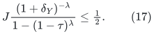

Use the same weight `W^(-lambda)` for every born layer. In a
finite execution prefix, each epoch's child weights are summed in
reverse chronological order, with a possible final living child
included. Equations (14)--(15) bound that sum by the corresponding
geometric series in (17). Summing over epochs gives half the
parent's weight.

There is only one positive child of the dummy root in an augmenting
call, because its collapse matches the root and terminates that call.
Its weight is one. Total layer weight in every finite execution
prefix is therefore at most two. Each layer has `W<=n`, so at most
`2(n+1)^lambda` layers are created. All attempts and collapses have
the same order of count. This proves termination with the exponent
in (1); it does not condition the count on already having terminated.

### 4.1 An independent count using the public signature

The same rate also follows from a shorter count of the source's
original signature vectors. This provides a second route after the
current-blocker growth lemma, without using the lifetime tree.

The source's signature decreases lexicographically using the original
birth-selected growth, the adopted-extension rule, and the collapse
decrease. Those rules are unchanged here. Its absolute coordinates
are nondecreasing because the original birth-selected inequality is
also unchanged. But the current-blocker bound now limits the number
of positive layers to

<!-- math-display: 538e0ffe98be4961f505eafd
L=O(\delta_Y^{-1}\log(n+1)).
-->
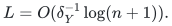

Keep the source's logarithmic base `b=1/(1-mu^3)`. Its largest
finite coordinate is at most

<!-- math-display: 1bb5ae5cac354cfab2d15631
H=O\!\left(\mu^{-3}
       [L\log(1/\delta_X)+L\mu+\log(n+1)]\right).
-->
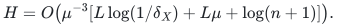

Fixed signs and at most `2L` nondecreasing nonnegative integer
absolute coordinates give at most

<!-- math-display: f13ea564a8530be98219f00b
(2L+1){\lceil H\rceil+2\lceil L\rceil+1
                  \choose 2\lceil L\rceil+1}
-->
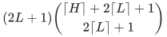

signatures, with harmless ceiling adjustments. Its logarithm is

<!-- math-display: aa753bef6475644faee0c1e9
O\!\left(L\log(2+H/L)\right)
   =O\!\left((r/\epsilon)\log(2+r/\epsilon)
                      \log(n+1)\right).
-->
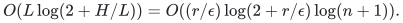

This count remains valid when the displayed upper bound `L` exceeds
`n`; it is simply an overcount. The cases `n<=1` are handled
directly. Thus the sharper exponent is already obtained by the new
current-blocker lemma together with the public signature's existing
monotonicity properties. The two counting proofs give the same
quantitative conclusion.

## 5. The certifying version needs one additional check, not a promise oracle

Retain the birth check (3) and its explicit certificate from the
companion note. Also check (4) for a newly surviving last layer at
the end of a main-loop iteration. If a cascade of collapses ends at
a surviving parent, check that parent after its actual extension
attempt. All lower layers remain unchanged, so checking only this
last affected layer preserves (4) for the whole live stack.

If the new check fails, construct `S,C` from (10). The actual
greedy maximality records prove hitting, and (12) proves the
cardinality guarantee. It is not necessary to verify (2) globally.
On promised inputs the check never changes the source's operation
sequence.

The supporting metadata is maintained by resource reference counts,
candidate lists, and left-cap marks. Updating it costs at most one
input scan per build or extension. The extra check, including
materializing a certificate on failure, has the same bound. The
explicit-input and rational-arithmetic analysis in the companion
note therefore proves (1) for the certifying version on arbitrary
inputs as well.

## 6. Comparison and scope

The previous length-aware count of the source signature gives a
uniform exponent `O((r^2/epsilon) log(2+r/epsilon))`. The present
proof saves one factor `r` by retaining the current blocking-set
size in the near-threshold hitting calculation. The source already
has the efficient bound `(2r-3)` per matching blocker; the new use
is to apply it to every current historical candidate and obtain
the parent-to-child growth (15).

This is a public-algorithm reanalysis with an explicit certificate
implementation. It does not improve the sufficient condition (2),
does not solve the exact Haxell boundary `epsilon=0`, and does not
give polynomial dependence on `1/epsilon`. It does not assert a
globally best known uniform bound without a separate literature
audit. For ordinary bipartite graphs (`r=2`), standard matching
algorithms are much faster and should be used instead.

A relevant later public algorithm is Graf--Haxell,
[*Finding Independent Transversals Efficiently*,
arXiv:1811.02687v2](https://arxiv.org/html/1811.02687v2),
Theorem 4 and Section 7.1. Its constellation certificate does imply
the same weak-Haxell promise, by using the input slack
`epsilon'=epsilon/(r-1)`; it would be incorrect to dismiss it by
the coarser `2(r-1)` resource-union bound. The displayed feasible
parameters in Definition 10 have
`rho=mu=epsilon'/(10r)`, hence `rho=Theta(epsilon/r^2)`
for that application. A length-aware count of its displayed
signature gives the rank-squared rate, rather than immediately
giving (1). Its theorem itself states polynomial time for fixed
parameters and explicitly does not optimize their dependence.
This is a comparison with those named formulas, not an exclusion
of stronger analyses of that or other public algorithms.

The [public parameter comparison](weak-haxell-public-parameter-comparison.md) distinguishes the imported qualitative theorem from this quantitative analysis.
