# A normalized-image obstruction to bulk ambient deactivation

**A mechanism boundary, 24 October 2026.** This note examines one concrete
congestion-aware modification of a greedy spanner. It does not give a lower
bound for ambient-aware sparsification, and it does not claim that an
arbitrary dynamic matching trajectory realizes the construction.

The failed rule is: once an ambient resource reaches its load threshold,
remove from the **active** graph every selected native edge whose fixed
ambient image uses that resource, while retaining the selected edges and
the already assigned demand routes in the output. The example below uses
loads of the **loop-erased ambient routes**. It is not a counterexample
that depends on counting canceled traversals.

## 1. The precise rule

Let <code class="math">J</code> be a loopless native multigraph. Its edge IDs are distinct even
when their endpoints agree. Each native edge <code class="math">e=uv</code> has a fixed simple
path <code class="math">\Pi(e)</code> in an ambient graph, from the image of <code class="math">u</code> to the image
of <code class="math">v</code>. Write
<!-- math-display: 2942301e0b6d1ca2170fcacb
\Delta=\max_v\deg_J(v),\qquad
 C_0=\max_x|\{e:x\in\Pi(e)\}|.
 \tag{1}
-->
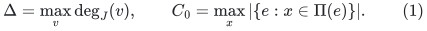
Endpoints are included in vertex congestion.

The algorithm maintains an active native graph <code class="math">F</code>, a retained selected
graph <code class="math">H\supseteq F</code>, and one assigned route for each processed native
edge. Initially both graphs are empty. On processing <code class="math">e</code>:

1. If its endpoints have an <code class="math">F</code>-path of at most <code class="math">b</code> edges, use such a
   path. Otherwise select <code class="math">e</code>, insert it into <code class="math">F</code> and <code class="math">H</code>, and use
   its identity route.
2. Concatenate the fixed ambient images of the chosen native path, then
   erase loops before adding its vertex loads.
3. At a resource whose load first reaches <code class="math">\tau</code>, deactivate every edge
   of <code class="math">F</code> whose fixed image contains that resource. Deactivation does
   not remove an edge from <code class="math">H</code> or change earlier assigned routes.

Take any fixed integer <code class="math">c\geq1</code> and integer quality parameter
<code class="math">\gamma\geq1</code>, with the prescribed scalar threshold
<!-- math-display: b0ff6910aaa6ca3d9d22c8f2
\tau=c\gamma(C_0+\Delta).
 \tag{2}
-->
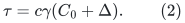
The same scalar threshold may also be imposed on ambient edges. The
example has no earlier edge-threshold event.

The construction works for every <code class="math">b\geq3</code>. In fact every active graph
that occurs is a forest, so no choice between different active native
paths is involved.

## 2. Native graph and exact threshold calibration

Choose an integer <code class="math">s\geq64c\gamma</code>. Let <code class="math">A,B</code> be disjoint sets of
size <code class="math">s</code>, so the native vertex count is <code class="math">n=2s</code>. Put
<!-- math-display: 35e9d646151c3c0c3235b670
P=\left\lfloor\frac{s}{16c\gamma}\right\rfloor,\qquad
 D=4s,\qquad
 q=8c\gamma-2.
 \tag{3}
-->
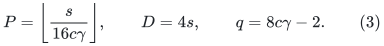
Choose distinct centers <code class="math">a_j\in A,b_j\in B</code>, for <code class="math">1\leq j\leq P</code>.
For phase <code class="math">j</code>, create a cross double-star
<!-- math-display: bca130fe972e351eebcde699
T_j=\{a_jb:b\in B\}
       \ \cup\ \{ab_j:a\in A\setminus\{a_j\}\}.
 \tag{4}
-->
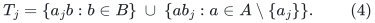
It has <code class="math">2s-1</code> edges, diameter three, and every edge joins <code class="math">A</code> to <code class="math">B</code>.
All occurrences in different phases have distinct native IDs. In
particular, two different double-stars can contain parallel IDs on
<code class="math">a_i b_j</code>; these IDs must not be silently identified.

Following the tree edges of phase <code class="math">j</code>, create
<!-- math-display: 0084d5eb13de1e59c26b9bde
T=qs+1
 \tag{5}
-->
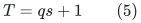
cross-demand IDs. They consist of <code class="math">q</code> perfect matchings between <code class="math">A</code>
and <code class="math">B</code>, followed by one extra edge. The <code class="math">Pq</code> full matchings can be
chosen edge-disjoint, since <code class="math">Pq&lt;s/2</code>. The extra edges can have distinct
endpoints across phases. Parallel IDs with tree edges remain allowed.

A center has at most <code class="math">s+P-1</code> tree incidences across all phases. Every
vertex has at most <code class="math">Pq+1</code> incidences in the full-matchings-plus-extra
demands. Thus every degree so far is less than <code class="math">2s</code>. Add a final group
of parallel padding IDs on any one native pair, all processed after the
phases, until the larger endpoint degree equals <code class="math">D</code>. This takes
<code class="math">O(s)</code> IDs, gives exactly
<!-- math-display: a5ce9a85107fe7c64e6bb8ca
\Delta=D,
 \tag{6}
-->
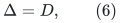
and does not affect any phase. The smaller endpoint degree remains at
most <code class="math">D</code>.

There are
<!-- math-display: 49c7224875fe06e7fa5d7588
m=P(2s-1+T)+O(s)=\Theta(s^2)
 \tag{7}
-->
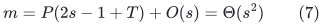
native edge IDs. Constants may depend on the fixed <code class="math">c</code>, but not on
<code class="math">s,\gamma</code>.

## 3. Ambient images and their normalization

For each phase add a private ambient hub <code class="math">x_j</code>. Its incident ambient
edges join it to all native vertices. Map every ID <code class="math">uv\in T_j</code> to
<!-- math-display: 1655345f2e0a7c4845ef504d
u-x_j-v.
 \tag{8}
-->
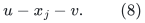
Every matching-demand and padding ID gets its own direct ambient edge
between its native endpoints.

The input paths are simple. No native vertex is an internal vertex of
an input path. Hence its input congestion is exactly its native degree.
The input congestion of <code class="math">x_j</code> is <code class="math">2s-1</code>, and all other relevant
resources have smaller congestion. Therefore
<!-- math-display: 40333f0872d1ce2db5122748
C_0=D.
 \tag{9}
-->
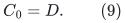
The declared threshold is consequently the exact integer
<!-- math-display: e8257859a8b8a4ef15609e82
\tau=2c\gamma D=8c\gamma s.
 \tag{10}
-->
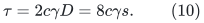

For a native path lying in <code class="math">T_j</code>, its concatenated ambient walk lies
entirely in the star centered at <code class="math">x_j</code>. Every intermediate native
vertex produces a return excursion from <code class="math">x_j</code> and back. Loop erasure
therefore gives exactly
<!-- math-display: 0a24393e917370b0e6847821
u-x_j-v
 \tag{11}
-->
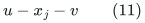
for the demand's endpoints <code class="math">u,v</code>. In particular, <code class="math">x_j</code> receives
**one**, rather than three, new units from a length-three native route.
The same conclusion holds for all identity routes of <code class="math">T_j</code>.

## 4. Every phase deletes its entire active tree

At the start of a phase the active graph is empty. Every edge of <code class="math">T_j</code>
is selected, because every proper initial subset of a tree has
disconnected endpoints for its next edge. The <code class="math">2s-1</code> identity routes
give <code class="math">x_j</code> that initial load.

The following <code class="math">T</code> cross demands have unique active paths of at most
three edges. Thus none is selected. By (11), each gives exactly one
unit to <code class="math">x_j</code>. Equations (3), (5), and (10) yield
<!-- math-display: 74466921935def818b4a29b9
\begin{split}
  (2s-1)+T
     &=(2s-1)+(8c\gamma-2)s+1\\
     &=8c\gamma s=\tau.
 \end{split}
 \tag{12}
-->
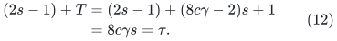
The hub reaches its threshold precisely on the last demand.

There is no earlier ambient vertex event. A native vertex receives load
only when it is the endpoint of a processed native demand; its total
load throughout the whole run is at most its native degree, at most
<code class="math">D&lt;\tau</code>. Other hubs have disjoint phase roles. An arm <code class="math">vx_j</code> receives
at most the current hub load, and in fact strictly less than <code class="math">\tau</code>:
its phase load is at most <code class="math">s+q+1</code>, whereas
<code class="math">\tau=8c\gamma s</code>.

At the event in (12), every edge of <code class="math">T_j</code> has a fixed image containing
<code class="math">x_j</code>. The rule therefore removes the whole tree from <code class="math">F</code>. It keeps
all <code class="math">2s-1</code> edges in <code class="math">H</code>, with their already assigned routes. This
establishes the induction needed to start the next phase with empty
active graph.

After the <code class="math">P</code> phases,
<!-- math-display: 11daf127f9044fd77eedfc44
|H|\geq P(2s-1)=\Omega\!\left(\frac{n^2}{c\gamma}\right).
 \tag{13}
-->
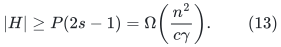
Processing the final padding cannot remove these retained IDs.

For example, with <code class="math">\gamma=\lceil\log_2 n\rceil</code>, the rule keeps
<code class="math">\Omega(n^2/\log n)</code> IDs on an input with <code class="math">m=\Theta(n^2)</code>, despite
normalized ambient paths of constant length and threshold
<code class="math">\Theta(\gamma(C_0+\Delta))</code>. This is much larger than
<code class="math">n\mathrm{polylog}n</code>. The active high-girth invariant provides
no bound on the inactive inventory: every active graph here is a tree.

## 5. Degree-three ambient variant with short simple input paths

The hubs' large physical degrees are not necessary. For each phase,
replace its star by a balanced binary tree <code class="math">X_j</code>, with <code class="math">s</code> leaf
positions for <code class="math">A</code> in its left half and <code class="math">s</code> leaf positions for <code class="math">B</code>
in its right half. Attach each native vertex to its phase leaf.
Map an edge of <code class="math">T_j</code> to the unique path between its two attached
native vertices.

Because every edge in (4) joins <code class="math">A</code> to <code class="math">B</code>, every such input path
uses the central edge <code class="math">f_j</code> of <code class="math">X_j</code>. Every subsequent cross-demand
route, after loop erasure inside this one tree, is its unique
endpoint-to-endpoint tree path and also uses <code class="math">f_j</code>. No noncentral
resource gets more phase load than <code class="math">f_j</code>; the two central endpoint
vertices have the same full phase load. Thus the scalar threshold
event again deactivates all of <code class="math">T_j</code>, no later than the event in (12),
and no earlier resource can change the active support: a resource
reaching the scalar threshold must already have accumulated the full
hub-equivalent count.

Replace each native vertex's physical incidence list by its own
balanced binary port tree. The canonical native image is its root;
one port is used for each phase-tree attachment and each direct-demand
incidence. Input paths start or end at this root. When a composed
<code class="math">T_j</code>-walk visits an intermediate native vertex, the two traversals
of its same phase-attachment path cancel. Therefore the normalized
route is still the unique path through <code class="math">X_j</code>, with only its two
endpoint port-tree paths.

All physical degrees are at most three, input path lengths are
<code class="math">O(\log n)</code>, and the total ambient size is <code class="math">O(m)</code>.
The input congestion of a port fiber is at most the corresponding
native degree; the central resources of <code class="math">X_j</code> have congestion
<code class="math">2s-1</code>. Hence <code class="math">C_0=D</code> still holds. Native-fiber query loads are
endpoint loads and remain at most <code class="math">D</code>. The same exact scalar
threshold and retained-ID lower bound follow.

This version is still a statement about the specified fixed-image
rule. Loop erasure is permitted; arbitrary replacement of a route by
a different ambient path is a different algorithm.

## 6. What would have to change

The failure is already static. It is not caused by dynamic route
notifications, moving endpoints, amortized update credit, or a failure
to implement short native path queries.

The input is a generic fixed-image native/ambient interface. This note
does not assert that each image contains a distinct own central
physical edge, that it is generated by a first-touched projection, or
that a particular matching-backend initializer produces the table.
Those are separate reachability restrictions. The present conclusion
is the exact failure of the stated bulk-deactivation template on its
advertised general ambient input.

The obstruction does not exclude a rule that:

* retains only a carefully chosen subset of the edges using a saturated
  resource;
* selects new native edges according to the ambient capacity they add,
  rather than merely abandoning all current images through the resource;
* reroutes earlier demands and proves a joint bound on its new selected
  inventory and the work of those reroutings; or
* computes paths in a richer ambient network instead of concatenating
  fixed images of the currently active native support.

Such a repair needs an additional theorem. The active native girth
bound and the threshold <code class="math">\Theta(\gamma(C_0+\Delta))</code> alone do not
prove sparse retained support. In particular, replacing a native-edge
congestion counter by a literal ambient congestion counter does not,
by itself, close the ambient-aware low-recourse interface needed by
the matching backend.
