# A reachable obstruction for a directed any-source tree epoch

**25 October 2026. New construction; root review and independent checks completed.**

The later-epoch checks are in
[tight-dag-and-directed-epoch-independent-audit.md](../graph-backends/tight-dag-and-directed-epoch-independent-audit.md). The explicit
preparation and its terminal-selection qualification are part of
the root review; no claim is made about every preparation policy.

This note gives a genuine general-matching ledger in which an exact
conservative source SPT has linearly many current records, but exhausting
all of its directed ancestor-to-descendant threshold paths earns only
polylogarithmic numerical and price credit. The fixed semantic certificate
remains far above LOW, and an explicit strong direction survives outside
that directed path family.

The obstruction is to the **directed** forest interface in
[any-source-fixed-tree-matching-interface.md](../graph-backends/any-source-fixed-tree-matching-interface.md). Reversing one tight receiving
edge gives an immediate escape. In particular, this is not an obstruction
to a compatible bidirected-forest interface, to local cut/link repairs, or
to an improved matching algorithm. It does not prove that a full refresh
is necessary.

Preparation below uses legal structural priorities and exact conservative
source paths to explicitly selected terminal bins. It does not assume that
an arbitrary improving allocation is automatically returned by an exact
source oracle. A particular algorithm that fixes a different global
terminal-selection policy is not asserted to follow this preparation.

## 1. Physical graph, current matching and record counts

Fix an integer <code class="math">q</code> tending to infinity. One copy of the construction
contains an odd cycle on <code class="math">2q+1</code> vertices. Initially match <code class="math">q</code> disjoint
cycle edges, leaving one cycle vertex free. Eventually this cycle will be
contracted to one free factor-critical bin <code class="math">W</code>, of weight

<!-- math-display: 3430e5b608ccdc2c14aec3dc
w_W=q+1.
-->
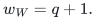

Attach <code class="math">q</code> distinct external rows <code class="math">r_i</code> at distinct physical cycle
ports. Row <code class="math">r_i</code> also has an assigned singleton leaf <code class="math">d_i</code> and a free
singleton leaf <code class="math">w_i</code>. Its three physical edges are therefore

<!-- math-display: 95cd46d49ab5590bc89c9c76
r_iW,\quad r_id_i,\quad r_iw_i.
-->
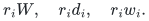

The notation <code class="math">r_iW</code> denotes one physical edge to its specified cycle
port, not an edge to a new physical supervertex.

There are four additional matched row/child pairs

<!-- math-display: 4cea894fc0db92d798620685
(s,b),\quad(u,g),\quad(r,a),\quad(t,c),
-->
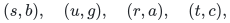

and two additional free singleton bins <code class="math">f,h</code>. Their physical incidences
are

<!-- math-display: a680c4a5e7a8bdb5e57b47d0
\begin{array}{c|l}
\text{row}&\text{neighbouring bins or future bins}\\\hline
s&f,b\\
u&h,g\\
r&W,a,b\\
t&g,c,b.
\end{array}                                                     \tag{O1}
-->
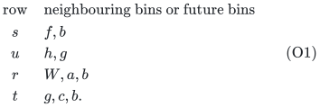

The port of <code class="math">rW</code> is distinct from the <code class="math">q</code> branch ports. There are
enough cycle vertices to choose all of these ports with at most one
external incidence at each physical vertex. Every physical vertex has
degree at most three. The bin <code class="math">b</code> has degree three, through <code class="math">s,r,t</code>.

Use two disjoint copies of this graph, with distinguished contacts
<code class="math">a,a'</code>, and add a matched remainder pair <code class="math">p,q_*</code> with physical
edges

<!-- math-display: fe59706644374c59bff8e29b
ap,\quad pq_*,\quad q_*a'.             \tag{O2}
-->
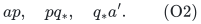

These are the only remaining paired-remainder contacts after preparation.
The physical graph is connected and nonbipartite because of its odd cycles.

One copy has <code class="math">5q+11</code> physical vertices: <code class="math">2q+1</code> cycle vertices,
<code class="math">q+4</code> external rows, and <code class="math">2q+6</code> external singleton bins. Thus the
whole graph has

<!-- math-display: 558abc753d781ea61376bcc7
N=10q+24.                              \tag{O3}
-->
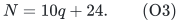

After contraction, each copy still has <code class="math">q+4</code> rows and <code class="math">2q+7</code> bins,
including <code class="math">W</code>. Its ordinary directed allocation graph has
<code class="math">\Theta(q)=\Theta(N)</code> current records. The argument is therefore not
based merely on the physical volume hidden inside one contracted bin.

The current matching has all <code class="math">q</code> internal cycle matches and all
<code class="math">q+4</code> row/child matches in each copy, plus <code class="math">pq_*</code>. It has size
<code class="math">4q+9</code>. Exposing the physical port of <code class="math">rW</code> as the free base of the
factor-critical cycle gives the augmenting path

<!-- math-display: a4fcde23d7544dd037e10282
W,r,a,p,q_*,a',r',W'.                   \tag{O4}
-->
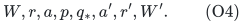

Internal cycle matchings can expose these prescribed ports. Conversely,
any matching uses at most <code class="math">q</code> internal edges in each odd cycle, at
most one remaining edge per external row, and at most two further edges
incident to <code class="math">p,q_*</code>. Hence its size is at most <code class="math">4q+10</code>. The true
matching gap is exactly one.

Take the legitimate phase target <code class="math">K=1</code>, and

<!-- math-display: c1641c7c6fbbf223ba055f8c
L=10000CN,
-->
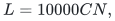

where <code class="math">C</code> is the usual logarithmic phase parameter. We restrict to
sufficiently large members of the family, so <code class="math">C\ge128</code>. All small
padding is on the guarded dyadic grid and is negligible compared with the
strict constant margins below.

## 2. Creating the odd bin is a legal operation

Write the cycle as alternating matched pairs
<code class="math">(z_1,v_1),\ldots,(z_q,v_q)</code>, with free vertex <code class="math">v_0</code>, path edges
<code class="math">v_{i-1}z_i,z_iv_i</code>, and closing edge <code class="math">v_qv_0</code>.

Choose the central port of <code class="math">rW</code> to be <code class="math">z_1</code>. Start cycle growth by
expanding <code class="math">(z_1,v_1)</code> from <code class="math">v_0</code>. Consequently <code class="math">z_1</code> is an actual
row throughout the subsequent cycle growth. The still paired vertex <code class="math">r</code>
does not acquire an eligible bin contact there before the cycle contracts.
Its other current possible parent, <code class="math">b</code>, has slack approximately one.
This prevents the contact <code class="math">a</code> from being born prematurely.

First expand the external pairs <code class="math">(r_i,d_i)</code> from their free bins
<code class="math">w_i</code>. This is a legal choice among eligible expansions. It puts
<code class="math">C+1</code> units on <code class="math">r_iw_i</code>, <code class="math">L-C-1</code> on <code class="math">r_id_i</code>, and gives
<code class="math">d_i</code> slack one. The cycle-port incidence is born with tiny padding
when its port first becomes a bin, or when that port is later swallowed
as a row by the contraction.

Grow the two exposed arms of the odd cycle. Whenever an exposed frontier
is eligible, expand the next matched pair. When neither frontier is
eligible, query the original free-bin endpoint <code class="math">v_0</code> in the exact
conservative source graph. An unfinished frontier has slack at most
<code class="math">5C</code> by the no-eligible-contact guarantee. Its path to <code class="math">v_0</code> uses
large assigned donors and gives a source offer at least
<code class="math">.149/C</code>, for the declared <code class="math">L</code> and sufficiently large scale.
Every exact winning source then has pre-step slack below <code class="math">5.04C</code>,
and post-step slack below <code class="math">6C</code>. External leaves have no other
remainder contacts, so raising them is harmless.

Here is a direct check of the large-donor induction used in that bound.
Each old nonfree cycle bin has slack at most <code class="math">6C</code>, and each attached
external row sends at most <code class="math">6C</code> plus tiny padding to its current cycle
port. Its singleton residual contributes a further <code class="math">C</code>. Telescoping
the column equations along an arm of at most <code class="math">q</code> rows therefore
bounds every complementary parent allocation by
<code class="math">20(q+1)C</code>, with room for endpoints and all padding. Its assigned
donor is at least <code class="math">L-20(q+1)C\ge .99L</code>. The same summed equations
give that lower bound for the free-bin slack. A path has at most <code class="math">q</code>
such donors, so (A1) of
the independent interface audit bounds its conservative price by
<code class="math">q/(2(.99L))+q/H</code>, much less than <code class="math">.001/C</code>. This closes the offer
and slack induction. Finite-grid rounding is below the displayed margins.

If no next expansion ever became eligible, the unfinished frontier would
keep supplying a passing constant-ratio answer. Constant objective
progress and the bounded positive-slack objective rule out infinitely many
such numerical steps. Thus all cycle pairs are eventually expanded. This
preparation is finite; no fast preparation bound is claimed.

The final physical collision edge, at which the two growing arms meet,
joins two bins. It need not be the initially designated edge
<code class="math">v_qv_0</code>. The remaining row-labelled path formed by the two arms has
these collision bins as its endpoints. The entire cycle bin set
has <code class="math">q+1</code> bins and <code class="math">q</code> captive cycle rows, so its Hall surplus is
one. A proper set containing both collision endpoints has at least two
components in the remaining row-labelled cycle path and hence surplus at
least two. Adding external star leaves cannot reduce this surplus: each
external row requires both of its outside leaves to become captive and
adds two bins for only one row. Therefore the inclusion-minimal tight set
containing the collision edge is exactly the cycle bin set. The two
endpoints cannot both be freed, and the legal operation is its
factor-critical contraction.

After contraction the top capacity of <code class="math">W</code> is

<!-- math-display: 688ba5be759d372f409f9c66
L-C(q+1),\qquad
 s_W=L-C(q+1)-\sum_i x_{r_iW}-x_{rW},                 \tag{O5}
-->
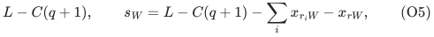

up to the explicitly tiny positivity debt. In particular, <code class="math">s_W</code> is
not set equal to the slack of an ordinary singleton free bin. All external
loads in (O5) are <code class="math">O(qC)</code>, so <code class="math">s_W\ge .99L</code> throughout the
preparation after increasing the harmless fixed constants if necessary.

The new contact from <code class="math">W</code> to <code class="math">r</code> is eligible. Expand <code class="math">(r,a)</code> from
<code class="math">W</code>, giving <code class="math">a</code> slack one and assigning <code class="math">C+1</code> to <code class="math">rW</code>.
The extra incidence <code class="math">rb</code> receives only tiny padding. The pairs
<code class="math">(s,b)</code> and <code class="math">(u,g)</code> were already expanded from <code class="math">f,h</code>; their
singleton children still have slack approximately one. The pair <code class="math">(t,c)</code>
is still unexpanded because both of its bin contacts <code class="math">b,g</code> are small.

## 3. Exact-source preparation of the star and gate

The following three stages operate independently in each copy.

### 3.1 Raise all star leaves to at least eight

Repeatedly query terminal <code class="math">W</code> in the exact conservative source graph
until every <code class="math">d_i</code> and <code class="math">a</code> has slack at least eight. Bin <code class="math">a</code> was
just born with slack one in the central expansion after contraction;
unlike some older branch leaves, it was not present during cycle pricing.
A leaf below
eight has a direct one-row path to <code class="math">W</code>, with its assigned donor at
least <code class="math">.99L</code>; its offer is at least <code class="math">3/32-O(1/L)</code>.

Every competitive source is a leaf <code class="math">d_i</code> or <code class="math">a</code>, and its path is
exactly that one-row path. The free bins have offer <code class="math">O(1/L)</code>. Bin
<code class="math">b</code> can reach <code class="math">W</code> only through its tiny donor <code class="math">b\to r</code>, whose
cost is prohibitive; the <code class="math">g,h</code> component is still separate. A winning
leaf of slack near the threshold remains below <code class="math">8.1</code> after its step.
Leaves that were raised beyond eight during cycle preparation do not need
to be raised again.

This process terminates by the same constant-progress argument. A leaf
never serves as a terminal during cycle or star preparation, and its
<code class="math">w_i</code> incidence stays fixed at <code class="math">C+1</code>. Thus every branch row now has

<!-- math-display: d72240276cc24c8c0a0475e1
x_{r_iW}\ge7-o(1),\qquad s_{d_i}\ge8.
                                                                  \tag{O6}
-->
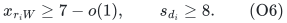

The contact <code class="math">a</code> remains below <code class="math">3C</code>, and no paired-remainder
expansion is forced.

### 3.2 Raise b by exact queries to f

Query terminal <code class="math">f</code> repeatedly until <code class="math">b</code>'s slack first reaches
<code class="math">2C</code>. While it is below that threshold, its direct path
<code class="math">b\to s\to f</code> has large donor and terminal values and offer at least
<code class="math">.37/C</code>. Every exact winning source therefore has pre-step slack below
<code class="math">2.03C</code>, and post-step slack below <code class="math">2.1C</code>. In particular, neither
contact <code class="math">a</code> nor contact <code class="math">b</code> becomes eligible. The only possible
winning sources are <code class="math">b,a</code>, or some of the <code class="math">d_i</code>. Every donor on
the direct <code class="math">b</code>-path remains large because total moved mass is
<code class="math">O(qC)\ll L</code>.

At the first crossing of <code class="math">2C</code>, the last path starts at <code class="math">b</code>. Just
before that step, <code class="math">s_b&gt;1.99C</code>. Compare this winning exact path with
the alternative source path

<!-- math-display: 8a6dab8144cf3f555019abd6
a\to r\to b\to s\to f.
-->
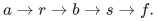

The additional donor <code class="math">a\to r</code> has allocation at least
<code class="math">L-O(C)</code>, hence conservative cost <code class="math">O(H/L)</code>. Exact optimality
therefore gives

<!-- math-display: 711a9aa3deb7355c0e90e8c8
\sigma_a\le\sigma_b+O(H/L),
                 \qquad s_a\ge1.9C.                              \tag{O7}
-->
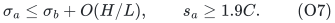

Every increase of <code class="math">a</code> during this stage uses the one-row transfer
<code class="math">a\to r\to b</code>, followed by the large <code class="math">b</code>-donor. Since <code class="math">a</code>
started this stage below <code class="math">8.1</code>, (O7) implies that the gate incidence
<code class="math">rb</code> acquires at least <code class="math">C</code> units for large enough <code class="math">C</code>. Any
branch-leaf source also increases <code class="math">rb</code>, while decreasing <code class="math">rW</code>.
The initial <code class="math">rW</code> allocation and the total increase of <code class="math">a</code> bound
the gate from above. At the end of this stage,

<!-- math-display: 7fffe4f4e7aea0ca4e1a35b9
\begin{gathered}
 C\le x_{rb}\le4C,\qquad 1.9C\le s_a\le2.1C,
 \\ 2C\le s_b\le2.01C,
 \qquad s_W,\ s_{w_i},\ s_f\ge .99L.
 \end{gathered}                                                   \tag{O8}
-->
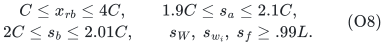

All branch incidences into <code class="math">W</code> only increase during this stage, so
(O6) is preserved. Existing leaves with slack above <code class="math">2.1C</code> need not
participate; all leaves still have slack at least eight.

### 3.3 Introduce a fresh dominant source from a separate component

The <code class="math">u,g,h</code> allocation component is still separate. Query terminal
<code class="math">h</code> and increase <code class="math">g</code> until its contact to <code class="math">t</code> becomes eligible.
Every such exact path starts at <code class="math">g</code>. Its actual slack at the first
eligibility is between the standard contact bounds <code class="math">3C</code> and
<code class="math">5C+o(C)</code>. Expand <code class="math">(t,c)</code> from <code class="math">g</code>, with

<!-- math-display: 552099f2086af16f2b23dce7
x_{tg}=C+1,\qquad x_{tb}=\epsilon,
 \qquad x_{tc}=L-C-1-\epsilon.                         \tag{O9}
-->
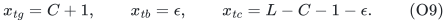

The new bin <code class="math">c</code> has slack <code class="math">1+\epsilon</code>; <code class="math">g</code> has slack between
<code class="math">2C-1</code> and <code class="math">4.1C</code>. Bin <code class="math">b</code> changes only by the tiny padding.
The two copies can be prepared separately before beginning the tested
epoch. The remaining pair (O2) does not join their ordinary allocation
components.

## 4. Lower ledgers and the settled matching state

Every displayed top update preserves exact row sums and bin equations.
All coordinates are positive, polynomially bounded, and on the fixed grid.
The only top debt needed is the existing negligible positivity-service
debt. No contact has slack at least <code class="math">3C</code> when the tested epoch begins:
the only remainder contacts are <code class="math">a,a'</code>, each of slack at most
<code class="math">2.1C</code>. There is no physical edge between two distinct current bins.

The current allocation graph also admits explicit debt-free integral
ledgers at every floor <code class="math">c_0\le C</code>. Give each branch row <code class="math">L-c_0</code>
to <code class="math">d_i</code>, <code class="math">c_0</code> to <code class="math">w_i</code>, and zero to <code class="math">W</code>. Give row <code class="math">r</code>
values <code class="math">L-c_0</code> at <code class="math">a</code>, <code class="math">c_0</code> at <code class="math">W</code>, and zero at <code class="math">b</code>.
Give <code class="math">s</code> values <code class="math">L-c_0,c_0</code> at <code class="math">b,f</code>; give <code class="math">t</code> values
<code class="math">L-c_0,c_0,0</code> at <code class="math">c,g,b</code>; and give <code class="math">u</code> values
<code class="math">L-2c_0,2c_0</code> at <code class="math">g,h</code>. Each singleton's residual is at least
<code class="math">c_0</code>, while the residual of <code class="math">W</code> is <code class="math">L-c_0</code>, which exceeds
<code class="math">c_0(q+1)</code>. The cycle preparation has the analogous arm ledgers
used in [root-only-sp-tree-epoch-counterexample.md](root-only-sp-tree-epoch-counterexample.md).

This checks the actual floor constraints. It does not impose a nonexistent
coordinatewise equality between different integral floors. The operations
are ordinary ledger expansions, exact pricing transfers, and the minimal
tight contraction; no artificial feasibility repair is being used to
create the state.

## 5. A large exact conservative SPT with one source child

Start the operative interface with its persistent registers. They obey
<code class="math">x/2&lt;\ell&lt;x</code>, so every donor price divided by <code class="math">H</code> is at most
<code class="math">1/(2x)+1/H</code>. From <code class="math">c</code>, the routes to all bins in its copy use
at most one large donor, the gate donor of allocation at least <code class="math">C</code>,
and one branch donor of allocation at least <code class="math">7-o(1)</code>. Other routes
through <code class="math">s</code> or <code class="math">u</code> use only large donors.

Thus the total conservative path price is below <code class="math">.09H</code>, and the
offer from <code class="math">c</code> is greater than <code class="math">.65H</code> everywhere, for large enough
<code class="math">C,H</code>. Every other direct source offer is at most
<code class="math">(3/32+o(1))H</code>, because all other small bins have slack at least
eight. The singleton bins <code class="math">a,b,g</code> have the still larger slacks in
(O8)--(O9).

Consequently <code class="math">c</code> is the unique source child of the exact SPT in its
ordinary component. The underlying allocation support is a tree, so all
ordinary paths from <code class="math">c</code> have the following orientation:

<!-- math-display: 90e961088890e1f3d73230c8
\begin{array}{l}
 c\to t\to b\to r\to W\to r_i\to\{d_i,w_i\},\\
 b\to s\to f,\qquad t\to g\to u\to h,
 \qquad r\to a.
 \end{array}                                                     \tag{O10}
-->
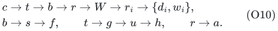

Every <code class="math">d_i</code>, every <code class="math">w_i</code>, and <code class="math">a,f,h</code> is a leaf of this
directed tree. There are linearly many of them. Its receiving arcs are
tight in the fixed old labels, and the old potential satisfies

<!-- math-display: 06bbb60e70d39fcdf3cb2702
\pi_v\ge .65                           \tag{O11}
-->
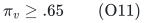

at every ordinary bin. Both copies give such a tree in the forest.

## 6. Any directed-tree choice earns only polylogarithmic credit

Freeze the forest (O10), and allow **all** of its ancestor-bin to
descendant-bin passing paths. This is the full original any-source
interface, not a restriction to <code class="math">c</code>.

Only the bins <code class="math">c,b,g</code> can be starts of accepted paths in one copy.
All other small bins are leaves. To see that <code class="math">W</code> cannot start one,
use induction. Until its first putative start, every numerical transfer
into its star from above crosses the gate donor <code class="math">b\to r</code>. That donor
only decreases and starts with at most <code class="math">4C</code> units. Thus each large
star bin has slack at least <code class="math">.99L-4C&gt;.98L</code>. A descendant free leaf
has slack at most <code class="math">L</code>, so the reciprocal ratio is below <code class="math">5/3</code>,
already excluding the threshold. A descendant <code class="math">d_i</code> has small slack,
which gives negative gain from <code class="math">W</code>. No first accepted start at <code class="math">W</code>
can therefore occur.

Every other slack has only nonpositive changes. Since each of the three
possible positive-slack coordinates is at most <code class="math">L+o(1)</code>, the total
objective gain in one copy is at most <code class="math">O(\log L)</code>. The operative
step rule gives a fixed positive gain per accepted step. Hence **every**
sequence of directed-tree choices has only

<!-- math-display: 37dd34b17d4a13c641ba9dc0
O(\log L)                              \tag{O12}
-->
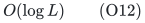

accepted steps before TREE-EMPTY. The same bound holds for both copies.

No uncharged guard event is needed. Initially the minimum slack is
approximately one; acceptance and the normalized step keep the global
minimum slack nondecreasing. If a donor lies on an accepted path, then
<code class="math">\bar c/H\ge1/(4x)</code> and threshold acceptance force
<code class="math">x&gt;s_{\rm start}/3</code>. Its small decrease therefore leaves it bounded
away from the tiny positivity guard. All upper magnitudes remain bounded
by row sums. The contacts <code class="math">a,a'</code> only lose slack, so no structural
action becomes eligible.

Each path in (O10) has constant ordinary length. Only <code class="math">O(\log L)</code>
allocation records are changed at all. Their motion directions are fixed
throughout the epoch, and their magnitudes stay in the fixed polynomial
range. Total logarithmic allocation variation and the number of register
notifications are therefore at most

<!-- math-display: d7718d6d6ce3125b940408e0
O(\log L\log S),                         \tag{O13}
-->
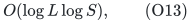

which is polylogarithmic. There is no linear price credit hidden in a long
path application.

## 7. Semantic excess and an actual tree-external comparison survive

Every free branch leaf still has slack at least <code class="math">.98L</code>. By (O11),
the fixed certificate has

<!-- math-display: 540d5149cd3ebfa698bde9c4
E\ge q\bigl(.65(.98L)-5/4\bigr)=\Omega(qL),                       \tag{O14}
-->
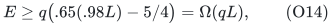

in each copy. This is far above the operative five-N LOW threshold.

The actual one-row path

<!-- math-display: ab8e84f3479299946040115c
a\to r\to W                         \tag{O15}
-->
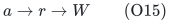

survives. Its donor allocation is <code class="math">L-O(C)</code>, and <code class="math">W</code> has slack
at least <code class="math">.98L</code>. Its starting slack never exceeds <code class="math">2.1C</code>.
Moving <code class="math">L/10</code> units on (O15) gives a nonnegative feasible comparison
with

<!-- math-display: 5281ad3b3446e7a2bd7fd31a
P\ge\frac{L}{21C}>12N,\qquad Q_s<1,\qquad Q_x<1.                 \tag{O16}
-->
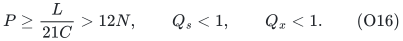

Thus this is not merely an isolated positive direction with negligible
normalized mass. It has the matching comparison's required absolute
margin, and the physical graph independently has the actual gap one.

Path (O15) is absent from the directed family only because <code class="math">a</code> is a
child of row <code class="math">r</code>: its first donor reverses the old receiving tree
arc <code class="math">r\to a</code>. All following receiving arcs are old-label tight.

## 8. The repair boundary is explicit

Cut the old tree edge <code class="math">b\to r</code>, and reroot that component at <code class="math">a</code>.
Only the edge <code class="math">ra</code> changes orientation. The resulting directed
component begins <code class="math">a\to r\to W</code>, with the same old potential feasible
on every ordinary arc. The reversed edge has equal old labels at its
endpoints, and <code class="math">r\to W</code> remains a tight receiving arc. A new direct
source arc at <code class="math">a</code> is already feasible; it need not be tight.

Equivalently, one can permit a path to start by reversing its parent's
tight receiving edge and then continue downward. A compatible bidirected
underlying-forest search includes (O15) without needing a global SPT
refresh. For example, row <code class="math">r</code> can expose the local starting offer
<code class="math">\sigma_a-\bar c_{a\to r}</code>.

Therefore the established conclusion is only that exhausted **directed**
any-source epochs do not universally earn linear objective or price
credit, even on reachable top matching ledgers with exact-source
preparation. The construction does not obstruct the stronger compatible
forest interface, and it does not charge or require a global rebuild.
