# Congested greedy support: a static lemma and its dynamic boundary

**Separate mathematical investigation, 24 October 2026.** This note
records a congestion-capped greedy support construction. Its active
and saturated-edge mechanism is a variant of the dynamic spanner in
[Kyng--Meierhans--Zoecklein, A Simple Dynamic Spanner via APSP,
Section 4](https://arxiv.org/html/2408.11368v1).
The native-split accounting and the ambient counterexample below
address the additional interfaces needed here. No novelty claim is
made for the underlying greedy mechanism. It does not replace the
maintained spanner in the 4/5 matching construction.

The construction simultaneously obtains sparse selected support,
short routes, and bounded EDGE congestion in its own native graph.
There is a useful conditional recourse bound under native splits.
Two additional properties needed by the matching backend do not
follow: a low-degree selected-star invariant maintained without
circular feedback, and the stronger arbitrary-ambient congestion
bound. Fast distance queries are a third, separate algorithmic
requirement.

## 1. Static statement

Let <code class="math">G</code> be an undirected loopless multigraph with explicit edge IDs,
<code class="math">n</code> vertices, <code class="math">m</code> edges, and maximum degree at most
<code class="math">\Delta\geq1</code>. Fix an integer <code class="math">b\geq1</code>, and put
<!-- math-display: 7a3916fddf2e594387cfe3d1
L=2b,\qquad \tau=\lceil4\Delta L\rceil .
 \tag{1}
-->
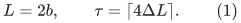
There is an elementary deterministic construction of a selected
subgraph <code class="math">H\subseteq G</code> and a simple <code class="math">H</code>-path <code class="math">P_e</code> for every
input edge <code class="math">e</code>, with the same endpoints, such that
<!-- math-display: 1aeaf9628798291c0d0c2eaf
\begin{split}
 |E(H)|&\leq 2n^{1+1/b}+mL/\tau,\\
 |P_e|&\leq L,\\
 \max_{f\in E(H)}|\{e:f\in P_e\}|&\leq\tau .
 \end{split}
 \tag{2}
-->
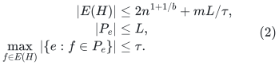
In particular <code class="math">b=\lceil\log_2(n+2)\rceil</code> gives <code class="math">O(n)</code>
selected edges, <code class="math">O(\log n)</code> route length, and
<code class="math">O(\Delta\log n)</code> native edge congestion. This is an existence
and finite-construction statement. A BFS implementation of each
test is not near-linear.

### Construction

Maintain the output graph <code class="math">H</code>, an ACTIVE subgraph <code class="math">F\subseteq H</code>,
and an integer load counter on each active selected edge.
Initially both graphs are empty. Process input IDs in a fixed order.

For <code class="math">e=uv</code>, find a shortest <code class="math">u</code>-to-<code class="math">v</code> path in <code class="math">F</code>.
If its length is at most <code class="math">L</code>, assign it to <code class="math">e</code>. Otherwise
insert <code class="math">e</code> into <code class="math">H</code> and <code class="math">F</code>, with counter zero, and assign
its one-edge identity path. Increment the counter of every active
edge used by this route. Once a counter reaches <code class="math">\tau</code>, remove
that edge from <code class="math">F</code>, but RETAIN it in <code class="math">H</code> and retain all paths
already assigned to it. Process all threshold removals before the
next demand.

Every path is simple. A threshold crossing therefore changes a
counter by one, so a removed edge has exactly <code class="math">\tau</code> assigned
route occurrences. No later route uses it. This proves the last
two inequalities in (2).

### Active girth and selected size

When a new edge is added to <code class="math">F</code>, its endpoints previously had
distance greater than <code class="math">2b</code>. The resulting graph has no cycle of
length at most <code class="math">2b+1</code>. Deletions preserve this property. In
particular <code class="math">F</code> is simple even though <code class="math">G</code> may have parallel IDs.

For completeness, every <code class="math">n</code>-vertex graph of girth greater than
<code class="math">2b+1</code> has at most <code class="math">2n^{1+1/b}</code> edges. If it has <code class="math">a</code> edges,
successively delete vertices of degree below <code class="math">a/n</code>. Not all
vertices can disappear, since their total removed edges would be
less than <code class="math">a</code>. The remaining subgraph has minimum degree
<code class="math">\delta\geq a/n</code>. If <code class="math">\delta\geq2</code>, a breadth-first ball of
depth <code class="math">b</code> has no repeated vertices or extra short connections,
and hence
<!-- math-display: 25c6209486c28cc3a4d70b56
n\geq(\delta-1)^b.
-->
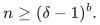
Thus <code class="math">a\leq n(1+n^{1/b})\leq2n^{1+1/b}</code>.
The case <code class="math">\delta&lt;2</code> satisfies the same bound directly.

Every inactive selected edge has received <code class="math">\tau</code> occurrences.
The total number of assigned occurrences is at most <code class="math">mL</code>.
There are therefore at most <code class="math">mL/\tau</code> inactive selected edges.
Adding the active bound proves the first inequality in (2).

This also explains precisely why the earlier uncapacitated greedy
counterexample is avoided: a bridge carrying too many cross demands
becomes unavailable to subsequent routes, forcing additional support.
It does not explain how to maintain that support after changes.

## 2. A precise conditional dynamic lemma

Consider one period of a changing native multigraph. Updates may
insert or delete edge lifetimes, insert isolated vertices, or split
one vertex into two by partitioning its current incidences.
An old loop may awaken after such a split; treat its zero-length
route as an endpoint-annotated demand before the split. No vertex
identification is allowed. Let:

* <code class="math">n_*</code> bound the number of resident native vertex slots;
* <code class="math">\Delta</code> bound native degree throughout the period;
* <code class="math">m_0</code> be the initial number of demand IDs;
* <code class="math">B</code> and <code class="math">D</code> count genuine native edge births and deaths;
* <code class="math">s</code> index the native binary splits;
* <code class="math">d_s</code> be the degree of the split vertex in the FULL selected
  graph <code class="math">H</code>, including inactive selected edges, immediately
  before split <code class="math">s</code>.

Use the same fixed <code class="math">b,L,\tau</code> throughout the period, with
<code class="math">\tau\geq\Delta</code>. Start by applying Section 1 to the initial
edge IDs. Maintain every current route explicitly together with
current inverse lists.

After an update, first invalidate all affected demand routes and
remove their inverse-list entries. Historical active counters are
NOT decremented. Then reroute every still-present affected demand,
using the same greedy rule. If its own input edge is already an
INACTIVE selected edge, its identity path is always permitted as
a special case. Such an edge receives no new nonidentity route,
and at most its own one current demand uses this exception.

### Current-load bound

Every active edge has current route load no larger than its
historical counter. Once it becomes inactive, no new route of a
different demand can use it. Its current load is consequently at
most <code class="math">\tau+1</code>, including its possible identity exception.
Repeated invalidations of that one identity route do not create
multiple current demands.

An edge deletion invalidates at most <code class="math">\tau+1</code> paths through that
selected edge, plus the disappearing demand itself, which does not
need rerouting. A split of a vertex of selected degree <code class="math">d_s</code>
invalidates at most
<!-- math-display: 220a1b4d1fc37bf19b3c4a43
d_s(\tau+1)+\Delta
 \tag{3}
-->
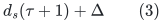
current demands. Indeed every nonempty route passing through the
vertex uses one of its selected incident edges. The extra
<code class="math">\Delta</code> accounts for endpoint annotations and empty-loop
demands whose own endpoint changes. Enumerating these current
inverse lists, and deduplicating their IDs, is an explicit way
to find the affected set.

Let <code class="math">R_{\rm calls}</code> count all initial and subsequent route calls.
Then
<!-- math-display: 78d9fc3eabf5ab3041549b17
R_{\rm calls}\leq
 m_0+B+(\tau+1)D+
               \sum_s\bigl(d_s(\tau+1)+\Delta\bigr).
 \tag{4}
-->
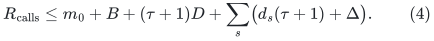
The selected graph itself changes endpoints under the native split;
old path records are retired before those endpoint changes are
published. Queries occur only after rerouting settles.

### Cumulative selected-ID recourse

The active graph still has girth greater than <code class="math">2b+1</code>.
A native split cannot create a new short cycle: a new cycle maps
to a closed trail using distinct old edge IDs, which contains an
old cycle no longer than that trail. Edge removals and saturation
removals are also harmless.

Every saturation event consumes <code class="math">\tau</code> historical occurrences.
Each route call adds at most <code class="math">L</code> such occurrences, so there are
at most <code class="math">LR_{\rm calls}/\tau</code> saturation events over the whole
period. A selected native ID is born at most once during its own
native lifetime; it never leaves the output merely because it
saturates. It dies only when that native edge dies. Therefore the
total number of selected-ID births plus deaths is at most
<!-- math-display: 14c3726f33c865d1e01ba32f
\begin{split}
 2n_*^{1+1/b}+2D+\frac{L R_{\rm calls}}{\tau}
 \ \leq\ &
 2n_*^{1+1/b}+2D+\frac{L(m_0+B)}{\tau}\\
 &+2LD+L\sum_s(2d_s+1).
 \end{split}
 \tag{5}
-->
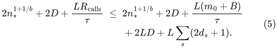
This is a cumulative statement, not a worst-case per-update claim.
It also bounds current support size by the same cumulative
expression; it does not retain the static <code class="math">O(n_*)</code> size
automatically for an arbitrarily long period.

In particular, if an INDEPENDENT mechanism ensures
<code class="math">d_s\leq d_H</code>, then (5) gives
<!-- math-display: c1f92087000f03f3c26629bc
O\!\left(n_*^{1+1/b}
       +\frac{L(m_0+B)}{\tau}
       +L(D+(d_H+1)q_{\rm split})\right).
 \tag{6}
-->
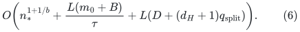
Selected endpoint changes at each split are at most <code class="math">d_s</code> as
well. Thus a subpolynomial <code class="math">d_H</code>, together with an appropriate
period bound, would give the desired form of propagated selected
recourse. Formula (6) is a useful conditional interface.

## 3. Why naive selected-degree feedback does not close the lemma

It is tempting to invoke the existing rule that splits an overfull
selected star at threshold <code class="math">z</code>. But (5) must then also count those
feedback splits. At such a split, <code class="math">d_s=\Theta(z)</code> is consistent
with the rule, so our current bound allows
<!-- math-display: 3726189ec63aa0dfe668822d
O(Lz)
 \tag{7}
-->
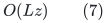
new selected births funded by that one feedback event.
The ordinary excess-degree potential decreases by only
<code class="math">\Theta(z)</code>. Substituting (7) into the potential inequality
therefore does not yield an absorbing coefficient below one,
regardless of merely increasing <code class="math">z</code>: both sides scale with
the same <code class="math">z</code>.

This is an obstruction to THAT proof, not an example forcing the
algorithm to make <code class="math">\Theta(Lz)</code> births. A stronger charging
invariant, a partition rule that bounds route breakage independently
of the full selected star, or a separate degree-control mechanism
could change the conclusion. The conditional lemma must not be
presented as having already supplied such a mechanism.

One can also remove a low-load inactive selected edge and reroute
its remaining users. Choosing the eviction threshold
<code class="math">\tau/(cL)</code> makes each eviction fund at most <code class="math">1/c</code> additional
saturations. This can control that EVICTION cascade and bound the
number of retained inactive edges by current route mass. It does
not remove the <code class="math">d_s\tau</code> invalidation term caused by a native
selected-star split, and it does not by itself fix (7).

## 4. Native edge congestion is not the ambient contract

The dynamic repair proof requires more than congestion in <code class="math">H</code>.
Its input graph <code class="math">J</code> is itself embedded by simple native paths
<code class="math">\Pi</code> in an arbitrary immediate ambient graph. Writing
<code class="math">C_0=\mathrm{vcong}(\Pi)</code>, the needed output guarantee is
of the form
<!-- math-display: 92af2af9147220dc3bee327e
\mathrm{vcong}(\Pi\circ P)
                       \leq\Gamma\bigl(C_0+\Delta(J)\bigr).
 \tag{8}
-->
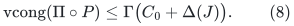
The static greedy lemma only proves, directly,
<!-- math-display: 8b91907c1f3ec1e48c9e806f
\mathrm{vcong}(\Pi\circ P)
                       \leq(\tau+1)C_0,
 \tag{9}
-->
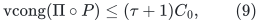
up to the fixed convention for endpoint annotations.
With <code class="math">\tau=\Theta(\Delta(J)L)</code>, this is a PRODUCT of
<code class="math">\Delta(J)</code> and <code class="math">C_0</code>, rather than their sum. The two may
both be large in a projected instance.

The vertex version in the native selected graph also only gives
<code class="math">O(\deg_H(v)\tau)</code> from the edge bound. The balanced-tree
counterexample in
[../graph-backends/central-greedy-recoursing-under-splits.md](../graph-backends/central-greedy-recoursing-under-splits.md)
shows why short routes and sparse, low-degree support alone do
not supply a congestion guarantee; the capacity construction
repairs native edge congestion but does not establish (8).

No lower bound against other ambient-aware algorithms is claimed.
An additional capacity-aware selection or weighted routing argument might
prove (8) for a modified algorithm. The existing static
length-free sparsifier obtains precisely this stronger property
through degree-band witnesses and path selection; it is not a
corollary of the own-graph greedy argument.

### 4.1 A concrete failure of (8), even with selected degree three

Let <code class="math">L\geq2</code> be even, put <code class="math">b=L/2</code>, and let <code class="math">T</code> be a full
binary tree of height <code class="math">4L</code>. Write
<!-- math-display: fcc3e3b158675292a0c5f522
n=|V(T)|=2^{4L+1}-1,\qquad
 J=T^L,
 \tag{10}
-->
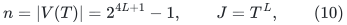
where distinct vertices are adjacent in <code class="math">J</code> exactly when their
tree distance is at most <code class="math">L</code>. This is a simple native graph.
Its maximum degree satisfies
<!-- math-display: 377df9a62872a5445b0eb057
2^L\leq\Delta(J)\leq3(2^L-1).
 \tag{11}
-->
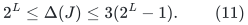
The lower bound follows already from a sufficiently deep radius
<code class="math">L</code> ball; the upper bound is the usual binary branching count.

Process ALL tree edges first in congested greedy. Every such edge
is selected, since before its insertion its endpoints lie in
different components of the processed tree. Subsequently every
native demand has a unique tree path of length at most <code class="math">L</code>.
For a fixed tree edge, the number of such paths using it is at
most
<!-- math-display: 271797dfabd54a58d88e9685
\sum_{\substack{i,j\geq0\\i+j\leq L-1}}2^i2^j
   =\sum_{s=0}^{L-1}(s+1)2^s
   <L2^L.
 \tag{12}
-->
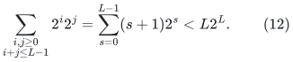
Indeed its two sides have at most <code class="math">2^i</code> and <code class="math">2^j</code> vertices
at the indicated distances from the edge endpoints. In view of
<code class="math">\tau=4\Delta(J)L</code>, no selected edge ever saturates.
The final output is EXACTLY <code class="math">H=T</code>, with its unique tree routes.
It has selected maximum degree three, <code class="math">n-1</code> edges, and all the
claimed native congestion and length bounds. Also
<code class="math">n^{1/b}=O(1)</code> for this choice, so it lies in the linear-size
regime of the static lemma.

Now introduce a new ambient vertex <code class="math">x</code>. Embed every tree edge
<code class="math">uv</code> as the simple path <code class="math">u-x-v</code>, and every non-tree
native edge <code class="math">uv</code> as its own direct ambient edge. The ambient
graph contains the necessary star edges and direct non-tree
edges, each with its own identity. Then
<!-- math-display: d68492184d506f0722aa9c23
C_0=n-1,\qquad C_0+\Delta(J)=\Theta(n).
 \tag{13}
-->
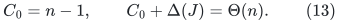
The first equality counts the <code class="math">n-1</code> tree-edge images through
<code class="math">x</code>; each other native vertex is only an endpoint of at most
<code class="math">\Delta(J)</code> input images.

Every selected tree route, after composition, is a walk through
the same hub. Erasing ALL closed subwalks leaves the simple
ambient path <code class="math">u-x-v</code>. Thus the hub occurs in every one of
the <code class="math">m=&#124;E(J)&#124;</code> normalized demand routes, not merely in a
backtracking representation.

To count <code class="math">m</code>, partition the tree leaves into groups descending
from vertices <code class="math">L/2</code> levels above them. Every group contains
<code class="math">q=2^{L/2}</code> leaves, and every pair within a group has tree
distance at most <code class="math">L</code>. There are <code class="math">2^{4L}/q</code> groups, so
<!-- math-display: 4f3d90438110a09c42f84bf1
m\geq 2^{4L}(q-1)/2
                            =\Omega(n2^{L/2}).
 \tag{14}
-->
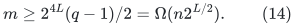
Consequently the output ambient congestion exceeds
<code class="math">C_0+\Delta(J)</code> by a factor <code class="math">\Omega(2^{L/2})= \Omega(n^{1/8})</code>. A subpolynomial factor <code class="math">\Gamma</code> cannot
absorb this family. Native edge capacities, a degree-three
selected graph, and complete loop erasure do not imply (8).

### 4.2 The immediate ambient graph can also have degree three

The large degree of <code class="math">x</code> is not essential. Make one binary tree
<code class="math">X</code> with one distinct port for every native vertex, allowing
at most a factor-two number of unused leaf ports. Use two
binary halves joined by a distinguished central edge. Assign
half of the leaves from EACH group used in (14) to ports in
each half of <code class="math">X</code>. Distribute all other native vertices among
the remaining ports. Each half needs only <code class="math">O(n)</code> ports.

Give each native vertex <code class="math">v</code> a distinct center <code class="math">c_v</code>, joined
to its port in <code class="math">X</code>. Separately attach at <code class="math">c_v</code> a private
binary port tree for the non-tree native edges incident to
<code class="math">v</code>. Join the corresponding private ports by a genuine
external edge for every such native edge. Trees of zero or
one port use the evident constant-size cases.

Embed a native TREE edge through its endpoint centers and
the unique path in <code class="math">X</code>. Embed a NON-TREE edge through the
two private endpoint port trees and its own external edge.
These are simple paths of length <code class="math">O(\log n)</code>.
Every ambient vertex has degree at most three: a center
has one attachment toward <code class="math">X</code> and one toward its private
port tree; all other records belong to binary trees or
their leaf attachments.

At any vertex of <code class="math">X</code>, at most <code class="math">n-1</code> input tree-edge
images occur. At any private fiber or center, at most
<code class="math">\Delta(J)</code> input images occur. Hence
<!-- math-display: d28e890c01779c4eba0c3e82
C_0\leq\max\{n-1,\Delta(J)\}.
 \tag{15}
-->
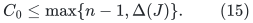
All selected routes still use only tree-edge images, whose
union lies in <code class="math">X</code> together with its center attachments.
After loop erasure the route from <code class="math">c_u</code> to <code class="math">c_v</code> is
the unique path in that tree. Whenever <code class="math">u,v</code> belong to
opposite halves of one leaf group, this route crosses the
central edge of <code class="math">X</code>.

There are <code class="math">q^2/4</code> such pairs per group. Their total is
<!-- math-display: 2ac605961c110b482d72a944
(2^{4L}/q)\,q^2/4
                         =\Omega(n2^{L/2}).
 \tag{16}
-->
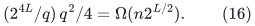
Thus the SAME polynomial violation of (8) occurs with
degree-three ambient graph and simple, logarithmic-length
input images. All graph sizes remain polynomial in <code class="math">n</code>.
The failure is specific to the congested-greedy support and
route choice, and does not rule out an ambient-aware
construction selecting different native edges.

### 4.3 Direct ambient saturation is not enough by itself

One natural repair is to count normalized AMBIENT loads and, at a
saturated resource, deactivate every selected native edge whose fixed
image uses it. The exact static example in
[the bulk-deactivation obstruction](ambient-bulk-deactivation-obstruction.md)
shows that this rule can retain <code class="math">\Omega(n^2/\gamma)</code> selected IDs on
<code class="math">\Theta(n^2)</code> input IDs with threshold
<code class="math">\Theta(\gamma(C_0+\Delta))</code>. Its active graphs are always trees.
The example survives loop erasure and a degree-three ambient
representation with logarithmic-length input paths.

Thus this particular replacement loses the sparse retained-support
guarantee before any dynamic degree feedback is considered. It does
not exclude a different ambient-aware selection or rerouting rule.

## 5. Fast distance tests and route notifications remain separate

A literal BFS test gives a finite algorithm, but may inspect the
whole selected graph per demand. The number of demand reroutes
in (4) may be much larger than the selected-ID recourse in (5).
This separation is useful: a candidate dynamic distance provider
could have cheap path-reporting queries, while only the much
smaller selected/active update stream invokes its expensive
maintenance.

For a provider returning a path of length at most
<code class="math">\gamma\mathrm{dist}_F(u,v)</code>, use route threshold
<code class="math">L=2\gamma b</code>. Rejecting a route longer than <code class="math">L</code> then certifies
that the true distance is greater than <code class="math">2b</code>, which preserves
the same active-girth bound. All displayed occurrence charges
use this enlarged <code class="math">L</code>. Returned paths must be explicit, and
the provider must support the actual active edge updates and
encoded native splits. A distance estimate without a path is
insufficient.

Neither this interface nor the static result assumes that the
necessary approximate-distance provider, independent degree
controller, and arbitrary-ambient congestion property already
coexist. Establishing their compatible quantitative bounds is
the remaining algorithmic task.
