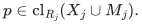
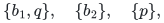
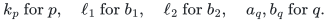
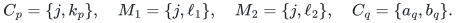
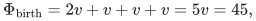
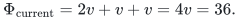
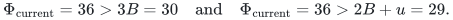

# Birth-time rank savings can disappear from the current resource cover

**25 October 2026. A finite local-search obstruction, not an approximation lower bound.**

This note examines a proposed refinement of conservative completion.
For a candidate c with owner p, call a used resource j problematic when

<!-- math-display: 03db874fca79b07a96fca57c
p\in\mathrm{cl}_{R_j}(X_j\cup M_j).
-->

Only at those resources, mark all unmarked matching records using j.
The implicit all-subsets proof still works: at a problematic resource the
completion removes every unmarked matching receiver, and at any other
resource p is already outside the span of every possible old reservation.

The following example shows that a rank saving established when a center
is born need not survive in the **current** rank cover after its designated
group shrinks. In particular this refinement alone does not justify replacing
the current coarse coefficient by 3B per blocker, or by 2B+u.

## 1. Four players and a rank-two recipient resource

Take threshold B=10 and give every resource value v=9. Every two-resource
bundle is minimal above B. The player matroid is the partition matroid
with three blocks

<!-- math-display: 3795b02f8c1fa58a65701ba1
\{b_1,q\},\quad\{b_2\},\quad\{p\},
-->

each of capacity one. Its rank is r=3. Thus b1 and q are parallel, while
b2 and p supply the two other independent directions.

There is a resource j with recipient matroid U_(2,3) on
{b1,b2,p}; q is a loop for j. There are also private resources

<!-- math-display: 74834a3f2ab567ed9b51854d
k_p\text{ for }p,\quad \ell_1\text{ for }b_1,\quad
 \ell_2\text{ for }b_2,\quad a_q,b_q\text{ for }q.
-->

Each private resource has a rank-one recipient matroid with only its
named player nonloop. The only liked bundles above B are respectively

<!-- math-display: e9689532519e38f6bbbd5318
C_p=\{j,k_p\},\quad M_1=\{j,\ell_1\},\quad
 M_2=\{j,\ell_2\},\quad C_q=\{a_q,b_q\}.
-->

Initially the matching contains M1 and M2. Its owners {b1,b2} are
independent, and resource j serves two players legally.

## 2. A literal birth and one earliest-layer exchange

In layer one, p is the only eligible unmatched player outside the span
of {b1,b2}. With no selected records or blockers, both its resources are
available. At j it lies in the span of the two current recipients, so j
is problematic. Its private resource is nonproblematic. Completion therefore
stores Cp with designated group {M1,M2}.

The layer is now maximal: p is still the only eligible player, and both
its resources are in its own selected support and hence unavailable.

In the next layer, removing the earlier blocker owners leaves the empty
player set. Player q is eligible and has its two unused private resources.
Both are nonproblematic, so Cq is a fresh free candidate. Its fundamental
player circuit is {q,b1}. The earliest-layer exchange removes M1 and inserts
Cq, discarding the second layer.

The retained first layer consists of the unchanged center Cp and the
single designated blocker M2. Its eligibility flat is unchanged, since
{q,b2} spans the same player flat as {b1,b2}. It remains maximal: p still
has no resource outside its selected-plus-blocker closure.

This prefix can arise from the empty allocation under the problematic-only
rule, with fixed player order b1,b2,p,q. The first phase inserts M1. In the
second phase b2 is independent of the current player set, and at resource j
it is outside the span of the single receiver b1. Hence M2 is free and is
inserted. The third phase is exactly the two-layer prefix above.

No recipient matroid in this example has rank above two; the player
matroid is a particularly simple rank-three partition matroid.

## 3. The current cover no longer has the birth saving

At birth, the resource-j set {p,b1,b2} has rank two. The current cover
is then

<!-- math-display: 40e3e363b25c68e25ce01efc
\Phi_{\rm birth}=2v+v+v+v=5v=45,
-->

where the last three terms are kp, ell1 and ell2. There are two blockers.
The shared dependence at j supplies a saving relative to counting all
three j occurrences separately.

After the exchange, the current selected/blocker resource-j set is
{p,b2}. It is independent and has rank two. Only kp and ell2 contribute
private resources to this cover. Therefore

<!-- math-display: b3d5faa3a3487cc8552e3954
\Phi_{\rm current}=2v+v+v=4v=36.
-->

There is now one blocker. In particular

<!-- math-display: 05ce33d074cccfc7ca8f3dc0
\Phi_{\rm current}=36>3B=30
 \quad\text{and}\quad
 \Phi_{\rm current}=36>2B+u=29.
-->

The coarse coefficient actually proved in the accepted construction is
2(B+u)=38, so this state does not contradict that theorem. The sharper
shared-resource coefficient is max{2u,2B+2min(u,B)}=38 and is also safe.

The retained all-subsets invariant is intact. Its empty-subset reservation
is the current allocation. For the subset {Cp}, deleting M2 leaves no
matching receiver at j and inserts p, which is feasible. The new Cq uses
private resources and cannot create any recipient conflict.

Cp is, in fact, already feasible against the current matching: p and b2
can jointly receive j. Its remaining designated blocker is conservative.
The existing algorithm processes it as free only once its designated
group is empty, so this extra freedom is not currently used.

## 4. What the example does and does not establish

This is a legal finite operation history for the stated refined rule.
It refutes an unconditional inequality on the current rank cover based
only on birth-time dependency savings and the current group sizes. It
does not assert feasibility of a much larger target LP, and it does not
give a lower bound against every possible four-approximation algorithm.

For example, B=10 and T=110/3 satisfy the accepted rank-three sufficient
coefficient condition B+2rho(B+u)<=T. The displayed first-layer covers
are both larger than (T-B) times its w=1, so the normal first-layer cover
test does not stop this prefix. The input need not satisfy the high-target
promise; the theorem's infeasibility branch is allowed to terminate later.
An additional preprocessing rule could reject this particular target
earlier without making the proposed current-cover inequality true.

A repair could inspect Cp, recognize its newly free recipient allocation,
and augment with it. More generally a repair might release some conservative
blockers while maintaining all simultaneous reservations. Such a repair
would be a new algorithmic invariant and requires its own polynomial
implementation, old-prefix preservation, and progress count. The example
does not rule it out. It does show why keeping the original birth charge
without paying for any current repair is insufficient.
