# Exact logarithmic client states can hide good cycles behind recursive routes

**Separate mathematical analysis, 24 October 2026.** This note strengthens
[recursive-cycle-quality-obstruction.md](recursive-cycle-quality-obstruction.md).
It uses EXACT gradients of the permitted separable logarithms and an
EXACTLY conserved, positive, integer-valued flow. Every local correction
has exactly zero gradient, including after ordinary integer pricing.
Nevertheless a chain of constant-stretch native routes leaves terminal
cycle quality exponentially smaller than the original optimum.

Two objective profiles use the same graph and route chain. The first
uses only <code class="math">\log f</code>. The second is a literal valid frozen state of the
all-expanded two-sided logarithmic maximum-flow threshold client:
integral ordinary capacities, the prescribed equal pads, one weighted
negative logarithm on the return arc, and a legitimate threshold.

This does not prove that the particular ASZ/stable-forest hierarchy
will choose these route tables. Nor does it claim that the fixed
step-selection implementation reaches this exact state. It proves
that separable logarithmic gradients and exact conservation, by
themselves, do not imply the stronger cumulative norm bound needed
to replace the recursive quality product.

## 1. One exactly conserved logical graph

Fix <code class="math">d\geq2</code>, and put
<!-- math-display: d4d1f9c3e622dee36bb532cb
N=2^d-1,\qquad h=2^{d-1}.
 \tag{1}
-->
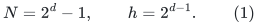
There are ordered vertices <code class="math">w_0,\ldots,w_N</code>. The even-indexed
vertices form <code class="math">A</code>, the odd-indexed vertices form <code class="math">B</code>, and both
sets have cardinality <code class="math">h</code>. Add two distinct vertices <code class="math">s,t</code>.

The ordinary directed multigraph has:

* every edge <code class="math">a\to b</code>, for <code class="math">a\in A,b\in B</code>;
* <code class="math">h</code> distinct parallel edges from <code class="math">s</code> to each <code class="math">a\in A</code>;
* <code class="math">h</code> distinct parallel edges from each <code class="math">b\in B</code> to <code class="math">t</code>.

There are <code class="math">M=3h^2</code> ordinary edge IDs. Add one return edge
<code class="math">e_{\rm ret}:t\to s</code>. Set
<!-- math-display: 3f7b2796f70648efa355b12e
f_e=1\quad(e\text{ ordinary}),\qquad
                            f_{\rm ret}=h^2.
 \tag{2}
-->
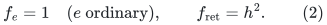
This flow is exactly conserved. Every <code class="math">a</code> has <code class="math">h</code> units
entering and <code class="math">h</code> leaving; the same holds at every <code class="math">b</code>.
Source and sink both have total ordinary flow <code class="math">h^2</code>, balanced
by the return coordinate.

All values in (2) are integers, hence belong to the numerical
<code class="math">\varepsilon</code>-grid. For a master <code class="math">S</code> above the actual size,
they lie within the client's polynomial magnitude envelope.
Every parallel edge retains its own lifetime and price.

## 2. A nested route chain of stretch at most three

Let <code class="math">G_0</code> be the whole graph and write <code class="math">L_0=N</code>. For
<code class="math">i=1,\ldots,d-1</code>, put
<!-- math-display: 7a583a1d8dd2c3c486acfe71
L_i=2^{d-i}-1.
 \tag{3}
-->
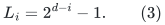
The graph <code class="math">G_i</code> retains:

* the inner edges whose endpoint index distance is at most <code class="math">L_i</code>;
* one fixed source edge <code class="math">s\to w_0</code>;
* one fixed sink edge <code class="math">w_N\to t</code>;
* the return edge.

Thus <code class="math">G_{d-1}</code> is the alternating path
<code class="math">w_0,w_1,\ldots,w_N</code>, its source and sink edges, and the
return edge. It has exactly one undirected simple cycle.

Every removed edge is routed using genuine selected native IDs.
An inner edge joins an even to an odd index, so its index distance
is odd. Between stages <code class="math">i</code> and <code class="math">i+1</code>, the old distance cap is
<!-- math-display: 0bd5fa8bb8d55a1bb88078a2
L_i=2L_{i+1}+1.
 \tag{4}
-->
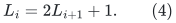
An odd distance at most <code class="math">L_i</code> is either at most <code class="math">L_{i+1}</code>,
or is a sum of three positive odd distances at most <code class="math">L_{i+1}</code>.
For the latter case, use distances
<!-- math-display: 438091f4d5bc8972f41db255
L_{i+1},\quad1,\quad
                                      q-L_{i+1}-1.
 \tag{5}
-->
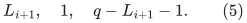
The corresponding monotone-in-index path has three edges.
Reference orientations alternate along it, but its endpoints
are correct. Retained edges may use identity routes.

At the first stage the source and sink edges also have short
routes. An even index distance from <code class="math">w_0</code> to any <code class="math">a\in A</code>
is at most <code class="math">2L_1</code> and is a sum of two positive odd distances
at most <code class="math">L_1</code>, unless it is zero. Route
<code class="math">s\to a</code> through the retained <code class="math">s\to w_0</code> edge and those
at most two inner edges. Similarly route <code class="math">b\to t</code> through
at most two inner edges to <code class="math">w_N</code>, then the retained sink
edge. Parallel copies at the retained endpoints use its
one selected genuine edge.

Consequently every nonidentity route has at most THREE ordinary
edges. The return uses its identity route. All routes are simple
and preserve their exact immediate endpoints.

## 3. Why uniform ordinary gradients make every correction zero

Suppose every ordinary gradient equals some common number <code class="math">a</code>.
Define a potential on the acyclic ordinary graph by
<!-- math-display: dbb02205f7027315001fcc64
p(s)=0,\quad p(A)=a,\quad p(B)=2a,\quad p(t)=3a.
 \tag{6}
-->
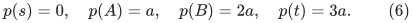
Every ordinary reference edge has gradient equal to its endpoint
potential difference. Therefore EVERY ordinary route of Section 2
has the same signed gradient as its input edge:
<!-- math-display: f45f17a5eeeeade70af0e61a
g^\top R_i(e)=g_e.
 \tag{7}
-->
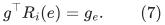
The return gradient may be arbitrary; its route is always the
identity. It follows that
<!-- math-display: 6b0b2eb7003ebd8d5fd1bc0e
g^\top(e-R_i(e))=0
                        \quad\text{at every stage and edge}.
 \tag{8}
-->
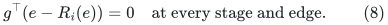
All composite corrections have the same property.

Suppose also that all ordinary lengths equal <code class="math">\ell&gt;0</code>, while
the return length is <code class="math">\ell_{\rm ret}&gt;0</code> and gradient
<code class="math">g_{\rm ret}&gt;0</code>. Section 2 then has weighted stretch at
most three. Any simple cycle avoiding the return has gradient
zero. Any cycle using the return has gradient of absolute value
<code class="math">3a+g_{\rm ret}</code>, because its ordinary <code class="math">s</code>-to-<code class="math">t</code> path
telescopes (6).

The original graph has ordinary paths of three edges. Hence,
when <code class="math">a\geq0</code>, its exact optimum is
<!-- math-display: 0c66b21df9d23531fa6b9794
\beta_0=\frac{3a+g_{\rm ret}}
                                    {3\ell+\ell_{\rm ret}}.
 \tag{9}
-->
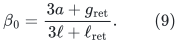
The terminal graph's unique cycle has <code class="math">N+2</code> ordinary edges,
so its exact optimum is
<!-- math-display: d50d7bad2548ebc3f7c2bfb2
\beta_{d-1}=
                    \frac{3a+g_{\rm ret}}
                                {(N+2)\ell+\ell_{\rm ret}}.
 \tag{10}
-->
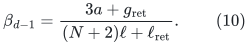
No local correction supplies another nonzero numerator.
The ratio gap is
<!-- math-display: 3880dd19ad2f11a3f7f4ea7c
\frac{\beta_0}{\beta_{d-1}}
              =\frac{(N+2)\ell+\ell_{\rm ret}}
                                    {3\ell+\ell_{\rm ret}}.
 \tag{11}
-->
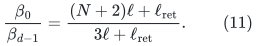
If <code class="math">\ell_{\rm ret}/\ell</code> is bounded by an absolute
constant, this is <code class="math">\Omega(N)=\Omega(2^d)</code>.

This loss is present even in the BEST terminal cycle, measured
by its net norm. It is not caused by a raw representation
that failed to remove some backtracking.

## 4. Exact profile A: only positive logarithms

Give every logical coordinate the permitted objective
<!-- math-display: fc0b488a497ec3ec92d5cd48
\phi_e(f_e)=\log f_e.
 \tag{12}
-->
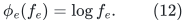
At (2), ordinary edges have <code class="math">g_e=\lambda_e=1</code>, while
<!-- math-display: 397368f2063db2b344874251
g_{\rm ret}=\lambda_{\rm ret}=1/h^2.
 \tag{13}
-->
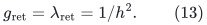
Take lengths <code class="math">\lambda</code>. Equations (9)--(10) give
<!-- math-display: f279423f7a940f8da558f338
\beta_0=1,\qquad
 \beta_{d-1}
       =\frac{3+1/h^2}{N+2+1/h^2}
       =\Theta(1/N).
 \tag{14}
-->
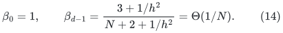
Every logarithmic argument is positive and every logical value
is exactly conserved.

There is an additional POSITIVE observation specific to this
profile. If all coordinates are <code class="math">\log f_e</code>, <code class="math">f_e&gt;0</code>, and
<code class="math">Bf=0</code>, then
<!-- math-display: 7ab1d8465fafc9949b7e6b70
g^\top f=\sum_e1=\|\lambda f\|_1.
 \tag{15}
-->
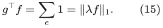
Thus the current flow itself is a ratio-one circulation,
and a directed cycle of its positive support also has ratio one.
A different algorithm could exploit that fact. The example
does not rule out such a client-specific bypass. It shows
that (15) does not force the selected recursive route
representatives to retain a comparable ratio.

The matching top client generally has fixed nonzero divergence,
and the projection client has two-sided terms. Their complete
algorithm is not reduced to this special positive-circulation
observation.

## 5. Exact profile B: the all-expanded threshold objective

This profile has the literal ordinary bounds and return term
from Section 7 of
[../graph-backends/near-feasible-rounding-and-exact-projection.md](../graph-backends/near-feasible-rounding-and-exact-projection.md).

Assign original capacity one to every ordinary arc. Its scaled
upper capacity is 16, and lower capacity is zero. The total
original source capacity is
<!-- math-display: d07a7d1c036fd4c79b9654e8
\beta=h^2.
 \tag{16}
-->
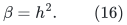
There is no ordinary arc entering <code class="math">s</code> or leaving <code class="math">t</code>,
and there are no self-loops, so the global preprocessing
requirements hold.

Use the legitimate threshold <code class="math">b=\beta/2=h^2/2</code>, which
is integral because <code class="math">h</code> is a power of two and <code class="math">d\geq2</code>.
It is also the ordinary first midpoint of the initial
<code class="math">[0,\beta]</code> search interval. Set
<!-- math-display: 7efd62db69966eff7c01d966
T=16b=8h^2,\qquad
         W=20000(M+1)=20000(3h^2+1).
 \tag{17}
-->
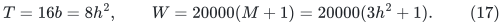
Let the two pads on every ordinary arc equal
<code class="math">\zeta=4\delta</code>, as at initialization. The objective is
<!-- math-display: 32f35a238042d35736f1060c
\Phi(f,z)=
    \sum_{e\ {\rm ordinary}}
       [\log(f_e+\zeta)+\log(16+\zeta-f_e)]
                      -W\log(T-z).
 \tag{18}
-->
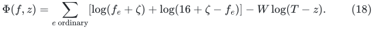
Evaluate it at the exact flow (2), so <code class="math">z=h^2</code>.
All ordinary flows lie strictly within their true bounds,
and <code class="math">T-z=7h^2&gt;0</code>. This is far before the success condition.

Every ordinary coordinate has the identical exact derivative
and price
<!-- math-display: 74782f27013351eff44788ac
a=\frac1{1+\zeta}-\frac1{15+\zeta},\qquad
 \ell=\lambda=
       \frac1{1+\zeta}+\frac1{15+\zeta}.
 \tag{19}
-->
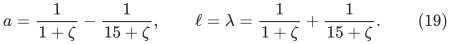
For <code class="math">\zeta\leq1/100</code>, safe absolute bounds are
<!-- math-display: 99c0cc5d1f8fb52695804466
4/5<a<1,\qquad1<\ell<2.
 \tag{20}
-->
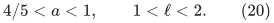
The return derivative equals its absolute price:
<!-- math-display: c9e7d2a24744dfba7ddece34
g_{\rm ret}=\ell_{\rm ret}
       =\frac{W}{7h^2}
       =\frac{60000}{7}+\frac{20000}{7h^2}.
 \tag{21}
-->
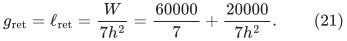
It lies between two fixed positive constants, independently
of <code class="math">h</code>. Thus (8) holds EXACTLY and (11) is <code class="math">\Omega(N)</code>.
The original ratio in (9) is bounded below by an absolute
constant greater than <code class="math">1/2</code>, whereas (10) is <code class="math">O(1/N)</code>.

This state satisfies more than the generic <code class="math">&#124;g&#124;\leq\lambda</code>
inequality: it has exactly the prescribed common padding,
integral ordinary capacities, the actual integral threshold
weight <code class="math">W</code>, and exact flow conservation. No coordinate
descriptor has been reverse-engineered to obtain an arbitrary
gradient.

The straight ray
<!-- math-display: d726778cec9b31a3a5e9c54b
f_e(t)=t,\qquad z(t)=t h^2,
                           \qquad0\leq t\leq1,
 \tag{22}
-->
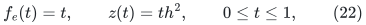
is conserved and feasible throughout. All ordinary derivatives
and the return derivative are positive on this ray, so the
objective increases strictly with <code class="math">t</code>. Grid points on it
are exact feasible states. This is not a proof that a fixed
backend's canonical step rule visits <code class="math">t=1</code>; that stronger
reachability statement is unnecessary for the claimed failure
of an implication based only on the displayed state conditions.

## 6. Integer pricing, exact cancellation, and native port paths

At an exact anchor the client uses
<!-- math-display: 7131495015b077cf80f1364b
\ell^{\rm int}_e=\lceil H_{\rm price}\lambda_e\rceil,
             \qquad
        \gamma_e=\mathrm{round}(H_{\rm price}g_e),
                      \qquad H_{\rm price}=S^{100}.
 \tag{23}
-->
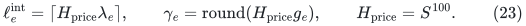
In profile A, <code class="math">h^2</code> is a power of two dividing
<code class="math">H_{\rm price}</code> when <code class="math">S</code> is a sufficiently large power
of two. Thus every price in (13) is represented exactly.

In profile B, all ordinary <code class="math">\gamma_e</code> are the SAME
integer <code class="math">\gamma</code>, and all ordinary lengths are the SAME
integer <code class="math">\ell^{\rm int}</code>. Define the native potential
<!-- math-display: 744f17ddd3e8c4ea60034c76
0,\ \gamma,\ 2\gamma,\ 3\gamma
 \tag{24}
-->
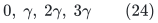
on the four layers. Each route still has exactly its own
input gradient. Every correction numerator is exactly
zero after rounding, not merely small. The return's
rounded label is immaterial to (8), because it is never
rerouted. The positive optimum and <code class="math">\Omega(N)</code> ratio
gap survive the rounding by fixed constants.

Apply the actual port-PATH degree reduction of the priced
client, from Section 3 of
[../graph-backends/priced-logarithmic-steps-from-raw-cycles.md](../graph-backends/priced-logarithmic-steps-from-raw-cycles.md).
Each real incidence has its own port, and ports of one
logical vertex are joined by the prescribed private path.
Connectors have length one and gradient zero. There are
<code class="math">O(M)</code> such records, all genuine real lifetimes stay fixed,
and the resulting backend graph has maximum degree three.

The route of a removed real edge consists of at most three
ordinary selected edges and a constant number of port
subpaths. Its connector cost is <code class="math">O(M)</code>. Every ordinary
integer length is <code class="math">\Omega(H_{\rm price})</code>; hence local
stretch is still bounded by an absolute constant. The
exact signed integer gradient is preserved because
connector gradients vanish and (24) telescopes.

The original short cycle has only a constant number of
real edges and at most <code class="math">O(M)</code> connector cost. The
terminal graph, after contracting its port paths, has
exactly the unique cycle used in (10). Every nonzero
terminal cycle therefore traverses all its <code class="math">N+2</code>
ordinary real edges. Positive connector lengths can
only worsen its ratio. Since <code class="math">H_{\rm price}\gg M</code>,
the original constant ratio and exponential gap survive.

These connectors are the numerical engine's private
conservation representation. They are not additional
logarithmic coordinates, and no extra descriptor is
assigned to them. Logical conservation (2) and the
engine's exact increment lift are the relevant interface.
Open native paths are never erased merely because their
logical or eventual physical images coincide.

## 7. Consequence for a possible improvement

Both exact profiles satisfy the numerical state properties
that motivated this check. Profile B also has the literal
all-expanded objective and bounds. Therefore none of
those properties alone implies a small cumulative route
mass, or an additive/max replacement for recursive
stretch in the separate-candidate comparison.

A stronger algorithm might use its actual forest family,
ASZ alternatives, a special reachable-state invariant,
or the positive-support observation (15) in a suitable
subcase. It might also optimize combinations of zero-
gradient corrections to shorten a terminal representative.
Those are additional algorithmic mechanisms, not
consequences of gradient telescoping or conservation.

### 7.1 A positive special case exposed by this example

The example itself has an efficient STATIC alternative. Suppose a
graph consists of ordinary edges and one distinguished return edge
<code class="math">t\to s</code>, all lengths are positive, and
<!-- math-display: e6ede132386abb6c2534aa10
g_{uv}=p(v)-p(u)
                      \quad\text{on every ordinary edge}.
 \tag{25}
-->
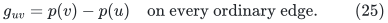
Ordinary traversals may use either orientation, with the corresponding
signed gradient. Put
<!-- math-display: 5eb879b31351568826edc0e5
d_\ell=\mathrm{dist}_{\ell,{\rm ordinary}}(s,t),
 \qquad \kappa=g_{\rm ret}+p(t)-p(s).
-->
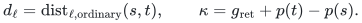
If <code class="math">s,t</code> are connected in the ordinary graph, the exact maximum
absolute cycle ratio is
<!-- math-display: a3329fa72790454cc2e13db8
\frac{|\kappa|}
                               {\ell_{\rm ret}+d_\ell}.
 \tag{26}
-->
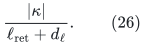
Every ordinary cycle has zero numerator. Every simple cycle containing
the return edge has numerator of absolute value <code class="math">&#124;\kappa&#124;</code>, so a
shortest ordinary <code class="math">s</code>-to-<code class="math">t</code> path attains (26). The potential can
be checked by a graph traversal, and a shortest path can be found in
<code class="math">O((n+m)\log(n+2))</code> scalar operations. This is a static bypass,
not a claim that a complete such scan is affordable at every
numerical query.

There is also an approximate version. If a supplied potential satisfies
<!-- math-display: fa772940bba664d923f235bf
|g_{uv}-(p(v)-p(u))|\leq\epsilon\ell_{uv}
                       \quad\text{on every ordinary edge},
 \tag{27}
-->
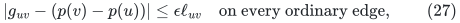
then the shortest-return-cycle candidate has ratio within
<code class="math">2\epsilon</code> of the global optimum. Indeed, for any circulation <code class="math">c</code>,
the ordinary length is at least <code class="math">d_\ell&#124;c_{\rm ret}&#124;</code>, by the
shortest-path Lipschitz potential. Its numerator is at most
<!-- math-display: 31445af6206ca0f93e1373b4
|\kappa|\,|c_{\rm ret}|
                  +\epsilon\|\ell c_{\rm ordinary}\|_1.
-->
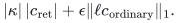
The optimum is therefore at most the quantity in (26) plus
<code class="math">\epsilon</code>. In particular, circulations omitting the return edge
have ratio at most <code class="math">\epsilon</code>, so they are included in this bound.
The shortest-return cycle has ratio at least (26)
minus <code class="math">\epsilon</code>, proving the claim.

Thus the two-sided example does not rule out algorithms that exploit
additional gradient structure. It shows that merely passing this
structure to independently stretch-bounded route maps does not
automatically exploit it.

The present example does not claim that all nested
tables in Section 2 arise from the actual maintained
distance hierarchy. That remains the exact scope boundary.
It does show that an improvement must use more than
the general priced-logarithmic interface, even when its
values, gradients, integrality, native IDs, and flow
conservation are all respected.
