# Potential-gradient shortcuts and their limits in the actual matching clients

**Separate mathematical analysis, 24 October 2026.** An ordinary
gradient that is close to a vertex potential permits a useful
shortest-return-cycle shortcut. The two actual matching clients
do not satisfy that condition automatically. This note gives
explicit legal states, including the literal zero-flow
initialization of an exchange projection, and states the
additional algorithmic interface that would be needed.

No change to the current matching theorem or exponent is claimed.

## 1. The precise shortest-return-cycle shortcut

Let an oriented graph have positive lengths, ordinary edges, and
one distinguished return edge <code class="math">t\to s</code>. Suppose a supplied
potential <code class="math">p</code> satisfies
<!-- math-display: db8d9373d51794be0c0f769a
|g_{uv}-(p(v)-p(u))|\le \epsilon\ell_{uv}
                    \quad\text{on ordinary edges}.
 \tag{1}
-->
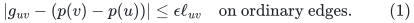
Ordinary paths may use either reference orientation, with the
corresponding signed gradient. Let
<!-- math-display: 5b6f084713da9ec58882d345
d=\mathrm{dist}_{\ell,{\rm ordinary}}(s,t),\qquad
 \kappa=g_{\rm ret}+p(t)-p(s).
-->
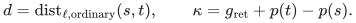
If <code class="math">s,t</code> are connected, a shortest ordinary path plus the
return edge has ratio within additive <code class="math">2\epsilon</code> of the
global maximum absolute circulation ratio.

Indeed, for any circulation <code class="math">c</code>, an ordinary shortest-path
Lipschitz potential gives
<!-- math-display: e294498176808d94f0c64e27
\|\ell c_{\rm ordinary}\|_1\ge d|c_{\rm ret}|.
-->
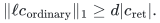
Hence
<!-- math-display: 273c9dae0dde79064081f196
|g^{\mathsf T}c|
 \le|\kappa|\,|c_{\rm ret}|
       +\epsilon\|\ell c_{\rm ordinary}\|_1.
-->
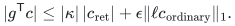
The optimum is at most
<code class="math">&#124;\kappa&#124;/(\ell_{\rm ret}+d)+\epsilon</code>; the stated candidate
has ratio at least that fraction minus <code class="math">\epsilon</code>.
Circulations omitting the return edge have ratio at most
<code class="math">\epsilon</code>, so they are included. At <code class="math">\epsilon=0</code> the
shortest-return-cycle formula is exact.

This is a STATIC implication from a supplied potential. Checking
it and computing a shortest path costs a full graph scan plus
ordinary shortest-path work. It does not give the subpolynomial
amortized update/query interface required by the numerical client.
The detailed proof also appears in
[the logarithmic-state obstruction](logarithmic-client-quality-obstruction.md),
Section 7.1.

## 2. A legal top-ledger state with large potential defect

Let <code class="math">C\ge3</code>, let <code class="math">w\ge2</code> be an integer, and set
<!-- math-display: 663e41048f754b568facb400
L=3Cw,\qquad \sigma=8\delta.
 \tag{2}
-->
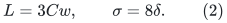
Use three bins <code class="math">d_1,d_2,d_3</code>, each of weight <code class="math">w</code>, and two
rows <code class="math">r_1,r_2</code>, each adjacent to all three bins. For every
integral level use the allocation
<!-- math-display: ffb781ac530976662fe20d5a
X^{\rm int}=
 \begin{pmatrix}
 0&2L/3&L/3\\
 2L/3&0&L/3
 \end{pmatrix}.
 \tag{3}
-->
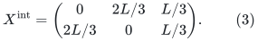
Its four positive incidences form a tree. Thus the actual
integral allocation already has an acyclic carrier. Each row
sums to <code class="math">L</code>, each bin load is <code class="math">2L/3</code>, and each residual is
<code class="math">L/3=Cw</code>. Zero integral debts satisfy every required floor
<code class="math">c_jw</code> with <code class="math">c_j\le C</code>.

At the top instead use
<!-- math-display: adda4310a4f05e8507f6c878
X^0=
 \begin{pmatrix}
 1&2L/3-1&L/3\\
 2L/3-1&1&L/3
 \end{pmatrix},
 \qquad
 p^0_d=\sigma,\qquad s_d=\sigma.
 \tag{4}
-->
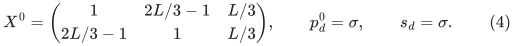
The column loads are unchanged, so the top equations
<!-- math-display: 6392fd5933da1277fbe5c6f5
s_d=L-\mathrm{load}(d)+p^0_d-Cw
 \tag{5}
-->
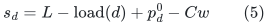
hold exactly. The allocation entries are positive integers
when <code class="math">L&gt;3</code>. Slacks and debts are exact grid values, and
the total top debt <code class="math">3\sigma=24\delta</code> is below the phase's
tiny-debt allowance. Exact cached values <code class="math">\sigma=8\delta</code>
are already above the positivity-service trigger. There is
no hidden need to repair these slacks before a pricing call.

Strict Hall holds: no proper subset of the three bins contains
a captive row, whereas the full set has two captive rows and
deficiency one. Bottom weights obey <code class="math">3w=L/C\le L</code>.
The carrier's canonical injection supplies one free bin.

This has an actual subcubic physical realization. Realize
each bin by an odd cycle of length <code class="math">2w-1</code>, using distinct
cycle vertices as the two row contacts. Each row has its
three prescribed contacts; every physical degree is at most
three. All bins are constructively factor-critical. There
are no distinct-bin edges and no paired-remainder contacts.

For compatibility with a nontrivial legal phase target WITHOUT
adding original isolated vertices, retain this <code class="math">6w-1</code>-vertex
core and add <code class="math">2w-1</code> disjoint triangle bins, each of weight
two, together with two disjoint matched edges in the paired
remainder. There are no edges between these components. The
total number of physical vertices is
<!-- math-display: 457a74ca16b49e5b0a513f50
N=(6w-1)+3(2w-1)+4=12w.
-->
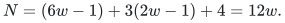
Every vertex has positive degree, the maximum degree is three,
and no bin has a remainder contact. The additional bins have
zero debts and top slacks <code class="math">L-2C&gt;0</code>; they contribute only
slack leaves to the numerical graph.

Choose <code class="math">K=40000</code>, for sufficiently large integer <code class="math">w</code>.
Then the prescribed threshold is exactly
<!-- math-display: 3d0c064cf20ffce065b87a14
\left\lceil10000CN/K\right\rceil=3Cw=L.
 \tag{6}
-->
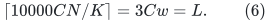
The represented matching has size
<code class="math">(3w-1)+(2w-1)+2=5w</code>, so its physical cardinality
deficit is <code class="math">w</code>. Taking <code class="math">w\ge80000</code> makes both the
phase target and the upper gain bound
<code class="math">U_{\rm gain}=80000</code> compatible with the direct driver's
invariant; the latter produces this target.
This confirms the algebraic/physical phase
scope; it is not a claim that a particular earlier sequence
of the implemented algorithm reaches exactly (4).

## 3. No potential fits this top gradient accurately

For the top objective, <code class="math">g_e=\lambda_e=1/x_e</code> on allocations
and <code class="math">g_d=\lambda_d=1/s_d</code> on slack arcs. Let
<!-- math-display: e860a91ee63c521d9b4e5b29
A=2L/3-1.
-->
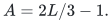
The row-only four-cycle that increases <code class="math">x_{11},x_{22}</code>
and decreases <code class="math">x_{12},x_{21}</code> has ratio
<!-- math-display: 8a4cba446015129911f08544
\frac{2-2/A}{2+2/A}
                     =\frac{A-1}{A+1}=1-O(1/L).
 \tag{7}
-->
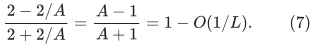
Every vertex potential vanishes on this exact circulation.
Consequently any potential approximation on the allocation
graph satisfies
<!-- math-display: b8903cc71f5cbd4c71130807
\max_e\frac{|g_e-(p(v_e)-p(u_e))|}{\lambda_e}
                     \ge\frac{A-1}{A+1}.
 \tag{8}
-->
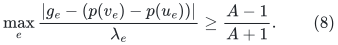
In particular, the error cannot be a small constant, let
alone the numerical accuracy parameter.

The same conclusion survives removing ANY ONE incidence
as a putative distinguished return edge. Removing an edge
in one column leaves the four-cycle on the other two
columns. Its ratio is either (7) or
<!-- math-display: b5334dd85c9651a5d67ee301
\frac{1-1/A}{1+1/A+6/L}=1-O(1/L).
 \tag{9}
-->
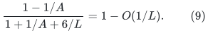
Removing a slack arc leaves all the allocation cycles.

The slack source does not cure this problem. Every elementary
cycle using one row, two bin contacts, and their two slack
arcs has canceling slack gradients because all <code class="math">s_d=\sigma</code>.
Its numerator is at most one in absolute value and its
length is at least <code class="math">2/\sigma</code>, so its ratio is at most
<code class="math">\sigma/2</code>. Thus checking only these short slack-source
cycles misses the strong row-only direction (7).

The official integer pricing and degree-three port paths
do not remove the obstruction. Gradient errors telescope
against native circulations, real prices are multiplied by
the common large price scale, and the additional zero-gradient
port-path length is negligible compared with those real
prices. All parallel and connector identities remain literal.

## 4. It need not be an isolated off-center iterate

Consider the top client starting from (4), with no structural
action available. Let <code class="math">\eta</code> bound the TOTAL core debt,
including the initial <code class="math">3\sigma</code> and all later positivity
increments. On the guarded prefixes this remains below a
negligible <code class="math">\eta&lt;S^{-800}</code>. Total core row mass stays <code class="math">2L</code>.
The other two columns each have upper load <code class="math">2L/3+p_d</code>,
so column capacities imply
<!-- math-display: 592b756f41917b51ed8cd8dc
\mathrm{load}(d_1)
                               \ge 2L/3-\eta.
 \tag{10}
-->
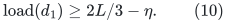
As long as <code class="math">x_{11}\le L/100</code>, it follows that
<code class="math">x_{21}\ge 0.65L</code>, for the guarded sizes. One of the other
two entries in row one, say <code class="math">x_{1j}</code>, is at least
<code class="math">(L-x_{11})/2\ge0.495L</code>.

The four-cycle increasing <code class="math">x_{11},x_{2j}</code> has positive
derivative sum at least <code class="math">1/x_{11}</code>; its negative sum is
at most
<!-- math-display: 41182d5c36d95d047f41e51c
1/x_{21}+1/x_{1j}<4/L.
 \tag{11}
-->
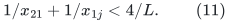
Its ratio is consequently at least
<!-- math-display: 999808f57d9a85a2dd631f87
\frac{1-4x_{11}/L}{1+4x_{11}/L}
                         \ge\frac{12}{13}>\frac9{10}.
 \tag{12}
-->
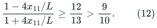
Thus every potential still has normalized error above <code class="math">9/10</code>,
and a valid LOW is impossible.

An accepted numerical step changes each coordinate by at most
a <code class="math">q/100</code> fraction of its present value. Explicit positivity
repairs contribute at most the tiny total <code class="math">\eta</code>; while
<code class="math">x_{11}\le L/100</code>, it cannot be the large donor of its row.
Starting at <code class="math">x_{11}=1</code>, reaching <code class="math">L/100</code> therefore takes
<!-- math-display: 741b8e754750c9b2114b6c8d
\Omega(q^{-1}\log L)
 \tag{13}
-->
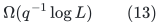
accepted steps. If it never reaches that value, (12) continues
to hold instead. This is a trajectory statement FROM the
displayed valid state, not a proof of its reachability from
the phase's prescribed initial partition.

Accordingly, feasibility, positive slacks and exact conservation
do not imply that all but a constant number of priced queries
have nearly conservative gradients. Proving a stronger
reachable-state property would be a new theorem.

## 5. Projection gradients fail conservativity already at initialization

The obstruction is more immediate in the ACTUAL exchange network.
Every positive INTEGRAL parent allocation <code class="math">x_e&gt;0</code>, on an incidence
<code class="math">(r,d)</code>, creates two DISTINCT ordinary arc IDs:
<!-- math-display: 03b49cea8d2d3200a4c4f78b
d\longrightarrow r\quad[\mathrm{cap}=x_e],
       \qquad
        r\longrightarrow d\quad[\mathrm{cap}=L+1].
 \tag{14}
-->
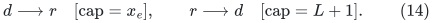
Both have lower bound zero. In a threshold test their upper
capacities are multiplied by 16, both initial flows are zero,
and both lower/upper pads equal <code class="math">\zeta=4\delta</code>.

For either arc with scaled upper <code class="math">U_e\ge16</code>, the initial
exact gradient and absolute price are
<!-- math-display: cbf97b1c06858db929566879
g_e=\frac1\zeta-\frac1{U_e+\zeta},\qquad
       \lambda_e=\frac1\zeta+\frac1{U_e+\zeta}.
 \tag{15}
-->
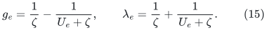
Their genuine directed two-edge cycle has ratio
<!-- math-display: dbd8cafd41aa136edcb5af52
\frac{2/\zeta-\sum_{e=1}^2 1/(U_e+\zeta)}
      {2/\zeta+\sum_{e=1}^2 1/(U_e+\zeta)}
                         =1-O(\delta).
 \tag{16}
-->
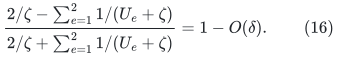
It uses no numerical return arc. Every vertex potential
vanishes on it, so the best normalized potential error on
the ordinary graph is at least (16).

This is the literal zero-flow initialized state of the local
or all-expanded projection, whenever a positive incidence is
represented. No speculative reachability or choice of later
steps is involved. It also survives exact integer rounding:
the leading lower-pad reciprocal is common, and the two
positive rounded labels cannot become conservative around
their directed two-edge cycle.

These are not the forward and reverse representations of the
SAME undirected edge. They are two different ordinary flow
variables with different capacity descriptors. A positive
circulation on both changes the barrier variables while
leaving the induced allocation
<code class="math">x'_e=x_e-F_{d,r}+F_{r,d}</code> unchanged. The current objective
legitimately includes that degree of freedom.

One could design a different signed-coordinate formulation
that combines the two directions and removes such redundant
exchange circulations. It would require a new barrier,
local boundary/lock proof, exact recovery interface, and
numerical update analysis. It is not an allowed loop erasure
of the current objective, and it would not by itself eliminate
the top-state obstruction (7).

## 6. What a useful stronger theorem would have to supply

The positive shortcut in Section 1 would need two separate
ingredients for a worst-case time improvement:

1. A proved centrality or gradient-decomposition invariant
   giving sufficiently small residual <code class="math">\epsilon</code> on a
   suitably defined ordinary graph for the queries being
   replaced, together with a charged treatment of all
   exceptional queries.
2. A deterministic dynamic shortest-path/potential interface
   handling the clients' signed gradient changes, positive
   length changes, topology edits, and representation
   retirement, with actual-size initialization and
   subpolynomial amortized work. Recomputing a static
   shortest path at every numerical query does not have
   that bound.

An approximate potential found only by solving the general
weighted cycle-ratio dual is not a simplification: that is
another formulation of the same optimization obligation.
For the ordinary graph with incidence matrix <code class="math">B</code>, finite
linear-programming duality gives the exact identity
<!-- math-display: 48e6798a39354fb0f8076312
\min_p\max_e\frac{|g_e-(B^{\mathsf T}p)_e|}{\ell_e}
 =
 \max_{\substack{Bc=0\\ \|\ell c\|_1\le1}}g^{\mathsf T}c.
 \tag{17}
-->
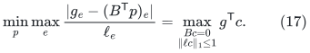
The two inequalities defining each absolute residual produce
signed dual variables, whose vertex constraints are <code class="math">Bc=0</code>
and whose total weighted absolute value is at most one.
Thus (17) requires the same circulation optimization unless
additional structure makes the potential available cheaply.
Likewise, conservation alone supplies no centrality:
(4) obeys all ledger equations and (16) occurs at exact
projection initialization.

These examples leave open an algorithm that deliberately
maintains centrality, optimizes combinations of correction
circulations, or changes the projection barrier. They rule
out obtaining the desired worst-case improvement solely
from the present logarithmic objective, matching feasibility,
or exact-conservation invariants.
