# Adversarial collapse audit of the prefix allocation core

**25 October 2026. Fresh adversarial mathematical audit prompted by the corrected public layer-growth argument.**

This audit found no counterexample to the currently specified algorithm.
It did find a small, reachable state that invalidates a tempting weakened
variant: checking only the center whose designated group changed, or
merely rescanning for new available bundles, does not suffice. The
existing algorithm's scan of **all retained centers** detects the missing
release and prevents the invalid charge. The example below violates
both the general sharp coefficient and the sharper equal-unit coefficient
before that required normalization.

The checked proof chain is
[general-resource-all-remaining-blockers.md](../allocation-and-scheduling/general-resource-all-remaining-blockers.md),
[recipient matroid configuration proof](../../problems/recipient-matroid-configuration/proof.md), and
[recipient polymatroid proof](../../problems/recipient-polymatroid/proof.md), together with
the exact micro-signature in
[matroid-allocation-current-blocker-quasipolynomial.md](../allocation-and-scheduling/matroid-allocation-current-blocker-quasipolynomial.md).
The earlier reviews were not used as substitutes for checking the
state transitions here.

## 1. The particular public failure mechanism being tested

The current [Davies--Rothvoss--Zhang v4, Section 4](https://arxiv.org/html/1807.07189v4)
explains that a lower bound on layer blockers held at creation but
could fail after later collapses. Its repair checks existing adding
edges again and changes their relative size. That is the concrete
reason to inspect the current state after every exchange; merely
having a valid argument at a layer's birth would not close the issue.

The present audit asks whether an analogous stale assertion can enter
the internal algorithm through old maximality, internal prefixes,
same-owner replacement, a vanished resource dependence, or a small-quota
running-time argument. The answer depends on the exact mutations in
the manuscript, not on the fact that a different public algorithm
has been corrected.

## 2. A reachable counterexample to checking only the changed group

### 2.1. Players, resources and minimal bundles

There are six players named b0, b1, b2, q, p and d. The player matroid
is the rank-five partition matroid with blocks

<!-- math-display: 68e45784c312360650c7e133
\{b_0\},\quad\{b_1,d\},\quad
                    \{b_2\},\quad\{q\},\quad\{p\},
 \tag{A1}
-->
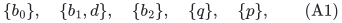

each of capacity one. Fix player scan order b0,b1,b2,q,p,d. Every
resource has value 9 and the bundle threshold is B=10. Every listed
two-resource bundle is therefore inclusion-minimal above B.

The nonloop recipients of the resources are as follows; every unlisted
player is a loop in that resource's recipient matroid.

| Resource | Recipient matroid |
|---|---|
| k | U_(2,3) on {b0,b1,q} |
| ell | U_(1,2) on {b0,q} |
| j | U_(2,3) on {b1,b2,p} |
| t_b2 | one nonloop, b2 |
| t_p | one nonloop, p |
| t_d and s_d | one nonloop, d, in each resource |

Thus the only threshold bundles for the six owners are

<!-- math-display: 4f5f71f97a700c2507d84d41
\begin{array}{c|c}
 b_0&\{k,\ell\}\\
 b_1&\{k,j\}\\
 b_2&\{j,t_{b_2}\}\\
 q&\{k,\ell\}\\
 p&\{j,t_p\}\\
 d&\{t_d,s_d\}.
 \end{array}
 \tag{A2}
-->
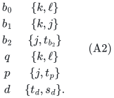

Different players may have the same resource names, because these
resources have their supplied recipient matroids. No physical-item
exclusivity is assumed where the matroid permits two recipients.

### 2.2. Literal reachability from the empty allocation

The first three phases insert the bundles of b0, b1 and b2 without
blocking. After b0, the service of k to b1 is independent of its service
to b0. After b1, the service of j to b2 is independent of its service
to b1. All private services are free. The matching now has three
records M0,M1,M2, with owners b0,b1,b2 and bundles (A2).

In the next phase, q and p are the only players outside the current
player span. In layer one choose q first. Both k and ell are available
over the empty selected-and-marked prefix. The resource k is problematic
because its two current recipients b0,b1 span q. The resource ell is
also problematic because b0 spans q there. The exact dependency-filtered
completion rule therefore stores

<!-- math-display: 47039122ad6556c6c8174bf1
c_q=\{k,\ell\},\qquad D(c_q)=\{M_0,M_1\}.
 \tag{A3}
-->
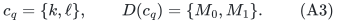

Player p is still eligible. At j, the preceding reserved set contains
b1, but not b2: M1 is marked and M2 is unmarked. Player p is outside
the span of b1 in U_(2,3), so j is available. It is nevertheless
problematic over the whole actual matching, whose j recipients b1,b2
span p. The new completion marks exactly M2, giving

<!-- math-display: 24117aef28d636c39036ace4
c_p=\{j,t_p\},\qquad D(c_p)=\{M_2\}.
 \tag{A4}
-->
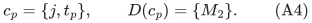

Both centers lie in layer one, ordered c_q before c_p. This layer is
maximal: q and p are its only eligible players, and each of their
resources is already in its own selected support and hence unavailable.
Both centers also fail the current strong-release test at this point.
Their nonempty groups pass the exact-boundary layer test, so a second
layer is appended. The example does not presume a feasible high target;
it is a reachable search state, and a current-cover inequality would
have to respect it at every state where that inequality is invoked.

In layer two, removing the earlier blocker owners leaves the empty
player set. The scan eventually reaches d, whose two private services
are strongly free. The fundamental player circuit is {d,b1}. The
earliest-layer exchange removes M1, inserts d's fresh matching record,
and truncates layer two. The retained layer is now

<!-- math-display: b6c6eb02ad401593a12b4326
D(c_q)=\{M_0\},\qquad D(c_p)=\{M_2\}.
 \tag{A5}
-->
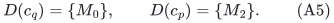

The new d record is unmarked. In particular, it does not inherit M1's
group flag. No other matching allocation is altered.

### 2.3. The changed group still blocks; the unchanged group does not

The changed center c_q is still dependent on its remaining group:
at ell, q is spanned by b0. It does not pass the strong-release test.
At k, q and b0 have become independent, but freedom is required at
every used resource.

The group of c_p has not changed at all. However, its preceding reserved
set at j has lost b1 when M1 was deleted from D(c_q). Now p and b2
are independent at j, and t_p is private. Thus c_p passes the current
strong-release test even though its own group remains {M2}.

This distinction is the adversarial point. A normalization routine
that inspects only the group losing M1 tests c_q, sees its continuing
dependence at ell, and misses c_p.

Simply rebuilding an available bundle in the retained last layer
also does not repair this omission. Its player eligibility flat is
unchanged because d and b1 are parallel in the player matroid. Its
eligible players are still q,p. Their old bundles remain in X, so
those resources are still excluded by the availability rule. A fresh
available-bundle scan finds nothing, even though the stored c_p can
now be exchanged.

### 2.4. The numerical current charge really fails before full normalization

After the exchange, the resources contributing to the cover have
current reserved ranks

<!-- math-display: 6a001f1677253724b2642831
k:2,\quad\ell:1,\quad j:2,
                 \quad t_p:1,\quad t_{b_2}:1.
-->
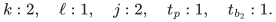

The private resources of d are unmarked and do not contribute to W.
Therefore

<!-- math-display: 8fc0a3160abee187be0b0ebe
\Phi=7\cdot9=63,
              \qquad |Y|=2.
 \tag{A6}
-->
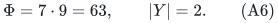

The general claimed coefficient is

<!-- math-display: 2992e51bbea7077d7fdfe472
C(B,u)=\max\{u,2B+\min(u,B)\}=29,
             \qquad C(B,u)|Y|=58<63.
 \tag{A7}
-->
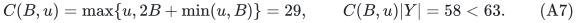

Thus the sharp charge is false in this reachable, not-yet-normalized
state. The same combinatorial instance with value one per resource
and quota b=2 has Phi=7>(2b-1)|Y|=6, violating the sharper unit charge
at the same intermediate point.

All designated groups are nonempty. Universal reservations, every
ordered-prefix rank-additivity invariant, and inherited availability
still hold. For example, at j the prefix ending at c_q has W empty
and unmarked set {b2}; the prefix ending at c_p has W={p,b2} and no
unmarked j recipient. These satisfy prefix additivity. The defect
in the weakened variant is specifically the missing current release,
not a failure of those maintained invariants.

### 2.5. What the specified algorithm does instead

The current manuscript scans **every** retained center before applying
the charge or completed growth test. It rejects release of c_q, detects
release of c_p, and processes c_p atomically. Player p is outside the
current matching span, so this step augments the matching and ends
the phase. The intermediate state (A5) is never used for the sharp
cover calculation.

This is a counterexample to the weakened changed-group-only or
new-bundle-only variants, not to the present algorithm. It shows that
the full scan is a necessary part of the proved implementation and
must not be optimized away without a separate dependency-maintenance
argument.

## 3. Why all internal prefixes, not merely completed layers, are needed

There is also a small countermodel to a weaker collection of state
axioms. At one resource, use a linear matroid over F_2 with matching
elements

<!-- math-display: e2e5d14c0c6f0fe1c2071df7
b=e_2,\qquad u=e_1+e_2,
-->
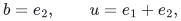

and two selected elements in the same layer, ordered

<!-- math-display: efe31dbe10913bb184141db8
c_1=e_1,\qquad c_2=e_3,
                \qquad D(c_1)=\{b\},\quad D(c_2)=\{u\}.
 \tag{A8}
-->
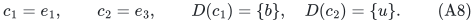

All four subset reservations are independent: {b,u}, {c1,u}, {b,c2},
and {c1,c2}. Each center is independent over its strictly preceding W.
At the completed layer the unmarked matching set is empty, so a
layer-boundary-only additivity assertion also holds.

Nevertheless c1 is independent over its own group {b} but dependent
over the actual matching {b,u}. Treating its passing local release
test as strong freedom would be false. The missing internal prefix
is exactly the one ending at c1:

<!-- math-display: bff4684eab316992efb29a57
r(\{b,c_1,u\})=2
       <r(\{b,c_1\})+|\{u\}|=3.
 \tag{A9}
-->
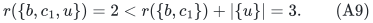

The actual algorithm rules this state out twice: its invariant includes
this internal prefix, and its completion at c1 would mark both unmarked
matching elements b,u at the problematic resource. This is a countermodel
to weakened proof assumptions, not a legal history of the specified
completion rule. It confirms that the internal-prefix hypothesis used
to turn the release test into strong freedom is substantive.

## 4. Old layer maximality is preserved on an identical current domain

This audit rederived the player-flat identity rather than assuming that
earliest exchange automatically preserves maximality.

Let a free center in layer i have incoming owner p, and let h<i be
the outgoing matching record's designated layer. If p is not already
matched but is spanned by the current independent owner set I, let
C be its fundamental circuit in I union {p}. The algorithm chooses
h as the earliest blocker layer met by C.

For each retained layer ell<=h, the circuit meets no owner in Y_<ell.
Consequently C is a circuit in J_ell union {p}, where

<!-- math-display: c96fb26e3c8ed98dcd2a6a54
J_\ell=I\setminus\mathrm{owners}(Y_{<\ell}).
-->
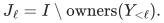

The outgoing owner a belongs to this circuit. The independent sets
J_ell and J_ell-a+p have the same span: the circuit expresses each
of a and p in terms of the other together with its remaining elements.
The groups Y_<ell are unchanged, because the outgoing record lies
in layer h>=ell. Therefore

<!-- math-display: 6b9fc218142703624c46a468
\mathrm{cl}_M(I'\setminus\mathrm{owners}(Y'_{<\ell}))
  =\mathrm{cl}_M(I\setminus\mathrm{owners}(Y_{<\ell}))
                 \qquad(\ell\le h).
 \tag{A10}
-->
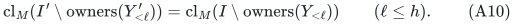

If p is already matched, eligibility forces its own matching record
into an earlier group. That record is removed, I'=I, and the same
identity follows directly for every retained layer. The new record
again has no inherited flag.

For ell<h, all selected and designated matching records in the entire
prefix through ell are literally the same objects, with the same
bundles or count vectors. Hence every resource closure, or every
polymatroid residual availability count, used in its old failed scan
is identical. Combining this with (A10) gives the same eligible-player
domain and the same available local optimization instances. Its old
maximality inequality is still true for a current reason.

At h, the resource prefix can lose the outgoing record. Availability
can increase there. The algorithm explicitly makes h the last layer
and rescans it before another completion or growth conclusion. No
statement here preserves h's old resource maximality. Higher layers
are discarded altogether.

For a factor-lambda local oracle, the preserved fact is the certified
upper bound on the true available optimum from the earlier failed
call. The proof does not assume monotonicity of approximate returned
bundles across different calls.

## 5. Internal-prefix exchange, released groups, and same-owner records

For any retained ordered prefix S, the incoming center strictly follows
every selected record of S, since its layer i is larger than h. Strong
freedom therefore places its whole incoming resource block outside
the old matching together with all retained selected blocks, in the
precise rank-additivity sense of the polymatroid addendum.

At a fixed resource and retained internal prefix, the outgoing record
has exactly three possibilities:

| Outgoing resource block relative to S | Effect before insertion |
|---|---|
| It belongs to Y(S) | Delete it from W(S); independence of U(S) over the smaller W persists. |
| It belongs to the matching outside Y(S) | Delete it from U(S); a subset remains independent over W(S). |
| It does not use this resource | No deletion at this resource. |

The incoming block is independent over the whole old W(S) union U(S),
hence over its post-deletion subset. Insert it into U(S) as an unmarked
matching block. This proves the new prefix additivity in every case,
including a prefix ending inside layer h before the center that owned
the outgoing blocker.

Released higher groups introduce no fourth case. Their matching records
were already outside Y(S) for every retained prefix S and therefore
already belonged to U(S). Unmarking them globally neither adds a new
record to that prefix's U nor changes its resource allocation.

There is a useful additional consequence of (A10). The newly inserted
matching owner cannot equal the owner of any retained center. Otherwise
its new unmarked record would put that owner inside
I' minus owners(Y'_<ell) at the retained center's layer ell, contradicting
the preserved eligibility of that center. Thus creating a new matching
record does not silently create an already-matched version of a retained
selected owner.

Previously repeated selected owner names are still permitted. For
recipient matroids, their services at one resource remain distinct
ground elements because such same-owner reuse at that resource is
excluded by availability. For recipient polymatroids, the fixed natural
matroid uses distinct copies, and eligibility ensures that an eligible
owner's old matching block is already included in the reserved count
vector. The residual count bound therefore leaves enough unused copies
for the incoming block. Subsequent lower-prefix rank queries depend
only on the unchanged count vectors; no global relabeling is required.

Record identity is essential to the progress argument. If a new record
inherited an outgoing record's group flag merely because their owners
coincide, the retained blocker count would not decrease, and deleting
the higher suffix could increase rather than decrease the signature.
That mutation is expressly excluded by the current algorithm.

## 6. Current dependency witnesses are recomputed after their premises change

For a center c, its earlier reserved set can lose elements even when
D(c) is unchanged, as (A3)--(A7) demonstrate. The algorithm does not
retain a saved birth witness as a current rank deficit. It tests the
present earlier W plus the present D(c).

If that test fails, the integer natural-matroid rank deficit is at least
one. In the singleton-group case, the deficient resource must also be
used by its single blocker: otherwise the tested set is only the
earlier W, over which the entire center block is independently certified
by inherited availability. This provides the currently valid unit
saving used in the charge.

If the test passes, every-prefix additivity implies freedom over the
actual matching plus all retained earlier centers. The algorithm then
performs an atomic player exchange or augmentation. It does not release
the center's group as an independent mutation. Before the next sharp
charge, it repeats the full scan until every retained center again has
a current dependence witness. The adversarial state in Section 2 is
removed precisely at this point.

## 7. Exact-signature time does not assume positive small-quota slack

Fix one augmentation phase with k<r matching records. Every stored
center has a nonempty, disjoint designated group before a free cascade.
Thus the total stored-center count is at most k. A fresh free candidate
is not inserted into X. During a cascade or eager release no center
is added; selected records are only retained or discarded. Blocked
insertions resume only after empty groups are processed. Consequently
at every charged microstate,

<!-- math-display: 565f7ad183c31bf115c435a9
\sum_i|X_i|\le k,
                 \qquad\sum_i|Y_i|\le k.
 \tag{A11}
-->
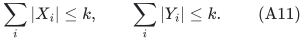

Every non-last layer passed a test requiring at least one blocker,
and no exchange changes a layer below its last retained layer h.
Only the last layer can therefore be unfinished or newly empty.
The number of layers is at most k+1<=r even at an intermediate state.

For the signature

<!-- math-display: 06fd1c1762167802d894ee1e
(-|X_1|,|Y_1|,\ldots,-|X_\ell|,|Y_\ell|,\infty),
 \tag{A12}
-->
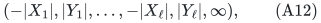

every possible charged nonterminal event decreases it:

| Event | First changed signature entry |
|---|---|
| Append an empty last layer | The old infinity sentinel becomes the finite entry 0. |
| Insert a blocked center | The last selected count increases, so its negative entry decreases before its blocker increase matters. |
| Exchange a fresh free center | At the earliest outgoing layer h, X_h is unchanged and Y_h decreases by one. |
| Exchange an empty-group or redundantly blocked stored center | Its layer is strictly above h and is discarded; the same first change Y_h to Y_h-1 occurs. |

A successful augmentation ends the phase. Pruning a transient candidate,
testing release and computing a circuit are work inside one event, not
uncharged permanent state changes. A complete failed scan leads to a
completed layer followed by append or a valid failure certificate.
The schedule of operations does not repeatedly scan an unchanged state
without one of these outcomes.

For fixed length ell<=r, nonnegative selected-count lists with sum at
most r number binomial(r+ell,ell), and so do the blocker-count lists.
Therefore the number of possible signatures is at most

<!-- math-display: c55c54ce73d252b027a1f208
\sum_{\ell=0}^{r}\binom{r+\ell}{\ell}^{\!2}
                      \le(r+1)2^{4r}=2^{O(r)}.
 \tag{A13}
-->
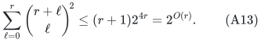

Strict descent prevents revisiting a signature even with different
record identities or different numerical allocations. There are at
most r augmentation phases. Whole-block rank tests, available-count
scans and numerical pruning remain polynomial per event by the
natural-matroid count implementation. No iteration counts service
copies individually.

For the equal-unit theorem, the exact condition is

<!-- math-display: a6c3b7b59d7f72deebd66ed1
(3-2/r)b<t+1+(r-1)/r.
 \tag{A14}
-->
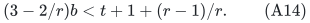

At an empty completed new layer, the current upper cover is
(2b-1)s, where s counts earlier blockers. The integer lower cover is
(t-b+1)w and s/w<=(r-1)/r, giving precisely the strict contradiction
in (A14). Every continuing layer therefore has a blocker. This is all
that (A11)--(A13) require.

For example, t=4 and b=2 leave only 3/r slack in (A14). That does
not invalidate the exact rank-exponential bound: this proof uses no
constant multiplicative layer growth. It does invalidate an automatic
uniform rank-quasipolynomial conclusion from this quota alone. The
current unit theorem explicitly retains that restriction, and the
scheduling workload theorem separately manufactures and pays for a
positive relative margin. No small-quota growth margin is imported
from a historical creation-time inequality.

## 8. Verdict and required implementation contract

No substantive gap was found in the specified prefix core after these
adversarial checks. Its protection against the public collapse failure
mechanism is a concrete conjunction of operations:

* preserve every internal ordered prefix;
* exchange one matching record in the earliest eligible blocker layer;
* create a fresh unmarked record, even for a repeated owner;
* keep lower failed-scan domains literally unchanged and refresh the
  last retained layer;
* test every retained center's current release condition before a
  charge or growth calculation, and process releases atomically;
* use the exact composition signature for the small-quota boundary.

The six-player construction proves that replacing the fifth item by
a changed-group-only check is unsound for the claimed charge. The
linear countermodel proves that a layer-boundary-only rank invariant
does not justify strong release. These are explicit counterexamples
to weakened variants, not counterexamples to the current algorithm.

The audited conclusion remains internal mathematical verification of
the written algorithm. It is not external peer review, an implementation
claim, or a publication-priority determination.
