# A congestion obstruction with literal first-touched central provenance

**Separate construction, 24 October 2026.** The arbitrary-ambient
example in
[congested-greedy-support-and-dynamic-boundary.md](congested-greedy-support-and-dynamic-boundary.md)
does not by itself settle the more restricted dynamic-repair
interface. Here we realize a comparable obstruction by an actual
old route table and a legal sequence of native vertex splits.
Every preliminary image has the required form
<!-- math-display: a98b23da7ceba05a0caf27f3
\overleftarrow{P_e^u}\ \oplus e\ \oplus P_e^v,
 \tag{1}
-->
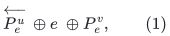
with its OWN distinct genuine central native edge <code class="math">e</code>.
The exterior prefixes are in a retained lower-layer graph, and
the two anchors are literally the first touched vertices of the
old route after the splits.

This disproves the proposed additive ambient guarantee for the
UNCHANGED congested-greedy selection, even on this restricted
class. It is not a lower bound on a different ambient-aware
selection algorithm. Nor does it claim that the currently used
deterministic static sparsifier will choose the specific initial
table constructed below.

## 1. The projected graph that will arise

Let <code class="math">L\geq2</code> be even, let <code class="math">T</code> be a full binary tree of height
<code class="math">4L</code>, and put
<!-- math-display: bf8b07dc3771d1608f5c761c
n=|V(T)|=2^{4L+1}-1,\qquad J=T^L,\qquad q=2^{L/2}.
 \tag{2}
-->
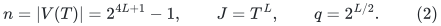
As before,
<!-- math-display: bbde7559a54b4bcffc335fe7
2^L\leq\Delta_J\leq3(2^L-1).
 \tag{3}
-->
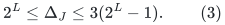
Each bottom subtree of height <code class="math">L/2</code> supplies a group of <code class="math">q</code>
leaves. Choose a sign <code class="math">\chi(v)\in\{-,+\}</code> on the vertices of
<code class="math">T</code>, putting exactly half of each such leaf group on each
side. Internal tree vertices can have either sign.

The congested-greedy order will process the <code class="math">n-1</code> TREE IDs first.
Every later <code class="math">J</code>-edge has its unique tree route of length at most
<code class="math">L</code>, and each tree edge has fewer than <code class="math">L2^L</code> route users.
At threshold <code class="math">\tau=4\Delta_JL</code>, no edge saturates. Thus this
order selects exactly the abstract support <code class="math">T</code>, of maximum
degree three. This is the same fully checked native argument
as in the earlier note.

## 2. Two native port systems and private central edges

All native edges in this section have unit length. Every tree is
an explicitly generated balanced binary tree with separate edge
IDs. Its root is attached by one edge to the indicated anchor;
its leaves are private ports. Constant-size cases can use a
subdivided edge. Every native vertex has degree at most three.

For each <code class="math">v\in V(T)</code>, make one anchor <code class="math">z_v</code>. It joins TWO
separate port systems:

* a prefix port tree <code class="math">P_v</code>, attached to <code class="math">z_v</code> by one edge;
* a blue port tree <code class="math">B_v</code>, attached to <code class="math">z_v</code> by one edge.

The anchor itself therefore initially has degree two.

### The shared prefix tree

Make a binary tree <code class="math">X</code> with two binary halves joined by one
distinguished central edge <code class="math">f</code>. Reserve a separate port <code class="math">t_v</code>
in side <code class="math">\chi(v)</code> for every <code class="math">v</code>. Connect <code class="math">t_v</code> to a dedicated
leaf of <code class="math">P_v</code>. The prefix trees and <code class="math">X</code>, together with these
attachments, form one tree.

For every TREE edge <code class="math">e=uv</code>, orient it from its tree parent
<code class="math">u</code> to its child <code class="math">v</code>. Reserve a private leaf <code class="math">a_e</code> in
<code class="math">P_u</code> and a private leaf <code class="math">b_e</code> in side <code class="math">\chi(u)</code> of <code class="math">X</code>.
Add the genuine central native edge
<!-- math-display: 405473194c801047cd8ad467
e=a_eb_e .
 \tag{4}
-->
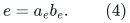
Thus this selected candidate's OWN central edge stays entirely
on side <code class="math">\chi(u)</code> of the distinguished cut.

For every NON-TREE edge <code class="math">e=uv</code> of <code class="math">J</code>, choose an orientation
and reserve private leaves <code class="math">a_e\in P_u</code>, <code class="math">b_e\in P_v</code>.
Add the genuine central native edge <code class="math">e=a_eb_e</code>.
All these central edge IDs and all their endpoint ports are
distinct. These central edges are NOT initially selected.

Each side of <code class="math">X</code> needs only <code class="math">O(n)</code> reserved ports: the
<code class="math">t_v</code>'s and at most one <code class="math">b_e</code> for each tree edge. Taking the
next power of two and leaving unused leaf ports harmlessly
present gives <code class="math">O(n)</code> actual vertices and depth <code class="math">O(\log n)</code>.

### The blue connector graph

For every edge <code class="math">e=uv</code> of <code class="math">J</code>, use one private leaf in <code class="math">B_u</code>
and one private leaf in <code class="math">B_v</code>, and join them by a blue edge
<code class="math">d_e</code>. These IDs are distinct from every central ID <code class="math">e</code>.
The blue connector, with its two endpoint-port paths, joins
anchors <code class="math">z_u,z_v</code>.

Let <code class="math">H_0</code> contain ALL prefix-system edges, all blue-system
edges, and both attachment edges at every anchor. It excludes
the genuine central edges (4) and their non-tree analogues.
The full native graph consists of <code class="math">H_0</code> plus those central
edges. Both its vertex and edge inventories are
<code class="math">\Theta(&#124;E(J)&#124;+n)</code>: in particular the blue system alone
has two separate port leaves for every <code class="math">J</code>-edge.
The graph <code class="math">H_0</code> has linear size in its actual
native vertex inventory. There is no unidentified copied
central edge and no high-degree native vertex hidden in the
construction.

## 3. A valid, short initial lower-layer table

Every edge of <code class="math">H_0</code> uses its own identity route.
For a central edge <code class="math">e=uv</code>, its old route is:

1. from <code class="math">a_e</code> to <code class="math">z_u</code>, through <code class="math">P_u</code>;
2. from <code class="math">z_u</code> through <code class="math">B_u</code>, its OWN blue connector
   <code class="math">d_e</code>, and <code class="math">B_v</code>, to <code class="math">z_v</code>;
3. from <code class="math">z_v</code> to <code class="math">b_e</code> through the prefix system.

For a non-tree <code class="math">e</code>, step 3 stays inside <code class="math">P_v</code>.
For a tree <code class="math">e=uv</code>, step 3 runs through <code class="math">P_v</code>, <code class="math">t_v</code>,
the unique path in <code class="math">X</code>, and the private port <code class="math">b_e</code>.
These paths are simple and lie in <code class="math">H_0</code>.
All have length
<!-- math-display: 727e069104d7cbadc92aa27e
\Lambda=O(\log n).
 \tag{5}
-->
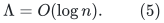

Their vertex-occurrence congestion, counting all initial native
input edge domains, is <code class="math">O(n)</code>. At a blue or local prefix port
tree, at most <code class="math">\Delta_J</code> central routes occur, apart from
constantly many identity-route incidences. At a vertex of <code class="math">X</code>,
only the <code class="math">n-1</code> TREE central routes can occur, again apart from
identity-route incidences. No non-tree central route uses <code class="math">X</code>.
Therefore
<!-- math-display: 342c5ad37f3be0b04e1db5c2
C_{\rm old}=O(n).
 \tag{6}
-->
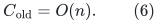
In particular these are low-length routes with an explicit
occurrence inventory, rather than compressed routes with
unaccounted multiplicity.

## 4. Legal splits produce exactly the desired preliminary images

For every anchor <code class="math">z_v</code>, perform one native binary split:
its attachment to <code class="math">P_v</code> belongs to <code class="math">z_v^P</code>, and its
attachment to <code class="math">B_v</code> belongs to <code class="math">z_v^B</code>.
Both resulting vertices are touched. No edge is inserted or
deleted, and no central edge endpoint changes. The touched
set is exactly
<!-- math-display: 5688bdfbcbf9669d83ee0c41
S=\{z_v^P,z_v^B:v\in V(T)\},
                         \qquad |S|=2n .
 \tag{7}
-->
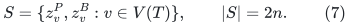
The native graph continues to have maximum degree three.

After ALL these splits, the blue system is a separate connected
component: its vertices are the <code class="math">B_v</code>'s, the blue connectors,
and the <code class="math">z_v^B</code>'s. Its only former links toward the prefix
system passed through the unsplit anchors, and those links have
all been severed by partitioning the two incidences. Every
genuine central edge has both endpoints in the prefix system
(possibly one endpoint in <code class="math">X</code>). Thus there is no surviving
blue bypass, even in the full current native graph.

Each central old route is now genuinely broken at its two
anchors. Starting at <code class="math">a_e</code>, its first touched vertex is
<code class="math">z_u^P</code>. Starting at <code class="math">b_e</code>, its first touched vertex is
<code class="math">z_v^P</code>. No exterior prefix contains any other touched
vertex: the blue-side anchors lie in the disconnected middle
piece of the broken old route.

Consequently its projected edge is precisely
<!-- math-display: 7792f84aeeacac541ab5c5df
\widehat e=z_u^Pz_v^P.
 \tag{8}
-->
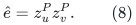
The preliminary image is the retained prefix from <code class="math">z_u^P</code>
to <code class="math">a_e</code>, the OWN central edge <code class="math">e=a_eb_e</code>, and the retained
prefix from <code class="math">b_e</code> to <code class="math">z_v^P</code>. It is simple.

For a tree ID this image goes through <code class="math">X</code>; for a non-tree ID
it uses only its endpoint prefix trees and its central edge.
The nonloop projected graph is thus EXACTLY <code class="math">J=T^L</code>.
The identity route of an <code class="math">H_0</code> edge incident to a split
anchor projects only to a loop at that edge's actual
descendant anchor; its normalized preliminary image is empty.
Other base identity routes are unaffected. There are no extra
nonloop projected blue edges and no unmentioned usable
old connector between prefix anchors.

More explicitly, an attachment edge has exactly one touched
current endpoint, either <code class="math">z_v^P</code> or <code class="math">z_v^B</code>, and an
untouched port-tree root as its other endpoint. In its
one-edge identity route, the nearest touched vertex from
BOTH ends is that SAME current descendant. The preliminary
image goes out and immediately back along the same ID,
so normalization leaves an empty route WITH the anchor
annotation. No other base edge is incident to a touched
vertex. This accounts for every additional affected base
domain.

The preliminary normalized table satisfies
<!-- math-display: 73614289a6a106bce022f062
L(W')=O(\log n),\qquad C(W')=O(n),
                       \qquad\Delta(J)\leq3\cdot2^L.
 \tag{9}
-->
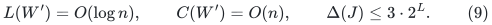
All images retain typed central IDs. In fact normalization
does not erase the central ID in this particular input table.

## 5. Greedy selection creates a true ambient cut bottleneck

Apply the unchanged congested-greedy algorithm to this projected
graph, in the order of Section 1. It selects the abstract tree
<code class="math">T</code>. The actual repaired support therefore consists of the
current lower graph <code class="math">H_0</code> and only the genuine central IDs
corresponding to TREE edges.

Assign every prefix tree <code class="math">P_v</code>, its anchor <code class="math">z_v^P</code>, and
its attachment to side <code class="math">\chi(v)</code>. The two halves of <code class="math">X</code>
have their indicated sides. Every selected TREE central edge
joins <code class="math">P_u</code> to its port <code class="math">b_e</code> in the SAME side <code class="math">\chi(u)</code>.
The entire blue component can be assigned arbitrarily to
one side, since after the splits it has no edge to the
prefix component. Thus the ONLY edge of this actual repaired
support crossing the distinguished partition is <code class="math">f</code>.

For every leaf pair <code class="math">u,v</code> in one bottom group with opposite
signs, its genuine non-tree central edge has endpoint ports
in opposite sides. Any repaired route for that demand in the
selected support MUST cross <code class="math">f</code>, regardless of its chosen
abstract tree orientation or subsequent loop erasure.
There are
<!-- math-display: 5db34796a6021e10d4e36e1d
(2^{4L}/q)\,(q^2/4)
                         =\Omega(n2^{L/2})
 \tag{10}
-->
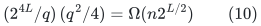
such simultaneous demands.

Combining (9)--(10), the output congestion is larger than
<code class="math">C(W')+\Delta(J)</code> by a factor <code class="math">\Omega(2^{L/2})</code>.
Since <code class="math">n=\Theta(2^{4L})</code>, this is a polynomial
<code class="math">\Omega(n^{1/8})</code> factor. It is not a backtracking artifact:
a nonempty cut must still be crossed after normalization.
It is also not due to a shared or omitted central edge:
every central lifetime is distinct and genuine.

## 6. Initial-base bounds and the exact scope boundary

The degree-three construction proves that the SPECIAL
prefix--own-central--suffix provenance, legal first-touched
anchors, short old routes, sparse lower support, and bounded
current native degree do not force the desired additive
ambient bound for congested greedy.

One must distinguish (6) from an even stronger possible
fresh-base guarantee <code class="math">C_{\rm old}\leq\Gamma\Delta_{\rm native}</code>
when the actual native degree is three. The displayed table
has <code class="math">C_{\rm old}=\Theta(n)</code>, so it is not asserted to be
the output of a particular fresh-base algorithm having a much
smaller congestion guarantee at that actual degree.

If degree-proportional initial bounds are required at a
declared core degree cap <code class="math">k</code>, one may take <code class="math">n\leq k</code>
and append an UNTOUCHED disjoint auxiliary component with
actual native degree <code class="math">\Theta(n)</code> and a sparse, explicit
base routing table. For example, on the next power-of-two
number of auxiliary vertices, use the complete graph as
input, its bit-coordinate hypercube as selected support,
and fixed-coordinate-order cube paths as routes.
The paths have length <code class="math">O(\log n)</code>, each cube edge has
at most <code class="math">O(n)</code> route occurrences, and every cube vertex
has at most <code class="math">O(n\log n)</code> occurrences. The selected degree
is <code class="math">O(\log n)</code>, so no large selected star is introduced.

The combined actual native degree is <code class="math">\Theta(n)\leq O(k)</code>,
and the whole initial table has
<!-- math-display: ec2d45206a202d9f74fc76f9
\Lambda=O(\log n),\qquad
      C_{\rm old}=O(n\log n)
                      =O(\Delta_{\rm native}\log n).
 \tag{11}
-->
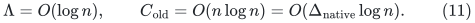
For a static initial call with the identity ambient embedding,
its input congestion is at most <code class="math">\Delta_{\rm native}</code>.
The constructed <code class="math">H_0,R_0</code> therefore meets the usual size,
length and additive-congestion OUTPUT contracts with
<code class="math">\Gamma_0=O(\log n)</code>, after increasing a fixed constant:
its support is sparse, its paths have length <code class="math">O(\log n)</code>,
and its congestion is <code class="math">O(\Gamma_0\Delta_{\rm native})</code>.
Consequently a black-box deduction using only those contracts
cannot exclude this initial table.
The auxiliary component receives no split and contributes
no nonloop projected demand. The obstruction (10) is unchanged;
even relative to the combined initial bound it loses a factor
<code class="math">\Omega(2^{L/2}/\log n)</code>. All inventories remain polynomial
in <code class="math">n</code>, and the lower selected support is sparse. Additional
untouched components may enlarge a declared parent period
without changing this local calculation.

The size variables must remain distinct. The gadget has
<code class="math">\Theta(m_J)</code> native vertices, where <code class="math">m_J=&#124;E(J)&#124;</code>, but
only <code class="math">n</code> anchor splits and <code class="math">2n</code> touched vertices.
A parent/core application with shrink parameter <code class="math">k\geq n</code>
must supply a sufficiently large actual parent inventory.
For example the combinatorial size inequalities are satisfied
if
<!-- math-display: 1b8b33121376d57478e155fd
m_{\rm parent}\geq c k m_J ,
 \tag{12}
-->
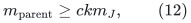
for a fixed sufficiently large <code class="math">c</code>: the allowed
<code class="math">m_{\rm parent}/k</code> core-vertex inventory can contain the
gadget and the <code class="math">n</code> split events, and the auxiliary complete
graph's <code class="math">O(n^2)</code> native edges also fit this parent bound.
This is only a size check. Constructing the exact preceding
low-stretch-forest/ASZ execution, and proving that its
deterministic initialization returns this table, would be
ADDITIONAL requirements; they are not established by padding
with untouched components.

Thus this is a literal legal route-table/update-history
realization with the standard degree and length envelopes.
It does NOT establish that the specific current initialization
routine, including its deterministic tie breaking, produces
these tables, or that every ambient-aware variant fails.
It identifies the missing positive invariant precisely:
the selected central support and its CURRENT routes must
control shared LOWER-PREFIX resources. Separate native-edge
load caps on the projected graph do not see those resources.

### A necessary ambient-cut condition for a replacement

Let <code class="math">A</code> be any cut of the actual native ambient graph,
and let <code class="math">D_A</code> count current demand IDs whose genuine
endpoints lie on opposite sides. If the repaired support is
<code class="math">H_0\cup E_{\rm sel}</code> and its routes have edge congestion
at most <code class="math">\rho</code>, then necessarily
<!-- math-display: f07d695135c5d53e11a4c56a
D_A\leq
               \rho\,|\partial_{H_0\cup E_{\rm sel}}A|.
 \tag{13}
-->
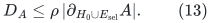
The same necessary inequality follows from a vertex-occurrence
congestion bound, since that bounds each edge's occurrence
load too. It is simply the fact that every crossing demand
must traverse a support edge of the cut.

In the displayed example <code class="math">H_0</code> contributes only the edge
<code class="math">f</code> to the cut and the greedy-selected central IDs contribute
NONE. A repair with target
<code class="math">\rho=\Gamma(C_{\rm old}+\Delta_J+\Delta_{\rm native})</code>
must therefore select additional genuine central IDs that
cross this ambient cut (or otherwise change the lower
support). Merely having many selected PROJECTED tree edges
cross the anchor partition does not suffice: those tree
edges cross the ambient cut through their shared lower
prefix, while their own central edges stay inside one side.

Condition (13) is only necessary, not a claimed sufficient
multicommodity-routing theorem. It pinpoints the additional
structure an ambient-aware dynamic selection must maintain,
without ruling out that such a construction is possible.
