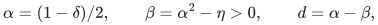
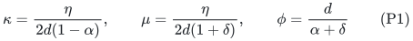
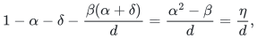
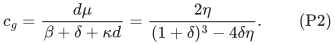
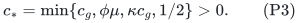
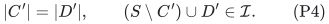
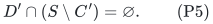
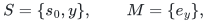
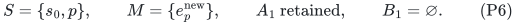
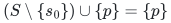

# A repeated-owner interface in the public matroid allocation algorithm

**25 October 2026. Source-interface audit, not a disproof of a published theorem.**

This note isolates a condition needed before treating a parameter
reoptimization of Davies--Rothvoss--Zhang as an independently verified
algorithmic baseline. It does not alter their stated Theorem 2 or claim
that every choice in their algorithm fails. It exhibits a literal
execution permitted by the displayed pseudocode and explains what a
stronger exchange rule would have to exclude.

Primary source: Davies, Rothvoss and Zhang, *A Tale of Santa Claus,
Hypergraphs and Matroids*, arXiv:1807.07189v4, 4 January 2026,
Algorithms 1--2 and Lemmas 8--12:

<https://arxiv.org/html/1807.07189v4>.

## 1. The parameter calculation and its scope

Write <code class="math">\delta=u/T</code>, and choose

<!-- math-display: c6f053c9d6ba7e43a43ce283
\alpha=(1-\delta)/2,\qquad
 \beta=\alpha^2-\eta>0,\qquad d=\alpha-\beta,
-->

where <code class="math">0&lt;\eta&lt;(1-\delta)^2/4</code>. The choices

<!-- math-display: d9e374a7e62d518f8cc7080b
\kappa=\frac{\eta}{2d(1-\alpha)},\qquad
 \mu=\frac{\eta}{2d(1+\delta)},\qquad
 \phi=\frac{d}{\alpha+\delta}
 \tag{P1}
-->

make the exact expression for <code class="math">\mu</code> in the source's Expansion Lemma
positive. Indeed <code class="math">\alpha+\delta=1-\alpha</code> and

<!-- math-display: 0fb5e596636d7b66cbc18e65
1-\alpha-\delta-\frac{\beta(\alpha+\delta)}d
     =\frac{\alpha^2-\beta}{d}=\frac\eta d,
-->

of which the <code class="math">\kappa(\alpha+\delta)</code> term uses exactly one half.
The source's geometric blocker coefficient becomes

<!-- math-display: 1d56b2721c5eacdbf9cb176d
c_g=\frac{d\mu}{\beta+\delta+\kappa d}
     =\frac{2\eta}{(1+\delta)^3-4\delta\eta}.
 \tag{P2}
-->

Here <code class="math">\kappa=2\mu</code>, <code class="math">\mu\ge\eta</code>,
<code class="math">\phi\ge\alpha&gt;\sqrt\eta</code>, and
<code class="math">\eta/4\le c_g&lt;1/2</code>. Thus all these constants are quantitatively
positive for fixed <code class="math">\eta</code>. Lemmas 9 and 10 use these symbolic
parameters; their resource inequalities do not require the numerical
choices printed earlier in the source.

There is a separate, harmless constant-choice issue in applying
Lemma 11. Its premise includes both geometric blocker growth and a
lower bound on the size of the proposed exchange set relative to the
earlier blocker prefix. A fresh expansion supplies the latter only with
coefficient <code class="math">\phi\mu</code>; an internal collapse supplies it with
coefficient <code class="math">\kappa c_g</code>. A conservative legal common constant is

<!-- math-display: 2ec19ae3ef35056610e09482
c_* = \min\{c_g,\phi\mu,\kappa c_g,1/2\}>0.
 \tag{P3}
-->

Use <code class="math">\gamma(c_*)</code> from Lemma 11, rather than silently substituting
<code class="math">\gamma(c_g)</code> in every call. This still gives polynomial running
time for fixed <code class="math">\eta</code>, if the swap-interface invariant discussed
next is supplied. In fact <code class="math">c_*\ge\eta^2/2</code> for the parameter range
above. The leading candidate value is
<code class="math">((1-\delta)^2/4-\eta)T</code>.

## 2. A condition required by the swap subroutine

At a call to source Algorithm 2, let <code class="math">S</code> be the independent player
set, <code class="math">i_0\in S</code> the exposed player, and <code class="math">D'</code> the players covered
by the resource-free candidate edges. The displayed subroutine asks
for an earlier player set <code class="math">C'</code> such that

<!-- math-display: 2af2d1e2e730784727048f73
|C'|=|D'|,\qquad (S\setminus C')\cup D'\in\mathcal I.
 \tag{P4}
-->

To retain the intended cardinality, this also needs

<!-- math-display: f37f959e9c36433d31d48aaa
D'\cap(S\setminus C')=\varnothing.
 \tag{P5}
-->

When <code class="math">D'</code> is a fresh output of Lemma 8, its membership in
<code class="math">(P\setminus S)\cup C</code> makes a suitable cardinality-preserving
exchange available. For a previously stored adding layer, this player
membership must still be true after intervening changes of <code class="math">S</code>.

Algorithm 1 requires a new expansion's resources to avoid the resources
of old adding and blocking layers. It does not impose disjointness of
their player names. Consequently a newly matched player can already
own an adding edge in a retained layer. The matching may then have two
different resource bundles associated with that player in the two
roles, even though their resources do not intersect.

## 3. A concrete allowed execution

Take <code class="math">T=1</code>, <code class="math">\delta=1/10</code>,
<code class="math">\alpha=9/20</code>, <code class="math">\beta=1/5</code>, and <code class="math">\eta=1/400</code>.
Then <code class="math">\kappa=1/110</code>, <code class="math">\mu=1/220</code>,
<code class="math">\phi=5/11</code>, and <code class="math">c_g=1/266</code>.

Use the rank-two uniform matroid on players <code class="math">s_0,y,p</code>.
Start an augmentation phase with

<!-- math-display: 6c02381a52ff07bc0df9cb42
S=\{s_0,y\},\qquad M=\{e_y\},
-->

where <code class="math">s_0</code> is exposed. The bundle <code class="math">e_y</code> consists of three
resources of value <code class="math">19/200</code>, for a total of <code class="math">57/200</code>. It is a
minimal <code class="math">\beta</code>-bundle, because deleting any resource leaves
<code class="math">38/200&lt;1/5</code>.

Player <code class="math">p</code> likes all three of these resources, two additional
resources of value <code class="math">9/100</code>, and five further distinct resources of
value <code class="math">19/200</code>. Let

* <code class="math">A_1</code> contain the single adding edge owned by <code class="math">p</code> using the
  first three resources and the two resources of value <code class="math">9/100</code>;
* <code class="math">H_2</code> contain the single adding edge owned by <code class="math">p</code> using the
  last five resources.

The first adding edge has value <code class="math">93/200</code>, is inclusion-minimal
above <code class="math">\alpha=90/200</code>, and has only <code class="math">36/200&lt;\beta</code> value
free of <code class="math">M</code>. Thus it is blocked, rather than already having a
free <code class="math">\beta</code>-subbundle. The next layer has <code class="math">B_1=\{e_y\}</code>.
The first expansion is legal: with discovered set <code class="math">\{s_0\}</code>,
replacing <code class="math">s_0</code> by <code class="math">p</code> preserves independence; a singleton
expansion exceeds its required size <code class="math">\mu</code>.

The second adding edge has value <code class="math">95/200</code>, is minimal above
<code class="math">\alpha</code>, and is entirely resource-disjoint from the previous
adding edge and from <code class="math">M</code>. The discovered set is now
<code class="math">\{s_0,y\}</code>; this second singleton expansion exceeds
<code class="math">2\mu</code>, and is again jointly eligible for the current call.
It has a free minimal <code class="math">\beta</code>-subbundle, obtained by taking any
three of its five resources.

In this second call, the displayed swap rules allow choosing
<code class="math">C'=\{y\}</code>, and consequently swapping out <code class="math">e_y</code> for the new
bundle of <code class="math">p</code>. The selected collapse layer is 1. The resulting
state is

<!-- math-display: 4be597adeada79d99f8facbf
S=\{s_0,p\},\qquad M=\{e_p^{\rm new}\},\qquad
  A_1\text{ retained},\qquad B_1=\varnothing.
 \tag{P6}
-->

The retained edge in <code class="math">A_1</code> is now entirely resource-free. The
inner collapse loop therefore calls Algorithm 2 on that edge with
layer index 1. Its candidate player set is <code class="math">D'=\{p\}</code>.
The only earlier exchange player is <code class="math">s_0</code>. Taking
<code class="math">C'=\{s_0\}</code> satisfies the literal tests (P4), because

<!-- math-display: 21b0cf31e2862fc73d1f9694
(S\setminus\{s_0\})\cup\{p\}=\{p\}
-->

is independent. But its size is one, not two. The exposed-player branch
then attempts to return the existing matching together with a second
edge also owned by <code class="math">p</code>. This is not a matching on the player side
and does not cover a rank-two independent set. Condition (P5) fails.

The numerical instance may be made fractionally feasible at target 1:
give each of <code class="math">s_0</code> and <code class="math">y</code> ten private resources of value
<code class="math">1/10</code>. They provide an integral feasible basis allocation, while
leaving all the displayed choices legal. The initial bundle <code class="math">e_y</code>
can itself be produced in an earlier phase: an adding edge consisting
of its three resources and two private resources has sufficient value,
and its minimal <code class="math">\beta</code>-subbundle may be chosen as <code class="math">e_y</code>.
Fixed scan orders can prioritize the displayed adding edges.

This execution is not forced. For example, in the second expansion
one could instead choose <code class="math">C'=\{s_0\}</code> and augment immediately.
The point is that the displayed independence tests and resource-side
disjointness alone do not prove the invariant for all allowed choices.
A proof using a particular stronger choice rule must state and verify
that rule, including its batch exchanges and quantitative progress.

### 3.1 The same interface test with the source's printed parameters

This issue is not caused by the alternative constants. Take the source's
own choices with <code class="math">T=1</code>, <code class="math">\delta=1/10</code>, and source approximation
slack <code class="math">\varepsilon=1/100</code>. Then
<code class="math">\alpha=71/200=0.355</code>, <code class="math">\beta=17/100</code>, and
<code class="math">\kappa=1/200</code>. Its expansion coefficient is approximately
<code class="math">0.1133</code>, so one adding edge satisfies the expansion requirement
for a discovered set of size either one or two.

Use a matching bundle <code class="math">e_y</code> with two resources of value <code class="math">0.1</code>.
Let the retained adding edge of <code class="math">p</code> consist of these two resources
and two additional resources of values <code class="math">0.09</code> and <code class="math">0.07</code>.
Its total is <code class="math">0.36</code>, it is minimal above <code class="math">0.355</code>, and only
<code class="math">0.16&lt;0.17</code> is initially free. Give <code class="math">p</code> four further private
resources of value <code class="math">0.09</code>; together they form the second adding
edge, of total <code class="math">0.36</code>. The same two swaps produce (P6) and the
same failure of (P5). Private target-value allocations for <code class="math">s_0,y</code>
again make <code class="math">Q(1)</code> feasible. This is the same literal-choice test,
not an additional impossibility claim.

## 4. What remains to be proved for the candidate public retuning

A complete independently checked retuning would need one of the
following, or an equivalent invariant:

1. a swap selection rule that preserves joint eligibility and distinct
   player ownership for every retained adding layer;
2. a repair that removes or replaces newly invalid stored adding edges,
   together with a new proof that current layer growth and the polynomial
   iteration bound survive the repair;
3. a source theorem explicitly providing this retained-layer interface
   with the symbolic parameters used in (P1).

Checking only the positivity of <code class="math">\mu,\phi,c_g,\gamma</code> is
insufficient. Pending this interface, the square curve is recorded as
an algebraic candidate from the public analysis, rather than as a
fully audited derived theorem. The published Theorem 2 is still reported
as the published baseline, without treating this note as a retraction.

The new one-at-a-time current-blocker construction is independent of
this issue. Its earliest-circuit exchange explicitly preserves every
retained eligibility flat, handles an already matched candidate owner
separately, and discards the layer from which that candidate came. Its
audits are in [Current blocker growth for matroid max-min allocation](../allocation-and-scheduling/matroid-allocation-current-blocker-quasipolynomial.md)
and [Current blocker growth for matroid max-min allocation](../allocation-and-scheduling/matroid-allocation-current-blocker-quasipolynomial.md).
