# Recursive cycle quality: an exact budget and a product-loss obstruction

**Separate mathematical analysis, 24 October 2026.** This note studies
whether the multiplicative raw-cycle quality loss can be removed just
by combining the exact normalized correction identities. It does not
change the current 4/5 matching candidate or any delivered checkpoint.

There are two conclusions.

1. A global telescoping argument can charge the SUM of the actual
   cumulative routed masses. It need not insert the worst stretch
   bound afresh in its notation.
2. Local stretch bounds alone do not control that sum by the sum or
   maximum of the local stretches. An explicit nested-shortcut
   example has zero-gradient local and composite corrections, but
   its best terminal cycle loses exponentially in the number of
   constant-stretch stages. The obstruction survives degree three,
   positive integer lengths, exact native gradients, and simple
   route normalization.

The example is an obstruction to selecting or averaging the separate
correction and terminal alternatives. It is NOT a lower bound for
general matching, min-ratio cycles, or every implementation of the
specific distance hierarchy. Optimizing arbitrary combinations of
corrections can cancel the long route and recover the original short
cycle; Section 5 identifies exactly what that additional task entails.

## 1. A settled chain of exact route maps

Let
<!-- math-display: ea819c9e3058abde5b9ddaae
G_0\supseteq G_1\supseteq\cdots\supseteq G_d
 \tag{1}
-->
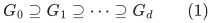
be nested undirected graphs on native vertex IDs. Edges have fixed
orientations, positive lengths <code class="math">\ell_e</code>, and gradients <code class="math">g_e</code>;
selected subgraphs retain these labels. For every edge
<code class="math">e=(u,v)\in E(G_i)</code>, a route <code class="math">R_i(e)</code> is an explicitly oriented
walk in <code class="math">G_{i+1}</code> from the SAME native <code class="math">u</code> to the SAME native
<code class="math">v</code>. Selected edges may use identity routes. Extend <code class="math">R_i</code>
linearly to signed edge vectors, and define
<!-- math-display: 3203bc1b2fcb04d6da8f91a5
D_i(e)=e-R_i(e).
 \tag{2}
-->
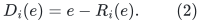
Native boundary preservation makes (2) a circulation.

For an original circulation <code class="math">c_0</code>, put
<!-- math-display: 8c8f84f0189a70652a9277ac
c_{i+1}=R_i(c_i).
 \tag{3}
-->
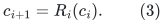
Coalesce coefficients by native edge ID after each operation.
Each <code class="math">c_i</code> remains a circulation. In this nested-subgraph model
all vectors already have literal interpretations in <code class="math">G_0</code>, so
there is no ambiguity about lifts or gauges.

The elementary identity from
[../graph-backends/normalized-route-cycle-comparison.md](../graph-backends/normalized-route-cycle-comparison.md)
telescopes to
<!-- math-display: 4e6753578a7fc45c1ecb701c
c_0=\sum_{i=0}^{d-1}\sum_{e\in E(G_i)}
                           (c_i)_eD_i(e)+c_d.
 \tag{4}
-->
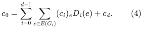
Taking the gradient is exact, for arbitrary signed coefficients.
Neither old route tables nor eventual physical aliases are used.

## 2. The cumulative-mass comparison lemma

Define the net mass and the charged raw image mass at stage <code class="math">i</code>:
<!-- math-display: 82b9930e124c4067facdd28f
W_i=\sum_e\ell_e|(c_i)_e|,\qquad
 A_i=\sum_e|(c_i)_e|\ell_{\rm raw}(R_i(e)).
 \tag{5}
-->
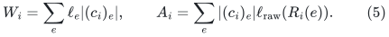
They satisfy <code class="math">W_{i+1}\leq A_i</code>. The correction family in round
<code class="math">i</code> has total positive charge at most <code class="math">W_i+A_i</code>.
The terminal circulation has charge <code class="math">W_d</code>. Therefore the
complete charge in (4) is at most
<!-- math-display: c80e3e7d57fa7e43b06e47ca
{\cal B}(c_0)
                       =\sum_{i=0}^{d-1}(W_i+A_i)+W_d.
 \tag{6}
-->
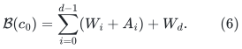
Identity-route terms are actually zero and may be omitted;
(6) is a convenient upper bound.

If <code class="math">g^\top c_0&gt;0</code>, some oriented local correction or terminal
cycle has gradient divided by its positive length at least
<!-- math-display: 6c8f10fe782e8ab00ca8eebb
\frac{g^\top c_0}{{\cal B}(c_0)}.
 \tag{7}
-->
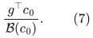
Indeed, if all those ratios were below <code class="math">r</code>, the absolute
numerator of every term in (4) would be below <code class="math">r</code> times its
charge, contradicting (4) with <code class="math">r=g^\top c_0/{\cal B}</code>.
Local coefficient decomposition into simple directed cycles
does not worsen that comparison.

One may avoid repeated net cancellation by retaining the full
occurrence expansion of the original edge routes. Let
<code class="math">\overline W_i</code> be the total positive mass of that expanded
representation of <code class="math">c_i</code>, before native cancellations. Then
<code class="math">W_i\leq\overline W_i</code>, and the occurrencewise charge in
round <code class="math">i</code> is at most
<code class="math">\overline W_i+\overline W_{i+1}</code>. Consequently
<!-- math-display: a20dbb9ff882f84031633595
{\cal B}(c_0)
                  \leq W_0+2\sum_{i=1}^d\overline W_i
 \tag{8}
-->
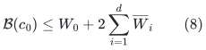
when the same occurrence representation is used for its
correction decomposition. This version includes multiplicity
and does not cancel different physical copies.

### A sufficient stronger invariant

If a new construction proves
<!-- math-display: c2761fb3c9d50accaa0bb8b8
\overline W_i\leq A\,W_0
                    \quad\text{for every }i\leq d
 \tag{9}
-->
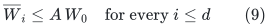
for every relevant comparator, then (8) gives loss at most
<code class="math">1+2dA</code>. An edgewise bound on every COMPOSED route,
<!-- math-display: 4dc3701ef2359d76b14f1b30
\ell_{\rm raw}(R_{i-1}\cdots R_0(e))\leq A\ell_e,
 \tag{10}
-->
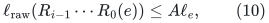
is sufficient for (9), although it can be stronger than needed.
Approximations in the local or terminal cycle solvers would
multiply this bound by their explicit solver loss.

This is a positive, exact interface for removing a product.
It requires a cumulative bound such as (9), not merely the
one-stage inequalities
<!-- math-display: 0152c2459bf95a05bc078673
\ell_{\rm raw}(R_i(e))\leq\delta_i\ell_e.
 \tag{11}
-->
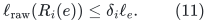
Those only imply
<code class="math">\overline W_i\leq(\prod_{j&lt;i}\delta_j)W_0</code>. Inserting
that estimate into (8) restores a product-sized denominator.

The same bookkeeping can be used with lifetime-fixed root
lifts whose physical raw lengths are dominated by their
stored charges. It cannot create a smaller charge than the
actual composed images. A specific vertex-sparsification
construction could supply additional structure; that would
be a new hypothesis beyond (2), (11), and raw domination.

## 3. An explicit simple-graph counterexample

Fix integers <code class="math">b\geq2</code>, <code class="math">d\geq1</code>, and <code class="math">N=b^d</code>. Make
vertices
<!-- math-display: 9b6d58d2d55aa1850889fc0b
v_0,v_1,\ldots,v_N,z.
 \tag{12}
-->
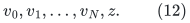
Include the oriented base path <code class="math">v_j\to v_{j+1}</code> for
<code class="math">0\leq j&lt;N</code>, and a two-edge return path
<code class="math">v_0\to z\to v_N</code>. Every edge has length one.

For <code class="math">i=0,\ldots,d-1</code>, add the shortcut edges
<!-- math-display: 74b311894cc88530def27449
e_{i,r}:v_{r b^{d-i}}\longrightarrow v_{(r+1)b^{d-i}},
                 \qquad 0\leq r<b^i.
 \tag{13}
-->
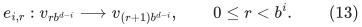
All these are distinct genuine edges; their spans are at
least two, so none duplicates a base edge. The return path
uses its fresh vertex <code class="math">z</code>. Thus the graph is simple.
It has <code class="math">O(N)</code> edges and vertices.

Assign gradients
<!-- math-display: 8865a9a237d4cf96dcae322d
\begin{array}{c|c}
 \text{edge}&g_e\\ \hline
 v_j\to v_{j+1}&1\\
 e_{i,r}&b^{d-i}\\
 v_0\to z,\ z\to v_N&0 .
 \end{array}
 \tag{14}
-->
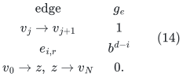
These are integers of at most <code class="math">O(\log N)</code> bits.
On the entire graph excluding the return path, <code class="math">g</code> is
the exact difference of the potential <code class="math">p(v_j)=j</code>.

Let <code class="math">G_i</code> retain the base and return paths and all shortcut
levels <code class="math">i,i+1,\ldots,d-1</code>. The map <code class="math">R_i</code> replaces
each level-<code class="math">i</code> shortcut by its <code class="math">b</code> consecutive children
at level <code class="math">i+1</code>, or by its <code class="math">b</code> base edges at the last
level. It fixes every other edge. Every route is simple and
has stretch at most <code class="math">b</code>. Moreover,
<!-- math-display: 80efc09b6f35e330f7621786
g^\top R_i(e)=g_e
                          \quad\text{for every edge }e.
 \tag{15}
-->
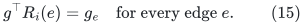
Therefore
<!-- math-display: 93041f5da13ba07977876138
g^\top D_i(e)=0
                      \quad\text{for all }i,e.
 \tag{16}
-->
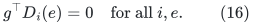
All composite corrections <code class="math">e-R_{d-1}\cdots R_0(e)</code>
also have zero gradient. Decomposing any of these corrections
into simple cycles cannot reveal a nonzero numerator: each
is supported away from <code class="math">z</code>, where (14) is a potential.

### Original optimum versus terminal optimum

The cycle consisting of the top shortcut <code class="math">e_{0,0}</code> and
the reversed return path has length three and gradient <code class="math">N</code>.
Its ratio is
<!-- math-display: 74ca8aa2a9c67049cd1ccd5a
\beta_0=N/3.
 \tag{17}
-->
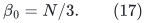
This is the original optimum. A simple cycle that avoids <code class="math">z</code>
has gradient zero. Any simple cycle using <code class="math">z</code> consists of
the return path and a <code class="math">v_0</code>-to-<code class="math">v_N</code> path in the
nonreturn graph; its gradient has absolute value <code class="math">N</code>,
and its length is at least three. General circulations
cannot improve on the best simple cycle.

The final graph <code class="math">G_d</code> is a single cycle, the base path
plus the return path. Every nonzero circulation is a
multiple of it, and its best ratio is exactly
<!-- math-display: 791595055c0745d9bfc0ab4e
\beta_d=N/(N+2).
 \tag{18}
-->
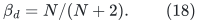
Consequently the best ratio among ALL separate local
correction cycles and ALL terminal cycles loses the factor
<!-- math-display: 5b7776350338bfbfc770bc11
\frac{\beta_0}{\beta_d}
                                      =\frac{b^d+2}{3}.
 \tag{19}
-->
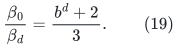
This is exponential in <code class="math">d</code>, even for fixed <code class="math">b=2</code>.
An additive <code class="math">O(\sum_i\delta_i)</code>, a maximum-local-stretch
bound, or a polynomial-in-depth replacement is false under
these interfaces.

For the comparator in (17), its stage-<code class="math">i</code> image uses
<code class="math">b^i</code> shortcuts and the return path. Its net AND raw
mass is <code class="math">b^i+2</code>. There is no route self-intersection to
erase and no distinction between physical raw length and
the terminal cycle's net length. The failure is genuine
geometric expansion of the surviving representative.

### 3.1 The usual priced-gradient bound does not remove the example

The obstruction also satisfies <code class="math">&#124;g_e&#124;\leq\ell_e</code>, with a
root optimum bounded below by an absolute constant. Set every
edge length to <code class="math">N</code>, retain the nonreturn gradients in (14),
and set each oriented return-edge gradient to <code class="math">-N</code>.
Then every gradient and length is an <code class="math">O(\log N)</code>-bit integer,
and
<!-- math-display: eaa5d1704983e1cb8bcc97c7
|g_e|\leq\ell_e\quad\text{for every }e.
 \tag{19a}
-->
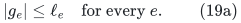
The top cycle has numerator <code class="math">3N</code> and length <code class="math">3N</code>,
so its ratio is exactly one, which is optimal under (19a).
The final cycle has the same numerator and length
<code class="math">N(N+2)</code>, hence ratio <code class="math">3/(N+2)</code>. The same loss
<code class="math">(N+2)/3</code> remains. All correction numerators are still zero,
since the return edges use identity routes.

Thus bounding every priced gradient by its length, or requiring
an original comparator of ratio at least <code class="math">1/2</code>, does not
justify the proposed additive comparison. This checks those
necessary numerical-client conditions; it does not assert
that every such gradient vector is produced by a particular
matching client's objective trajectory.

## 4. Degree three and strictly positive integer labels

The preceding example has maximum degree <code class="math">O(d)</code>. It can
be converted to maximum degree three without changing the
conclusion.

For each vertex <code class="math">v</code>, make one leaf for each incident real
edge, and join those leaves by a balanced binary tree.
Unused leaves up to the next power of two may be retained.
Every internal degree is at most three, and every leaf has
one tree edge and at most one real edge. The total number
of vertices remains <code class="math">O(N)</code>.

Let <code class="math">h_f\geq1</code> bound all fiber heights, so
<code class="math">h_f=O(\log(d+2))</code>, and set <code class="math">H=8h_f</code>.
Every original real edge receives length <code class="math">H</code> and its
gradient from (14). Fiber edges have length one and
gradient zero. A route between two leaves in one fiber
has length at most <code class="math">2h_f</code>.

Retain every fiber tree at every stage. Replace a removed
shortcut by its <code class="math">b</code> child real edges and the connecting
fiber paths, from the exact old leaf to the exact old leaf.
Its length is at most
<!-- math-display: 33ee21b2a8b010a6b28b659b
bH+2h_f(b+1)\leq2bH,
 \tag{20}
-->
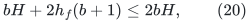
so each stage has stretch at most <code class="math">2b</code>. Open-edge
gradient equality (15) still holds. Extend <code class="math">p(v_j)=j</code>
constantly over each fiber; every correction remains
supported where <code class="math">g</code> is this exact potential.

The original short cycle has three real edges and at most
three fiber paths. Its length is at most
<!-- math-display: 270599e839ac64e966eb128c
3H+6h_f\leq4H,
 \tag{21}
-->
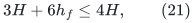
so its ratio is at least <code class="math">N/(4H)</code>.
After all shortcuts are removed, contracting the fiber
trees gives the single base-plus-return cycle. The terminal
cycle has <code class="math">N+2</code> real edges, so its ratio is at most
<!-- math-display: 1d05aef18550d00b9e2b426f
N/((N+2)H)\leq1/H.
 \tag{22}
-->
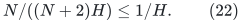
Thus the loss is at least <code class="math">N/4=b^d/4</code>.

The graph is simple, every current graph has degree at most
three, every length is a positive integer, and gradients
have <code class="math">O(\log N)</code> bits. Native route endpoints are literal
leaf IDs. The example needs no zero-length edge, frozen
gradient mismatch, invalid alias contraction, or unstable
callback. All real and fiber lifetimes can stay fixed
through the entire settled comparison.

For a degree-three version satisfying (19a) with constant
root ratio, instead choose <code class="math">H=8h_fN</code>. Multiply every
nonreturn gradient in (14) by <code class="math">8h_f</code>, and give each
oriented return edge gradient <code class="math">-H</code>. Fiber gradients
remain zero and fiber lengths remain one. Real gradients
are at most <code class="math">H</code> in magnitude. Every correction still
has zero numerator, and (20) still bounds local stretch.
The top cycle has numerator <code class="math">3H</code>, length at most
<code class="math">3H+6h_f</code>, and therefore ratio at least <code class="math">4/5</code>.
The terminal ratio is at most <code class="math">3/(N+2)</code>. The loss
is again <code class="math">\Omega(N)</code>, with polynomial magnitudes and
no short-word exception.

## 5. What arbitrary combinations could recover

The example does NOT rule out a procedure that optimizes
COMBINATIONS of candidates. In fact, summing all the
appropriate zero-gradient corrections cancels the long
base route and restores the top shortcut:
<!-- math-display: 5a09ca650f0e5f53f5d4a094
\text{top cycle}
    =\text{terminal cycle}
        +\sum_{i=0}^{d-1}\sum_{r=0}^{b^i-1}D_i(e_{i,r}).
 \tag{23}
-->
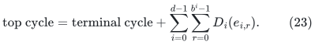
Every correction has zero numerator, yet their addition
reduces the final net norm from <code class="math">N+2</code> to three.
Positive-charge averaging cannot exploit that cancellation.

More generally, let <code class="math">Z(G)</code> be the circulation space of
a graph. Equation (4) proves the exact spanning identity
<!-- math-display: 294f1d5bbfe9cd44740218af
Z(G_0)=
   \mathrm{span}\{D_i(e):0\leq i<d,\ e\in E(G_i)\}
                  +Z(G_d).
 \tag{24}
-->
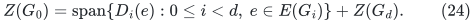
The reverse inclusion holds because all displayed generators
are genuine root circulations. Thus unrestricted optimization
of the root ratio over arbitrary linear combinations of
these generators is EXACTLY the original root min-ratio
cycle optimization problem.

This is an algebraic equality, not a computational lower
bound. It identifies the missing algorithmic task: efficiently
choose a low-norm representative after cancellations among
many ancestor corrections. In the zero-gradient case one
may formulate the special task as
<!-- math-display: c767a88e05e750f89831744a
\min_{z\in{\cal K}}\|L(c_d+z)\|_1,\qquad
       {\cal K}=\mathrm{span}\{D_i(e)\}.
 \tag{25}
-->
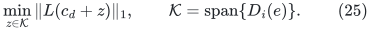
The numerator is constant on this affine space.
A fast solver for the structured instance (25), or a
provably sufficient candidate-specific shortcut operation,
could improve the current hierarchy. The decomposition
identity alone supplies no such solver or running-time
bound.

For example, a lifted walk can sometimes be shortened by
recognizing a complete contiguous image <code class="math">R_i(e)</code> and
substituting <code class="math">e</code>. For a general terminal simple cycle,
however, native cancellation and cycle decomposition may
have mixed images from several original edges. No existing
proof guarantees that the required shortcuts appear as
complete contiguous substrings. A dictionary of route
images is therefore only a possible data-structure input,
not a completed recovery algorithm.

### 5.1 A valid shortcut gives a useful local alternative

There is a precise positive rule when a whole route image IS
available as a contiguous subwalk. Suppose a current oriented
closed walk contains <code class="math">R(e)</code>, with
<!-- math-display: 66d9fd480b4158ee588605a3
L_R=\ell_{\rm raw}(R(e))\geq2\ell_e.
 \tag{25a}
-->
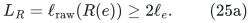
Replace that occurrence by <code class="math">e</code>, preserving its native
endpoints and orientation. Fix a target ratio <code class="math">\lambda&gt;0</code>.
Write <code class="math">q=g^\top(e-R(e))</code>. If
<!-- math-display: 74882bec4e4b96fca19816c7
q\geq-\lambda(L_R-\ell_e),
 \tag{25b}
-->
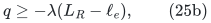
the replacement does not decrease the surplus
<code class="math">g^\top C-\lambda\ell_{\rm raw}(C)</code>. Any further valid
native cancellation can only improve its denominator.

If (25b) fails, the reverse correction has positive ratio
<!-- math-display: a8e7875d00f66d6b1cadbac2
\frac{-q}{\|L(e-R(e))\|_1}
   \geq\frac{-q}{L_R+\ell_e}
   >\lambda\,\frac{L_R-\ell_e}{L_R+\ell_e}
   \geq\lambda/3.
 \tag{25c}
-->
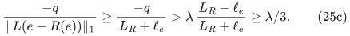
An explicit simple-cycle component attains at least this
ratio, with the usual orientation convention.
Thus a strong valid shortcut either preserves a target
surplus or exposes a constant-quality local alternative.

This rule is endpoint and gradient exact. It supplies no
guarantee that an available candidate walk contains enough
whole route images, nor a bound on the cost of finding them.

### 5.2 Even complete-route substring replacement is insufficient

There is a one-stage example in a degree-three native
multigraph. Let <code class="math">Q_1,Q_2</code> be internally disjoint <code class="math">x</code>-to-<code class="math">y</code>
paths of the same length <code class="math">L\geq2</code>. Add stems <code class="math">u x</code> and
<code class="math">y v</code>, and two distinct parallel edge IDs <code class="math">e_1,e_2</code>
from <code class="math">u</code> to <code class="math">v</code>. Every edge has length one.

Let <code class="math">H</code> contain the two paths and two stems. Its unique
simple cycle is <code class="math">Q_1-Q_2</code>; neither <code class="math">u</code> nor <code class="math">v</code>
lies on that cycle. Set
<!-- math-display: 36033eda0f9c3f256f022b34
R(e_1)=ux\oplus Q_1\oplus yv,\qquad
 R(e_2)=ux\oplus Q_2\oplus yv,
 \tag{25d}
-->
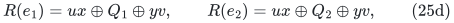
and use identity routes on <code class="math">H</code>. Give <code class="math">Q_1</code> total
gradient one, <code class="math">Q_2</code> and the stems gradient zero, and
set <code class="math">g_{e_1}=1</code>, <code class="math">g_{e_2}=0</code>. All nonzero gradient
can be placed on one edge of <code class="math">Q_1</code>, so labels are
integers in <code class="math">\{0,1\}</code>.

Both corrections have zero gradient. The original
two-edge cycle <code class="math">e_1-e_2</code> has ratio <code class="math">1/2</code>, while
the terminal cycle has ratio <code class="math">1/(2L)</code>.
Neither complete nonidentity route in (25d), in either
orientation, is a contiguous subwalk of the terminal
simple cycle: each contains both stems, which are
absent from every simple cycle of <code class="math">H</code>.

Thus a procedure that only replaces COMPLETE stored
route substrings in the returned terminal cycle makes
no nontrivial substitution here. The improvement needs
the joint cancellation
<!-- math-display: 7b971366d1b4f5a742282746
e_1-e_2=(Q_1-Q_2)+D(e_1)-D(e_2).
 \tag{25e}
-->
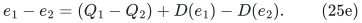
The common stems cancel between the two different
corrections. They are not an alias artifact.

This is an obstruction to that particular local shortcut
rule, not to all efficient representative optimizers.
The parallel edges are genuine native IDs, as permitted
by the recursive core interface. Section 4 already gives
a simple, degree-three obstruction to the broader
separate-candidate comparison.

## 6. Exact gradients, aliases, and the scope of the obstruction

All correction zeroes in the construction are gauge
invariant. If
<!-- math-display: c018fba7fe9e937067990b4d
g'=g+B^\top\pi,
 \tag{26}
-->
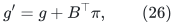
then <code class="math">g'^\top c=g^\top c</code> for every native circulation.
No choice of frozen vertex potential creates a useful
local numerator in (16). Correct zero-link contraction
and gradient-preserving raw lifts cannot change this fact.

Conversely, replacing a selected edge's gradient by the
gradient of an old or incorrectly projected route is not
an allowed shortcut. A replacement must have the same
IMMEDIATE boundary. Equal eventual physical images of
two aliases do not make an open path a circulation.
The fiber construction already uses exact immediate
endpoints, so that identity issue cannot explain away
the lower ratio.

This note isolates what follows from local path stretch,
exact corrections, and raw domination. It does not prove
that the particular KMPG stable-forest construction can
be forced to realize every nested route table above.
Vertex reduction, multiple forest choices, local ASZ
alternatives, and comparator-dependent averaging might
supply an additional cumulative-mass invariant. Such an
invariant must be stated and proved explicitly; it is
not a consequence of exact gradient telescoping.

For the current bottleneck, the concrete alternatives are
therefore:

* prove a cumulative bound such as (9), using additional
  structure of the actual hierarchy; or
* recover short root representatives by a new efficient
  cancellation/shortcut algorithm such as a structured
  version of (25).

Without one of these additions, replacing the full recursive
quality product by an additive or maximum local loss is
unsupported and is false for the stated local interfaces.
