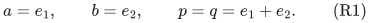
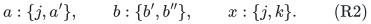
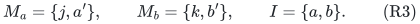
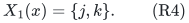
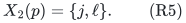

# Why physical current blockers do not directly become resource-matroid exchanges

**Resolution in the same checkpoint:** the naive rules refuted below
remain invalid, but the universal reservation invariant and conservative
completion in [general-resource-all-remaining-blockers.md](../allocation-and-scheduling/general-resource-all-remaining-blockers.md) now give a
valid general-recipient-matroid algorithm. The broader repeated-unit
recipient-polymatroid case still requires a separate argument.

**25 October 2026. Explicit interface obstructions and a positive
boundary.** This note concerns a proposed transfer, not a lower bound
for resource-matroid allocation. It does not invalidate the public
resource-matroid algorithm or the accepted player-local/binary-capacity
extensions.

The target model has common intrinsic resource values. Resource
<code class="math">j</code> may be supplied to a receiving-player set independent in its
own matroid <code class="math">R_j</code>, or to an integer vector in its own polymatroid.
The physical-unit algorithm instead has one owner of every individual
item. The distinction matters even when every resource matroid in an
example is a small uniform matroid.

## 1. The public comparison and the interface being tested

Bamas, Lindermayr, Megow, Rohwedder and Schloeter,
*Santa Claus meets Makespan and Matroids: Algorithms and Reductions*,
[arXiv:2307.08453v1](https://arxiv.org/abs/2307.08453v1),
Theorem 4, gives polynomial-time <code class="math">8+\varepsilon</code> for general
resource matroids/polymatroids and <code class="math">4+\varepsilon</code> for two values.
Their Section 4 uses a matroid and a polymatroid on the player ground
set, truncated polymatroid contraction, and explicit reservations
across recursive calls. It does not replace resource intersections by
arbitrarily chosen fundamental-circuit blockers.

The current-blocker theorem proved in this project uses two stronger
physical facts:

1. Every matching allocation that meets a new selected center has a
   unique physical intersection with the selected family, so its
   blocker owner is well defined.
2. A free candidate avoiding the retained selected physical items
   cannot create a new blocker of any retained selected center when
   it enters the matching.

The earliest player-matroid circuit preserves old player flats. It
does not, by itself, establish either resource-side fact above.

## 2. Separate circuit exchanges need not be jointly feasible

Consider a rank-two linear resource matroid with elements

<!-- math-display: c54f5e7abec555d15ef48384
a=e_1,\qquad b=e_2,\qquad p=q=e_1+e_2.
 \tag{R1}
-->

The current receiving set <code class="math">\{a,b\}</code> is independent. Individually
one may replace <code class="math">a</code> by <code class="math">p</code>, and one may replace <code class="math">b</code> by
<code class="math">q</code>. The selected old blockers are distinct. Nevertheless the
joint replacement <code class="math">\{p,q\}</code> is dependent.

Thus assigning each pending candidate a legal old circuit element,
even with distinct choices, does not supply simultaneous capacity.
The issue is not special to a difficult oracle matroid: this example
also has a transversal representation. Give <code class="math">p,q</code> access only
to one slot, and give <code class="math">a,b</code> access to either of two slots. A
single fixed slot assignment exposes their common conflict; two
independently rerouted assignments can conceal it.

This rules out one particular simultaneous-exchange implication. It
does not rule out maintaining a joint reservation or a consistent
slot representation.

Nor can an arbitrary resource matroid safely be replaced by the
bipartite graph of exchanges with one fixed basis. For rank <code class="math">k</code>,
let that basis be <code class="math">e_1,\ldots,e_k</code>, and let arbitrarily many
other elements all equal <code class="math">e_1+\cdots+e_k</code>. Each such element
can replace every basis vector, so the basis-exchange bipartite graph
can match <code class="math">k</code> of them to distinct slots. Their true matroid rank
is only one. Thus this proposed slot representation can overstate
simultaneously usable receiving capacity by an unbounded factor.

## 3. A one-at-a-time free exchange can create a hidden new blocker

The next example isolates the harder issue: even a one-at-a-time
earliest player exchange can break the retained resource invariant.

### 3.1 Players, values, and a feasible target allocation

There are four players <code class="math">a,b,x,p</code>. Their selection matroid is
the direct sum of singleton nonloops <code class="math">a,x</code> and one rank-one
parallel class <code class="math">\{b,p\}</code>. Its rank is three. In vector form
use three independent directions for <code class="math">a,b,x</code>, and set <code class="math">p=b</code>.

Every resource has intrinsic value one and can be supplied at most
once to a receiving player. The resource constraints are:

| Resource | Eligible receiving players | Resource matroid |
|---|---|---|
| <code class="math">j</code> | <code class="math">a,x,p</code> | uniform rank two |
| <code class="math">k</code> | <code class="math">b,x</code> | uniform rank one |
| <code class="math">a'</code> | <code class="math">a</code> | one singleton |
| <code class="math">b'</code>, <code class="math">b''</code> | <code class="math">b</code> | separate singletons |
| <code class="math">\ell</code> | <code class="math">p</code> | one singleton |

Take bundle target <code class="math">B=2</code>. The original instance really has a
feasible basis allocation at this target:

<!-- math-display: 8c514334d6f38ebade65c999
a:\{j,a'\},\qquad b:\{b',b''\},\qquad x:\{j,k\}.
 \tag{R2}
-->

Resource <code class="math">j</code> supplies two players, resource <code class="math">k</code> one, and
the basis <code class="math">\{a,b,x\}</code> has rank three. Hence the example does
not rely on an infeasible target promise.

### 3.2 A legal partial matching and first selected center

Consider the partial allocation

<!-- math-display: 880343158ba7700be3bb8bbf
M_a=\{j,a'\},\qquad M_b=\{k,b'\},\qquad I=\{a,b\}.
 \tag{R3}
-->

Both bundles are minimal above two; they can be inserted successively
from the empty matching by free rank-increasing choices. The unused
private item <code class="math">b''</code> does not affect their legality.

Select the center

<!-- math-display: d1b001a682dd307777f90c9b
X_1(x)=\{j,k\}.
 \tag{R4}
-->

At resource <code class="math">j</code>, adding <code class="math">x</code> to the current receiver <code class="math">a</code>
is feasible, so that resource has no actual matching blocker of this
center. At resource <code class="math">k</code>, player <code class="math">b</code> is its unique blocker.
Consequently the naive resource-circuit version records
<code class="math">Y_1=\{M_b\}</code>. The player <code class="math">x</code> is eligible because
<code class="math">x\notin\mathrm{cl}(I)</code>.

Suppose the naive forbidden test at each resource excludes the span
of the receiving players of selected centers and current blockers.
This is the natural attempt to replace forbidden physical items by
resource flats. The first layer can be completed under that test:
its only player eligible outside <code class="math">\mathrm{cl}(I)</code> is
<code class="math">x</code>, and its selected resources are unavailable to another copy
of its own candidate.

### 3.3 A free later center and its forced earliest exchange

At the next layer, remove the earlier blocker owner <code class="math">b</code> from
the eligibility base. Then <code class="math">J_2=\{a\}</code>, so <code class="math">p</code> is
eligible. Consider

<!-- math-display: 3aa3e7db6d2e78359b4b0687
X_2(p)=\{j,\ell\}.
 \tag{R5}
-->

At resource <code class="math">j</code>, the earlier selected receiver set is only
<code class="math">\{x\}</code>; the matching blocker <code class="math">b</code> receives no <code class="math">j</code>.
In the uniform rank-two resource matroid, <code class="math">p</code> is outside the
span of <code class="math">\{x\}</code>. The private resource <code class="math">\ell</code> is also
available. Thus (R5) passes the proposed resource-flat forbidden test.

It is also free relative to the actual current matching: assigning
<code class="math">j</code> to <code class="math">a,p</code> is feasible, and <code class="math">\ell</code> is unused.
The player fundamental circuit is exactly <code class="math">\{b,p\}</code>, so the
earliest exchange removes <code class="math">M_b</code> from layer one and inserts
<code class="math">X_2(p)</code>. The new matching receiver set at <code class="math">j</code> is
<code class="math">\{a,p\}</code>.

The recorded blocker of <code class="math">X_1(x)</code> has disappeared, and its old
resource <code class="math">k</code> is now free. But <code class="math">x</code> can no longer be added
at resource <code class="math">j</code>: <code class="math">\{a,p,x\}</code> has size three in a
rank-two uniform matroid. Therefore <code class="math">X_1(x)</code> has acquired a
new blocker at a resource that was previously free for it.

The physical-item free-cascade rule would regard its last recorded
blocker as gone. Using that rule now would insert an infeasible
allocation. Updating its blockers instead changes an earlier layer,
invalidating the literal old-forbidden-set and finite-signature proof
unless an additional argument is supplied.

### 3.4 What has and has not failed

All player-side circuit and closure facts remain correct in this
example. The failure is the unproved resource-side implication that
free insertion creates no new blocker. Replacing the forbidden test
by the span of the selected receivers alone, or selected receivers
plus their designated old blockers, does not repair it.

Forbidding an entire resource type after its first selected use would
reject (R5), but it discards arbitrarily large remaining capacity in
general. It is not an implementation of the same value certificate.

In a fixed two-slot representation of resource <code class="math">j</code>, allocation
<code class="math">M_a</code> uses one slot and selected center <code class="math">X_1(x)</code> reserves
the other. Then <code class="math">X_2(p)</code> cannot both avoid the selected slot
and be free against the actual matching. This is exactly why the
proved explicit-transversal and binary-capacity adapters remain sound:
their physical identities or cells retain that joint reservation.

## 4. The additional invariant needed by a general extension

A possible generalization must reserve the selected capacity and the
unaffected matching capacity simultaneously. For each resource, it
must prevent a candidate from consuming capacity that a retained
center will need after its recorded blockers are removed. Suitable
objects might be a jointly feasible resource assignment, a truncated
polymatroid contraction, or an exchange structure with a proved
reservation invariant.

Any such repair still needs all of the following proofs:

* insertion either identifies a charged current blocker or preserves
  every retained candidate's reservation;
* an earliest player exchange keeps the lower resource certificates
  valid, or updates them with a separately bounded progress measure;
* the fractional/resource-rank cover can be charged to the current
  blockers without counting one unavailable capacity many times;
* finding, updating and verifying reservations costs polynomial oracle
  work rather than an expanded numerical capacity.

The public Bamas et al. recursion explicitly contracts bounded
capacity for pending and blocking sets, which addresses precisely
this sort of interaction. Its correctness does not follow from the
simpler physical-item invariant, and its printed <code class="math">8+\varepsilon</code>
general-value bound is not improved by the examples or arguments in
this note.

The positive extensions currently proved here are arbitrary
player-selection matroids with downward-closed local bundle families,
their approximate available-bundle oracle version, explicit
transversal-resource slot representations, and binary uniform/type
capacities with per-player quotas. General resource-matroid or
polymatroid constraints remain a separate proof obligation.
