# A reachable obstruction to linear progress per old-root tree epoch

**25 October 2026. Root mathematical audit completed.** This note gives a family of legal slack-only top
matching states with true matching gap one. Their ordinary allocation
graphs have linear size. An exact source shortest-path tree can lose all
acceptable paths from its original source root after only logarithmic
progress and logarithmic coordinate-price variation.

The conclusion is deliberately specific. It refutes a claim that every
exhausted epoch using only paths from the old artificial-source tree root
must earn linear objective progress or linear logarithmic-price credit.
It does not refute local tree repair, using arbitrary intermediate source
bins, a more general potential-tight path provider, or a history-wide
amortization with additional credits. It is not a running-time lower bound
for matching.

Unlike a generic bad-cycle example, this family has an explicit actual
augmenting path, phase target <code class="math">K=1</code>, and a feasible comparison with
normalized positive slack mass far above <code class="math">12N</code>.

## 1. The connected subcubic physical graph

Take two disjoint alternating chains of length <code class="math">t</code> matched pairs,
where <code class="math">t</code> tends to infinity. On the left use bins
<code class="math">v_0=c_A,v_1,\ldots,v_t=a</code> and rows <code class="math">r_1,\ldots,r_t</code>,
with physical edges
<!-- math-display: d69bd782c1e26a42683eb2cf
v_{i-1}r_i,\quad r_i v_i.
-->
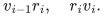
On the right use analogous bins
<code class="math">u_0=c_W,u_1,\ldots,u_t=w</code> and rows.

Add a matched pair <code class="math">r,b</code>, with physical edges <code class="math">ra,rw,rb</code>.
Add another matched pair <code class="math">p,q</code>, with physical edges <code class="math">ap,pq,qw</code>.
The initial matching contains every chain row/child pair, <code class="math">rb</code>,
and <code class="math">pq</code>. Its only free vertices are <code class="math">c_A,c_W</code>.

The graph is connected and has maximum degree three. In particular,
<code class="math">a,w,r</code> have degree three. The edges
<!-- math-display: c61bddedd4f2c411e3a3e0f9
a-r-w-q-p-a
-->
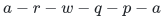
form an odd cycle. The construction is therefore a legitimate general
nonbipartite input, although no nonbipartite hardness is claimed.

There are
<!-- math-display: d1b96c3c3c37b8f4134873f0
N=4t+6
-->
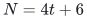
physical vertices. The current matching has <code class="math">N/2-1</code> edges. The path
from <code class="math">c_A</code> along its chain to <code class="math">a</code>, then through <code class="math">p,q,w</code>, then
back along the other chain to <code class="math">c_W</code>, is augmenting. Flipping it gives
a perfect matching. Thus the true gap is exactly one.

Use a phase with <code class="math">K=1</code>, and the usual sufficiently large row sum
<!-- math-display: 9a07fc6241504d31ea328311
L=10000\,C N,
-->
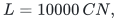
with <code class="math">C\ge 4</code> on the standard logarithmic scale. All bins in the
construction are singletons and have weight one.

## 2. A legal preparation of the top state

All ordinary top debts are zero. Tiny positivity-service debt, if used
by an implementation, can be absorbed in the perturbations below and
is too small to pay for a physical peel.

Start with the free bin at the beginning of each chain. Expand the first
matched pair. A top expansion places <code class="math">C+1</code> on the old parent incidence
and <code class="math">L-C-1</code> on the new child incidence. Its child has slack one.

For this preparation maintain an exact slack cache for structural
eligibility. This is an allowed special case of the client's approximate
cache: each numerical path changes only two bin slacks, so updating these
cache entries explicitly has constant additional work. The actual
eligibility test remains cached slack at least <code class="math">4C</code>. The guarantee
that an eligible bin has actual slack at least <code class="math">3C</code> is only a lower
bound, not an alternative trigger.

For every subsequent chain pair, increase the latest child's slack to
the first crossing of <code class="math">4C</code> using a positive numerical path back
toward its free chain root. Then expand the next pair. The old parent
slack is left at <code class="math">3C-1</code>, up to the small numerical overshoot. All old
internal chain bins cease to contact the paired remainder after their
successor has been expanded.

These numerical paths are valid strong directions. Before the final
bridge expansion, all nonfree slacks in a chain are <code class="math">O(C)</code>, so each
donor allocation on a path toward its free root is
<!-- math-display: b88c2ecfa58ee870b382b454
L-O(tC)\ge .99L.
-->
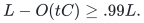
The whole ordinary path cost is at most <code class="math">O(t/L)</code>, while a newly born
source has slack at most <code class="math">O(C)</code>, and the free-root slack is
<code class="math">L-O(tC)</code>. The one-sided ratio is bounded below by an absolute
constant greater than <code class="math">1/2</code>.

One can also realize this preparation with exact source-path choices,
rather than asserting an arbitrary strong path is automatically the
global shortest-path answer. Always query the free-root endpoint in the
currently processed allocation component. If the latest contact is
temporarily not the maximizing source, the exact answer raises some
other low-slack bin in that same component. All old noncontact bins can
be raised safely. Until the latest contact reaches <code class="math">4C</code>, the true
strong path from that contact to the free root prevents termination.
Every chosen source has slack <code class="math">O(C)</code>, since that path's value dominates
the offer of a much larger-slack source. Constant progress and the
bounded potential range therefore force the desired contact to become
eligible after finitely many steps. No other contact in that allocation
component is eligible first.

The constants in this preparation can be made explicit. Inductively
keep all old nonfree slacks below <code class="math">5C</code>. Telescoping the chain bin
equations bounds every parent allocation by <code class="math">6(t+1)C</code>, so every
child-to-row donor has allocation at least <code class="math">.99L</code>. While the latest
contact has slack at most <code class="math">4C</code>, its offer at the free-root endpoint
is at least
<!-- math-display: 3ce2cdecbbe6a861f0bb3659
\frac{3}{16C}-\frac{t}{4(.99)L}>\frac{0.186}{C}.
-->
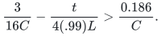
An exact winning source therefore has pre-step slack less than
<code class="math">(.75/.186)C&lt;4.033C</code>. A normalized step changes its slack by
at most a <code class="math">1/256</code> fraction, so its post-step slack is below
<code class="math">4.1C</code>. This closes the induction with slack. After an expansion,
the old contact lies between <code class="math">3C-1</code> and <code class="math">3.1C-1</code>, before any
later harmless increases. Thus every old noncontact stays at least
<code class="math">3C-1</code> and below <code class="math">4.1C</code>. Finite-word rounding can be made
smaller than the displayed constant margins with the already required
polynomial scale. The exact-source preparation is therefore not
relying on an unspecified hidden constant larger than the later
<code class="math">5C</code> bound.

On the left stop its last contact <code class="math">a</code> after raising its slack from one
to a value in <code class="math">[2,3]</code>. This is well below <code class="math">3C</code>. Process the right
component independently until <code class="math">w</code> first becomes eligible. The two
ordinary allocation components are still disjoint, so the small price
at <code class="math">a</code> does not force the right component's numerical answer to start
at <code class="math">a</code>.

Choose the eligible expansion of <code class="math">r,b</code> from <code class="math">w</code>, before expanding
the pair <code class="math">p,q</code>. This is a legal structural priority. The new row
has three incidences. For a tiny dyadic <code class="math">\epsilon&gt;0</code>, set
<!-- math-display: 4b4eebebbbafd519e2e98e6f
x_{rw}=C+1,\qquad
 x_{ra}=\epsilon,\qquad
 x_{rb}=L-C-1-\epsilon.                                  \tag{1}
-->
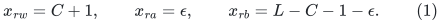
This is exactly the usual expansion plus a harmless positive padding
on the additional incidence. It decreases the old slack of <code class="math">a</code> by
<code class="math">\epsilon</code>, leaves the old slack of <code class="math">w</code> at about <code class="math">3C</code>, and gives
the new bin <code class="math">b</code> slack <code class="math">1+\epsilon</code>.

After this expansion:

* <code class="math">s_b=1+\epsilon</code>;
* <code class="math">s_a\in[2-\epsilon,3]</code>;
* <code class="math">s_w&lt;3.1C</code>, with the exact eligibility cache still below <code class="math">4C</code>;
* every old internal chain slack is between a fixed positive multiple
  of <code class="math">C</code> and <code class="math">5C</code>;
* each free-root slack is <code class="math">L-O(tC)</code>.

The only remainder contacts are <code class="math">a</code> and <code class="math">w</code>, through <code class="math">ap</code> and
<code class="math">wq</code>. Their slacks are below the expansion threshold. There is no
physical bin/bin edge for a contraction or pair operation, and ordinary
top debt is zero. Thus no structural action is being postponed at the
state where the epoch starts.

The actual remainder pair <code class="math">p,q</code> still certifies the true gap one.
Changing a canonical row injection does not change the represented
matching cardinality, so this gap does not depend on keeping one
particular carrier orientation.

## 3. The full ledger constraints are feasible

At the top every row sums to <code class="math">L</code>, and every bin satisfies
<!-- math-display: 92454121b771b4c6ffe24278
\mathrm{load}(d)+s_d=L-C.
-->
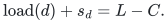
All coordinates are positive and lie in the guarded polynomial range.
Take <code class="math">\epsilon</code> on the existing common dyadic grid.

The physical allocation support is a tree, now with one degree-three
row <code class="math">r</code>. It admits every lower integral floor with zero debt. For
an integral floor <code class="math">c\le C</code>, assign row <code class="math">r</code> values
<!-- math-display: b9b8deebaa715875b1745cdc
c,\ c,\ L-2c
-->
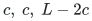
to <code class="math">a,w,b</code>, respectively. On either chain, give row <code class="math">i</code>
<!-- math-display: 55898abc70d68c89283c3012
L-(t-i+2)c
-->
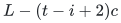
to its child bin and the complementary amount to its parent. Every
nonroot chain bin then has residual <code class="math">c</code>, bin <code class="math">b</code> has residual
<code class="math">2c</code>, and each free chain root has residual <code class="math">L-(t+1)c</code>.
All floor inequalities hold strictly or with equality. The values are
integral, nonnegative, and supported on the actual tree.

This explicitly checks that the state is not obtained by violating an
integral floor. The earlier client has no coordinatewise equality
requirement between different integral levels. Its established ledger
maintenance can process the legal top steps; this example does not
prescribe a fast numerical implementation of the new one-sided client.

## 4. The exact source tree is dominated by the new bin b

Use <code class="math">\beta=1/4</code>. In the threshold source graph, donor arcs have
length <code class="math">\beta/x</code>, receiver arcs have length zero, and the source
arc to a bin <code class="math">d</code> has length <code class="math">A-(1-\beta)/s_d</code>.

Every other bin has slack at least <code class="math">2-o(1)</code>, so its direct source
offer is at most <code class="math">3/8+o(1)</code>. The offer of <code class="math">b</code> is
<code class="math">3/4-o(1)</code>.

From <code class="math">b</code>, its donor <code class="math">b\to r</code> is large-allocation and cheap.
The two zero receiving arcs reach <code class="math">a</code> and <code class="math">w</code>. The paths from
there to the two free roots use only large-allocation chain donors.
Every such ordinary path has length <code class="math">O(t/L)</code>. Thus the offer
from <code class="math">b</code> exceeds <code class="math">0.7</code> everywhere, whereas all other sources
offer at most <code class="math">0.4</code>.

The exact source shortest-path tree therefore has the unique first bin
<code class="math">b</code>. It branches at row <code class="math">r</code> toward the two chains. All its receiving
arcs are tight in the old distance potential. The tree contains
<code class="math">\Theta(N)</code> actual records.

## 5. Exhausting only old-source-root paths

Freeze this exact tree and its old distance labels. Permit the numerical
steps described in [slack-potential-semantic-certificate.md](../graph-backends/slack-potential-semantic-certificate.md): a current
tree path from the artificial source must pass the current threshold.
Its first bin is therefore always <code class="math">b</code>.

Write <code class="math">u</code> for the cumulative slack increase of <code class="math">b</code>. Every other bin
is only a terminal or an intermediate vertex, so its slack never
increases. All ordinary tree incidences have their fixed donor or
receiver motion direction.

Once <code class="math">s_b&gt;4C</code>, no old internal bin or contact can remain an acceptable
terminal: all their slacks are at most <code class="math">5C</code>, whereas positive
<code class="math">\beta</code>-threshold acceptance requires
<!-- math-display: 617495c624e6f525d605d1ad
s_b<\frac{1-\beta}{1+\beta}s_{\rm terminal}
                       =\frac35s_{\rm terminal}.
-->
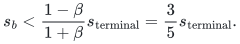
The two large free-root slacks are the last possible terminals.

A path from <code class="math">b</code> to a free root has <code class="math">t+1</code> donor incidences.
While <code class="math">u=O(L/t)</code>, their allocations remain
<code class="math">L-O(tC)-O(L/t)</code>, and the free-root slack remains
<code class="math">L-O(tC)-O(L/t)</code>. Its total donor charge is therefore
<code class="math">\Theta(t/L)</code>.

There are absolute constants <code class="math">c_1,c_2&gt;0</code> such that:

* if <code class="math">s_b&lt;c_1L/(t+1)</code>, a free-root path still passes the threshold;
* if <code class="math">s_b&gt;c_2L/(t+1)</code>, both free-root paths fail.

For example, a sufficiently small <code class="math">c_1</code> works by the preceding upper
bound on path charge. For the second direction, every donor allocation
is at most <code class="math">L</code>, so donor charge is at least <code class="math">(t+1)/L</code>.
The source term <code class="math">3/(4s_b)</code> alone is below the donor threshold
charge once <code class="math">s_b&gt;4L/(t+1)</code>.

It follows that exhaustion occurs at
<!-- math-display: e0c9dc1f9ccdb08e31c02664
s_b=\Theta(L/t)=\Theta(C),              \tag{2}
-->
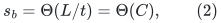
where the hidden constants can depend on the fixed factor <code class="math">10000</code>.
This argument allows arbitrary choices of accepted old-root tree
endpoints, not only repeated queries of one selected free root.

For the normalized constant-ratio step rule, <code class="math">s_b</code> grows by a
constant factor bounded away from one while a step is accepted.
Indeed, the raw charge <code class="math">V</code> lies between <code class="math">1/s_b</code> and
<code class="math">1/(\beta s_b)</code>, and
<code class="math">\beta/128\le\eta V\le\beta/64</code>. Hence only
<!-- math-display: 9a5ac15ad5c4fc6ad9a11227
O(\log C)
-->
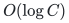
such numerical steps are needed in this epoch.

## 6. The earned credit is sublinear

Only <code class="math">b</code>'s slack increases during the epoch. The objective increase
therefore satisfies
<!-- math-display: 1bb3399394f3312d9eeb7afa
\Delta\Phi\le
                    \log\frac{s_b^{\rm final}}{s_b^{\rm initial}}
                          =O(\log C).                    \tag{3}
-->
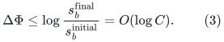

The total logarithmic variation of allocation prices is also only
<code class="math">O(\log N)</code>. Each large donor changes by at most <code class="math">O(L/t)</code>;
summed over the <code class="math">O(t)</code> donors, its negative logarithmic variation
is <code class="math">O(1)</code>.

On a chain, the initial receiving allocation at distance <code class="math">j</code>
from the far endpoint is at least a constant times <code class="math">Cj</code>.
Every such receiving coordinate increases by at most <code class="math">O(L/t)=O(C)</code>.
Consequently its total positive logarithmic variation is bounded by
<!-- math-display: 024824dffdd5971434bf4251
\sum_{j=1}^{t}\log(1+O(1)/j)
                         =O(\log(t+1)).
-->
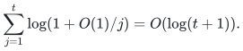
The receiving incidence <code class="math">ra</code> starts at <code class="math">\epsilon</code>; its possible
increase contributes only <code class="math">O(\log(C/\epsilon))=O(\log S)</code>.
Here <code class="math">S</code> is polynomially related to <code class="math">N</code>, and the padding exponent
is fixed. The other new-row incidence contributes <code class="math">O(1)</code>.
Slack variation adds <code class="math">O(\log C)</code>.

Thus neither objective gain nor total logarithmic coordinate movement
provides <code class="math">\Omega(N)</code> credit for an entire-tree refresh.

## 7. The semantic certificate does not terminate the epoch as LOW

For the old exact labels, put <code class="math">\pi=A-D_{\rm old}</code>. Every bin
has <code class="math">\pi_d\ge 1/2</code>, by the strict source dominance in Section 4.
Total slack is fixed:
<!-- math-display: 96404298f07661bc6a1bde9c
T=2L-C(2t+3).
-->
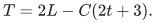
At every point in the epoch,
<!-- math-display: 562660628d6d4fab311373cc
\begin{aligned}
 E(\pi,s)
   &=\sum_d(s_d\pi_d-5/4)_+\\
   &\ge \tfrac12T-\tfrac54(2t+3)
     =\Omega(L)\gg7N.
\end{aligned}
\tag{4}
-->
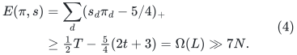
The stronger maintained LOW screen therefore cannot close this case.

There remains an explicit large comparison. Increase the slack of
contact <code class="math">a</code> by <code class="math">L/10</code> and decrease the free-root slack on its own
chain by <code class="math">L/10</code>, transferring allocation along that chain. All
donors and the terminal slack are still at least <code class="math">0.8L</code>, so this
is feasible. Since <code class="math">s_a\le3</code>,
<!-- math-display: 0d18602c6953fe8b41d2cdbb
P\ge L/30>12N.
-->
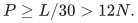
Its negative normalized coordinates are bounded by their coordinate
counts, as in the matching comparison theorem. The true matching gap
is still one, and neither contact became eligible during the old-root
epoch because their slacks only decreased.

The same example survives conservative integer source/donor pricing.
Choose the fixed polynomial scale <code class="math">H</code> as in the finite-word oracle.
The total rounding error on a simple path is <code class="math">O(N/H)</code>; all source
dominance margins and the asymptotic bounds in (2)--(4) have constant
slack. No exact-real-only cancellation is used.

## 8. Exact scope and a constructive lesson

This is a reachable obstruction to the literal old-root-path epoch
rule, with a connected subcubic physical graph, a linear-size active
ledger, and a genuine matching comparison. It is not a proof that a
full recomputation is necessary, nor that many such refreshes force a
quadratic total running time.

The root reachability and quantitative audit is
[root-only-sp-tree-epoch-root-audit.md](../graph-backends/root-only-sp-tree-epoch-root-audit.md). The fixed-tree interface in
[any-source-fixed-tree-matching-interface.md](../graph-backends/any-source-fixed-tree-matching-interface.md) deliberately allows
intermediate source bins, which this example does not rule out.

In fact the strong path from <code class="math">a</code> to its own free root is a segment
of the old ordinary tree starting at an intermediate bin. Its receiving
arcs are still tight in the old potential. Allowing a fresh source arc
to such an intermediate bin would continue progress while preserving
old-potential feasibility.

Thus one concrete next interface is stronger than a fixed-root tree
search but weaker than arbitrary directed SSSP: find a threshold-passing
ancestor-to-descendant bin path in a fixed directed forest, with a
source price at every bin, under implicit allocation updates. Its
completion and any bound on when that larger search space must be
refreshed remain open. The counterexample does not rule them out.

