# Concentrated boundary vertices can force a degree loss in a virtual merge

**Separate mathematical follow-up, 24 October 2026.** This note does not
change the reviewed sequential router or any matching checkpoint. It
gives a simple-graph family showing that one degree-dependent loss in
the current virtual-merge lemma is real under that lemma's hypotheses.
It is not a lower bound for deterministic routing, and it does not
assert that a repeated version is reachable by the complete recursive
cut-matching construction.

## 1. The interface being tested

The merge in
[../graph-backends/virtual-expander-hierarchy-reconstruction.md](../graph-backends/virtual-expander-hierarchy-reconstruction.md),
Section 2, has disjoint blocks <code class="math">U_i</code>, an internal graph <code class="math">H_i</code> on
each block, and genuine host edges between blocks. Assume that

* every <code class="math">H_i</code> has edge sparsity at least <code class="math">\sigma</code>;
* every cut respecting whole blocks has boundary at least its
  smaller vertex mass, so the coarse outer sparsity is at least one;
* the host has maximum degree <code class="math">\Delta</code>.

The direct majority-rounding argument gives merged sparsity
<code class="math">\Omega(\sigma/(\Delta+1))</code>. The following construction shows that
the factor <code class="math">\Delta</code> cannot simply be removed from this interface,
even when every child embedding is the identity.

All sparsities below use vertex cardinality, rather than degree
volume:
<!-- math-display: c4d202dd3fb4e9eaeb93d9c5
\Psi(H)=\min_{\varnothing\ne S\subsetneq V(H)}
   \frac{|\partial_H S|}{\min\{|S|,|V(H)\setminus S|\}}.
-->
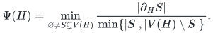

## 2. Explicit simple-graph construction

Choose integers
<!-- math-display: 43e8524e963a556419cc67a7
D\geq4,\qquad a\geq D,\qquad 1\leq r\leq a,
             \qquad \sigma_0=r/a.
-->
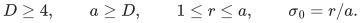
There are two equal blocks
<!-- math-display: 35e3c443ab1afddb065807a1
U_1=P_1\mathbin{\dot\cup}C_1,\qquad
 U_2=P_2\mathbin{\dot\cup}C_2,
 \qquad |P_i|=a,\quad |C_i|=(D-1)a.
 \tag{1}
-->
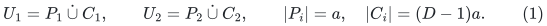
Thus each block has <code class="math">Da</code> vertices. The sets <code class="math">P_i</code> are the
boundary vertices; the larger <code class="math">C_i</code> have no edge to the other block.

Place a fixed-degree simple edge expander on each of the four sets.
There are absolute constants <code class="math">\alpha&gt;0</code> and <code class="math">d_0</code> for which all
four internal graphs have sparsity at least <code class="math">\alpha</code> and maximum
degree at most <code class="math">d_0</code>. One can use the deterministic arbitrary-size
construction in
[Chuzhoy et al., arXiv:1910.08025v2, Theorem 2.4](https://arxiv.org/pdf/1910.08025).
Removing loops and retaining one copy of each parallel pair loses
only a constant expansion factor because its maximum degree is an
absolute constant. Small constant-size cases can be fixed separately.
Decrease <code class="math">\alpha</code> if necessary so that <code class="math">\alpha\leq1</code>.

Inside each <code class="math">U_i</code>, add <code class="math">r</code> independent edges between <code class="math">P_i</code> and
<code class="math">C_i</code>. This is possible since <code class="math">r\leq a</code>. Let <code class="math">H_i</code> be the
resulting graph. Its maximum degree is at most <code class="math">d_0+1</code>.

Label both <code class="math">P_1</code> and <code class="math">P_2</code> by residues modulo <code class="math">a</code>. Add the
following genuine interblock edges:
<!-- math-display: dc62c08dc6c46bbc2fbfb218
xy\quad\Longleftrightarrow\quad
     x\in P_1,\ y\in P_2,\quad
     y-x\pmod a\in\{0,1,\ldots,D-1\}.
 \tag{2}
-->
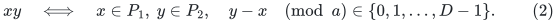
Because <code class="math">D\leq a</code>, (2) is a simple <code class="math">D</code>-regular bipartite graph.
The final host and the virtual merge are the same graph:
<!-- math-display: 15ce99e838e7df5b13dd82a4
G_0=G=H_1\cup H_2\cup E_{\rm cross}.
 \tag{3}
-->
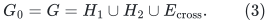
The children embed into it by literal inclusion, with dilation and
congestion one. All graphs in this construction are loopless and
simple; no multiplicity convention is needed.

The maximum degree of <code class="math">G</code> is between <code class="math">D</code> and <code class="math">D+d_0+1</code>, hence
<!-- math-display: 313fb82b01ccafe61d77a447
\Delta=\Theta(D).
 \tag{4}
-->

There are exactly <code class="math">Da</code> interblock edges. The only nontrivial cut
respecting the two blocks has smaller mass <code class="math">Da</code>, so its outer
sparsity is exactly one.

## 3. Child sparsity is <code class="math">\Theta(r/a)</code>

The cut <code class="math">P_i</code> has exactly <code class="math">r</code> crossing edges and smaller side
<code class="math">a</code>, proving <code class="math">\Psi(H_i)\leq\sigma_0</code>. We prove the matching
lower bound without assuming anything about the positions of the
<code class="math">r</code> independent connecting edges.

Fix <code class="math">H_i</code>, and take a smaller cut side <code class="math">S</code>, with
<!-- math-display: 77fc8e54aab7356300e1f674
w=|S|\leq Da/2,\qquad
 x=|S\cap C_i|,\qquad y=|S\cap P_i|.
-->
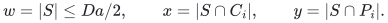

If <code class="math">x&gt;&#124;C_i&#124;/2</code>, then
<!-- math-display: af519453aad285d4446c36ae
|C_i|-x\geq(D/2-1)a\geq w/2,
-->
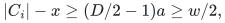
where the second inequality uses <code class="math">D\geq4</code> and <code class="math">w\leq Da/2</code>.
The core expander alone contributes at least <code class="math">\alpha w/2</code>.

Suppose next that <code class="math">x\leq&#124;C_i&#124;/2</code>. If <code class="math">y\leq a/2</code>, the two
internal expanders contribute at least <code class="math">\alpha(x+y)=\alpha w</code>.
If <code class="math">y&gt;a/2</code> and <code class="math">x\geq a</code>, the core contributes at least
<code class="math">\alpha x\geq\alpha w/2</code>.

The remaining case is <code class="math">y&gt;a/2</code> and <code class="math">x&lt;a</code>, so <code class="math">w&lt;2a</code>. Put
<!-- math-display: 9b03b1df9c4639c1f014b1e0
z=x+(a-y).
 \tag{5}
-->
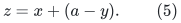
The internal expanders give at least <code class="math">\alpha z</code> crossing edges.
If <code class="math">z\geq r/2</code>, this is at least
<!-- math-display: a9d9e667db91a2c428401e2e
\alpha r/2\geq(\alpha/4)\sigma_0 w.
 \tag{6}
-->
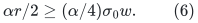
If <code class="math">z&lt;r/2</code>, at most <code class="math">x+(a-y)=z</code> of the <code class="math">r</code> independent
connecting edges can fail to cross from <code class="math">S\cap P_i</code> to
<code class="math">C_i\setminus S</code>: every such failure uses a distinct endpoint in
<code class="math">S\cap C_i</code> or <code class="math">P_i\setminus S</code>. Consequently more than <code class="math">r/2</code>
of them cross, again giving at least <code class="math">\sigma_0 w/4</code>.

All cases imply
<!-- math-display: 5ae3b247545aaa43ae11f19b
\frac{\alpha}{4}\sigma_0
                        \leq\Psi(H_i)\leq\sigma_0.
 \tag{7}
-->
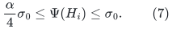

## 4. The merged graph loses a factor <code class="math">\Theta(D)</code>

Consider the cut <code class="math">C_1</code> in <code class="math">G</code>. Its only crossing edges are the
<code class="math">r</code> independent edges from <code class="math">C_1</code> to <code class="math">P_1</code>. The other block is
accessible only through the small boundary set <code class="math">P_1</code>. Since
<code class="math">&#124;C_1&#124;=(D-1)a&lt;&#124;V(G)&#124;/2=Da</code>,
<!-- math-display: 039651201bcc6b33bb0a0809
\Psi(G)\leq\frac{r}{(D-1)a}
                      =\frac{\sigma_0}{D-1}.
 \tag{8}
-->
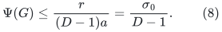
Equations (4), (7), and (8) give
<!-- math-display: a29f72c754ee9b05cc00708d
\Psi(G)=O\!\left(\frac{\min_i\Psi(H_i)}{\Delta}\right).
 \tag{9}
-->
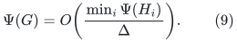
The lower bound of the existing majority-rounding merge lemma
shows that this order is also sufficient for this family, up to
absolute constants.

Thus excellent coarse expansion and perfect child embeddings do
not force the fine graph to retain a constant fraction of child
expansion. Coarse edges can be concentrated on a <code class="math">1/D</code> fraction
of each block. A cut can then retain almost an entire child while
avoiding all coarse edges.

## 5. Consequences and precise limits

The current hierarchy has matching-host degree
<code class="math">\Delta=O(\log n)</code>. The example shows that its stated merge
hypotheses alone cannot replace a per-merge inverse polynomial
in <code class="math">\log n</code> by a fixed constant. A stronger invariant would be
needed, such as a suitable distribution of cross-block incidences
relative to every potentially weak child cut.

This is only a one-merge obstruction. It establishes none of the
following:

* a lower bound on the depth dependence of every router;
* a matching hierarchy for which this loss compounds at every level;
* reachability of this exact graph by the particular deterministic
  cut-player and matching-player choices;
* a lower bound for a construction allowed to change its virtual
  cross edges or reroute them through children.

Replacing concentrated cross edges by better distributed virtual
edges is a possible algorithmic direction. It requires an explicit
embedding with controlled congestion. Routing those new edges
inside a child using only its current expansion guarantee can pay
an inverse-child-expansion factor, so that operation needs its own
cost proof. Merely assigning larger weights or multiplicities to
internal child edges moves the burden to the root embedding and
does not by itself improve the physical routing bound.

The reviewed <code class="math">4/5</code> composition and its actual sequential router
remain unchanged by this follow-up.
