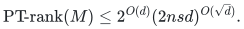

# Partial-transpose decompositions of ordinary arithmetic circuits

A small division-free arithmetic circuit imposes a structural bound on its paired coefficient matrix. The proof controls shared circuit computations and squarefree projection without first expanding the circuit into all block components. It applies in every characteristic.

[Reader's proof](proof.md) · [Complete mathematical source](circuits.tex) · [Dependencies and comparison](sources.md) · [Exact finite checks](verify/README.md)

For an ordinary circuit of size `s` in `d` blocks of `n`-by-`n` variables, the matrix of coefficients containing exactly one variable from every block satisfies

<!-- math-display: 10e41493a2ae612c26a18084
\mathrm{PT\!\text{-}rank}(M)\le 2^{O(d)}(2nsd)^{O(\sqrt d)}.
-->

The coefficient ring may be any commutative unital ring if rank is replaced by the length of a supplied sum of partial transposes of outer products. Over fields, including characteristic two, this is the usual PT-rank bound. The specified coordinate pairs remain fixed throughout.

This is a **supporting structural result**, with a uniform construction of compact factor circuits and factor-entry queries. It supplies no general fast algorithm for evaluating arbitrary coefficients, permanents or contractions against succinct vectors. The factor-entry bound has the same asymptotic envelope as the displayed decomposition length; dense printing costs the number of coordinates printed. Arbitrary ring-element bit costs are separate.

**Randomness.** The theorem and factor construction are exact and deterministic. The finite validators use fixed seeds to choose examples and exact arithmetic to check each example.

**Review status.** Ready for mathematical review of the focused circuit theorem, its ring-uniform supplied decomposition, geometric border consequence and arithmetic factor-entry construction. The existing integral crossing theorem and coefficient algorithm are named, proved repository dependencies; no rectangular matrix multiplication or SAT theorem is a premise. Three executed finite suites check the local DAG, projection and orientation identities. They do not formally verify the asymptotic theorem. External peer review and proof-assistant verification are not claimed.

**Attribution.** icekylinx and GPT-6 Astra Pro. Apache-2.0 under the repository [license](../../LICENSE) and [NOTICE](../../NOTICE). Curated from `tcs_research_checkpoint.zip`; selected source sections and transformations are recorded in the [import manifest](../../provenance/imports/tcs-research-20261102.json) and [source map](sources.md).
