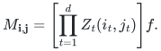
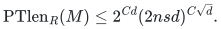
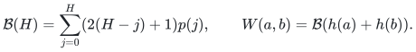
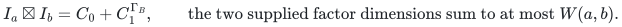
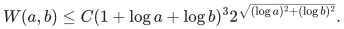
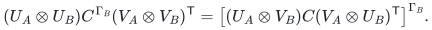
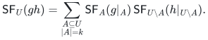
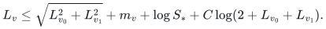
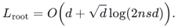
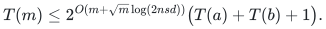

# Circuit size controls paired partial-transpose length

<!-- review-status:start -->
**Ready for review.** Complete focused mathematical deduction of ordinary circuit paired-coefficient PT length, all-field rank, ring-uniform supplied factors, geometric border consequence and arithmetic factor-entry/compact-circuit construction from the existing normalization-one integral crossing primitive.

**Dependencies and scope.** Canonical integral crossing/finite duality manuscripts at pin2658b60c9d032611492792718bd9d39f721de09f are proved repository dependencies;no rectangular matrix or SAT result is used. Effective factor queries additionally use the canonical explicit crossing-coefficient algorithm. Ring-operation costs and integral crossing generation are charged separately;arbitrary ring-value bit lengths and dense printing are separate. Border closure over algebraic closure bounds geometric border PT-rank only;ordinary PT-rank at a limit and finite limiting factors are not asserted. Finite DAG/projection/orientation suites do not prove the asymptotic theorem or certify publication priority;no PDF build,external peer review or proof-assistant verification is claimed.

The [verification note](verify/README.md) identifies executable coverage. This status does not claim external peer review or proof-assistant verification.
<!-- review-status:end -->

**Attribution:** icekylinx and GPT-6 Astra Pro. Apache-2.0. This reader's proof accompanies the complete retained derivation in [circuits.tex](circuits.tex). The construction is a structural result about supplied factors. Its entry-query algorithm does not compute arbitrary coefficient contractions.

## Statement and representation

Fix integers `n>=2`, `d>=1`, `s>=2` and a commutative unital ring `R`. A division-free commutative arithmetic circuit has binary addition and multiplication gates, specified ring constants and size counting all gates and inputs. Its variables are `Z_t(i,j)`, with `t` in `1,...,d` and `i,j` in `1,...,n`. Set

<!-- math-display: 5cf1f9a9c8a84b6a931e87ca
M_{\mathbf i,\mathbf j}=
\left[\prod_{t=1}^d Z_t(i_t,j_t)\right]f.
-->

A partial transpose exchanges the row and column coordinates of a chosen subset of the `d` prescribed pairs. Define supplied PT length as the least number of partial transposes of outer products in a decomposition. Over a field this agrees with PT-rank, because rank-one matrices are outer products. Over a ring the statement concerns the actual factorization through free modules, without invoking module rank.

**Theorem.** There is an absolute constant `C` such that every such matrix admits a supplied decomposition of length

<!-- math-display: f5a54d3f8fa487d6cb782230
\mathrm{PTlen}_R(M)\le 2^{Cd}(2nsd)^{C\sqrt d}.
-->

This applies to the specified coefficients of any circuit output; the output need not itself be set-multilinear. In particular, it applies when the circuit computes the paired polynomial with coefficient matrix `M`. The estimate is uniform over all commutative unital rings, including rings with zero divisors. Over fields it yields the ordinary PT-rank bound in every characteristic.

The sole nonclassical algebraic input is the existing normalization-one integral crossing theorem. Its complete finite proof is in the canonical [finite crossing](../../problems/noncommutative-crossing/manuscripts/finite-crossing.tex) and [integral pieces](../../problems/noncommutative-crossing/manuscripts/integral-pieces.tex), pinned at commit `2658b60c9d032611492792718bd9d39f721de09f`. No theorem from that problem's rectangular matrix multiplication branch is used.

## 1. The finite two-block profile

Let `p(j)` be the partition function, zero for negative arguments, and let `h(a)` be the smallest positive integer with `p(h(a))>=a`. Define

<!-- math-display: c6714eef34a5324a47e5d4db
\mathcal B(H)=\sum_{j=0}^H(2(H-j)+1)p(j),\qquad
W(a,b)=\mathcal B(h(a)+h(b)).
-->

The integral primitive decomposes the identity on two partition-label spaces into integer pieces indexed by `-H<=u<=H`. A piece has two available supplied factor dimensions, from the two complementary flattenings. Use its first flattening when `u<=0` and its second when `u>0`. The chosen dimension is at most the sum of `p(j)` over `0<=j<=H-|u|`. Restrict the partition labels to `a` and `b` labels and group by orientation. This gives

<!-- math-display: 5f79b7e1f20643f08a0fd808
I_a\boxtimes I_b=C_0+C_1^{\Gamma_B},\qquad
\text{the two supplied factor dimensions sum to at most }W(a,b).
-->

The normalization is exactly one over the integers. Both factorizations therefore specialize to every commutative unital ring, even when the characteristic divides factorials appearing in a rational derivation of the source identity.

The classical Hardy–Ramanujan partition asymptotic implies that `B(H)<=C H p(H)`. Indeed, for `j>=H/2`, the ratio `p(j)/p(H)` decays exponentially in `(H-j)/sqrt(H)`; summing its linearly weighted tail costs `O(H)`. The portion below `H/2` is exponentially smaller. Minimality of `h(a)` then bounds its square root by a constant times `log(a)+2log(1+log(a))+O(1)`. Applying the Euclidean triangle inequality gives the finite profile

<!-- math-display: a995fcdb06d30584ef1b2ffd
W(a,b)\le C(1+\log a+\log b)^3
2^{\sqrt{(\log a)^2+(\log b)^2}}.
-->

All logarithms here have base two. The important feature is the Euclidean combination of child logarithms, with only a logarithmic additive error after taking logarithms.

## 2. Preserve one factorization per orientation

On a nonempty ordered scope, call an orientation canonical when it excludes the first coordinate. Complementing all orientation bits amounts to transposing an outer product and interchanging its factors, so these orientations suffice. An orientation width `R` means one supplied factorization of dimension at most `R` for each canonical orientation. Total PT length is at most the width times the number of canonical orientations.

The necessary rectangular covariance is

<!-- math-display: cf2b76a84505dbaed86229b3
(U_A\otimes U_B)C^{\Gamma_B}(V_A\otimes V_B)^{\mathsf T}
=\left[(U_A\otimes V_B)C(V_A\otimes U_B)^{\mathsf T}\right]^{\Gamma_B}.
-->

It follows by expanding an entry and commuting scalar factors. The right-hand partial transpose acts on the whole physical scope `B`; the left-hand one acts on its latent index. The interchange of `U_B` and `V_B` is essential.

Suppose two matrices on disjoint scopes have orientation widths `R_A,R_B`. Pad child factorizations to these widths and insert the two-block identity between the rectangular factors. For child orientations `alpha,beta`, its two terms have parent orientations `alpha union beta` and `alpha union complement(beta)`. Designate the side containing the first coordinate of the parent as `A`. Each canonical parent orientation determines exactly one child pair and one choice of the two-block term: its first bit on `B` tells whether to complement that child's orientation. Thus no multiplicity of child orientations enters one parent's width. The product width is at most `W(R_A,R_B)`.

For a sum of `q` products, concatenate at most one factorization per product in each parent orientation. Its width is at most `q` times the largest product width. Different products may split the physical scope differently. The uniqueness statement is per product and survives those varying, possibly interleaved, partitions.

## 3. A balanced frontier respects circuit sharing

Consider a homogeneous circuit of degree `m>=2` and size `S`, with formal degree labels even on zero components. Mark gates of degree greater than `2m/3`. A marked addition has marked children. A marked product has at most one marked child. Process marked gates in reverse topological order, starting with output context one. At an addition propagate its context to both input wires; at a product with one marked child multiply the context by the unmarked sibling before propagating it. Add incoming contexts at shared gates.

Stop at marked products with two unmarked children. Substitution of the marked gate equations expresses the output as a sum of at most `S` products `g_u h_u`. Choose one child of degree at least `m/3` as `g_u`, and multiply the other child by the accumulated context to obtain `h_u`. Both factor degrees lie between `m/3` and `2m/3` and sum to `m`.

Only `O(S)` input wires are processed. Propagation and context accumulation add `O(S)` gates in total; a context is a shared circuit, not a sum expanded over paths. Each factor therefore has a homogeneous circuit of size at most a fixed constant times `S`. The same proof preserves complementary scopes in a syntactically set-multilinear circuit. Explicit positive-degree zero inputs can be discarded.

The mathematical source spells out the exact substitution identity. The finite DAG suites also check an equivalent stopping rule at the first balanced child. Their negative control detects the erroneous practice of summing both balanced children, which can duplicate the polynomial and fails especially visibly in characteristic two.

## 4. Extract squarefree components locally

First homogenize the original circuit through total degree `d`. At a product, component `k` is the sum of products of child components whose degrees sum to `k`. This uses `O(s(d+1)^2)` gates and no division or interpolation.

For a scope `U` of size `m` and homogeneous factors of degrees `k,m-k`, distribute its squarefree component by

<!-- math-display: 04d0d55a2b9fabf6f46d61ab
\mathsf{SF}_U(gh)=
\sum_{\substack{A\subseteq U\\|A|=k}}
\mathsf{SF}_A(g|_A)\,
\mathsf{SF}_{U\setminus A}(h|_{U\setminus A}).
-->

Here restriction sets all variables outside the indicated scope to zero. Every contributing monomial assigns each block to exactly one factor. Homogeneity forces the stated subset size. Repeated-block monomials cannot contribute. The child circuits remain ordinary homogeneous restricted circuits; their squarefree components are tracked recursively, without constructing all projected gate components in advance.

Apply this identity to each balanced frontier product. At a node with `m` blocks, there are at most `S_* 2^m` products, all on complementary balanced scopes. The recursion depth is `O(log(d))`. Each individual descendant circuit grows by only a fixed constant per level, so every descendant has size at most `S_*=s d^{O(1)}`. This is a bound on one descendant circuit, not on all circuits in the recursion together.

At one block the coefficient matrix has the supplied factorization `M I`, of width at most `n`. Combining the frontier and orientation lemmas yields the recurrence for logarithmic width

<!-- math-display: 64a87f4a7729836287f751d7
L_v\le\sqrt{L_{v_0}^2+L_{v_1}^2}
+m_v+\log S_*+C\log(2+L_{v_0}+L_{v_1}).
-->

For each maximum over possible split sizes, select a maximizing pair. Repeating this choice gives one balanced numerical tree with `d` singleton leaves; the multiplier `S_* 2^m` already pays for all actual summands. A coarse induction first gives `L_v=O(m_v lambda)` for `lambda=1+log(n)+log(S_*)`, because the Euclidean norm of two balanced child sizes is at most `sqrt(5)m_v/3`. This coarse estimate bounds the last logarithmic error.

Group nodes into bands with sizes between `2^j` and `2^(j+1)`. Balance implies each band is the union of only a constant number of antichains. Each such antichain has at most `d/2^j` nodes. The Euclidean norm of its subset-assignment errors is `O(sqrt(d) 2^(j/2))`; summing the bands gives `O(d)`. Its remaining errors contribute at most `O(sqrt(d/2^j)[log(S_*)+j+1+log(2+lambda)])`; their convergent sum is `O(sqrt(d)log(2nsd))`. The leaf norm is `sqrt(d)log(n)`. Repeated Euclidean triangle inequalities now give

<!-- math-display: c4cb6b5caffe7e7c52855fce
L_{\mathrm{root}}=O\!\left(d+\sqrt d\log(2nsd)\right).
-->

There are `2^(d-1)` canonical orientations. Adding their lengths contributes only another `O(d)` to the logarithm and proves the theorem. Every step used supplied integral factorizations and ring arithmetic, so there is no field-size or characteristic restriction.

## 5. Geometric border consequence

For a field, work over its algebraic closure. Geometric border PT-rank is the least integer length whose PT-length locus has the matrix in its Zariski closure. Border circuit size uses the coefficientwise Zariski closure of outputs of size-bounded circuits with constants in that algebraic closure. This convention is essential over finite fields.

A size-`s` circuit has bounded total degree, so all its outputs lie in one finite-dimensional coefficient space. Extracting the specified paired coefficients is a linear, Zariski-continuous map. The uniform pointwise theorem places the image of every size-`s` output in the same length-bounded locus. Continuity places the image of their closure in the closure of that locus. Hence the displayed bound also holds for **geometric border** PT-rank of outputs of border circuits. Ordinary PT-rank at a limit point and finite factor-entry algorithms for degenerate limiting factors do not follow from this step.

## 6. Uniform factor entries and compact circuits

Write `H=d+sqrt(d)log(2nsd)`. The additional input for effective access is the existing [crossing coefficient algorithm](../../problems/noncommutative-crossing/manuscripts/coefficient-computation.tex). For source weight parameters `h,E`, it generates an entry of either integer factor in `2^O(sqrt(h+E))` bit operations, with polynomial space and polynomial-bit intermediates in `h+E`. Generate the integer before specializing it to the ring.

Choose deterministic padding widths: the singleton width is `n`; for scope size `m>=2`, take `S_* 2^m` times the largest `W(R_a,R_b)` over balanced sizes summing to `m`. Their logarithms obey the already proved recurrence. The widths and their finite partition-label ranges are computable without looking at circuit values.

A factor label specifies a frontier term, a block assignment and a column in its local crossing factor; invalid padding labels are zero. The parent orientation determines both child orientations and whether the second child's factors must be interchanged. At a fixed queried parent entry, its label fixes the product and subset. Sum over at most `R_a R_b` latent pairs, multiplying the two child entries by one supplied crossing-factor entry. At a singleton, evaluate the homogeneous degree-one child circuit at the appropriate unit variable to recover its coefficient. No identity test or rank minimization is needed.

Both the ring-operation count and the integer-generation cost are bounded by a recurrence of the form

<!-- math-display: 622aba26cfe24b0e178197b1
T(m)\le2^{O(m+\sqrt m\log(2nsd))}
\bigl(T(a)+T(b)+1\bigr).
-->

After taking logarithms, follow the larger-cost child. Balanced sizes decrease geometrically, so both size and square-root-size charges have convergent sums. This gives `2^O(H)` ring operations and `2^O(H)` integer-generation bit operations per entry. Replacing fixed coordinates at leaves by coordinate indicators produces a circuit for each factor vector's multilinear form. Enumerating all orientations and columns still gives total arithmetic circuit size and construction cost `2^O(H)`.

This constructs compact factor circuits; printing every vector additionally pays for every printed coordinate. Contraction against an arbitrary succinct vector can require work exponential in the number of blocks and has no supplied bound here. For unrestricted integer circuits, repeated squaring of a constant can create exponentially long values. The theorem counts ring operations and separate crossing-constant generation, and supplies no general polynomial bit overhead for arbitrary ring values. No sharper evaluation-space bound is asserted beyond storage bounded by the generated circuit and its ring elements.
