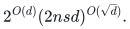

# Sources and contribution boundary

[Statement](README.md) · [Proof](proof.md) · [Complete mathematical source](circuits.tex) · [Finite evidence](verify/README.md)

## Selected result

The retained result bounds the paired squarefree coefficient matrix of an ordinary division-free arithmetic circuit by a supplied partial-transpose decomposition of length

<!-- math-display: 80b1f09eae906af6579c75cf
2^{O(d)}(2nsd)^{O(\sqrt d)}.
-->

The archive supplies complete proofs of rectangular covariance, orientation composition under differing partitions, balanced frontiers for shared circuits, lazy block projection, the numerical recurrence, geometric border closure and uniform factor entries. The curation preserves these sections in [circuits.tex](circuits.tex) and supplies a connected reader's proof. The set-multilinear estimate is retained as a proof lemma; it is not a second catalogue record. Arbitrary commutative unital rings have a supplied outer-product-length statement. Fields have the corresponding rank statement, including characteristic two. Border statements use an algebraic closure and bound geometric border rank only.

The factor-entry construction requires the additional existing coefficient-generation lemma. An explicit short PT decomposition gives entry access and compact factor circuits. It does not make contractions against arbitrary succinct vectors cheap. No general permanent or dense coefficient-evaluation algorithm is imported from this conclusion.

## Closed mathematical dependencies

All three canonical source files below already belong to this repository. They are referenced, not duplicated. The source pin is commit `2658b60c9d032611492792718bd9d39f721de09f` of [icekylinx/algorithm-frontier](https://github.com/icekylinx/algorithm-frontier/tree/2658b60c9d032611492792718bd9d39f721de09f/problems/noncommutative-crossing/manuscripts).

| Dependency | Exact role |
|---|---|
| [Finite crossing](../../problems/noncommutative-crossing/manuscripts/finite-crossing.tex) | Complete normal-ordering and finite duality proof underlying the source crossing identity. |
| [Integral pieces](../../problems/noncommutative-crossing/manuscripts/integral-pieces.tex), theorem `thm:integral-crossing` | Normalization-one identity and supplied integer factorizations in two complementary orientations, with explicit partition-number dimensions. |
| [Coefficient computation](../../problems/noncommutative-crossing/manuscripts/coefficient-computation.tex), lemma `lem:algebraic-coefficient-computation` | Uniform generation of an integer factor entry with polynomial-bit intermediates in the partition weight and the stated subexponential bit cost. Required for effective factor queries, beyond the structural bound. |
| [NIST DLMF, equation 27.14.8](https://dlmf.nist.gov/27.14.E8) | Classical partition asymptotic used to estimate the finite profile. Checked against the primary text on November 2, 2026. |

The existing canonical finite proof credits the released Claude / Anthropic crossing construction; the normalization-one integral extension is credited to icekylinx and GPT-6 Astra Pro. This package invokes the locally proved finite primitive. No SAT runtime, recent rectangular matrix spectrum, tensor-contraction theorem or unconstructed counting oracle is a dependency. Arbitrary ring multiplication must be commutative for the rectangular covariance proved here; the stronger noncommutative target scope of the existing crossing-circuit application is not transferred to this theorem.

## Comparison with inspected primary literature

[Rossman and Zhu, ITCS 2026](https://doi.org/10.4230/LIPIcs.ITCS.2026.113), with [full arXiv text 2512.01227v1](https://arxiv.org/html/2512.01227v1), introduces PT-rank and relates high rank to formula lower bounds using a shifted tensor. Its Section 6 gives Kronecker-product and ordered-branching-program bounds. The retained theorem instead starts from the raw paired coefficient polynomial of an ordinary circuit. Reindexing a tensor as the shifted polynomial does not preserve circuit size for free, so these encodings must remain distinct. This comparison was checked on November 2, 2026; no publication-priority claim is inferred.

[Brand, Kaski and Wang, ESA 2026](https://drops.dagstuhl.de/entities/document/10.4230/LIPIcs.ESA.2026.63), Theorem 2 and Lemma 9 in the publisher PDF, treats partition-rank families and multiplicative complexity. Its distribution of set-multilinear components is established background. The corresponding component lemma is numbered **6** in [arXiv:2607.02241v2](https://arxiv.org/html/2607.02241v2). Both primary versions were inspected on November 2, 2026. The present theorem adds the paired-coordinate orientation composition and Euclidean recursive charge to the existing integral primitive; it does not claim to invent homogeneous frontiers or squarefree component distribution.

Targeted searches for the exact measure with ordinary arithmetic circuits, square-root exponents and characteristic two did not locate a primary publication of the retained all-degree circuit bound. This bounded comparison supports presenting the theorem for expert review; it does not establish historical novelty. Papers about the ordinary matrix rank or positivity of a partially transposed operator study different measures.

## Source selection

The source archive is `tcs_research_checkpoint.zip`, member prefix `tcs_research_checkpoint/`. Archive member hashes and their target transformations are recorded in the repository import metadata.

| Archive member | Treatment |
|---|---|
| `manuscripts/partial_transpose.tex` | Preserve complete sections on the integral profile, orientations, shared frontiers, set-multilinear intermediate bound, lazy ordinary projection, border bound and constructive circuit factors. Replace the broad title and abstract with focused scope, retain relevant bibliography and add a precise coefficient-interface paragraph. |
| `research_notes/constructive_circuit_factors.md` | Reconcile uniform-label, ring-operation and bit-cost boundaries into the reader's proof; no duplicate note imported. |
| `audits/border_pt_audit.md` | Reconcile algebraic-closure convention and continuous coefficient-map proof; omit unrelated lower-bound and maximal-profile sections. |
| `research_notes/pt_novelty_audit.md`, `research_notes/circuit_schur_literature_audit.md` | Review inputs for source pins and attribution; comparisons freshly checked above, no audit bundle copied. |
| `verification/circuit_frontier/check_circuit_frontier.py`, `check_homogeneous_projection.py`, `check_interleaved_composition.py` | Adapt to the native verification directory, add attribution and stable frontier receipt name; execute all three locally. |

The other structural network families, Schur/immanant applications, lower-bound growth criteria and flattening obstructions are outside this focused selection. Their omission does not classify them as false; they are distinct contributions, direct corollaries or separately scoped algorithms. The full archive remains the provenance source.

**Attribution:** icekylinx and GPT-6 Astra Pro. Apache-2.0 under the repository [license](../../LICENSE) and [NOTICE](../../NOTICE).
