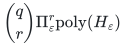

# Scheduling with an activated machine basis

**Guarantee**

Returns an actual activated basis and a complete legal schedule; offers factor <code class="math">1+\varepsilon</code>, exact factor <code class="math">3/2</code>, and the bucket curve <code class="math">\gamma_k=\frac{3\cdot2^k-1}{2^{k+1}-1}</code>. Detects global infeasibility.

**Objective and output**

Minimize maximum load subject to all original job totals and one exact combined setup and assignment budget.

**Randomness**

Deterministic enumeration of activation bases and profiles, followed by exact feasibility and recovery tests.

**Time**

Let <code class="math">\delta=\varepsilon/2</code>, <code class="math">K=\lfloor1/\delta\rfloor</code>, <code class="math">L=\left\lceil(1-\delta)/\delta^2\right\rceil</code>, and <code class="math">\Pi_\varepsilon=\min\{\binom{L+K}{K},\exp(3(K+1))\}</code>. The three bounds are

<!-- math-display: 1ebdc3ba9ef7134a895c6dbc
\binom{q}{r}\Pi_\varepsilon^r\mathrm{poly}(H_\varepsilon)
-->

<!-- math-display: 775760c026c176838605a99c
\binom{q}{r}6^r\mathrm{poly}(H)
-->

And

<!-- math-display: 98a6d92cdc17f107f5795169
\binom{q}{r}(k+1)^r\mathrm{poly}(H+k)
-->

**Space**

Polynomial in the complete binary input and paid oracle workspace; numerical resource multiplicities are not expanded into individual units. The full rational accuracy encoding is charged.

**Parameters**

<code class="math">q</code> is the physical-machine count; <code class="math">r</code> is the activation-matroid rank; <code class="math">\varepsilon</code> is rational with <code class="math">0&lt;\varepsilon\le1</code>; <code class="math">k\ge0</code> is an integer. <code class="math">H_\varepsilon=H+\mathrm{size}(\varepsilon)</code>. Original totals are <code class="math">n_j=f_j(P)</code>.

**Model and representation**

Arbitrary nonnegative machine-type processing times, integral job polymatroids, an actual machine-matroid basis, nonnegative setup and assignment costs, eligibility masks, and one shared exact budget.

**Lower-bound scope**

No lower bound is claimed for this algorithm.

**Review status**

The [verification note](verify/README.md) records the proof scope, executable evidence and remaining conditions. No proof-assistant verification or external peer review is claimed.

**Source**

[Manuscript and proof](proof.md), with [dependencies and verification sources](sources.md).

The rank-sensitive enumeration first chooses an actual activated basis, then profiles only its <code class="math">r</code> machines. Original job totals stay mandatory after restriction; an affordable setup basis alone does not certify scheduling feasibility.

**Attribution.** Yilin Liu · GPT-6 Astra Pro
