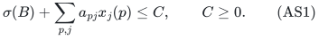
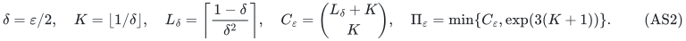

# Scheduling on an activated matroid basis with one shared budget

The [complete-table realization](reference-realization.md) implements the
actual activation and original-total restriction adapter, binary greedy
feasibility, all three profile clients and exact target search. Its inherited
reference LP/count costs remain separate from the paid polynomial primitives
in the theorem below.

## 1. Model and results

Let <code class="math">P</code> be <code class="math">q</code> physical machines and let <code class="math">M</code> be a rank-<code class="math">r</code> matroid
on <code class="math">P</code>. The activated set must be an actual basis <code class="math">B</code> of <code class="math">M</code>.
Resource type <code class="math">j</code> has a normalized monotone integral submodular rank
<code class="math">f_j</code> and original mandatory count <code class="math">n_j=f_j(P)</code>. A schedule consists
of integer vectors <code class="math">x_j\in B(f_j)</code> with <code class="math">x_j(p)=0</code> outside <code class="math">B</code>.
Processing times <code class="math">\ell_{pj}</code>, assignment costs <code class="math">a_{pj}</code>, and machine
setup fees <code class="math">\sigma_p</code> are nonnegative rationals. Eligibility masks are
allowed. The original budget is

<!-- math-display: 54bebee0bbf8db7a7a4235a4
\sigma(B)+\sum_{p,j}a_{pj}x_j(p)\le C,\qquad C\ge0. \tag{AS1}
-->

The original <code class="math">n_j</code> remains mandatory after every eligibility or
activation mask. Let OPT be the minimum makespan of a legal schedule.
The binary input size <code class="math">H</code> includes paid polynomial matroid, rank,
submodular-minimization, exact LP and polymatroid-intersection work.

For rational <code class="math">0&lt;\varepsilon\le1</code>, put

<!-- math-display: f1a9f004d958c459095ab1fe
\delta=\varepsilon/2,\quad K=\lfloor1/\delta\rfloor,\quad
 L_\delta=\left\lceil\frac{1-\delta}{\delta^2}\right\rceil,\quad
 C_\varepsilon=\binom{L_\delta+K}{K},\quad
 \Pi_\varepsilon=\min\{C_\varepsilon,\exp(3(K+1))\}. \tag{AS2}
-->

Also let <code class="math">H_\varepsilon=H+\mathrm{size}(\varepsilon)</code>, including
the entire rational numerator and denominator.

**Theorem AS (activation adapter).** A deterministic algorithm detects
global budget infeasibility or returns a legal activated-basis schedule.
The following guarantee/time pairs are available, all with polynomial
workspace in the displayed input:

| Makespan guarantee | Time |
| --- | --- |
| <code class="math">(1+\varepsilon)\mathrm{OPT}</code> | <code class="math">\binom qr\Pi_\varepsilon^r\mathrm{poly}(H_\varepsilon)</code> |
| <code class="math">\tfrac32\mathrm{OPT}</code> | <code class="math">\binom qr6^r\mathrm{poly}(H)</code> |
| <code class="math">\gamma_k\mathrm{OPT}</code>, <code class="math">\gamma_k=(3\cdot2^k-1)/(2^{k+1}-1)</code>, integer <code class="math">k\ge0</code> | <code class="math">\binom qr(k+1)^r\mathrm{poly}(H+k)</code> |

In particular the first bound is
<code class="math">2^{O(q+r/\varepsilon)}\mathrm{poly}(H_\varepsilon)</code>, hence
<code class="math">2^{O(q/\varepsilon)}\mathrm{poly}(H_\varepsilon)</code>.
Every original job total and the single shared budget remain exact.

The rank-sensitive enumeration in the table fixes the active basis
before generating profiles. Summing over all possible cardinalities
recovers the coarser bounds <code class="math">(1+\Pi_\varepsilon)^q</code>, <code class="math">7^q</code>, and
<code class="math">(k+2)^q</code>, respectively. For one given rank, the displayed binomial
bounds are at least as strong.

## 2. Initialization and the zero optimum

**Lemma 1 (exact feasibility).** Global feasibility with unbounded load,
and feasibility at makespan zero, can each be decided in
<code class="math">\binom qr\mathrm{poly}(H)</code> time and polynomial space.

**Proof.** Stream all <code class="math">r</code>-subsets of <code class="math">P</code>. Reject nonbases by a rank
test and bases with <code class="math">\sigma(B)&gt;C</code>. For each remaining basis, restrict
every original resource to eligible pairs on <code class="math">B</code>, retaining total
<code class="math">n_j=f_j(P)</code>. If a masked resource has smaller full rank, reject it.
Otherwise minimize assignment cost over the product of these original
resource bases. The product is integral, so its minimum has an integral
optimizer. Accept precisely when this cost is at most <code class="math">C-\sigma(B)</code>.

Every accepted output is a legal original schedule. Conversely every
legal activated-basis schedule appears in one enumerated basis and
certifies that basis's cost test. This proves the unbounded-load test.
Adding the mask <code class="math">\ell_{pj}=0</code> proves the zero-load test. Both tests
stream one subset and one polynomial optimization workspace. <code class="math">\square</code>

A minimum-setup basis alone is insufficient: it may lack recipient
capacity for the mandatory jobs. The lemma tests both costs and original
totals. If all job totals are zero, choose any affordable basis and return
zero load. Rank <code class="math">r=0</code> is feasible exactly when all mandatory totals are
zero, since no machine is active.

## 3. Fixed-basis profiles and joint integral recovery

Fix a positive target <code class="math">T</code>, a genuine basis <code class="math">B</code>, and its residual
assignment budget <code class="math">C-\sigma(B)</code>. All coordinates outside <code class="math">B</code> are zero.

Use one of the following finite active-machine profile families:

1. The [arbitrary-processing scheme](../arbitrary-processing-scheduling/proof.md)
   has at most <code class="math">\Pi_\varepsilon</code> profiles per active machine and gives
   load at most <code class="math">(1+\varepsilon)T</code>.
2. The [six-profile construction](../six-profile-three-halves/proof.md)
   has six profiles per active machine and gives load at most <code class="math">3T/2</code>.
3. The [bucket construction](../processing-bucket-tradeoff/proof.md)
   has <code class="math">k+1</code> profiles per active machine and gives load at most
   <code class="math">\gamma_kT</code>.

In each construction every full target-<code class="math">T</code> schedule supplies a valid
profile at each of its machines. Each fixed profile defines one rational
LP and one integral machine-cap polymatroid for rounding. Original
resource constraints continue to couple all active machines.

**Lemma 2 (activation preserves the profile guarantee).** A feasible
fixed-basis profile LP gives an integer schedule of the corresponding
load bound and total cost at most (AS1). If a full target-<code class="math">T</code> original
schedule exists on <code class="math">B</code>, some enumerated profile LP is feasible.

**Proof.** The profile LP includes every original type total, the masked
resource ranks, the profile constraints, and budget <code class="math">C-\sigma(B)</code>.
The profile construction supplies an integral machine-cap polymatroid
containing its fractional witness. Intersect it with the direct sum of
the masked resource polymatroids and require total <code class="math">N=\sum_jn_j</code>.
Every resource total is at most its original <code class="math">n_j</code>; therefore total
<code class="math">N</code> forces every original total separately. This is a maximum-total
face of an integral polymatroid intersection.

Minimize actual assignment cost on that face and choose an integral
optimizer. Its cost is no larger than the fractional witness's cost.
All profile load estimates apply to that same integer point. The basis
<code class="math">B</code> remains fixed, so adding its unchanged setup fee gives (AS1).

For completeness, the actual bin counts or labels of a full target
schedule provide one enumerated profile. The unchanged schedule
satisfies its joint LP, with the same resource totals and cost.
No resource is duplicated between profiles or machines. <code class="math">\square</code>

There are at most <code class="math">\binom qr</code> tested basis candidates and at most
<code class="math">\Pi_\varepsilon^r</code>, <code class="math">6^r</code>, or <code class="math">(k+1)^r</code> joint profiles per basis.
Tests of nonbases and failed profiles cost polynomial work. The profile
families are generated only on occupied input bins and streamed as in
their proofs; an accuracy-sized table or unit-copy expansion is
unnecessary. Lemmas 1 and 2 therefore give the table's all-input bounds.

## 4. Exact target optimization

After Lemma 1 has supplied a feasible schedule and rejected target zero,
choose a rational grid <code class="math">g&gt;0</code> dividing all positive processing times.
A common denominator followed by an integer gcd computes <code class="math">g</code> with
polynomial encoding. Every integer schedule load and OPT lies on the grid.

Initialize a failed lower target zero and an upper grid target equal
to the saved feasible schedule's makespan. At a grid midpoint <code class="math">T</code>,
run the complete basis/profile search. Total failure implies OPT <code class="math">&gt;T</code>
by Lemma 2 and raises the lower endpoint. A success saves its actual
schedule and lowers the upper endpoint. If the approximation coefficient
is <code class="math">\rho</code>, the saved schedule always has makespan at most <code class="math">\rho U</code>.

When the endpoints are adjacent, <code class="math">U=L+g</code> and <code class="math">L&lt;\mathrm{OPT}</code> imply
<code class="math">U\le\mathrm{OPT}</code>. The saved schedule thus has makespan at most
<code class="math">\rho\mathrm{OPT}</code>. This argument requires no monotonicity of relaxed
successes and incurs no extra accuracy loss. The initial upper load is
at most <code class="math">(\sum_jn_j)\max_{p,j}\ell_{pj}</code>, so the number of target calls
and every target encoding are polynomial. This proves Theorem AS.
<code class="math">\square</code>

The same proof applies to any fixed-cardinality activation family with
a polynomial membership test, replacing the matroid-basis test. Several
independent exact assignment budgets require a different recovery
argument: the integral-face step above minimizes one scalar objective.

---

**Attribution:** Yilin Liu and GPT-6 Astra Pro.
