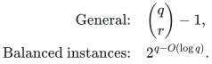

# Oracle barriers and configuration gaps

**Guarantee**

Deterministic factors strictly below <code class="math">2</code> for allocation and strictly below <code class="math">3/2</code> for two-size scheduling require <code class="math">\binom{q}{r}-1</code> recipient-rank queries on the hidden-set instances. Separate configuration constructions give a gap approaching <code class="math">r</code> for the aggregate LP and an exact gap <code class="math">2</code> for the full residual LP.

**Objective and output**

Prove oracle-query lower bounds and exact integrality gaps; distinguish the integer optimum from each explicitly defined fractional comparator.

**Randomness**

Lower bounds for deterministic rank-query algorithms, together with explicit integrality-gap constructions. These query statements do not claim the same bound for randomized algorithms.

**Time**

The query lower bound and its balanced-instance consequence are:

<!-- math-display: 16fc61b76645b2c4546d5555
\begin{aligned}
\text{General:}\quad &\binom{q}{r}-1,\\
\text{Balanced instances:}\quad &2^{q-O(\log q)}.
\end{aligned}
-->

The refined heavy-cover parameter can equal zero throughout the allocation lower-bound family.

**Space**

No running-time or workspace upper bound is asserted by a lower-bound construction.

**Parameters**

<code class="math">q&gt;r\ge1</code> are the hidden ground size and rank. The refined-parameter construction uses <code class="math">q=2r</code>. The residual-LP gap uses <code class="math">r\ge3</code>.

**Model and representation**

Full rank-value oracles for the query lower bounds; explicit cardinality rank formulas for the two configuration gaps. The heavy threshold for the refined-parameter barrier is <code class="math">\mathrm{OPT}/(2+\eta)</code> with fixed <code class="math">\eta&gt;0</code>.

**Lower-bound scope**

This record contains oracle-query and relaxation-gap results. It does not assert explicit-input NP-hardness, ETH lower bounds, or optimal exponential bases for the approximation upper bounds.

**Review status**

**Ready for review.** The deterministic rank/corank oracle barriers below factor two for allocation and below three halves for scheduling; the refined-parameter-zero barrier at threshold `OPT/(2+eta)`; the aggregate configuration gap approaching the selection rank and full-residual gap exactly two. The greedy residual-capacity identity and both explicit component decompositions have direct local proofs.

**Dependencies and scope.** The lower bounds use arbitrary integral recipient or job polymatroids in the full value-oracle model. They do not assert randomized lower bounds or NP/ETH hardness for explicit restricted-assignment inputs. The refined compulsory parameter is zero while its unrefined heavy-cover rank grows with the ground. The four-unit promise/two-unit output problem is separate and is not settled by these examples. Finite checks support the constructions, not the unbounded transcript argument.

The [verification note](verify/README.md) identifies executable coverage. This status does not claim external peer review or proof-assistant verification.

**Source**

[Manuscript and proof](proof.md), with [dependencies and verification sources](sources.md).

## Results

**Hidden-rank allocation and scheduling query barriers**

[Main proof](proof.md)

**Strictly-below-two allocation remains hard at refined heavy parameter zero**

[Refined-parameter proof](refined-parameter-barrier.md)

**Aggregate configuration gap approaching rank; full residual configuration gap exactly two**

[Configuration-gap proofs](configuration-gaps.md)

**Attribution.** icekylinx · GPT-6 Astra Pro
