# Two integrality gaps for recipient-polymatroid configuration relaxations

The first construction has a gap approaching the selected-player rank
for the aggregate configuration LP. The second has an exact gap of two
even after every residual-capacity cut is added. Both use explicit
cardinality rank functions; neither is a computational hardness claim.

## 1. The two relaxations

Let <code class="math">M</code> be the player-selection matroid. At target <code class="math">T</code>, player <code class="math">p</code>
puts nonnegative mass <code class="math">\mu_{pn}</code> on its locally legal integral
configurations <code class="math">n</code> of value at least <code class="math">T</code>. Write
<!-- math-display: 2d2e384c93bb33b6e986b6dd
x_p=\sum_n\mu_{pn},\qquad y_{pj}=\sum_n\mu_{pn}n_j.
-->
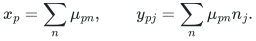
The aggregate relaxation requires
<!-- math-display: 6f6d192737e69369f210a86b
x\in B(M),\qquad y_{\cdot j}\in P(f_j)\quad\text{for every type }j.
 \tag{G1}
-->
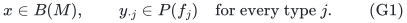
It retains only the summed recipient rank <code class="math">f_j</code>; it does not retain a
separate column for each component of a decomposition of that rank.

For a single resource <code class="math">f</code>, a feasible integral reserve <code class="math">z\in P(f)</code>
has residual singleton capacity
<!-- math-display: d237edea3dab7d8279ebd987
a_p(z)=\min_{A\ni p}\{f(A)-z(A)\}.
-->
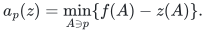
The full residual relaxation adds every inequality
<!-- math-display: e28472391cd5b873a97a1d90
\sum_{p,n}\mu_{pn}(n_j-a_p(z))_+\le z(P).
 \tag{G2}
-->
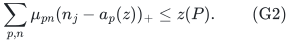
The following equivalent subset form makes the second construction
checkable without enumerating numerical reserve counts:
<!-- math-display: 48c1ed51b10cab6e6817fb4a
\sum_{p,n}\mu_{pn}(n_j-m_p(S))_+\le f(S),\qquad
 m_p(S)=f(S\cup\{p\})-f(S).
 \tag{G3}
-->
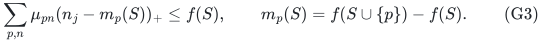

**Lemma 1.** The full families (G2) and (G3) are equivalent.

**Proof.** Define the violation of (G2) for every real <code class="math">z\in P(f)</code>
by subtracting <code class="math">z(P)</code> from its left side. Each hinge equals
<!-- math-display: 7e38941eac8a2240ad337671
(n_j-a_p(z))_+
 =\max\{0,\max_{A\ni p}(n_j-f(A)+z(A))\},
-->
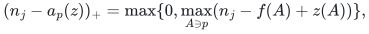
so the violation is a convex function of <code class="math">z</code>. Its maximum is attained
at a polymatroid vertex. The needed vertex description follows by
maximizing any linear objective: set negative-weight coordinates to
zero, order its positive-weight coordinates decreasingly, and assign
the successive rank increments. Diminishing marginals make this
greedy vector feasible; telescoping the objective over the ordered
prefixes bounds every feasible objective by that greedy value.
Thus the polytope is the convex hull of these greedy vectors.
Every vertex is therefore a greedy vector on an
ordered subset <code class="math">S</code>, is supported on <code class="math">S</code>, and has total
<code class="math">z(S)=f(S)</code>. Its residual capacity can be computed directly,
without a unit-copy representation. For any set <code class="math">A</code> containing
<code class="math">p</code>, feasibility, support and submodularity give

<!-- math-display: 0cfd3597a50994ecd9ad2d0a
\begin{aligned}
f(A)-z(A)
&=f(A)-z(A\cap S)\\
&\ge f(A)-f(A\cap S)\\
&\ge f(A\cup S)-f(S)\\
&\ge f(S\cup\{p\})-f(S).
\end{aligned}
-->
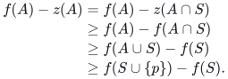

Taking <code class="math">A=S\cup\{p\}</code> attains equality because
<code class="math">z(S\cup\{p\})=f(S)</code>. Thus its residual capacity at
<code class="math">p</code> is exactly <code class="math">m_p(S)</code>, including the zero
case <code class="math">p\in S</code>. Its reserve inequality is (G3).
Convexity now shows that all subset cuts imply all reserve cuts.
Conversely, a greedy base on any <code class="math">S</code> is an integral feasible reserve
whose inequality is that subset cut. <code class="math">\square</code>

These are valid inequalities for integral allocations. Indeed, for a
feasible resource count vector <code class="math">n</code>, let <code class="math">A=\{p:n_p&gt;m_p(S)\}</code>.
Submodularity and feasibility give
<!-- math-display: bbf30fc484d2b36a56a98617
n(A)\le f(A)\le f(S\cup A)
       \le f(S)+\sum_{p\in A}m_p(S),
-->
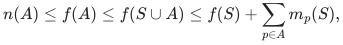
which proves the corresponding hinge inequality.

## 2. A gap approaching the selection rank

**Theorem 2.** For every <code class="math">r\ge2</code>, the aggregate relaxation has
instances with gap arbitrarily close to <code class="math">r</code>.

**Proof.** Choose integers <code class="math">D\ge r</code> and <code class="math">q=Dr</code>. Use the uniform
player matroid <code class="math">U_{r,q}</code>, one unit-valued resource, and
<!-- math-display: 213fb95666b83a405ca978d3
f(\varnothing)=0,\qquad f(S)=|S|+D\quad(S\ne\varnothing).
 \tag{G4}
-->
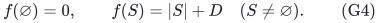
This is the sum of the free-matroid rank and <code class="math">D</code> rank-one
uniform-matroid ranks, so it is normalized, monotone, integral, and
submodular.

At each player put mass <code class="math">1/D</code> on its legal configuration of <code class="math">D+1</code>
units. Then <code class="math">x_p=1/D</code>, <code class="math">\sum_px_p=r</code>, and <code class="math">y_p=(D+1)/D</code>.
For every nonempty <code class="math">S</code> of size <code class="math">s</code>,
<!-- math-display: 24bf6cd02c396ee159577009
y(S)=s+s/D\le s+D=f(S),
-->
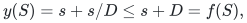
because <code class="math">s\le Dr\le D^2</code>. Thus the target <code class="math">D+1</code> is feasible.

For any selected <code class="math">r</code>-set <code class="math">I</code>, integer feasibility requires
<code class="math">n(I)\le r+D</code>. Consequently
<!-- math-display: 0ce4a94ec43075e1735fb955
\mathrm{OPT}_{\rm int}\le1+\lfloor D/r\rfloor.
-->
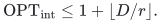
Equality is attained by giving that many units to each selected
player: for every <code class="math">A\subseteq I</code>,
<!-- math-display: fc385eba51d28f884f0478e6
n(A)=|A|+|A|\lfloor D/r\rfloor\le |A|+D.
-->
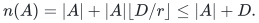
Adding unselected players to the tested set cannot decrease its rank.
Therefore the gap is at least
<!-- math-display: 1eacfafd0af6b12ab1649f58
\frac{D+1}{1+\lfloor D/r\rfloor},
 \tag{G5}
-->
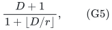
which tends to <code class="math">r</code> along <code class="math">D=rL</code>, <code class="math">L\to\infty</code>.
No target exceeds <code class="math">D+1</code>, the singleton capacity. <code class="math">\square</code>

The merged integer count vectors have the same direct decomposition:
put one unit of each positive coordinate in the free component.
The excess has total at most <code class="math">D</code>, by the rank inequality on
its positive support, and can be assigned one unit per rank-one component.
Conversely, adding component inequalities gives every merged rank row.
Keeping the free component and the <code class="math">D</code> rank-one components separate
excludes the displayed point: a <code class="math">D+1</code>-unit configuration must use all
<code class="math">D</code> rank-one services, forcing expected total <code class="math">Dr&gt;D</code> from components
whose combined capacity is <code class="math">D</code>. The integer feasible count vectors
are unchanged by merging, but their configuration relaxation changes.

## 3. Exact gap two after all residual cuts

**Theorem 3.** For every <code class="math">r\ge3</code>, there is an explicit single-resource
instance whose integer optimum is one and whose full residual
configuration optimum is two.

**Proof.** Set <code class="math">q=2r</code>, <code class="math">M=U_{r,2r}</code>, and
<!-- math-display: 073f152ca1d66f0c8f8e07df
f(S)=\min\{|S|,r-1\}+\min\{|S|,r+1\}.
 \tag{G6}
-->
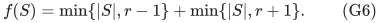
It is the sum of two uniform-matroid ranks. Every selected <code class="math">r</code>-set
can receive one unit per player. Two units per selected player violate
its own rank inequality, since <code class="math">f(I)=2r-1&lt;2r</code>. Hence the integer
optimum is exactly one.

Put mass <code class="math">1/2</code> on configuration <code class="math">n=2</code> at every player. Then
<code class="math">x_p=1/2</code>, <code class="math">y_p=1</code>, and <code class="math">x\in B(U_{r,2r})</code>.
The inequality <code class="math">f(S)\ge&#124;S&#124;</code> verifies every aggregate recipient row.
For a subset <code class="math">S</code> of size <code class="math">s</code>, its inside players have marginal zero
and every outside player has the same next marginal <code class="math">m(s)</code>. The
left side of (G3) is
<!-- math-display: 6bacb767f52c6342c3f2ea0a
L(s)=s+\frac{2r-s}{2}(2-m(s))_+.
-->
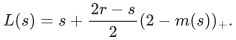
The following four cases exhaust all subsets:

| Subset size | Outside marginal | Left side <code class="math">L(s)</code> | Slack <code class="math">f(S)-L(s)</code> |
|---|---:|---:|---:|
| <code class="math">0\le s\le r-2</code> | <code class="math">2</code> | <code class="math">s</code> | <code class="math">s</code> |
| <code class="math">s=r-1</code> | <code class="math">1</code> | <code class="math">(3r-1)/2</code> | <code class="math">(r-3)/2</code> |
| <code class="math">s=r</code> | <code class="math">1</code> | <code class="math">3r/2</code> | <code class="math">(r-2)/2</code> |
| <code class="math">r+1\le s\le2r</code> | <code class="math">0</code>, or no outside player | <code class="math">2r</code> | <code class="math">0</code> |

All slacks are nonnegative for <code class="math">r\ge3</code>. Lemma 1 therefore verifies
every feasible-reserve cut, with arbitrary support. The singleton
capacity is two, so no configuration target above two exists. Thus
<!-- math-display: f9383d80ff934cbfcf070237
\mathrm{OPT}_{\rm full\ residual\ LP}=2,\qquad
 \mathrm{OPT}_{\rm int}=1.
 \qquad\square
-->

The two component resources have recipient matroids
<code class="math">U_{r-1,2r}</code> and <code class="math">U_{r+1,2r}</code>. Their merged integer
counts can be decomposed directly. Every coordinate is zero, one or two.
If <code class="math">d</code> coordinates are doubled, their own rank row implies
<code class="math">d\le r-1</code>. Put one of each doubled coordinate in each
component. If <code class="math">k</code> coordinates are single, the total-rank row
gives <code class="math">k\le2r-2d</code>, exactly the sum of the remaining capacities
<code class="math">r-1-d</code> and <code class="math">r+1-d</code>. Split those single coordinates
between the two components within these capacities. Conversely, adding
their rank inequalities gives the merged inequalities. Thus their summed
integer counts are exactly the integer points of <code class="math">P(f)</code>.
In their separate-component configuration relaxation,
every target strictly above one requires one service from each
component. Total player mass <code class="math">r</code> would demand <code class="math">r</code> services from
the first component, exceeding its rank <code class="math">r-1</code>. Target one is feasible
integrally using the larger component, so that relaxation has optimum
exactly one.

## 4. Consequences

Theorem 2 excludes a rank-independent constant guarantee against the
unstrengthened aggregate LP. Theorem 3 excludes a factor strictly below
two against the full residual LP, even with unlimited computation.
These statements do not lower-bound approximation against integer
optimum, and they do not establish that factor two is achievable.
The [recipient-polymatroid algorithm](../recipient-polymatroid/proof.md)
uses the integral-comparator loss lemma and remains consistent with both
constructions.

**Attribution:** icekylinx and GPT-6 Astra Pro.
