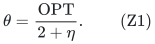
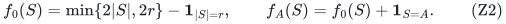
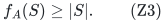
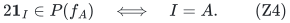
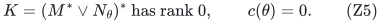
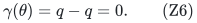
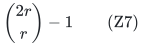

# The factor-two oracle obstruction persists at refined parameter zero

Fix any positive rational eta. Define the heavy threshold using the
same convention as the near-two algorithms:

<!-- math-display: 9931eed548be0cd6cf84a767
\theta={\mathrm{OPT}\over2+\eta}.
 \tag{Z1}
-->

In the arbitrary-player theorem, the parameter is the loop-deleted
corank of `K=(M* vee N_theta)*`. In the compulsory-player theorem,
the refined parameter is `gamma(theta)=rank(N_theta)-#coloops(N_theta)`.
This note proves that no deterministic factor strictly below two
can have `F(parameter) poly(H)` oracle time for either of these
refined parameters, even on instances where that parameter is zero.

The parameter convention in (Z1) is fixed while making this lower
bound. This is not a claim about every possible heavy threshold, and
it does not establish the same statement for the unrefined compulsory
heavy-cover rank `nu=rank(N_theta)`. It also does not rule out exact
factor two or determine an optimal exponential running-time base.

## 1. A hidden integral polymatroid

Choose an integer r>=2, let q=2r, and let P be a q-element player set.
For each hidden r-set A, define

<!-- math-display: c903de8ee7b0dbc9c509a9b6
f_0(S)=\min\{2|S|,2r\}-{\bf1}_{|S|=r},
 \qquad
 f_A(S)=f_0(S)+{\bf1}_{S=A}.
 \tag{Z2}
-->

These are the same hidden ranks as in
[A value-oracle barrier below factor two for rank-parameterized allocation](proof.md). Here their relevant
properties can also be checked directly.

The cardinality profile of f_0 has nonincreasing increments: r-1
increments of two, then two increments of one, and then zeros.
It is normalized, monotone and submodular. Raising its value at A
by one preserves monotonicity because each immediate successor of A
has value 2r, and each immediate predecessor has value 2r-2.

For submodularity it suffices to check the two-element local
inequalities

    f(X+x)+f(X+y)-f(X)-f(X+x+y) >= 0.

Raising A can decrease such a slack only when X=A or X+x+y=A.
In the first case the original cardinal-profile slack is one, from
the consecutive increments one and zero. In the second it is one,
from increments two and one. No local inequality has both negative
terms equal to A. The perturbation therefore leaves every slack
nonnegative. Thus f_A is an integral polymatroid rank.

Its total rank is 2r. For every S subseteq P,

<!-- math-display: e08cee4f71f4d70d7d008d5d
f_A(S)\ge|S|.
 \tag{Z3}
-->

For |S|<r this follows from 2|S|, for |S|=r from 2r-1>=r, and
for |S|>r from 2r>=|S|. Hence the all-ones vector on P is already
a feasible base of f_A. Its Boolean-cap matroid is the free matroid
on P.

On the other hand, for any r-set I,

<!-- math-display: d046be357d295da8a86b2e53
2\mathbf1_I\in P(f_A)
                               \quad\Longleftrightarrow\quad I=A.
 \tag{Z4}
-->

If I is not A, its own rank inequality rejects the total 2r because
f_A(I)=2r-1. If I=A, every subset inequality holds: the requested
count is at most 2|S|, and any set with enough requested elements
to reach 2r contains A and has rank at least 2r.

## 2. Arbitrary original player matroid: the parameter is zero

Let the original player matroid be `M=U_(r,2r)`. Use one recipient
resource f_A of unit value one. By (Z4), an integer allocation of
value two exists on A. Total rank 2r divided among r selected players
also proves that its minimum value cannot exceed two. Thus OPT=2.

At the fixed threshold (Z1), `theta=2/(2+eta)<1`. Every resource
unit is heavy. Equation (Z3) makes its Boolean matroid N_theta free
on all q players. In particular, M and N_theta have a common basis,
and their common-independent-set maximum is r. Consequently

<!-- math-display: a7cfb5263431f7659e3ad65a
K=(M^*\vee N_\theta)^*\text{ has rank }0,
                 \qquad c(\theta)=0.
 \tag{Z5}
-->

Any approximation factor alpha<2 must return a selected M-basis whose
minimum integer value is at least `2/alpha>1`. Each selected player
therefore receives at least two units. Its selected r-set must be A
by (Z4). The output identifies the hidden set exactly.

Thus the arbitrary-player refined parameter can be zero while
strictly beating factor two requires finding the hidden r-set.

## 3. Compulsory players: the refined corank is also zero

Keep the same q=2r players and hidden small resource f_A of value one.
Make all players compulsory. Add a large recipient matroid
`U_(r,2r)` with unit value two.

An allocation with value two at every player gives two small units
to every member of A and one large unit to every member of P\A.
It is feasible. The total available value is at most
`2r+2r=4r=2q`, so the all-player minimum cannot exceed two. Again
OPT=2.

At `theta=2/(2+eta)<1`, both resource types are heavy. The small
resource alone already admits `1_P` by (Z3), so their aggregate
Boolean matroid N_theta is free. It has rank q and every player
is a coloop. The refined parameter is therefore

<!-- math-display: 33402639bdff9949597e85a9
\gamma(\theta)=q-q=0.
 \tag{Z6}
-->

Suppose an alpha<2 algorithm returns value at least two at every
player. At most r players receive a large unit, because that
resource is a rank-r matroid with singleton capacity one. At least
r players receive no large unit, and every such player needs at
least two small units. Total small rank is exactly 2r. Therefore
there are exactly r small-only players, they receive exactly two
small units each, and every small unit is assigned to them. Their
r-set I must be A by (Z4), so the output again identifies A.

In this example the unrefined heavy-cover rank is nu=q, rather than
zero. Hence (Z6) is a statement about the refined loop-deleted dual
corank only. It must not be advertised as a lower bound at constant
unrefined heavy-cover rank for this threshold convention.

## 4. Oracle-query lower bound

The only rank-oracle answer depending on A is the answer at S=A.
All other answers agree with the common function f_0. The original
player matroid and any additional large matroid are fixed and reveal
no information about A.

Consider an adaptive deterministic algorithm and follow the transcript
in which every queried rank is answered by f_0. Until at least
`binom(2r,r)-1` different candidate r-sets have been queried, at least
two hidden sets remain consistent with the transcript. The algorithm
would have to return the same output for both, but the preceding
sections show that any alpha<2-valid output identifies a unique hidden
set. Therefore some promised instance forces at least

<!-- math-display: 4a7cc5d3af63985d4c35cbd3
{2r\choose r}-1
 \tag{Z7}
-->

queries to the hidden recipient rank oracle.

The quantity in (Z7) is exponential in q, while all numerical ranks
have polynomial bit length. In both applications the stated refined
parameter is identically zero. For any computable finite F and any
fixed polynomial degree, `F(0) poly(H)` cannot provide enough oracle
queries on all such instances. This establishes the claimed
fixed-parameter oracle obstruction for deterministic algorithms.

## 5. Interpretation of the boundary

The near-two positive theorems can use parameter zero to give a
one-heavy-unit allocation of value one in these examples. That meets
factor two, and hence also every positive-accuracy factor 2+eta.
Obtaining value strictly above one forces a second integral unit at
every relevant player and reveals the hidden high-quota set.

Accordingly, this obstruction supports two as the sharp possible
approximation threshold in the full value-oracle model under these
refined parameters. The current general-value positive theorem
approaches that threshold but does not yet attain it. The obstruction
does not close that positive-algorithm gap.

This is an oracle lower bound for arbitrary recipient polymatroids.
It is not an NP-hardness assertion for explicitly listed ordinary
restricted-assignment jobs or items, and it does not invalidate
stronger algorithms in explicitly represented subclasses. It also
does not assert hardness of the four-unit promise/two-unit output
gap, which is a different problem from distinguishing the hidden
exact two-unit basis in (Z4).

**Attribution:** Yilin Liu and GPT-6 Astra Pro.
