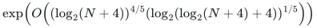
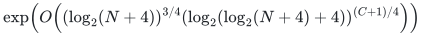
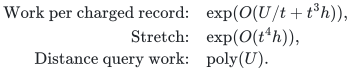
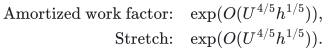
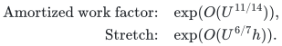
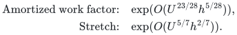
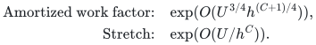
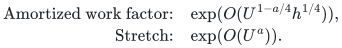

# Fully dynamic APSP tradeoff frontier

The manuscript gives incomparable fully dynamic all-pairs shortest-path tradeoffs. Each parameter choice retains both its update cost and its metric stretch.

**Guarantee**

Maintains approximate all-pairs distances under fully dynamic updates with the stretch stated for each parameter choice.

**Objective and output**

Trade amortized update work against distance stretch and return approximate distances for every queried pair.

**Randomness**

Deterministic fully dynamic metric construction. The source map supplies the hierarchy, initialization/update and numerical bounds; the parameter and output restrictions remain part of the theorem.

**Time**

Equalized choice: amortized update work

<!-- math-display: 16227039e8372d535071de76
\exp\!\left(O\!\left((\log_2(N+4))^{4/5}(\log_2(\log_2(N+4)+4))^{1/5}\right)\right)
-->

Fixed-<code class="math">C</code> choice:

<!-- math-display: d5c58d31d12a1929d4f3313d
\exp\!\left(O\!\left((\log_2(N+4))^{3/4}(\log_2(\log_2(N+4)+4))^{(C+1)/4}\right)\right)
-->

Queries take <code class="math">\mathrm{poly}(\log_2(N+4))</code> work. The detailed frontier below retains the locally defined logarithmic scales to keep all five comparisons legible.

**Space**

Actual-size hierarchy storage and query structures, charged to the graph inventory and update history; no master-cap padding is materialized.

**Parameters**

`n` is the fixed vertex count; `m` is the current edge count; `N` is the declared polynomial history cap; `U` is log of `N` plus a constant; `h` is log of `U` plus a constant. `C` is the fixed stretch-tuning constant in Tradeoff B. Local depth and branching parameters are rounded as specified in the source.

**Model and representation**

Undirected graphs with polynomial-range integer lengths and amortized maintenance. Theorem 2.1 gives the generic hierarchy implication; Corollary 2.2 instantiates it with the local construction. All displayed frontier points support nonnegative lengths and exact zero-distance answers by Corollary 6.1; the unrestricted general family is stated for positive lengths.

**Lower-bound scope**

The record is an upper-bound frontier and comparison map. It does not assert that either point is globally optimal.

**Review status**

**Ready for review.** The constructed fully dynamic metric hierarchy, full time/stretch curve and all five explicit parameter points, including the same-stretch `23/28` versus `6/7` comparison. The nonnegative-integer adapter supplies exact zero answers and transformed-range accounting.

**Dependencies and scope.** The tradeoff is amortized and reports numerical distances. Its general family assumes `t` tends to infinity and `t^2 h=o(U)`; extending that family to zero lengths additionally needs `t^4 h=o(U)` and a uniform stretch bound. The five displayed points satisfy the stronger conditions.

The [verification note](verify/README.md) identifies executable coverage. This status does not claim external peer review or proof-assistant verification.

**Source**

[Complete theorem and proof](proof.md), [dependencies and primary sources](sources.md).

## Quantitative tradeoffs

Set <code class="math">U=\log_2(N+4)</code> and <code class="math">h=\log_2(U+4)</code>. For <code class="math">t\to\infty</code> and <code class="math">t^2h=o(U)</code>, the general parameter choice gives:

<!-- math-display: bdb6729da5dfda88508a2283
\begin{aligned}\text{Work per charged record:}\quad&\exp(O(U/t+t^3h)),\\\text{Stretch:}\quad&\exp(O(t^4h)),\\\text{Distance query work:}\quad&\mathrm{poly}(U).\end{aligned}
-->

- **Balanced:** Set <code class="math">t=(U/h)^{1/5}</code>.

  <!-- math-display: 07ed938e8eb98792d68656c4
  \begin{aligned}\text{Amortized work factor:}\quad&\exp(O(U^{4/5}h^{1/5})),\\\text{Stretch:}\quad&\exp(O(U^{4/5}h^{1/5})).\end{aligned}
  -->
  

- **Smaller work exponent:** Set <code class="math">t=U^{3/14}</code>.

  <!-- math-display: 1a8fc183ce0291c9e36bf01b
  \begin{aligned}\text{Amortized work factor:}\quad&\exp(O(U^{11/14})),\\\text{Stretch:}\quad&\exp(O(U^{6/7}h)).\end{aligned}
  -->
  

- **Matched finer stretch:** Set <code class="math">t=(U/h)^{5/28}</code>.

  <!-- math-display: 0a725058a3704254f4f094de
  \begin{aligned}\text{Amortized work factor:}\quad&\exp(O(U^{23/28}h^{5/28})),\\\text{Stretch:}\quad&\exp(O(U^{5/7}h^{2/7})).\end{aligned}
  -->
  

- **Fixed <code class="math">C&gt;0</code>:** Set <code class="math">t=(U/h^{C+1})^{1/4}</code>.

  <!-- math-display: 50b3625717801b02b2e4291a
  \begin{aligned}\text{Amortized work factor:}\quad&\exp(O(U^{3/4}h^{(C+1)/4})),\\\text{Stretch:}\quad&\exp(O(U/h^C)).\end{aligned}
  -->
  

- **Fixed <code class="math">0&lt;a&lt;1</code>:** Set <code class="math">t=(U^a/h)^{1/4}</code>.

  <!-- math-display: 0752434504c17251609446a9
  \begin{aligned}\text{Amortized work factor:}\quad&\exp(O(U^{1-a/4}h^{1/4})),\\\text{Stretch:}\quad&\exp(O(U^a)).\end{aligned}
  -->
  

Total work multiplies the displayed factor by the actual initial vertex/edge inventory plus the number of updates. The port adapter supports arbitrary original degree and accounts for every allocated native record.

Read the [complete proof](proof.md), [source map](sources.md), and [complexity guide](../../docs/COMPLEXITY.md) for the exact symbolic forms, the amortized-update scope, and the comparison points. The source does not claim worst-case update time or a constant/polylogarithmic stretch point for Tradeoff B.

**Attribution.** Yilin Liu · GPT-6 Astra Pro
