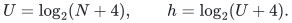
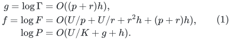
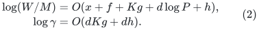
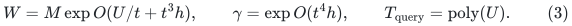
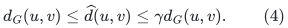
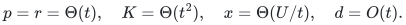
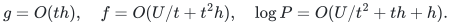
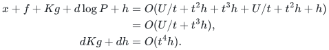
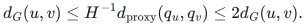

# Fully dynamic all-pairs distances: a time–stretch theorem

**icekylinx · GPT-6 Astra Pro**

## 1. Model, generic interface and its construction

Let an undirected graph have positive integer lengths in `[1,N^c]` for a fixed constant `c`. Let `M=n_0+m_0+Q` count the initial vertex and edge inventory and all elementary insertions and deletions, with `N>=M+4`. An edge-weight replacement is a deletion followed by an insertion. Parallel edge lifetimes have distinct identifiers. Write

<!-- math-display: bee90fb2f2798865aa0f5d6f
U=\log_2(N+4),\qquad h=\log_2(U+4).
-->

We use the normalized metric hierarchy with the following explicit local contract. For integer parameters `p,r,K`, reduction factor `k=2^x`, and depth `d=O(U/x)`, its structural and construction factors satisfy

<!-- math-display: 9633be891b1c3bf7eb1aecd2
\begin{aligned}
g=\log\Gamma&=O((p+r)h),\\
f=\log F&=O(U/p+U/r+r^2h+(p+r)h),\\
\log P&=O(U/K+g+h).
\end{aligned}
\tag{1}
-->

The hierarchy uses actual local inventories, returns upper distance estimates, and satisfies

<!-- math-display: 60c2f287f696a00ea50aba91
\begin{aligned}
\log(W/M)&=O(x+f+Kg+d\log P+h),\\
\log\gamma&=O(dKg+dh).
\end{aligned}
\tag{2}
-->

Here `W` is initialization plus total update work, `gamma` is stretch, and `P` includes child inventories and encoded child edits. A query follows one pair of pivot handles per level, ending in an exact table lookup, and costs `O(d poly(U))`. The shrink condition is `x>=C log P` for a sufficiently large fixed constant. The construction and the chronological accounting for initial credit are supplied by the [separated metric hierarchy](../../manuscripts/graph-backends/separated-metric-forest-and-strong-sssp.md). Equations (1)–(2), including the query interface, are the hypotheses of this composition theorem; they are not inferred from a distance-stretch guarantee alone.

**Supplied construction.** The
[linear-parameter static sparsifier](../../manuscripts/graph-backends/linear-parameter-static-sparsifier.md),
Sections 3–7, proves the separated structural and work factors in (1).
The [normalized repair](../../manuscripts/graph-backends/normalized-projected-route-composition.md)
and [separated metric hierarchy, Sections 2–7](../../manuscripts/graph-backends/separated-metric-forest-and-strong-sssp.md)
prove the chronological recurrence, upper metric estimates, stable
pivot handles and query construction in (2). The
[uniform source audit](../../manuscripts/graph-backends/uniform-source-interfaces-for-4-5.md)
keeps the elementary public algorithms within their parameter ranges
and proves the finite-bit adapters. Thus the generic theorem below
has a constructed instantiation, recorded as Corollary 2.2.

The deterministic contract is required on histories chosen adaptively
from earlier answers. A numerical query reads the settled hierarchy;
its stated cost is charged separately from update work. Neither a
randomized oblivious-history oracle nor an interface that silently
rebuilds on a query supplies these premises.

## 2. General time–stretch theorem

**Theorem 2.1.** Under the preceding hierarchy contract, let `t=t(U)` satisfy `t->infinity` and `t^2h=o(U)`. There is a deterministic fully dynamic distance oracle with

<!-- math-display: e5027dabccbb3186601b1bfc
W=M\exp O(U/t+t^3h),\qquad
\gamma=\exp O(t^4h),\qquad
T_{\rm query}=\mathrm{poly}(U).
\tag{3}
-->

After every settled external update, the returned value satisfies

<!-- math-display: ecf9e461acdd818a440c9322
d_G(u,v)\le \widehat d(u,v)\le\gamma d_G(u,v).
\tag{4}
-->

Disconnected pairs return infinity and equal endpoints return zero. The work is amortized over the complete update history.

**Proof.** Choose integer-rounded parameters

<!-- math-display: f6834fa5ddf1bebe5c82aa6d
p=r=\Theta(t),\quad K=\Theta(t^2),\quad
x=\Theta(U/t),\quad d=O(t).
-->

Enlarge the fixed multiplier in `x` when necessary. Equations (1) give

<!-- math-display: 31d50e5a44f48d1cd15556b7
g=O(th),\quad f=O(U/t+t^2h),\quad
\log P=O(U/t^2+th+h).
-->

Consequently `x/(U/t^2)=Theta(t)` and `x/(th)=Theta(U/(t^2h))` both diverge. The shrink condition holds for all sufficiently large `U`; finitely many smaller cases use an exact algorithm. Substituting in (2),

<!-- math-display: 7207e396734b9cdb7a20fbc0
\begin{aligned}
x+f+Kg+d\log P+h
 &=O(U/t+t^2h+t^3h+U/t+t^2h+h)\\
 &=O(U/t+t^3h),\\
dKg+dh&=O(t^4h).
\end{aligned}
-->

Rounding changes constant factors only. The per-level distance inequalities compose multiplicatively. Every local upper estimate is the length of a represented walk, so no estimate falls below the true distance. The query visits `O(t)` levels, where `t` is at most polynomial in `U`, and reads one exact base-table entry. These observations prove (3)–(4). ∎

**Corollary 2.2 (constructed distance oracle).** The local algorithms
identified in Section 1, with the named deterministic public inputs,
give (3)–(4) on the stated undirected graph model. Their constants are
uniform in the growing parameters. The preceding shrink calculation
and actual-size stopping rule check the required range; Section 4
supplies arbitrary original degree. This is the instantiated research
theorem underlying the frontier below.

## 3. Explicit nondominated parameter choices

Each row follows from Theorem 2.1 and retains its own stretch.

| Choice of `t` | Logarithm of amortized update factor | Logarithm of stretch |
|---|---|---|
| `(U/h)^(1/5)` | `O(U^(4/5) h^(1/5))` | `O(U^(4/5) h^(1/5))` |
| `U^(3/14)` | `O(U^(11/14))` | `O(U^(6/7) h)` |
| `U^(5/28) h^(-5/28)` | `O(U^(23/28) h^(5/28))` | `O(U^(5/7) h^(2/7))` |
| `(U/h^(C+1))^(1/4)`, fixed `C>0` | `O(U^(3/4) h^((C+1)/4))` | `O(U/h^C)` |
| `(U^a/h)^(1/4)`, fixed `0<a<1` | `O(U^(1-a/4) h^(1/4))` | `O(U^a)` |

**Proof of the table.** Substitute each choice into `U/t`, `t^3h`, and `t^4h`. In the fourth row the exponents of `h` in the first two terms are `(C+1)/4` and `(1-3C)/4`; the first is larger because `C>0`. In the last row the powers of `U` are `1-a/4` and `3a/4`; the first is larger because `a<1`. The other rows follow by the same two-term comparison. Each choice satisfies `t^2h=o(U)`. ∎

For the third row, a separately derived public-hierarchy comparison has log-update factor `O(U^(6/7)h^(1/7))` at the same stretch. Its assumptions and parameter reconstruction are recorded in the [matched comparison](../../manuscripts/graph-backends/same-stretch-apsp-comparison-and-root-audit.md). This is a comparison of two particular constructions, not an optimality theorem.

## 4. Arbitrary physical degrees

**Lemma 4.1.** A degree-three proxy preserves distances between original query vertices within a constant factor and increases lifetime inventory and updates by a polynomial logarithm.

**Proof.** Attach to each original vertex a virtual binary tree of height `O(log N)`, with one leaf for every used incidence. Allocate only root-to-leaf paths actually used; deletion may leave ghosts until the next global rebuild. Give every connector length one and each original edge `e` proxy length `H ell_e`, where `H` is a sufficiently large fixed multiple of `log N`. The original vertices' roots are their query handles.

A proxy walk projects to a physical walk after connector edges are discarded. Thus its length divided by `H` is at least the physical shortest-path distance. Conversely, lift a physical shortest path. Each of its edges costs at most `O(log N)` additional connector length, while `ell_e>=1`; the chosen `H` gives

<!-- math-display: a67a99577f7cbf02f26dd77a
d_G(u,v)\le H^{-1}d_{\rm proxy}(q_u,q_v)\le 2d_G(u,v).
-->

Each incidence allocates only `O(log N)` proxy records. A physical edit causes only polynomially many logarithmic-time proxy edits. Isolated original vertices are handled directly. No size-`N` port tree is materialized for each vertex. Applying the hierarchy to the proxy and dividing estimates by `H` proves the claim. ∎

The constant two is absorbed in the stretch factors above. This numerical distance interface needs no flat contraction of every physical fiber.

## 5. Output and representation

The oracle stores hierarchy records and exact base tables. It does not explicitly update an all-pairs matrix. All work in (3) includes late child edits paid from initialization credit and all actual base tables. Extracting a represented walk is charged to that walk; this theorem makes no simple-path reporting claim measured solely by a shorter loop-erased output. The separate incremental SSSP theorem supplies its own path-reporting proof.

The generic implication in Theorem 2.1 and its supplied construction in
Corollary 2.2 have separate roles. The source map records the local
proofs and published inputs of the constructed oracle. A complete
executable APSP implementation is not supplied; that software boundary
does not add a mathematical hypothesis to Corollary 2.2.

## 6. Nonnegative integer lengths at the displayed frontier points

**Corollary 6.1.** Every explicit row of the table in Section 3 extends
to nonnegative integer lengths in <code class="math">[0,N^c]</code>, with the same asymptotic
work and query bounds, at most a constant additional stretch factor,
and exact zero-distance answers.

**Proof.** Let <code class="math">R_0</code> be the least power of two at least <code class="math">N</code> and run
the positive-length algorithm on <code class="math">L_e=R_0^3\ell_e+1</code>.
These integers lie in the predeclared enlarged polynomial range
<code class="math">[1,8N^{c+3}+1]</code>. Let <code class="math">G(N)</code> be an explicit uniform upper bound
on the complete oracle's stretch for that range, including the root
degree adapter and all settled states. For each displayed row,
<code class="math">G(N)=N^{o(1)}</code>, so <code class="math">G(N)\leq N</code> eventually. If that explicit
bound exceeds <code class="math">N</code>, use the exact algorithm; this affects only
finitely many master sizes.

Otherwise return the floor of the estimate divided by <code class="math">R_0^3</code>.
A true zero distance has a simple zero-cost path of fewer than <code class="math">n</code>
edges, so the unfloored estimate is at most
<code class="math">G(N)n/R_0^3\leq1/N&lt;1</code>. Its floor is zero. A positive finite
integer distance <code class="math">d</code> lies below the floored estimate, which is at
most <code class="math">G(N)(d+n/R_0^3)\leq2G(N)d</code>. Infinity is unchanged.
The fixed perturbation adds only <code class="math">O(\log N)</code> length bits and no
update records. This is the numerical reduction in
[Zero-length edge adapters, Section 2](../../manuscripts/graph-backends/nonnegative-integer-distance-adapters.md). ∎

For the general parameter family, the same corollary follows under
the additional condition <code class="math">t^4h=o(U)</code>. The theorem's weaker
<code class="math">t^2h=o(U)</code> hypothesis alone does not imply subpolynomial stretch
or justify this fixed polynomial perturbation. The corollary supplies
numerical answers only, with no new simple-path reporting guarantee.
