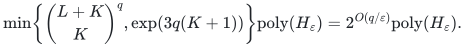

# Scheduling with arbitrary processing times

**Guarantee**

Returns an integer schedule of makespan at most <code class="math">(1+\varepsilon)\mathrm{OPT}</code>, or detects infeasibility even without a load bound.

**Objective and output**

Assign every original type total while preserving one exact assignment-cost budget.

**Randomness**

Deterministic profile enumeration and exact integral recovery, including the compressed-slot-surplus branch, with paid deterministic primitives.

**Time**

With <code class="math">\delta=\varepsilon/2</code>, <code class="math">K=\lfloor1/\delta\rfloor</code>, and <code class="math">L=\left\lceil(1-\delta)/\delta^2\right\rceil</code>, time is

<!-- math-display: a9f560c77e88b22d1d55346f
\min\!\left\{\binom{L+K}{K}^{q},\exp(3q(K+1))\right\}\mathrm{poly}(H_\varepsilon)=2^{O(q/\varepsilon)}\mathrm{poly}(H_\varepsilon).
-->

**Space**

Polynomial in the complete binary input and paid oracle workspace; numerical resource multiplicities are not expanded into individual units. The rational accuracy is never expanded into unary coordinates.

**Parameters**

<code class="math">q</code> is the physical-machine count; <code class="math">0&lt;\varepsilon\le1</code> is rational; <code class="math">H_\varepsilon=H+\mathrm{size}(\varepsilon)</code>; all original totals <code class="math">n_j=f_j(P)</code> are mandatory. <code class="math">H</code> includes the explicit ground, all rational and integer encodings, and paid rank, submodular-minimization, LP, intersection, and decomposition work.

**Model and representation**

Arbitrary nonnegative rational processing times and assignment costs, integral job polymatroids, eligibility masks, and one exact budget. Every original resource base must be recovered.

**Lower-bound scope**

No lower bound is claimed for this algorithm.

**Review status**

**Ready for review.** The complete exact-budget arbitrary-processing Theorem PS: original mandatory job-polymatroid bases, arbitrary nonnegative rational pair times/costs, exact bin boundaries, sparse occupied-bin grouping, load-pruned profile streaming with both composition and partition count bounds, one joint minimum-cost upper-prefix recovery, zero feasibility and one-sided grid optimization. The separate common-type-size slot-surplus Theorem S is also audited, including the fixed full-machine workload dual, binary scaled decomposition, guarded compressed count recursion, large-corank enumeration for polynomial space and the supplied-surplus-budget target search. The reference implements the PS profile and shared joint recovery semantics with explicit-table solver costs.

**Dependencies and scope.** The main approximation scheme uses the stated paid exact rank/SFM, rational LP and integral polymatroid-intersection primitives; its accuracy encoding and occupied-bin polynomial-space ledger remain explicit. The shipped reference shares canonical LP-vertex and numeric count enumeration, whose costs and potentially exponential vertex storage are charged separately from the fast theorem. The slot-surplus companion has common positive type sizes and no assignment budget. Its stronger bound retains the slot-surplus promise at OPT and the additive largest-smaller-job term, alongside the unconditional additive-largest-job fallback. That distinct compressed-slot algorithm is mathematically proved but not implemented by the profile reference. Finite reference tests, complete mathematical proofs, formal verification, external review and publication priority are distinct; the latter three are not claimed.

The [verification note](verify/README.md) identifies executable coverage. This status does not claim external peer review or proof-assistant verification.

**Source**

[Manuscript and proof](proof.md), with [dependencies and verification sources](sources.md).

## A separate slot-surplus guarantee for common type sizes

The [compressed slot-surplus theorem](slot-surplus.md) handles common
processing sizes and mandatory original job-polymatroid bases, with
arbitrary binary multiplicities and no assignment-cost budget.
Let <code class="math">a</code> be the maximum size, <code class="math">h</code> its mandatory total, <code class="math">u</code> the largest
smaller size, and

<code class="math">s_p(T)=\min\{f_b(\{p\}),\lfloor T/a\rfloor\}</code>,  <code class="math">c_{\mathrm{slot}}(T)=\sum_p s_p(T)-h</code>.

**<code class="math">C_{\max}\le\mathrm{OPT}+a</code>**

Always retained as a polynomial fallback

**<code class="math">C_{\max}\le\min\{\mathrm{OPT}+a,(1+\varepsilon)\mathrm{OPT}+u\}</code>**

<code class="math">\Gamma(1/\varepsilon)^k\mathrm{poly}(H)</code> when <code class="math">c_{\mathrm{slot}}(\mathrm{OPT})\le k</code>, for rational <code class="math">0&lt;\varepsilon\le1/2</code>

**Factor <code class="math">1+\eta</code>**

<code class="math">\Gamma(2/\eta)^k\mathrm{poly}(H)</code> when <code class="math">u\le(\eta/2)\mathrm{OPT}</code> and <code class="math">c_{\mathrm{slot}}(\mathrm{OPT})\le k</code>, for rational <code class="math">0&lt;\eta\le1</code>

Here <code class="math">\Gamma(R)=R^R/(R-1)^{R-1}</code>. The supplied slot-surplus budget <code class="math">k</code>
can itself be binary encoded. A hybrid count enumeration guarantees
polynomial workspace even when its numerical value exceeds the number
of machines. This theorem does not impose at most one largest unit per
machine, and its additive smaller-unit loss is explicit.

**Attribution.** icekylinx · GPT-6 Astra Pro
