# Compressed large-job slots and corank scheduling with arbitrary smaller sizes

The batched omission method extends from at most one large unit per
machine to arbitrary binary-encoded counts of a largest job size.
The relevant corank counts unused largest-job positions at the
comparison makespan. All computation is on the physical machines
and their integer count vectors; a numerical slot universe is never
expanded. A separate large-corank enumeration is needed to retain
polynomial space when that corank itself is binary encoded.

The result is a conditional parameterized bound for general job
sizes: at a supplied slot-surplus budget k, the algorithm always
keeps a public additive schedule, and gives makespan at most
(1+epsilon)OPT+u when the optimum's slot surplus is at most k.
Here u is the largest size strictly below the maximum size a.

## 1. Model, slot surplus and theorem

Let P be a set of q>=1 machines. All job types have positive rational
sizes and normalized monotone integral job-polymatroid ranks on P.
The assignment of each type must be an integer base of its rank.
Aggregate all types of maximum size a into f_b, and put

<!-- math-display: abd3eb61e530a41410fb3562
h=f_b(P).
 \tag{S1}
-->
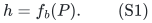

The remaining types j have sizes 0<p_j<=u<a and ranks f_j.
Set u=0 if that family is empty. Aggregation of equal-sized types
can be undone by integral polymatroid sum decomposition. All ranks,
job counts and rational sizes are encoded in binary. There are no
additional machine constraints coupling different types.

For a nonnegative target T, define the per-machine largest-job
slot capacities and their total by

<!-- math-display: 0a8c033fee8c9ce78f89517b
s_p(T)=\min\{f_b(\{p\}),\lfloor T/a\rfloor\},
               \qquad N(T)=\sum_p s_p(T).
 \tag{S2}
-->
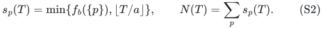

At any feasible makespan, the large assignment is a base bounded
by s(T), so N(T)>=h. Define its slot surplus by

<!-- math-display: 0c1523466a1dd5c8f4e42058
c_{\rm slot}(T)=N(T)-h.
 \tag{S3}
-->
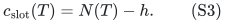

For infeasible small targets this expression can be negative; it
is only interpreted as a corank after the large box retains rank h.
The parameter-cap predicate is always written as N(T)<=h+k, so
no negative corank enters a runtime formula.

Fix rational 0<epsilon<=1/2 and an integer budget k>=0. Write
Gamma(R)=R^R/(R-1)^(R-1) for R>1.

**Theorem S.** There is a deterministic algorithm with runtime

<!-- math-display: f30b43f8e18726c1546079f2
\Gamma(1/\epsilon)^k\mathrm{poly}(H)
                     \le(e/\epsilon)^k\mathrm{poly}(H)
 \tag{S4}
-->
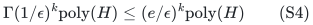

and polynomial workspace which always produces a schedule of
makespan at most OPT+a. Whenever

<!-- math-display: d63a614da06f25d750308537
c_{\rm slot}(\mathrm{OPT})\le k,
 \tag{S5}
-->
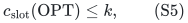

its output also satisfies

<!-- math-display: 79ff749aae8fe783ced17be7
C_{\max}\le(1+\epsilon)\mathrm{OPT}+u.
 \tag{S6}
-->
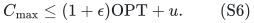

Thus it obtains the smaller of these two bounds under (S5).
H includes the physical input, the encodings of epsilon and k,
oracle-answer bit lengths, and the paid deterministic submodular
minimization, rational LP, and integral polymatroid-intersection
primitives. The polynomial degree is independent of k and epsilon.

The theorem does not impose T<2a or at most one largest unit per
machine. Numerical values of h, N(T), and k may all be exponentially
larger than their encodings. The additive term and slot-surplus condition remain part of the theorem.

## 2. Degenerate classes and the original load grid

If there are no jobs, return the empty schedule. If a designated
largest class has h=0, the remaining arbitrary-sized jobs can be
fractionally optimized and rounded with per-machine additive u.
This gives OPT+u in polynomial oracle time, which is stronger than
(S6), without a slot recursion.

If h>0 and there are no smaller jobs, the one-size instance is
solved exactly. A target T is feasible precisely when the box
0<=x<=floor(T/a)*1 preserves total rank h in P(f_b). The capped
rank is computed by submodular minimization, and integer bases of
the capped polymatroid give actual schedules. Binary search on the
integer largest-job count per machine is polynomial in the encoded
range. The rest of the proof assumes h>0 and a nonempty smaller
class, so 0<u<a and OPT>=a>0.

Choose a positive rational g such that every original size is an
integer multiple of g. Its bit length is polynomial, for example
by using the reciprocal product of the original denominators.
Every integral schedule load and OPT lies on the g-grid. Let

<!-- math-display: a5c0bcb8af964c232a0532f3
V=ah+\sum_jp_j f_j(P)
 \tag{S7}
-->
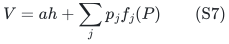

be the total job workload. Any choice of integer bases has every
machine load at most V, so V is a genuine feasible upper makespan
on this grid.

Write 1-epsilon=B/A with integers A>B>=1, and put

<!-- math-display: fd37a79cce6d76fa78c21f31
\Delta=g/A,\qquad m_j=p_j/\Delta,\qquad
 t=a/\Delta,\qquad b=(1-\epsilon)t.
 \tag{S8}
-->
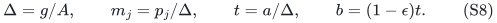

Every m_j, t and b is a positive integer. In particular, if a/g=L
then t=AL and b=BL, so the quota gap has exactly
t/(t-b)=1/epsilon. No numerical rounding of the quotas is used.

## 3. A fixed full-machine dual for each target

Fix a positive g-grid target T that meets the budget predicate.
First calculate s=s(T). The rank under the large-job box is

<!-- math-display: 74d622378ef475cdbb873efa
h_s=\min_{R\subseteq P}\{f_b(R)+s(P\setminus R)\}.
 \tag{S9}
-->
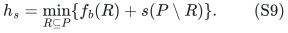

If h_s<h, no original target-T schedule exists: every such
schedule would supply a large base inside that box. Otherwise the
large box retains rank h, and c=N(T)-h is nonnegative and at most k.

Form the integral smaller-workload rank

<!-- math-display: baba827060e9bc0f2d9f350d
F(R)=\sum_jm_j f_j(R),
             \qquad C=T/\Delta\in\mathbb Z_{\ge0}.
 \tag{S10}
-->
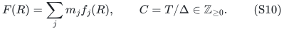

Cap it coordinatewise at C, with rank

<!-- math-display: aac259f574b453094f7e281d
G(R)=\min_{D\subseteq R}\{F(D)+C|R\setminus D|\}.
 \tag{S11}
-->
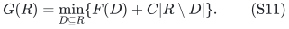

If G(P)<F(P), the target is infeasible: the smaller workload of
any original target schedule would be a base of F inside the cap.
Otherwise G(P)=F(P). Form once, on the full physical machine set,
the complement dual

<!-- math-display: 66551386bac24c3e01996ea1
f_T(R)=C|R|+G(P\setminus R)-F(P).
 \tag{S12}
-->
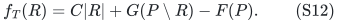

It is normalized, integral, monotone and submodular. Monotonicity
uses the coordinate cap C on G. Its singleton ranks are at most C,
and its bases are precisely y=C*1-w for w in B(G).

All later count deletions retain this same f_T on the same full
machine set. No dual is recomputed after deleting slots or after
setting a machine's remaining slot count to zero.

## 4. The original target supplies a per-slot promise

In an original target-T schedule, let x* be its integer large-job
base, with x*<=s. Its smaller-workload vector w* is an integer
base of F and obeys w*<=C*1. Hence w* belongs to B(G), and the
dual base y*=C*1-w* satisfies

<!-- math-display: 1d39eed3b734bf094de05886
y^*_p\ge t x^*_p.
 \tag{S13}
-->
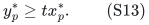

This follows from a*x*_p+Delta*w*_p<=T. By downward closure,
t*x* belongs to P(f_T).

Conceptually, make s_p distinct slots owned by each machine p.
A slot subset is independent in the natural large-job matroid when
its vector of owner counts is independent in P(f_b). Its rank is
h by (S9), on N(T) slots, with corank c. The lifted resource
rank on a slot subset Z is

<!-- math-display: f0c4cc07d7a5f58b549f0a6c
\widetilde f_T(Z)=f_T(\mathrm{owners}(Z)).
 \tag{S14}
-->
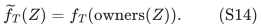

This is an integral polymatroid rank. For a selected slot basis
with owner counts x, t units on each selected slot are feasible
exactly when t*x belongs to P(f_T). One direction sums over all
slots of each owner set; the other bounds a partial set by the
full selected counts of its owners.

Equation (S13) supplies this stronger promise. The conceptual
description explains the corank but is not an implementation:
the compressed algorithm below directly uses count vectors.

## 5. A compressed gap routine when c is small

Assume first that c<q^2. The routine maintains a remaining count
vector n<=s. It seeks an integer x in B(f_b) with x<=n and
b*x in P(f_T), under the stronger promise that such an x* exists
with t*x* in P(f_T).

At a node, test whether the box n retains large rank h using

<!-- math-display: b8a3f501b9bc79410fb0490a
H(n)=\min_{R\subseteq P}\{f_b(R)+n(P\setminus R)\}.
 \tag{S15}
-->
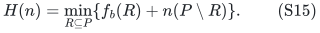

If not, report FAILURE. Otherwise put d=n(P)-h>=0 and minimize

<!-- math-display: 397c0eea636ef153f9fdf16e
f_T(R)-b n(R)
 \tag{S16}
-->
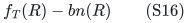

over physical machine subsets R. This is submodular minimization
on q elements, irrespective of the number of slots.

If the minimum is nonnegative, b*n belongs to P(f_T). Find any
integer base x of the boxed large polymatroid, so x<=n; then
b*x is also feasible. Such a base is obtained by greedy rank
increments of the box-capped polymatroid, whose rank oracle uses
the same capped-rank formula. Return x.

If a negative minimizer R is returned, machines with n_p=0 may
be removed from R without increasing the objective, since f_T
is monotone. Put

<!-- math-display: 50836082863e9b47126d2091
m=n(R),\qquad \ell=m-\left\lfloor f_T(R)/t\right\rfloor.
 \tag{S17}
-->
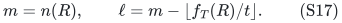

The violation f_T(R)<bm and nonnegativity give 1<=ell<=m.
Every promised x* satisfies t*x*(R)<=f_T(R), so the unselected
slot count n-x* inside R is at least ell. Its total over P is d.
Thus ell>d is a sound failure, tested before enumeration.

Otherwise enumerate every integer deletion pattern z supported
on R with

<!-- math-display: fd7b059708476784424591f4
0\le z_p\le n_p,\qquad z(R)=\ell.
 \tag{S18}
-->
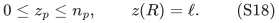

Recurse with n-z, returning the first successful x. If all attempts
fail, report FAILURE. Each pattern is counted even when its rank
test immediately fails.

For any fixed promised x*, there is an integer pattern in (S18)
with z<=n-x*, because the available omission counts on R total
at least ell. That child retains x* and its t-quota promise, and
its box rank is still h. Induction on d proves that a promised
node cannot fail. Every success is explicitly verified to be a
large base with b*x in P(f_T), on promised or unpromised inputs.

This proof depends only on counts. Slot labels are exchangeable
within each owner, so no exponentially large element-identity table
is required.

## 6. Counting patterns, failed attempts and recursive space

Write R_0=t/(t-b)=1/epsilon. At a deficient node,

<!-- math-display: f46fc74fbddf3dc627c32eba
\ell\ge m-f_T(R)/t>m/R_0.
 \tag{S19}
-->
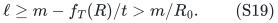

Every pattern in (S18) can be injected into an ell-subset of m
conceptual slots by choosing the first z_p slots of each owner.
Therefore the number of patterns is at most
binom(m,ell)<=Gamma(R_0)^ell. The standard entropy inequality
also covers ell=m. Each attempted child has remaining budget
d-ell, including a child whose box rank falls below h.

The same induction as for the batch theorem gives at most

<!-- math-display: 33abafa8878535fa67df5714
(c+1)\Gamma(1/\epsilon)^c
 \tag{S20}
-->
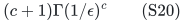

attempted computation nodes. The ell>d guard keeps this bound
valid on every unpromised input. It is not a promise-only
complexity estimate.

The pattern iterator must enumerate exact-sum patterns with
polynomial delay; a rectangular enumeration of all coordinate
choices would not suffice in this branch. One implementation
orders the owners and keeps the remaining total ell'. For each
next coordinate, its permitted interval is

<!-- math-display: 9f1200462fb076980193b009
\max\{0,\ell'-\text{sum of later capacities}\}
        \ \le z_p\le\ \min\{n_p,\ell'\}.
 \tag{S21}
-->
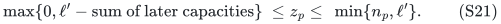

Every partial choice in this interval has a completion because
integer interval capacities realize every intermediate total.
Consequently each generated partial node extends a valid leaf,
and the enumeration cost is polynomial per emitted pattern. The
iterator uses only polynomially many binary counters.

Here c<q^2, so the recursion depth is less than q^2. Each frame
stores q-dimensional binary count vectors, a deficient owner set,
and a polynomial-space iterator. All oracle calls are on q physical
machines. Thus the entire recursion uses polynomial workspace.

## 7. A different enumeration when the binary corank is large

If c>=q^2, a stack of depth c would not establish polynomial
space in the original bit encoding. Instead enumerate integer
vectors z with

<!-- math-display: 3d615eb6dbb45e4f32a8d35a
0\le z_p\le\min\{s_p,c\},\qquad z(P)=c.
 \tag{S22}
-->
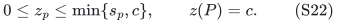

For each, put x=s-z. Then x(P)=N(T)-c=h. Test whether x belongs
to P(f_b) and b*x belongs to P(f_T), by physical-ground
submodular minimization. If both tests pass, x is a large base
and the required b-quota output. Return it. If none passes,
report FAILURE.

Every promised large base x* gives a pattern z=s-x* in (S22),
because its total omission count is c. Its t-quota feasibility
implies its b-quota feasibility. Hence failure is again a sound
rejection of the stronger promise. Every success is valid without
any promise.

Even the rectangular enumeration, including tuples whose total is
not c, has at most (c+1)^q candidates. For q>=1 and c>=q^2,

<!-- math-display: d942548c9954e31158401d2c
(c+1)^q\le e^c.
 \tag{S23}
-->
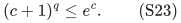

Indeed, c-q log(c+1) is increasing for c>=q^2. At c=q^2 it
equals q[q-log(q^2+1)], which is nonnegative: the function
x-log(x^2+1) is increasing for x>=1 and is positive at x=1.
Since epsilon<=1/2, monotonicity of Gamma gives

<!-- math-display: 562862424a026fdf2e8de849
e^c\le4^c\le\Gamma(1/\epsilon)^c.
 \tag{S24}
-->
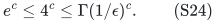

Thus this branch fits the same target runtime. Its iterator stores
only q binary counters, even if c is numerically enormous. All
tests and output counts have polynomial bit length. This branch
uses polynomial workspace independent of the numerical value of c.

Sections 5--7 together give a deterministic compressed gap routine
with time Gamma(1/epsilon)^c poly(H) and polynomial space on all
inputs. The restriction epsilon<=1/2 makes the simple large-corank
comparison (S24) available.

## 8. Reconstructing every original job and bounding the load

Let x be the returned integer large base, with x<=s and b*x in
P(f_T). Extend b*x to an integer base y of f_T on the full
physical machine set. Its singleton bounds imply y<=C*1, so

<!-- math-display: 85030a8248aa93cda7f68195
w=C\mathbf1-y
 \tag{S25}
-->
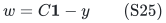

is a nonnegative integer base of G. Since G(P)=F(P), it is also
a base of F.

**Lemma 1 (binary workload decomposition).** If
<code class="math">w\in B(F)\cap\mathbb Z^P</code>, where <code class="math">F=\sum_jm_jf_j</code> and the positive
integers <code class="math">m_j</code> are binary encoded, then in polynomial oracle time one
can find integral <code class="math">z_j\in B(m_jf_j)</code> with <code class="math">\sum_jz_j=w</code>.

**Proof.** On the explicit pair ground <code class="math">E=P\times J</code>, use the two
integral ranks
<!-- math-display: 95276311653de0e49c96c566
\mathcal A(S)=\sum_jm_jf_j(S_j),\qquad
 \mathcal B(S)=\sum_{p:S\cap(\{p\}\times J)\ne\varnothing}w_p.
 \tag{S25a}
-->
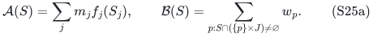
For <code class="math">R=\bigcap_jS_j</code>, one has
<!-- math-display: 213b7936740731bb05c0f9c6
\mathcal B(E\setminus S)=w(P)-w(R),\qquad
 \mathcal A(S)\ge F(R)\ge w(R).
-->
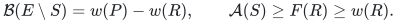
The integral polymatroid-intersection min-max theorem therefore gives
a common integer vector of total <code class="math">w(P)=F(P)</code>. The typewise caps and
the per-machine caps each sum to this total, so every one is attained:
its components satisfy <code class="math">z_j(P)=m_jf_j(P)</code> and
<code class="math">\sum_jz_j(p)=w_p</code>. This proves the lemma. The pair ground has
<code class="math">q&#124;J&#124;</code> coordinates; no multiplier is expanded into copies.
<code class="math">\square</code>

Divide <code class="math">z_j</code> by <code class="math">m_j</code>. This gives fractional original bases
with per-machine smaller workload exactly <code class="math">\Delta w_p</code>.
Apply the [per-machine upper-prefix rounding lemma](../many-size-scheduling/proof.md#2-the-per-machine-form-of-the-public-rounding-lemma):
it preserves every original type total and increases each smaller
load by at most <code class="math">u</code>. The proof constructs one chain polymatroid
for every machine and intersects their direct sum with the original
type product on its full-total face. Thus it does not round types
independently. The largest-size base <code class="math">x</code> is retained and decomposed
among its original equal-sized types without changing machine loads.

At each machine p, the resulting total load is at most

<!-- math-display: fa2731beed6f91be6702b71c
\begin{split}
 a x_p+\Delta w_p+u
    &=T+a x_p-\Delta y_p+u\\
    &\le T+(a-b\Delta)x_p+u\\
    &=T+\epsilon a x_p+u\\
    &\le(1+\epsilon)T+u.
 \end{split}
 \tag{S26}
-->
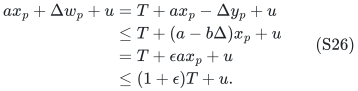

The last step uses x_p<=s_p(T)<=floor(T/a), so a*x_p<=T.
There may be many largest units on this machine. The estimate
does not replace x_p by one or assume a small-target interval.

Every target failure is genuine original infeasibility: the large
box can lose rank, the smaller workload cap can lose rank, or the
compressed gap routine can reject the per-slot promise. Every
success supplies an actual integer schedule satisfying (S26).
No success is asserted to certify feasibility at T itself.

## 9. A monotone budget cap and a one-sided minimization search

The function N(T) is nondecreasing in T. On the original g-grid
between zero and V, compute the largest target T_cap satisfying

<!-- math-display: 6568f5713b4bb9df17f5ffcc
N(T_{\rm cap})\le h+k.
 \tag{S27}
-->
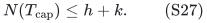

Binary search for this endpoint uses only the integer formula (S2)
and has polynomial bit complexity. Zero satisfies this predicate,
so the endpoint always exists. Every target below it also meets
the budget. This step treats (S27) as a resource budget, not as
an original-feasibility test.

Compute a public additive schedule of makespan at most OPT+a and
save it as fallback. If T_cap=0, or if the full target routine
fails at T_cap, return this fallback. Otherwise save the successful
schedule there. Maintain lower target zero, genuinely infeasible
because h>0, and this successful upper target. At each midpoint,
failure moves the lower target and success moves the upper target
with its actual schedule.

All target calls stay below T_cap, so every nontrivial core has
0<=c<=k. Failures are genuine infeasibility conclusions. When the
two grid endpoints become adjacent, the failed lower endpoint
is strictly below OPT, so the successful upper endpoint is at
most OPT. Its saved schedule satisfies (S6). Return the better
actual schedule of this candidate and the fallback.

This minimization search does not assume monotone success. It
only uses the implication FAILURE => T<OPT. It also never treats
an over-budget target as infeasible; such targets are outside the
chosen search interval.

Under (S5), OPT is within the budget prefix, so T_cap>=OPT.
An original optimal schedule is feasible at that larger target.
Sections 3--7 therefore guarantee success at T_cap. This proves
that the strong search is entered whenever the theorem's budget
condition holds. It can also succeed without that condition, in
which case the same strong bound is obtained by the successful
search path. Failure at T_cap leaves the fallback guarantee intact.

## 10. Total runtime, binary bounds and consequences

The searches for T_cap and for the final target use polynomially
many trials in log(V/g+1). Slot counts s_p, their sum N, and the
surplus c have polynomial binary length even when their numerical
values are huge. Every large-box rank query uses physical-ground
submodular minimization. Every f_T query uses the small capped-rank
formula on the same physical ground, with polynomial oracle cost.
Nesting these paid routines preserves polynomial cost per node.

Every core call has time at most Gamma(1/epsilon)^k poly(H).
The hybrid small/large-corank implementation proves polynomial
space in both regimes. Base extension, sum decomposition, and
per-machine rounding are polynomial-space, binary-capacity
operations. This proves (S4) and the stated space guarantee.

If u<=epsilon OPT, the strong bound becomes
(1+2epsilon)OPT. More explicitly, for rational 0<eta<=1, taking
epsilon=eta/2 gives factor 1+eta under

<!-- math-display: 4d044b02e5571c8bd9a68d1a
u\le(\eta/2)\mathrm{OPT},
                 \qquad c_{\rm slot}(\mathrm{OPT})\le k,
 \tag{S28}
-->
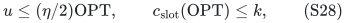

with time Gamma(2/eta)^k poly(H), at most
(2e/eta)^k poly(H). This is an explicit small-unit consequence;
no unconditional approximation scheme for arbitrary sizes is
inferred by deleting the additive term.

When OPT<2a, each nonzero slot capacity is one, so the slot surplus
reduces to the number of nonloop large-job positions minus h.
For larger optima, the same theorem allows multiple slots and
multiple large units per machine. The earlier exact three-halves
two-size theorem uses an integer smaller-count reconstruction
that avoids an additive u; its unconditional factor is a distinct
result and is not replaced by (S6).

## 11. Public comparison and proof dependencies

Bamas, Lindermayr, Megow, Rohwedder and Schloeter,
[arXiv:2307.08453v1, Theorem 23](https://arxiv.org/html/2307.08453v1),
give the public largest-job additive rounding used for the fallback,
and hence a factor-two schedule for arbitrary sizes in this
polymatroid model. Their two-value result has a narrower size
assumption and is not the general-size baseline. The public
rounding statement and its per-machine proof were checked directly
in the preceding source and workload audits.

The contribution established here is the compressed slot-surplus
algorithm and its binary-space analysis, combined with an explicit
budgeted target search. The guarantee retains both its parameter
condition and its additive smaller-unit loss. The proof does not
use an expanded large-job list, an assumed polynomial dependence on
the numerical slot count, or the ordered-layer allocation theorem.

The theorem is a conditional parameterized guarantee with a complete compressed implementation and polynomial binary workspace. The source of the additive rounding primitive is credited above; no publication-priority claim is made.

**Attribution:** Yilin Liu and GPT-6 Astra Pro.
