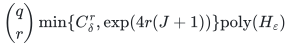
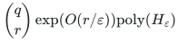

# An approximation scheme for arbitrary-value allocation

**Guarantee**

Returns an actual selected basis and an integer allocation of utility at least <code class="math">(1-\varepsilon)\mathrm{OPT}</code> under the exact combined setup and assignment budget.

**Objective and output**

Maximize minimum player-specific utility; detect whether any selected basis is affordable even at zero utility.

**Randomness**

Deterministic profile and basis enumeration with paid exact rank, submodular-minimization, LP and intersection primitives.

**Time**

Put <code class="math">\delta=\varepsilon/3</code>, <code class="math">J=\lfloor1/\delta\rfloor</code>, <code class="math">K=\lceil1/\delta\rceil</code>, <code class="math">L=\left\lceil(1-\delta)/\delta^2\right\rceil</code>, and <code class="math">C_\delta=\binom{L+K}{K}</code>. Time is

<!-- math-display: e9ede6a0724f2a2292ed888c
\binom{q}{r}\min\{C_\delta^r,\exp(4r(J+1))\}\mathrm{poly}(H_\varepsilon)
-->

Hence

<!-- math-display: ea221737035e25693956aef6
\binom{q}{r}\exp(O(r/\varepsilon))\mathrm{poly}(H_\varepsilon)
-->

**Space**

Polynomial in the complete binary input and paid oracle workspace; numerical resource multiplicities are not expanded into individual units. Space includes the full rational accuracy encoding.

**Parameters**

<code class="math">q</code> is the nonloop player count; <code class="math">r</code> is the selected matroid rank; <code class="math">0&lt;\varepsilon\le1</code> is rational; <code class="math">H_\varepsilon=H+\mathrm{size}(\varepsilon)</code>. <code class="math">H</code> includes the explicit ground, all rational and integer encodings, and paid rank, submodular-minimization, LP, intersection, and decomposition work.

**Model and representation**

Arbitrary nonnegative player-type values, integral recipient polymatroids, an actual original player basis, nonnegative setup and assignment costs, eligibility masks, and one shared scalar budget. Unused resources are allowed.

**Lower-bound scope**

No lower bound is claimed for this algorithm.

**Review status**

The [verification note](verify/README.md) records the proof scope, executable evidence and remaining conditions. No proof-assistant verification or external peer review is claimed.

**Source**

[Manuscript and proof](proof.md), with [dependencies and verification sources](sources.md).

**Attribution.** Yilin Liu · GPT-6 Astra Pro
