# Arbitrary-value allocation with setup fees: an exact-budget approximation scheme

Big-value count profiles give a deterministic approximation scheme for
the full optional-player allocation model: an arbitrary original player
matroid, arbitrary player-dependent values, arbitrary integral recipient
polymatroids, nonnegative setup fees, and one shared exact setup and
assignment budget. Resource units may be left unused.

For 0<epsilon<=1 the returned minimum utility is at least
(1-epsilon)OPT. The time is 2^(O(q/epsilon)) times polynomial work,
and space is polynomial in the full binary input and accuracy
encoding. More precisely, time is binom(q,r)*exp(O(r/epsilon))
times polynomial work, where r is the original player rank.

The rounding refinement is that big-bin count equalities make
all big-value boundary prefixes integral. Their contribution to
lower-prefix rounding loss is zero. Only the small-value part loses
up to delta times the target, even when an original value greatly
exceeds the target.

## 1. Original model and accuracy encoding

Let M have rank r>=1 on q nonloop players P. The output selects
an actual M-basis B. Resource type j has a normalized monotone
integral submodular recipient rank f_j. Its allocated integer vector
x_j belongs to P(f_j); unused units are allowed. Every pair has
nonnegative rational value v_(p,j) and assignment cost a_(p,j).
Player p has nonnegative rational setup fee sigma_p. The one budget is

<!-- math-display: 57b28410c5bf04e26cd48924
\sum_{p\in B}\sigma_p+\sum_{p\in B,j}a_{p,j}x_j(p)\le C,\qquad C\ge0.
 \tag{PA1}
-->
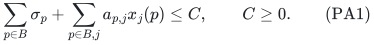

Counts outside B are zero. OPT is the maximum minimum original
utility over the selected basis. Original player loops can be removed.
Zero-valued assignments can be discarded: they give no utility and
dropping them preserves resource feasibility and nonnegative cost.
An additional pair eligibility mask is allowed.

H includes the original binary input, explicit player-type coordinates
and paid polynomial matroid, rank, SFM, LP and intersection work. Put

<!-- math-display: 27c34482dc42cc797be3653f
H_\epsilon=H+\mathrm{size}(\epsilon),
 \tag{PA2}
-->
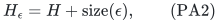

including the full rational numerator and denominator. Near-one
accuracy rationals can have long encodings despite small log(1/epsilon).

First find a minimum-setup M-basis. If its fee exceeds C, no original
solution is feasible even at zero utility. Otherwise retain it with
zero counts as an initial legal solution. Rank zero is handled
separately with the chosen empty-set objective convention.

## 2. The theorem and state parameters

For rational 0<epsilon<=1 define

<!-- math-display: 52f17b2fcfad9e6b1052326b
\delta=\epsilon/3,\qquad J=\lfloor1/\delta\rfloor,\qquad
 K=\lceil1/\delta\rceil,\qquad
 b_\delta=\left\lceil\frac{1-\delta}{\delta^2}\right\rceil.
 \tag{PA3}
-->
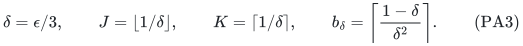

Here J>=3 and K<=J+1. Write

<!-- math-display: 1aad7a00db631682f9483d42
C_\delta=\binom{b_\delta+K}{K}.
 \tag{PA4}
-->
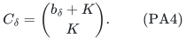

**Theorem PA.** On every feasible original instance a deterministic
algorithm returns a genuine M-basis and integer allocation satisfying
PA1 exactly, of value at least (1-epsilon)OPT. Its time obeys both

<!-- math-display: 42a67f6a2b191e8ac8c16d5a
\binom qr C_\delta^r\mathrm{poly}(H_\epsilon),
 \qquad
 \binom qr\exp(4r(J+1))\mathrm{poly}(H_\epsilon).
 \tag{PA5}
-->
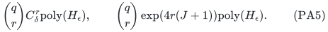

Consequently the time is

<!-- math-display: bfa9c511f66183747d512982
2^{O(q+r/\epsilon)}\mathrm{poly}(H_\epsilon)
       \ \le\ 2^{O(q/\epsilon)}\mathrm{poly}(H_\epsilon).
 \tag{PA6}
-->
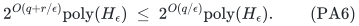

Space is polynomial in H_epsilon. Neither 1/epsilon nor any resource
multiplicity is expanded into unary coordinates. The actual selected
basis is fixed before each profile LP and its rounding. Its setup
fee is then constant; no dummy selection reduction is needed.

## 3. Target capping and occupied bins

Fix a rational T>0 and one actual M-basis B with sigma(B)<=C.
Set outside assignments to zero and cap each remaining positive value:

<!-- math-display: 071a4d3e25d828b2ef844ffc
w_{p,j}=\min\{v_{p,j},T\}.
 \tag{PA7}
-->
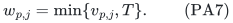

Actual output utility is evaluated at v, which is at least w.
Capping preserves full **integer** target feasibility: if no assigned
unit reaches T, values are unchanged; otherwise one capped unit
already supplies T. This is not an equivalence for arbitrary
fractional full-target witnesses.

A pair is small when w_(p,j)<=delta*T. Big normalized values lie in
(delta,1], partitioned into

<!-- math-display: ac5d80e923a0db0f0770c7d5
(\lambda_i,\mu_i],\qquad
 \lambda_i=\delta+i\delta^2,\qquad
 \mu_i=\min\{1,\delta+(i+1)\delta^2\},
       \quad 0\le i<b_\delta.
 \tag{PA8}
-->
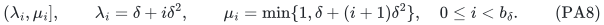

Each interval has width at most delta^2. The index of a big normalized
value t is ceil((t-delta)/delta^2)-1. Equality at an internal endpoint
belongs to the preceding bin; equality at delta is small, and capped
value T belongs to the last bin.

Construct only bins containing an actual eligible positive-value
coordinate at that selected player. Absent bins have count zero.
There are at most the explicit number of input coordinates. Bin
indices and rational endpoints have polynomial encoding in H_epsilon
and the target bits; no b_delta-sized table is constructed.

## 4. Profiles and the fixed-basis LP

At each selected player enumerate nonnegative integer big-bin counts
satisfying

<!-- math-display: 38c287e502e5e37c611f393c
\sum_i h_{p,i}\le K,\qquad L_p=\sum_i\lambda_i h_{p,i}\le2,
 \tag{PA9}
-->
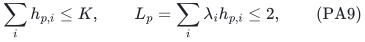

and define

<!-- math-display: 8233559a334dbf4f5480b8d9
U_p=\sum_i\mu_i h_{p,i}.
 \tag{PA10}
-->
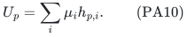

For one basis and its profiles, solve one joint resource LP:

- Keep every original resource constraint, masking outside players
  and forbidden pairs to zero.
- Require the fractional total in each big bin to equal h_(p,i).
- Require true small utility at p to be at least max{0,1-U_p}*T.
- Require actual assignment cost at most C-sigma(B).

Small true and capped values agree. A type remains governed by its
single original recipient polymatroid across all selected players
and all value bins. No resource is copied.

This is a bounded rational LP in the original coordinates. Resource
separation uses polynomial submodular minimization; the bin equalities,
utility rows and cost row are explicit. All rank values, feasible
witnesses and rows have polynomial bit length in the stated exact
oracle model. Empty LPs are skipped.

The big-bin equalities are requirements on the fractional LP.
The output need not preserve each bin count separately: the lower-
prefix construction below preserves sufficient total utility.

## 5. Full integer targets supply enumerated profiles

Take any original integer full-T allocation on a basis B*. Capping
by PA7 leaves every selected player's utility at least T.

At a player, if the assigned big units have total capped utility
at least T, retain an initial segment of any ordering that first
reaches T. Its total is less than 2T: the sum before the last unit
is below T, and the last capped unit is at most T. Drop all other
big units and all small units.

If the big total is below T, retain every big unit and the original
small units. In either case the retained big count is at most
K=ceil(1/delta). Before a first-reaching last unit, the number of
units is strictly below 1/delta because each is larger than delta*T.
For a total below T, the entire count is strictly below 1/delta.

The retained big utility is below 2T, so L_p<=2. If it reaches T,
then U_p>=1 and the LP requires no small utility. Otherwise U_p*T
is at least the actual big utility, so the original small allocation
supplies at least max{0,1-U_p}T.

All retained counts decrease coordinatewise from the original
allocation. Resource feasibility and its nonnegative cost are
preserved, and the selected setup fee is unchanged. Thus one
enumerated joint profile LP is feasible. This is an existence
argument, not an enumeration of individual unit identities.

## 6. Cost-preserving lower-prefix rounding

For a fixed selected basis and a fractional independent resource
allocation x, choose a nonincreasing value ordering of type
coordinates at every player. There is an integer independent
allocation x' of no greater actual assignment cost such that for
every prefix S in each chosen ordering,

<!-- math-display: e9e62c95d7b03253aa6a57d2
x'(S)\ge\lfloor x(S)\rfloor.
 \tag{PA11}
-->
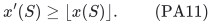

The following complete construction justifies the simultaneous
all-prefix and cost guarantees.

For one masked resource f on its current player ground, let n=f(P).
Add one free disposal coordinate 0 and define

<!-- math-display: 02d3d4b91d42bebb2a8abc67
\widehat f(S)=
 \begin{cases}
 f(S),&0\notin S,\\
 n,&0\in S.
 \end{cases}
 \tag{PA12}
-->
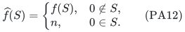

This is a normalized monotone integral submodular rank. Extend x
to a base by assigning n-x(P) to disposal, at cost zero. This base
completion is auxiliary: original unused units stay optional.

Set d_e=widehat f({e}), and on the augmented coordinate ground E put

<!-- math-display: ac7fbea7fd42092b2c39e358
g(S)=\widehat f(E\setminus S)+d(S)-n.
 \tag{PA13}
-->
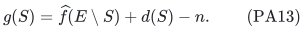

This rank is normalized, integral and submodular. It is monotone
because every marginal of widehat f is at most the corresponding
singleton capacity. Complementation gives

<!-- math-display: 1e091751a0f8adb3f94b09b6
y=d-\widehat x\in B(g)
                  \quad\Longleftrightarrow\quad
              \widehat x\in B(\widehat f).
 \tag{PA14}
-->
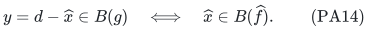

Indeed, the inequalities on E minus S and the base total give the
complemented upper inequality on S. Singleton bounds ensure
nonnegative complemented coordinates. No unit copies are introduced.

Take the direct sum of complement resource polymatroids. At each
selected player's chosen order impose ceiling-prefix caps ceil(y(S)).
These form an integral chain polymatroid; for nonempty coordinate
set A its rank is the largest prefix cap at an index belonging to A.
Give each disposal coordinate the cap d_e. The direct sum of the
player chains and disposal caps is integral and contains y.

Intersect this side with the complement resource direct sum and
require total sum_j g_j(E_j). This is a nonempty integral full-total
face: the original y supplies it, and each resource bounds its own
total. Thus every complement resource remains a base.

Maximize actual assignment coefficients a applied to y on this
face, with disposal coefficient zero. Complementing an integer
maximizer back gives an original cost no larger than the fractional
cost, because the constant sum_e a_e d_e is unchanged. Discarding
only the zero-cost disposal coordinates leaves independent integer
vectors in the original resources.

For every player prefix S, d(S) is an integer, so

<!-- math-display: c159a231d9de5688d57d19cf
x'(S)\ge d(S)-\lceil y(S)\rceil
           =\lfloor d(S)-y(S)\rfloor=\lfloor x(S)\rfloor.
 \tag{PA15}
-->
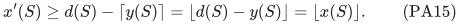

All prefixes and the exact cost comparison hold at the same point.
All counts and ranks remain binary, and only one auxiliary disposal
coordinate is added per resource.

## 7. Big-bin boundaries eliminate the large-value loss

Give each big coordinate in bin i surrogate value lambda_i*T.
Keep each small coordinate's true value. Order big bins by decreasing
surrogate value, followed by the small coordinates in decreasing
value order. This is nonincreasing because big surrogate values
are at least delta*T and small values are at most delta*T. Put
big coordinates first when these values tie.

Apply PA11 to this order. For surrogate values s_1>=...>=s_m>=0,
s_(m+1)=0, and fractional prefix totals X_h, summation by parts gives

<!-- math-display: 9baaf18e1fc60339f60fbbce
\sum_i s_i x'_i
 \ge \sum_i s_i x_i-
       \sum_h(s_h-s_{h+1})(X_h-\lfloor X_h\rfloor).
 \tag{PA16}
-->
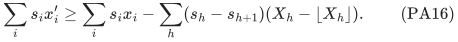

Within a big bin the value difference is zero. At the end of a big
bin, the fractional prefix is a sum of the integer specified big-bin
counts, so its fractional-part error is zero. This also includes
the boundary from the last big bin to the small group.

Only prefixes inside the small group contribute possible loss.
Their value differences telescope to at most the largest small
value, which is at most delta*T. Therefore

<!-- math-display: 9b4947e65e7baf908be668de
\text{integer surrogate utility at }p
       \ge\text{fractional surrogate utility at }p-\delta T.
 \tag{PA17}
-->
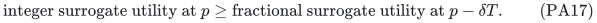

This is not a generic loss bounded by the largest original value.
The exact fractional big-bin counts remove those boundary errors.
No big-bin count equality is required at the rounded integer point.
When there is no big group this is the usual small-value bound;
when there is no small group the loss in this calculation is zero.

## 8. Utility and the shared exact budget

The fractional big surrogate utility is L_p*T. Including the small
LP requirement, fractional surrogate utility is at least

<!-- math-display: b2b3f0644ac678cdebc19be1
[L_p+\max\{0,1-U_p\}]T.
-->
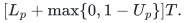

Since each bin has width at most delta^2,

<!-- math-display: 12fbf1c579e507c1e0599226
0\le U_p-L_p
                      \le\delta^2\sum_i h_{p,i}\le K\delta^2.
 \tag{PA18}
-->
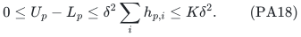

If U_p<=1, the preceding surrogate expression is 1-(U_p-L_p).
If U_p>1 it is L_p=U_p-(U_p-L_p), even larger than 1-K*delta^2.
Thus PA17 and actual values at least the surrogate imply

<!-- math-display: 30344c169fc9535135b7491c
\mathrm{utility}_{x'}(p)
                  \ge(1-\delta-K\delta^2)T\ge(1-\epsilon)T.
 \tag{PA19}
-->
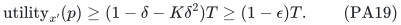

For the last inequality,
delta+K*delta^2<=2delta+delta^2
=2epsilon/3+epsilon^2/9<=7epsilon/9<=epsilon.

The lower-prefix construction does not increase actual assignment
cost. The same original basis B is retained, hence the same setup
fee is charged. The original combined budget PA1 remains exact.
Real resource vectors are independent, as required; auxiliary base
completions never make unused original units mandatory.

## 9. Exact enumeration and polynomial binary workspace

At each selected player, order its occupied bins. Maintain partial
count s and lower sum L. At the next lower endpoint lambda>0
enumerate exactly

<!-- math-display: d702a857cc0a059c7b513c15
0\le h\le
       \min\left\{K-s,\left\lfloor\frac{2-L}{\lambda}\right\rfloor\right\}.
 \tag{PA20}
-->
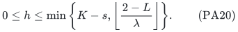

Each generated partial state satisfies PA9 and can be completed
by assigning zero to all later bins. Every valid profile occurs
exactly once. At a fixed depth, distinct partial vectors have
distinct all-zero completions. If there are m occupied bins and
p valid profiles, the enumeration tree has at most (m+1)p nodes.
This gives polynomial delay and polynomial work per profile.

Counters and bin indices are binary. Rational endpoints and
partial sums have polynomial bit length in H_epsilon and the
target encoding. The number of stored positions is the original
number of occupied input bins, not b_delta or K.

Stream all r-subsets of P; reject nonbases and unaffordable setup
fees in polynomial time. For each remaining B stream the Cartesian
product of its player profile families. Only the current basis,
current profiles, one LP/intersection workspace and the best original
solution need be retained. This gives polynomial space even for a
binary-small epsilon.

## 10. Complete state-count and all-input bounds

Ignoring L<=2 and including all b_delta bins gives C_delta possible
nonnegative vectors of count sum at most K.

For the stronger bound, lambda_i>=delta^2(J+i). Every valid profile
therefore maps to an integer partition of total at most
n=floor(2/delta^2)<2(J+1)^2, by using h_i parts of size J+i.
Distinct indices are distinct positive part sizes, so this map
is injective; absent bins only restrict the partitions.

For any t>0, the number of integer partitions of total at most n
is bounded by

<!-- math-display: 5c17c6628ee461c3266ea170
\exp(tn)\prod_{j\ge1}(1-\exp(-tj))^{-1}.
-->
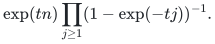

The logarithm of the product is
sum_(ell>=1)1/[ell(exp(t*ell)-1)]<=2/t, using exp(y)-1>=y and
sum_(ell>=1)ell^(-2)<=2. Taking t=1/(J+1) bounds the count by
exp(4(J+1)). This is an analysis-only convergent series argument;
no partition table or infinite product is computed.

The pruned enumerator PA20 is essential. Merely enumerating all
unweighted count vectors and checking L afterward would not prove
the stronger bound.

There are at most binom(q,r) selected-set candidates, each with at
most C_delta^r profiles and also at most exp(4r(J+1)) profiles.
Basis tests, failed setup gates, failed LPs, successful roundings
and all traversal work are included in PA5. These bounds hold
on all targets, including those without a full integer witness.

## 11. One-sided optimization on the original value grid

The affordable minimum-setup basis with zero counts initializes
nominal target zero. If no eligible positive values remain, it is
already optimal.

Otherwise choose a positive rational g dividing all positive
original pair values. A common denominator and integer gcd give
polynomial bit length. All integer utility totals and OPT are
multiples of g. A finite upper bound is

<!-- math-display: 76ef9d0c7b556ebd0384bc9b
V=\sum_j f_j(P)\max_p v_{p,j},
-->
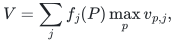

which also lies on the grid. Start lower target L=0 and external
upper target U=V+g. At each positive grid midpoint T, run all
actual-basis profile attempts.

If every LP fails, Section 5 excludes any original integer
allocation of utility at least T, hence T>OPT; lower U to T.
On success, save its actual original solution and raise L to T.
Its minimum utility is at least (1-epsilon)T.

The upper target remains strictly greater than OPT, without any
monotonicity assumption on weak successes. At adjacency U=L+g,
grid integrality gives L>=OPT. The saved output therefore has
value at least (1-epsilon)OPT. The legal zero initializer covers
the case where the final lower target is zero.

There are polynomially many target calls in the original binary
encoding. Target-dependent capping and binning are recomputed
exactly in polynomial space. No additional approximation loss
is introduced by optimization.

The [native exact-table realization](reference-realization.md) implements this
original-basis/profile, scalar-cost recovery and original-grid optimization
pipeline. Its streamed active-system LP factor is explicit and separate
from the paid polynomial primitive costs in PA5.

## 12. Scope and related results

This is the full original optional-player model with one shared
setup and assignment budget. It needs no common intrinsic values,
bounded price diversity, small heavy support or bounded corank.
The selected basis is arbitrary in M. Original resources are only
restricted by legitimate zero masks.

The former near-two theorems remain useful for their strictly
sub-two whole-ground bases. The present scheme has a larger
accuracy-dependent exponential base and gives arbitrary accuracy.
The inherited full-oracle below-two barriers do not contradict it:
their hidden-set query bounds are at most exponential in q, and
no corank-only algorithm is asserted.

The PA5 time curve is internally derived. Ordinary allocation,
configuration methods, fixed-player approximation and matroid
rounding have substantial public antecedents. No first-public-
scheme or fastest-known claim is made without a separate exhaustive
literature audit. No formal-verification claim is attached.

---

**Attribution:** icekylinx and GPT-6 Astra Pro.
