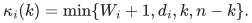

# Exact Boolean linear optimization compiler

Fixing the number of selected original variables permits a row's most frequent coefficient to be subtracted from every entry. The resulting short intervals can use fewer Boolean slack variables, including for dense rows with only a few exceptional coefficients.

[Proof](proof.md) · [Complete normalized compiler](manuscripts/cardinality-and-modal-interval-compilation.md) · [Sources](sources.md)

**Guarantee**

Exact feasibility, indexed witness recovery, and linear or explicitly listed polynomial-size lexicographic optimization for any number of signed equalities and signed interval rows.

**Objective and output**

An original Boolean vector satisfying every row and attaining the requested optimum, or an infeasibility answer.

**Randomness**

Deterministic compiler with a supplied deterministic indexed-witness Subset Sum backend; optimization, witnesses and the stated space transfer retain that same backend contract.

**Time**

<code class="math">T_B\le\mathrm{poly}(L)P_{\rm card}2^{\alpha n+\bar Q-(1-\alpha)B}</code> for any integer <code class="math">0\le B\le\bar Q</code>. The polynomial factor includes processing the <code class="math">n+1</code> cardinality layers sequentially. A prescribed cardinality can use its sharper individual parameters.

**Space**

If the same backend uses <code class="math">\mathrm{poly}(L')2^{\sigma v}</code> writable space on <code class="math">v</code> items, the compiler uses <code class="math">\mathrm{poly}(L)2^{\sigma(n+B)}</code>. A time-only backend supplies no additional space guarantee.

**Parameters**

For row <code class="math">i</code>, let <code class="math">W_i=u_i-\ell_i</code> and <code class="math">d_i=n-\max_c&#124;\{j:a_{ij}=c\}&#124;</code>, the number of coefficients different from a most frequent value. Nonconstant rows have <code class="math">\bar\kappa_i=\min\{W_i+1,d_i,\lfloor n/2\rfloor\}</code> and <code class="math">\bar Q=\sum_i\lceil\log_2\bar\kappa_i\rceil</code>. Constant rows are checked directly in each layer and contribute zero. The actual catalogue product is <code class="math">P_{\rm card}=\max(1,\max_k\prod_i p_i(k))</code>, with <code class="math">p_i(k)\le2\lceil\log_2(W_i+1)\rceil+1</code>.

**Model and representation**

Original variables and rows are explicitly inventoried, including with sparse coefficient encoding, so their counts are at most the complete binary input length <code class="math">L</code>. Coefficients, endpoints, equalities and objectives are signed binary integers. The equality <code class="math">\sum_jx_j=k</code> always concerns original variables only and is retained in every packed instance. Empty intervals, constant rows, <code class="math">n\le1</code>, and the layers <code class="math">k=0,n</code> are handled directly.

**Lower-bound scope**

No universal dominance or literature-priority claim is made. The earlier signed interval mechanism is credited in the source map. The local support, cardinality and coefficient-normalization refinements have complete proofs and introduce no further external theorem.

**Review status**

**Ready for review.** The complete signed interval-disjunction proof, bounded-slack interpolation, signed radix packing and indexed-witness/optimization transfer. Each halving emits at most two intervals with at most the original row support many integer values; all exceptional and binary-input cases are explicit. Includes fixed-cardinality layers, modal-coefficient subtraction, signed parity overlap and the resulting smaller slack budget, with exact preservation of the original cardinality and optimization witnesses.

**Dependencies and scope.** The Subset Sum backend is supplied with its stated indexed-witness time contract; a space bound requires that same backend. The compiler and finite checks do not establish the backend circuit or continuous-contact proofs. The cardinality refinement counts the original explicitly listed variables. Its strongest slack bound does not assert a universal improvement to every disjunction-product parameter.

The [verification note](verify/README.md) identifies executable coverage. This status does not claim external peer review or proof-assistant verification.

**Source**

[Complete proof](proof.md), [normalized compiler](manuscripts/cardinality-and-modal-interval-compilation.md), and [source map](sources.md).

## What the refinement changes

For a prescribed cardinality <code class="math">k</code>, each nonconstant row's cap is

<!-- math-display: b50b44af5cee0742407e6117
\kappa_i(k)=\min\{W_i+1,d_i,k,n-k\}.
-->

Since <code class="math">d_i</code> is at most the row's original support, the slack parameter never increases. For eight variables, a dense row <code class="math">(M,M,M,M,M,M,M,M+3)</code> with <code class="math">&#124;M&#124;\ge4</code> has normalized support one. At <code class="math">k=3</code> and interval <code class="math">[3M+1,3M+4]</code>, its slack contribution falls from two bits to zero. Other rows retain their own contributions.

The [unconditioned compiler](manuscripts/boolean-linear-optimization-compiler.md) remains available without a cardinality guard, using <code class="math">\kappa_i=\min\{W_i+1,s_i\}</code> for original support <code class="math">s_i</code>. A fixed number of interval rows still transfers the selected backend up to polynomial factors. The fast-time and low-space repository instantiations are separate algorithmic points; their guarantees are not combined.

**Attribution:** Yilin Liu and GPT-6 Astra Pro.
