# A support-sensitive interval compiler for exact Boolean linear optimization

**Abstract.** We give an exact signed interval-rounding rule whose emitted intervals contain at most as many integers as the original row has nonzero coefficients. Retaining these intervals and encoding a chosen number of slack bits gives a support-sensitive time–space interpolation for exact Boolean linear optimization. The general shrinking-interval method is due to Nederlof, van Leeuwen, and van der Zwaan, with the signed extension recorded by Bansal, Garg, Nederlof, and Vyas. The sharper boundary rule and the compiler accounting below are self-contained. The compiler is independent of its Subset Sum backend; numerical instantiations retain the separately stated backend hypotheses.

## 1. Target problem and result

We are given Boolean variables `x in {0,1}^n`, any number of signed binary integer equalities, and `m` signed binary interval constraints

<!-- math-display: 46298af300e805c655225e78
\ell_i\le a_i^T x\le u_i\qquad(i\in[m]).
-->
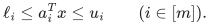

One-sided inequalities are included: intersect their permitted range with the elementary attainable range `[sum_j min(a_ij,0), sum_j max(a_ij,0)]`. An empty interval certifies infeasibility. A zero row is checked and removed. Let `L` denote the full binary input length, including all equalities, interval endpoints, and an optional signed linear objective. Let

<!-- math-display: 0a9e4f1a0b88e4e684e080f4
s_i=|\mathrm{supp}(a_i)|,\quad W_i=u_i-\ell_i,\quad
\kappa_i=\min\{W_i+1,s_i\},\quad
q_i=\lceil\log_2\kappa_i\rceil,\quad Q=\sum_i q_i.
\tag{B1}
-->
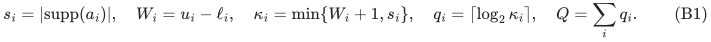

Exact rows (`W_i=0`) can instead be put in the equality system and contribute no parameter. A deterministic preprocessing step constructs, for every interval row, a catalogue of `p_i` short interval tests. It has

<!-- math-display: fd191269225fd5bbfd5eeddc
p_i\le 2\lceil\log_2(W_i+1)\rceil+1,
\tag{B2}
-->
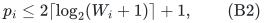

and `p_i=1` if `W_i+1<=s_i`. Every catalogue interval contains at most `kappa_i` integers. The catalogue is exact for every Boolean assignment, not only for some feasible witness.

Assume a deterministic Subset Sum backend returns an indexed witness in time

<!-- math-display: 4059c274ec749c71e0adff08
\mathrm{poly}(L')2^{\alpha N}
-->
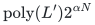

on `N` signed binary integers. If it also has writable-bit space `poly(L') 2^{sigma N}`, the same space interface can be used below. The polynomial degrees are constants belonging to the backend.

**Compiler theorem.** For every integer `B` with `0<=B<=Q`, exact feasibility and indexed witness recovery for the above Boolean linear system can be performed in

<!-- math-display: 00acd09647bee78737365a30
T_B\le\mathrm{poly}(L)\left(\prod_{i=1}^m p_i\right)
2^{\alpha n+Q-(1-\alpha)B},
\tag{B3}
-->
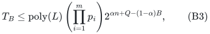

and, when the space interface is available,

<!-- math-display: 60b17a7c9eabd49880c795b0
S_B\le\mathrm{poly}(L)2^{\sigma(n+B)}.
\tag{B4}
-->
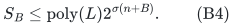

The equalities do not enter `Q` or the product of catalogue sizes. Their encoding lengths are charged to `L`. The same bounds, up to the displayed polynomial factor, permit exact signed linear optimization, and lexicographic optimization for any explicitly listed polynomial-size sequence of linear objectives.

The endpoints are useful:

<!-- math-display: 48675e0a3d81cc790a74df21
T_0\le\mathrm{poly}(L)\Bigl(\prod p_i\Bigr)2^{\alpha n+Q},
\qquad
T_Q\le\mathrm{poly}(L)\Bigl(\prod p_i\Bigr)2^{\alpha(n+Q)}.
\tag{B5}
-->
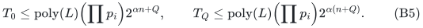

The first endpoint retains the `n`-item backend space exponent. The second replaces the boundary-target enumeration exponent `Q` by `alpha Q`. This comparison is between two proved compiler bounds; it is not a claim that this algorithm dominates every existing Boolean-IP algorithm in every parameter regime.

## 2. Signed short-interval catalogue

Fix a nonzero row <code class="math">a</code>, its original support size <code class="math">s\ge1</code>, and an integer interval <code class="math">[\ell,u]</code> of nonnegative width. Keep this same support bound throughout the procedure: floor-halving cannot turn an initially zero coefficient into a nonzero one. Before this procedure, a zero row is discarded if <code class="math">\ell\le0\le u</code>, and otherwise certifies infeasibility. Thus no logarithm or stopping rule below is applied with <code class="math">s=0</code>.

If <code class="math">u-\ell+1\le s</code>, emit <code class="math">(a,[\ell,u])</code> and stop. Otherwise set

<!-- math-display: 3688c9fb31d39b3fdd42de2b
a'_j=\lfloor a_j/2\rfloor,\qquad
t=|\{j:a_j\text{ is odd}\}|,\qquad
\ell'=\lceil\ell/2\rceil,\qquad
u'=\lfloor(u-t)/2\rfloor.
\tag{B6}
-->
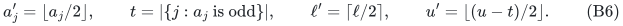

Emit the following two tests, omitting each one whose lower endpoint exceeds its upper endpoint:

<!-- math-display: 30ccb2d4b2fa049c9c6f990f
\left(a,\left[\ell,\min\{u,2\ell'+t-2\}\right]\right),
\qquad
\left(a,\left[\max\{\ell,2u'+2\},u\right]\right).
-->
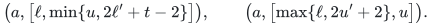

If <code class="math">\ell'\le u'</code>, continue with the single recursive instance <code class="math">(a',[\ell',u'])</code>; otherwise stop after these boundary tests. There are no endpoint-peeling calls and no recursive branching.

**Exactness for signed coefficients.** For every integer coefficient, including a negative one, <code class="math">a_j-2\lfloor a_j/2\rfloor</code> belongs to <code class="math">\{0,1\}</code> and equals its oddness indicator. Hence every Boolean assignment satisfies

<!-- math-display: 6b1b0e08c79c0fabf2f4ffcb
a^\top x=2(a')^\top x+\delta(x),\qquad
\delta(x)=\sum_{j:a_j\text{ is odd}}x_j,\qquad
0\le\delta(x)\le t\le s.
\tag{B7}
-->
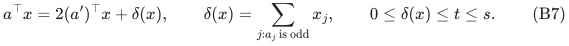

Write <code class="math">z=(a')^\top x</code>. If <code class="math">\ell'\le z\le u'</code>, then
<code class="math">a^\top x\ge2\ell'\ge\ell</code> and
<code class="math">a^\top x\le2u'+t\le u</code>. Each boundary interval was clipped to the parent interval, so every acceptance in any emitted or recursive test is parent-feasible.

Conversely, suppose <code class="math">\ell\le a^\top x\le u</code>. If <code class="math">z&lt;\ell'</code>, integrality and (B7) give <code class="math">a^\top x\le2\ell'+t-2</code>, placing the sum in the lower boundary test. If <code class="math">z&gt;u'</code>, then <code class="math">a^\top x\ge2u'+2</code>, placing it in the upper boundary test. In the remaining case the recursive interval accepts. This reasoning also covers <code class="math">\ell'&gt;u'</code>: every integer <code class="math">z</code> then lies below <code class="math">\ell'</code> or above <code class="math">u'</code>, so the two boundaries cover all parent-feasible assignments even though no recursive instance exists. For example, <code class="math">a=(1,1)</code> and <code class="math">[\ell,u]=[1,3]</code> have <code class="math">t=2</code>, <code class="math">\ell'=1</code>, <code class="math">u'=0</code>, and emit <code class="math">[1,2]</code> and <code class="math">[2,3]</code>. The overlap is intentional. Induction proves an exact disjunction assignment by assignment.

**Boundary size.** Before clipping, the lower interval contains
<code class="math">2\ell'-\ell+t-1</code> integers when this number is positive. Since <code class="math">2\ell'-\ell\in\{0,1\}</code>, this number is at most <code class="math">t</code>. Write <code class="math">u-t=2u'+\varepsilon</code> with <code class="math">\varepsilon\in\{0,1\}</code>. The upper interval similarly contains <code class="math">u-2u'-1=t+\varepsilon-1\le t</code> integers when nonempty. Thus both emitted intervals contain at most <code class="math">t\le s</code> integers. If <code class="math">t=0</code>, both boundaries are empty and the operation is an exact halving with no boundary tests. A terminal interval contains at most <code class="math">s</code> integers by the stopping rule. If the initial interval already has at most <code class="math">s</code> integers, the single emitted test has exactly <code class="math">W+1</code> values. This proves the cap <code class="math">\kappa=\min\{W+1,s\}</code>.

**Catalogue size and binary complexity.** Whenever the recursive interval is nonempty, its width satisfies

<!-- math-display: 398612155fe963b15a1b12c7
u'-\ell'\le\left\lfloor\frac{u-\ell-t}{2}\right\rfloor
\le\left\lfloor\frac{u-\ell}{2}\right\rfloor.
-->
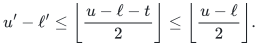

The procedure therefore performs at most <code class="math">\lceil\log_2(W+1)\rceil</code> halving steps, emits at most two intervals at each step, and emits at most one final interval. This proves (B2), including width zero. The recursion depth is logarithmic in the numerical width and hence polynomial in the binary input length; it does not iterate through the interval's integer values. This remains true when a negative coefficient such as <code class="math">-1</code> stops changing under floor-halving. Coefficient magnitudes do not increase, and the endpoint updates use a halving and an additive term at most <code class="math">s</code>, so their bit lengths remain polynomially bounded. An iterative implementation keeps only the current row and the polynomial-size output catalogue.

Overlapping or repeated tests are allowed. They contribute their actual multiplicities to <code class="math">p_i</code> and never create a second recursive call. The subsequent compiler enumerates the product of these finite catalogues, so overlap adds no factor beyond the displayed branch bound. Neither this step nor the bounded-slack encoding is claimed to preserve solution counts.

The general floor-rounding method is inherited from the cited literature. The explicit rule above replaces the previous project bound <code class="math">5s+1</code> by <code class="math">s</code> and its four emissions per scale by two, with a full local proof. No claim of literature priority or universal optimality is made. For a moderately wide interval it can still be useful to keep the initial interval as one test and use its actual width in the compiler; the smaller cap and the smaller catalogue are different resources.

## 3. A tunable number of slack bits

Choose integers `0<=b_i<=q_i` whose sum is `B`. Every `B` from zero to `Q` is possible by filling these intervals in any fixed order. Split each short interval from row `i` into consecutive chunks, each with at most `2^{b_i}` integer values. There are at most

<!-- math-display: 4b93b76f5d7abec80ead87ba
\left\lceil\frac{\kappa_i}{2^{b_i}}\right\rceil
\le 2^{q_i-b_i}
\tag{B8}
-->
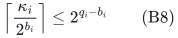

chunks per catalogue member. An empty interval is never emitted.

Consider one chunk `[l,u]`, let `w=u-l`, and put `q=ceil(log_2(w+1))<=b_i`. If `w=0`, the constraint is already an equality. Otherwise the `q` nonnegative integers

<!-- math-display: 9803a3d833b301622a3c35fa
1,2,4,\ldots,2^{q-2},\quad w-(2^{q-1}-1)
\tag{B9}
-->
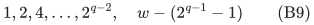

have subset sums exactly the integers `0,...,w`. For `q=1` the initial sequence is empty. To see the claim, the powers of two cover `[0,2^{q-1}-1]`; the final integer is between one and `2^{q-1}`, so adding it covers an overlapping or adjacent interval ending at `w`.

Consequently `(a')^T x in [l,u]` is equivalent to one equality

<!-- math-display: ac180f71b5fca7ff7c482312
(a')^T x+\sum_{t=1}^{q}v_t z_t=u,
\qquad z_t\in\{0,1\},
\tag{B10}
-->
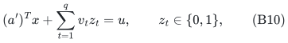

using at most `b_i` additional Boolean variables. Slack variables belonging to different rows are distinct. We need only decision and witness recovery; the possible nonuniqueness of the representation in (B9) causes no problem. It would matter for counting, which is not claimed.

For each tuple of catalogue members and chunks, we now have a pure signed equality system on at most `n+B` Boolean variables. The number of tuples is bounded by

<!-- math-display: 9b7354e148eec6d91f630b39
\left(\prod_i p_i\right)2^{Q-B}.
\tag{B11}
-->
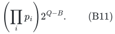

The catalogue construction, chunk enumeration, and radix-packing arithmetic take `poly(L)` bit operations per tuple. Every packed instance has `N<=n+B` variables and an encoding length `L'=poly(L)`; the polynomial factor in the backend contract is therefore absorbed into the displayed `poly(L)`. Only one packed instance and one backend workspace are live at a time. The branch count in (B11), rather than an unlisted factor depending on the number of original rows, is the complete exponential accounting.

## 4. Packing signed equalities without adding variables

Suppose a branch has equalities `c_j^T y=t_j`, for `j=0,...,r-1`, and `y` has `N<=n+B` Boolean coordinates. Set

<!-- math-display: 3d2bb19ae86c3ee6b9a26878
R=1+\max_j\left\{\sum_k|c_{jk}|+|t_j|\right\}.
\tag{B12}
-->
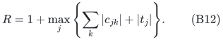

If the maximum is zero, the system is trivial and can be handled directly. Otherwise `R>=2`. Give Boolean coordinate `k` the signed integer weight

<!-- math-display: 8ddc09aa94fe2d88566b7206
A_k=\sum_{j=0}^{r-1}c_{jk}R^j,
\qquad T=\sum_{j=0}^{r-1}t_jR^j.
\tag{B13}
-->
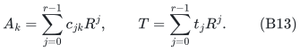

Then `sum_k A_k y_k=T` if and only if all original branch equalities hold. For the reverse implication set `d_j=c_j^T y-t_j`. We have `|d_j|<R`. Reducing `sum_j d_j R^j=0` modulo `R` forces `d_0=0`; division by `R` and induction force every `d_j=0`. This argument explicitly permits signed entries and targets; no unjustified nonnegative-digit/no-carry assumption is used.

The new bit length is polynomial in `L`: there are at most polynomially many rows and variables, the coefficients have polynomial bit length, and each packed integer has `O(r log R)` bits. The branch introduces no further Boolean variables. Solve branches sequentially, returning the first witness restricted to its original `n` coordinates. If desired, evaluate the original binary rows and objective once on that witness.

Multiplying (B11) by the backend time on `n+B` items proves (B3). Only one branch and one backend execution are stored at a time, giving (B4). The catalogues, loop indices, radix arithmetic, and witness use polynomial additional writable bits.

## 5. Optimization does not change the exponential parameters

For a signed linear objective `c^T x`, its exact attainable values lie in

<!-- math-display: b7a727e9af0b72360ea51fa3
\left[\sum_j\min(c_j,0),\sum_j\max(c_j,0)\right].
-->
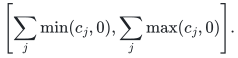

Binary search for the optimum takes polynomially many feasibility queries in the full binary input length. During each query, convert the objective threshold to exact targets using the ordinary signed interval reduction, enumerating its short target intervals completely. This one extra row costs only a polynomial factor in `L`; it contributes no slack variables. Thus the `B` and `Q` in (B3)–(B4) can remain those of the original interval constraints.

After obtaining an optimum, retrieve a witness for that optimum. For lexicographic optimization, add the optimum of each completed objective as an exact equality and proceed to the next objective. Exact rows do not add to `Q`. This gives an optimal indexed Boolean vector, not merely an optimum value. Listing the entire Pareto frontier is not claimed.

## 6. Instantiating the repository's deterministic algorithms

The repository records two separate Subset Sum contracts at the pinned commit:

<!-- math-display: 8992bcb362d0f98226cc4e4e
E=\frac{149809813343531}{301754962128739}
\simeq0.4964618056,
\quad
E_S=\frac{18261635770550353}{10^{17}}
=0.18261635770550353.
\tag{B14}
-->
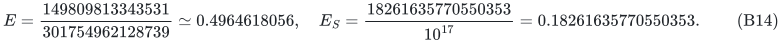

The fast contract has time `poly(L') 2^{E N}` with exact indexed witness recovery; it does not claim a separate space exponent. Substituting `alpha=E` into (B3), and choosing `B=Q`, yields

<!-- math-display: 1926b81e866eac3d99a5bc73
\mathrm{poly}(L)\left(\prod_i p_i\right)2^{E(n+Q)}.
\tag{B15}
-->
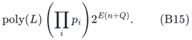

**Refined time-only instantiation.** If the exact circuit interfaces and the full-domain contact bounds in [the refined Subset Sum theorem](../../subset-sum-fast-deterministic/proof.md), Section 4, are supplied, one may instead substitute

<!-- math-display: 917f1b003368d3fc4128d396
\alpha=E_{\rm new}=\frac{158153814247997}{318927986919134}\simeq0.495891927754
-->
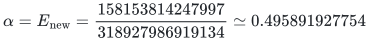

throughout (B3), (B5), and (B15). In particular, full slack gives `poly(L) (product_i p_i) 2^{E_new(n+Q)}` and a fixed number of interval rows gives `poly(L) 2^{E_new n}`. This instantiation inherits those analytic contact premises; checking its scalar exponent does not certify them. It remains a time-only point and supplies no new space exponent.

The separate low-space contract has time `poly(L') 2^{N/2}` and writable bits `poly(L') 2^{E_S N}`. It gives the full family

<!-- math-display: 01d83e0a30efda7a4951d2ac
T_B\le\mathrm{poly}(L)\left(\prod_i p_i\right)2^{n/2+Q-B/2},
\qquad
S_B\le\mathrm{poly}(L)2^{E_S(n+B)}.
\tag{B16}
-->
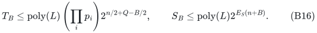

Do not combine the fast time exponent and low-space exponent into one unproved simultaneous guarantee.

For every fixed number of interval constraints, `Q=O(log n)` and the product of catalogue sizes is polynomial in `L`. Hence exact signed 0–1 knapsack, fixed-dimensional 0–1 knapsack, and Boolean linear optimization with any number of exact equalities and a fixed number of interval constraints inherit:

* the separate time bound `poly(L) 2^{E n}`;
* the separate time/space point `poly(L) 2^{n/2}` and `poly(L) 2^{E_S n}` writable bits.

These fixed-dimensional corollaries are consequences of the known reduction and the repository backend. They should not be presented as a newly discovered Knapsack-to-Subset-Sum equivalence. Their potential significance is that a new backend theorem automatically moves several standard general-problem frontiers.

For growing `m`, the displayed parameterized compiler is the additional useful content. For example, when all `s_i<=n`, all coefficient/endpoint bit lengths are `n^{c+o(1)}`, and `m=(gamma+o(1))n/log_2 n`, the full-slack bound (B15) is at most

<!-- math-display: 05ee27888782b68c5db17b01
2^{[E+(E+c)\gamma+o(1)]n}\mathrm{poly}(L),
\tag{B17}
-->
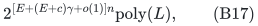

whereas the same backend with complete boundary-target enumeration gives the upper bound with coefficient `1+c` in place of `E+c`. A sub-half exponent is therefore certified whenever `gamma<(1/2-E)/(E+c)` by this compiler. This is a parameter-range statement for the explicitly compared construction; it is not a universal optimality claim for all growing-dimension Boolean IP algorithms.

## 7. Backend dependence and comparison

The compiler proof is independent of the repository's new Subset Sum claims. It can already be instantiated with classical deterministic backends, including ordinary meet-in-the-middle and Schroeppel–Shamir. The repository's smaller exponents are conditional only on accepting its existing backend theorem contracts, whose full proofs and internal reviews reside in that repository.

The relevant source comparisons are:

1. Nederlof–van Leeuwen–van der Zwaan, *Reducing a Target Interval to a Few Exact Queries*, MFCS 2012, Theorem 1, Theorem 2, Corollary 1: the interval mechanism and Knapsack/Subset-Sum time–space transfer are already known.
2. Bansal–Garg–Nederlof–Vyas, *Faster Space-Efficient Algorithms for Subset Sum, k-Sum and Related Problems*, 2017 manuscript, Lemma 4.4 and proof of Corollary 2: signed rows and a growing number of Boolean-IP inequalities are already handled by exact-target enumeration. This is the explicit compiler baseline for (B3).
3. The OpenAI public catalogue, entry 138, states a randomized `2^{0.49n}` word-RAM algorithm for polynomial-bit Subset Sum inputs. The deterministic `E` instantiation is not numerically faster than `0.49`; determinism, binary-input scope, and the separate space interface must stay visible. The catalogue was checked, not the entire linked manuscript in this manuscript.

The locally proved refinements are the support-sized boundary rule in Section 2 and the short-boundary/slack interpolation (B3); literature priority is not inferred from this comparison. Higher-dimensional dominance algorithms, coefficient-bounded dynamic programming, and structural integer-programming algorithms can be preferable in some regimes; no dominance over all of them is asserted. The compiler has no dynamic-graph backend dependency.

## Sources and pinned dependencies

* Jesper Nederlof, Erik Jan van Leeuwen, Ruben van der Zwaan. [Reducing a Target Interval to a Few Exact Queries](https://arxiv.org/pdf/1208.4225). MFCS 2012. Theorems 1–2 and Corollary 1.
* Nikhil Bansal, Shashwat Garg, Jesper Nederlof, Nikhil Vyas. [Faster Space-Efficient Algorithms for Subset Sum, k-Sum and Related Problems](https://arxiv.org/pdf/1612.02788). Version 2, June 2017. Lemma 4.4 and Corollary 2 proof.
* [Pinned repository fast-time contract](https://github.com/icekylinx/algorithm-frontier/blob/37b31138bf102a83d9efb2cbe44437eec45ae3c2/problems/subset-sum-fast-deterministic/README.md).
* [Pinned repository low-space contract](https://github.com/icekylinx/algorithm-frontier/blob/37b31138bf102a83d9efb2cbe44437eec45ae3c2/problems/subset-sum-low-space-deterministic/README.md).
* [Pinned fast-time full proof](https://github.com/icekylinx/algorithm-frontier/blob/37b31138bf102a83d9efb2cbe44437eec45ae3c2/problems/subset-sum-fast-deterministic/proof.md).
* [Pinned low-space theorem](https://github.com/icekylinx/algorithm-frontier/blob/37b31138bf102a83d9efb2cbe44437eec45ae3c2/problems/subset-sum-low-space-deterministic/proof.md).
* [OpenAI public catalogue](https://github.com/openai/math/blob/main/overview.tex), entry 138, accessed 2026-10-25.

