# Cardinality and coefficient normalization for exact Boolean interval compilation

**Status: ready for review.** The complete local proof and independent finite checks have been reviewed within this project. This companion
keeps the previously proved support-sized interval lemma available as a separate
unconditioned result. The present compiler is deterministic whenever its supplied
Subset Sum backend is deterministic. No literature-priority claim is made.

[Problem statement](../README.md) · [Unconditioned interval lemma](boolean-linear-optimization-compiler.md) · [Verification](../verify/README.md)

## 1. Problem, backend and guarantee

The original variables are <code class="math">x\in\{0,1\}^n</code>. The input consists of signed integer
interval rows <code class="math">\ell_i\le a_i^\top x\le u_i</code>, any number of signed exact linear
equalities, and optionally a linear objective or an explicitly listed
polynomial-size sequence of lexicographic linear objectives. All coefficients,
endpoints and objective data are binary encoded. Let <code class="math">L</code> be the full input
length. Original variables and rows are explicitly inventoried, so both <code class="math">n</code> and
the number of rows are at most <code class="math">L</code>. A sparse coefficient representation still
includes this original-variable inventory. Empty intervals are immediately
infeasible. Original zero rows are
checked directly before logarithms or support parameters are formed.

Assume a supplied indexed-witness Subset Sum algorithm runs on <code class="math">v</code> indexed items
in time <code class="math">\mathrm{poly}(L')2^{\alpha v}</code> and, when a space guarantee is
specified, space <code class="math">\mathrm{poly}(L')2^{\sigma v}</code>. Here <code class="math">L'</code> is the complete
binary length of the reduced instance, and <code class="math">\alpha,\sigma\ge0</code>. The compiler
requires the backend to return an indexed witness, directly or through a
witness-recovery reduction included in its stated bound. It does not deduce a
small-space guarantee from a decision-time theorem.

For each interval row, choose an integer coefficient value <code class="math">c_i</code> of maximum
multiplicity among its <code class="math">n</code> entries and define its **modal defect**

<!-- math-display: 8b33bf3cdf3b5255b4116f9c
d_i=n-\max_c|\{j:a_{ij}=c\}|.
-->
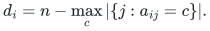

A fixed tie rule, such as least absolute value and then least signed value,
makes this deterministic. The empty and one-variable input cases are solved by
direct evaluation, so the definitions below concern <code class="math">n\ge2</code>.

If <code class="math">d_i=0</code>, the row is constant. In cardinality layer <code class="math">k</code> it is exactly the
scalar test <code class="math">\ell_i\le c_i k\le u_i</code>. It contributes no slack variables and can
reject that layer immediately. Let <code class="math">I</code> be the set of nonconstant interval rows.
For <code class="math">i\in I</code>, put <code class="math">W_i=u_i-\ell_i</code> and

<!-- math-display: 44ad9d0e637f069548f4402e
\bar\kappa_i=\min\{W_i+1,d_i,\lfloor n/2\rfloor\},\qquad
\bar q_i=\lceil\log_2\bar\kappa_i\rceil,\qquad
\bar Q=\sum_{i\in I}\bar q_i.
-->
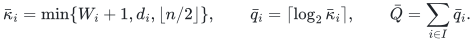

For each nontrivial cardinality <code class="math">1\le k\le n-1</code>, the construction below produces
<code class="math">p_i(k)</code> short tests for row <code class="math">i</code>, each with at most

<!-- math-display: cdadb08141d39b8d686f32ce
\kappa_i(k)=\min\{W_i+1,d_i,k,n-k\}
-->
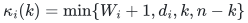

integer values. The catalogue bound is

<!-- math-display: 619eb8ad2e20568de2cb6036
p_i(k)\le2\lceil\log_2(W_i+1)\rceil+1.
-->
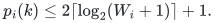

It has a single member when <code class="math">W_i+1\le\min\{d_i,k,n-k\}</code>. Define

<!-- math-display: e4acf39e89431269aeed3827
P_{\rm card}=\max\left(\{1\}\cup
 \left\{\prod_{i\in I}p_i(k):1\le k\le n-1\right\}\right).
-->
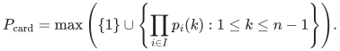

The explicit one covers an empty family of nontrivial calls and absorbs direct
input processing. Constant-row rejections may simply skip their layers. The
maximum uses the actual product in each layer; a one-test shortcut valid in one
layer cannot be reused without checking another layer.

**Theorem 1 (normalized cardinality compiler).** For every integer budget
<code class="math">0\le B\le\bar Q</code>, the original feasibility and indexed-witness problem can be
solved in time

<!-- math-display: 84791bbe0fe0dd67f49b894b
\mathrm{poly}(L)P_{\rm card}
2^{\alpha n+\bar Q-(1-\alpha)B}
-->
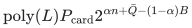

and, when supplied by the backend, space

<!-- math-display: 32d61a9fa9147c8928ec0c8f
\mathrm{poly}(L)2^{\sigma(n+B)}.
-->
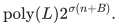

The same bounds support the stated optimization tasks, up to the polynomial
factor. Exact original equalities contribute no slack parameter. Constant rows
are treated as above, and <code class="math">n\le1</code> and <code class="math">k\in\{0,n\}</code> require direct evaluation
only. For a prescribed nontrivial cardinality, use that layer's sharper
<code class="math">Q_k=\sum_{i\in I}\lceil\log_2\kappa_i(k)\rceil</code> and catalogue product instead.

If the modal normalization is omitted, every statement remains true with the
original row support <code class="math">s_i</code> in place of <code class="math">d_i</code>. Thus cardinality conditioning alone
already improves the unconditioned cap <code class="math">\min\{W_i+1,s_i\}</code> to
<code class="math">\min\{W_i+1,s_i,k,n-k\}</code>. Since <code class="math">d_i\le s_i</code>, modal normalization never worsens
this uniform slack parameter. Catalogue sizes are actual construction data;
no universal comparison between the finer catalogue products is asserted.

## 2. Exact coefficient normalization within a layer

Fix a cardinality <code class="math">k</code> and preserve the exact equality

<!-- math-display: 4d5ec619d273e59d44bb0932
\sum_{j=1}^n x_j=k.
-->
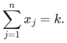

For row <code class="math">i</code>, put <code class="math">b_{ij}=a_{ij}-c_i</code>. On this layer,

<!-- math-display: f5c79ca6a731bf0465596a63
a_i^\top x=b_i^\top x+c_i k.
-->
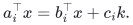

Consequently the original row is equivalent to

<!-- math-display: e0d35ab07a466f8988e317b2
\ell_i-c_i k\le b_i^\top x\le u_i-c_i k.
-->
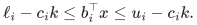

The new width is still <code class="math">W_i</code>, and the support of <code class="math">b_i</code> is exactly <code class="math">d_i</code>.
There were at least <code class="math">n-s_i</code> zero entries in the original row, so its most
frequent coefficient occurs at least that often, proving <code class="math">d_i\le s_i</code>.
If <code class="math">d_i=0</code>, the displayed interval is a direct test of zero and no interval
compiler is called for that row.

The transformation is valid for positive, zero or negative <code class="math">c_i</code>. It changes
neither the original variables nor any original exact equality. It is applied
only to interval tests under the retained cardinality guard. If the largest
coefficient magnitude is <code class="math">A</code>, centered coefficients have magnitude at most
<code class="math">2A</code>, and shifted endpoints have magnitude at most
<code class="math">\max\{&#124;\ell_i&#124;,&#124;u_i&#124;\}+nA</code>. Their bit lengths are polynomial in <code class="math">L</code>; no
pseudopolynomial dependence on <code class="math">c_i k</code> is introduced.

## 3. A signed interval disjunction with a cardinality guard

Consider a current signed row <code class="math">a</code> on <code class="math">n</code> original Boolean variables and an
interval <code class="math">[\ell,u]</code>; set <code class="math">W=u-\ell</code>. Suppose its original support at the start
of this row's recursion is <code class="math">d\ge1</code>, and <code class="math">1\le k\le n-1</code>. For each coordinate,
write

<!-- math-display: a86fa0d29c4f27803f63dbe6
a_j=2a'_j+\epsilon_j,\qquad
 a'_j=\lfloor a_j/2\rfloor,\qquad \epsilon_j\in\{0,1\}.
-->
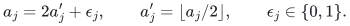

This convention also holds for negative odd integers. Let <code class="math">O</code> be the odd-index
set and <code class="math">t=&#124;O&#124;</code>. On the retained cardinality layer,

<!-- math-display: 014478eec8dddc5a707696be
a^\top x=2(a')^\top x+\delta(x),\qquad
\delta(x)=\sum_{j\in O}x_j\in[A,D],
-->
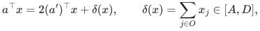

where

<!-- math-display: 80d51ddcc99e4f3be7cfdbb2
A=\max\{0,k+t-n\},\qquad D=\min\{k,t\},\qquad
 e=D-A=\min\{k,n-k,t,n-t\}.
-->
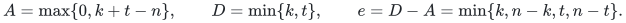

The lower bound counts the selected coordinates that cannot fit outside <code class="math">O</code>;
the upper bound counts those that can lie inside <code class="math">O</code>. Splitting into <code class="math">k+t\le n</code>
and <code class="math">k+t&gt;n</code>, then comparing <code class="math">k</code> with <code class="math">t</code>, proves the width identity. In
particular <code class="math">e\le\min\{d,k,n-k\}</code>, since integer flooring preserves every
original zero coefficient and hence <code class="math">t\le d</code> at every recursion depth.

Set

<!-- math-display: 4406ee8cfe3925e9db6254c7
\ell'=\left\lceil\frac{\ell-A}{2}\right\rceil,\qquad
 u'=\left\lfloor\frac{u-D}{2}\right\rfloor.
-->
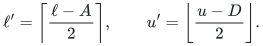

The row is equivalent, on the cardinality layer, to the disjunction of the
rounded-row test <code class="math">\ell'\le(a')^\top x\le u'</code> and the following nonempty boundary
tests on the current row:

<!-- math-display: 81d66f0af5c9fe0ce40e325d
[\ell,\min\{u,2\ell'+D-2\}],\qquad
[\max\{\ell,2u'+A+2\},u].
-->
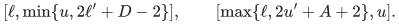

Indeed the rounded-row test implies a value between <code class="math">2\ell'+A\ge\ell</code> and
<code class="math">2u'+D\le u</code>. If an original feasible assignment has rounded value below
<code class="math">\ell'</code>, its original value is at most <code class="math">2\ell'+D-2</code>. If its rounded value is
above <code class="math">u'</code>, its original value is at least <code class="math">2u'+A+2</code>. These cases also cover an
empty child interval <code class="math">\ell'&gt;u'</code>. Boundary tests are clipped to <code class="math">[\ell,u]</code>,
so each reverse implication is immediate.

The lower boundary has at most

<!-- math-display: 25b911f911926fd733677d16
2\ell'-(\ell-A)+e-1\le e
-->
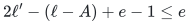

integers, and the upper has at most

<!-- math-display: 35726e8efdbc4a6ba23e8fe2
(u-D)-2u'+e-1\le e.
-->
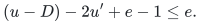

If <code class="math">e=0</code>, both are empty, including the case <code class="math">t=0</code>. Any nonempty child has
endpoint difference at most <code class="math">\lfloor(W-e)/2\rfloor\le\lfloor W/2\rfloor</code>.

Stop when an interval contains at most <code class="math">c=\min\{d,k,n-k\}\ge1</code> values.
Each rounding step emits at most two short boundary tests and recurses on only
one child. Overlapping boundary tests are retained literally; their overlap
creates no further recursion. Thus the catalogue contains at most
<code class="math">2\lceil\log_2(W+1)\rceil+1</code> tests, each with at most
<code class="math">\min\{W+1,d,k,n-k\}</code> integer values. If the initial interval already fits
that cap, its catalogue consists of that interval alone.

The recursion has at most <code class="math">\lceil\log_2(W+1)\rceil</code> rounds before a single-value
interval is reached. Each updated endpoint has absolute value at most one half
the previous endpoint magnitude plus <code class="math">n/2+1</code>, while flooring never increases
coefficient bit length. All catalogues are therefore computed in polynomial
binary time and space, even when coefficients and endpoints have large
magnitude. Reversed input intervals and zero rows were handled directly.

## 4. Slack variables and exact equation packing

Fix a nontrivial layer, choose one catalogue interval from each nonconstant
row, and put <code class="math">q_i=\lceil\log_2\kappa_i(k)\rceil</code>. Allocate integers
<code class="math">0\le b_i\le q_i</code> with total <code class="math">B_k</code>. Partition each selected short interval
into consecutive chunks of at most <code class="math">2^{b_i}</code> integer values. There are at most
<code class="math">2^{q_i-b_i}</code> chunks. Across all catalogue choices and chunks, the number of
branches is at most

<!-- math-display: 8528a1167c6ffd2574b0742b
\left(\prod_{i\in I}p_i(k)\right)2^{Q_k-B_k}.
-->
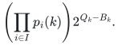

A chunk <code class="math">[a,a+w]</code> has <code class="math">0\le w\le2^{b_i}-1</code>. If <code class="math">w=0</code>, use its exact equality.
Otherwise let <code class="math">q=\lceil\log_2(w+1)\rceil\le b_i</code>. The <code class="math">q</code> positive integers

<!-- math-display: ea3f8367f7eff3b76c93ae6a
1,2,\ldots,2^{q-2},\quad w-(2^{q-1}-1)
-->
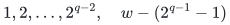

have subset sums exactly <code class="math">0,\ldots,w</code>; for <code class="math">q=1</code> the initial list is empty.
The initial powers cover <code class="math">[0,2^{q-1}-1]</code>. The final shift starts at an integer
between <code class="math">1</code> and <code class="math">2^{q-1}</code>, so its translated interval overlaps or abuts the
first and ends at <code class="math">w</code>. Add these coins as coefficients of distinct new Boolean
variables, and replace the chunk by the equality

<!-- math-display: a785fb7de31f0efb736f01ad
a_{\rm current}^{\top}x+\text{slack}=a+w.
-->
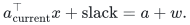

This gives an exact witness reduction, although different slack witnesses can
represent the same value. It uses at most <code class="math">b_i</code> new variables for the row and
at most <code class="math">n+B_k</code> variables overall. Original exact equalities and the cardinality
equality remain in the equation system with coefficient zero on every slack
variable. This is essential: the interval equivalences in Section 3 only hold
on that original-variable cardinality layer.

To pack all signed equalities <code class="math">v_r^\top z=t_r</code> into one exact Subset Sum
equation, choose

<!-- math-display: da03646325d9785011fb35b0
R=1+\max_r\left(|t_r|+\sum_j|v_{rj}|\right)
-->
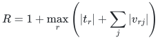

and use coefficients <code class="math">w_j=\sum_r v_{rj}R^r</code> and target <code class="math">T=\sum_r t_rR^r</code>.
Every residual <code class="math">v_r^\top z-t_r</code> has absolute value strictly below <code class="math">R</code>. If the
packed residual is zero, reducing modulo <code class="math">R</code> forces the lowest residual to be
zero, and division by <code class="math">R</code> repeats the argument for every row. The reverse
implication is immediate. Thus the packed equation is equivalent to every
branch equality, including the retained cardinality guard.

If the backend accepts only nonnegative item values, replace <code class="math">z_j</code> by
<code class="math">1-y_j</code> whenever <code class="math">w_j&lt;0</code>, make its coefficient <code class="math">&#124;w_j&#124;</code>, and replace the target
by <code class="math">T-\sum_{w_j&lt;0}w_j</code>. This is an indexed Boolean bijection. Zero coefficients
may be discarded with their bits fixed to zero; direct residual verification
then restores a valid witness. An out-of-range target is rejected directly.
The radix, packed coefficients and target have polynomial bit length because
there are polynomially many rows, each of polynomial bit length.

## 5. A uniform budget over all layers

For <code class="math">n\le1</code>, evaluate the at most two original assignments. Otherwise directly
evaluate the two assignments of cardinality zero and <code class="math">n</code>, and process the other
layers sequentially. Constant rows reject inconsistent layers before any
Subset Sum call. Original exact equalities are still checked in every branch.

For a chosen uniform <code class="math">0\le B\le\bar Q</code>, set

<!-- math-display: 438dde738c9ed872c5eb9991
B_k=\min\{B,Q_k\}.
-->
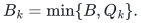

Any integer total between zero and <code class="math">Q_k=\sum_iq_i</code> can be distributed with
<code class="math">0\le b_i\le q_i</code>, for example by filling rows in order. We have

<!-- math-display: 2c0c9b6e99ddeb602dfa52d0
Q_k-B_k\le\bar Q-B,\qquad B_k\le B.
-->
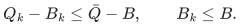

Therefore the total backend cost in one layer is at most

<!-- math-display: 538231f92556e20f5982e548
\mathrm{poly}(L)P_{\rm card}
 2^{Q_k-B_k+\alpha(n+B_k)}
\le
\mathrm{poly}(L)P_{\rm card}
 2^{\alpha n+\bar Q-(1-\alpha)B}.
-->
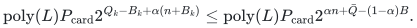

Both inequalities above, together with <code class="math">\alpha\ge0</code>, prove this even when
<code class="math">B&gt;Q_k</code> or <code class="math">\alpha&gt;1</code>. The reduced space is at most
<code class="math">\mathrm{poly}(L)2^{\sigma(n+B)}</code> for <code class="math">\sigma\ge0</code>. Polynomially many
cardinality layers add only a polynomial time factor, and sequential processing
reuses the same workspace. This proves Theorem 1 for feasibility and indexed
witnesses. The quantities <code class="math">p_i(k)</code> and their products can themselves be computed
in polynomial time and have polynomial bit length.

## 6. Objectives and a concrete improvement

For a linear objective threshold, append its signed interval row and apply the
same guarded normalization and interval disjunction. Enumerate every integer
target in each emitted short interval instead of assigning it slack bits. At
most <code class="math">O(n\log(W_{\rm obj}+2))</code> exact target tests are produced. This is a
polynomial factor and adds no Boolean variables or slack contribution to
<code class="math">\bar Q</code>. The objective still refers to the original variables: subtracting a
modal coefficient only shifts a layer's threshold by the known value <code class="math">c k</code>.
Threshold feasibility and witness values are thus interpreted in the original
objective, including when <code class="math">c&lt;0</code>.

Binary search over the signed objective range takes polynomially many threshold
queries. To optimize a listed lexicographic sequence, retain each attained value
as an exact original-variable equality before considering the next objective.
Directly evaluated extreme-cardinality assignments are compared by the same
original objective. This completes the optimization statement of Theorem 1.

For example, take eight original variables, an integer <code class="math">&#124;M&#124;\ge4</code>, and the dense row

<!-- math-display: bb9230af40bedf96532c0714
a=(M,M,M,M,M,M,M,M+3).
-->
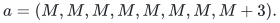

Its ordinary support is eight. On cardinality layer <code class="math">k=3</code>, coefficient
normalization changes it to <code class="math">(0,0,0,0,0,0,0,3)</code> and shifts its interval by
<code class="math">3M</code>. If the original interval is <code class="math">[3M+1,3M+4]</code>, the centered interval is
<code class="math">[1,4]</code>. The unnormalized cardinality cap is three and its row slack parameter
is <code class="math">\lceil\log_2 3\rceil=2</code>. The normalized support and cap are both one, so
this row's slack parameter becomes zero. The example works for either sign of
<code class="math">M</code>, including large binary values. Other rows keep their own contributions to
<code class="math">\bar Q</code>; this example does not assert that a general system has zero total
slack.

## 7. Independent finite checks

The [integrated checker](../verify/check_cardinality_compiler.py) compares the
compiled catalogue directly with the unmodified original Boolean rows. It also
checks the conditional disjunction on every generated rounding frame and on
additional raw parity fixtures for the version without modal normalization.
Negative common coefficients, constant rows, strict support reductions,
reversed intervals, zero/one-variable inputs, signed floor, empty children,
constant remainders and large binary shifts are explicit cases.

The completed suite covers 781 exhaustive coefficient rows and 255 additional
fixtures, plus 24 raw parity-layer fixtures: 126,629 layer intervals, 394,214
direct assignment comparisons and 418,103 local disjunction comparisons. It
includes 52,936 negative shifts, 2,308 constant-row cases, 18,598 constant
remainder frames and 11,319 empty child frames.

The integration suite enumerates every packed Boolean assignment and compares
the projected solution set with direct evaluation of the original system,
leaving original exact equalities unchanged. It covers 306 systems, 726
nontrivial layers, 846 budget profiles, 4,120 packed instances and 117,684 packed
assignments. There are 172 layers with a strict reduction in the total slack
parameter and 309 directly rejected constant-row cases.

A separate exact-integer check covers 468,325 rational exponent comparisons
for all <code class="math">0\le Q_k,B\le\bar Q\le64</code> and five nonnegative backend exponents,
including one above one. The checker refuses Python `-O`. It uses only the
standard library and elementary helpers from the existing unconditioned
interval checker. These finite checks supplement the proof; they do not run
or certify the supplied exponential-time Subset Sum backend.

**Attribution:** Yilin Liu and GPT-6 Astra Pro.
