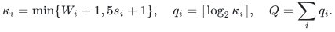
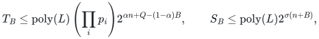
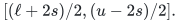
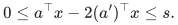
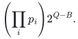
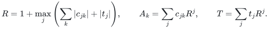

# Exact Boolean optimization by interval and slack compilation

## 1. Compiler theorem

The input has <code class="math">n</code> Boolean variables, signed binary integer equalities, and interval rows <code class="math">\ell_i\le a_i^\top x\le u_i</code>. Let <code class="math">L</code> be its binary length, <code class="math">s_i=&#124;\mathrm{supp}(a_i)&#124;</code>, and <code class="math">W_i=u_i-\ell_i</code>. Normalize one-sided rows against their attainable ranges and handle empty intervals and zero rows directly. Put
<!-- math-display: f4d5a4f898d7a3bf3b053128
\kappa_i=\min\{W_i+1,5s_i+1\},\quad q_i=\lceil\log_2\kappa_i\rceil,\quad Q=\sum_iq_i.
-->

Assume a deterministic Subset Sum backend returns indexed witnesses in time <code class="math">\mathrm{poly}(L')2^{\alpha N}</code>, and, if supplied, writable space <code class="math">\mathrm{poly}(L')2^{\sigma N}</code>. For any integer <code class="math">0\le B\le Q</code>, the compiler gives
<!-- math-display: d10cc014ca3dc9c461ad85d1
T_B\le\mathrm{poly}(L)\left(\prod_i p_i\right)
2^{\alpha n+Q-(1-\alpha)B},\qquad
S_B\le\mathrm{poly}(L)2^{\sigma(n+B)},
-->

where <code class="math">p_i\le4\lceil\log_2(W_i+1)\rceil+1</code>, and <code class="math">p_i=1</code> if <code class="math">W_i\le5s_i</code>. Exact equalities contribute no slack parameter. Feasibility, indexed witnesses, linear optimization, and explicitly listed polynomial-size lexicographic optimization are supported.

## 2. Signed interval lemma

For one row, stop when the interval width is at most <code class="math">5s</code>. Otherwise peel odd endpoints as singleton tests until both endpoints are even. Emit <code class="math">[\ell,\ell+3s]</code> and <code class="math">[u-2s,u]</code>, then recurse with <code class="math">a'_j=\lfloor a_j/2\rfloor</code> on
<!-- math-display: 875ddb8a62662bdd60586005
[(\ell+2s)/2,(u-2s)/2].
-->

For every Boolean assignment, even with signed coefficients,
<!-- math-display: 675acb38ae8293daf937a044
0\le a^\top x-2(a')^\top x\le s.
-->

This makes every recursive acceptance parent-feasible. A parent-feasible sum outside the two emitted boundaries has its rounded sum in the recursive interval. Induction proves exact disjunction assignment by assignment. At most two singleton endpoints and two boundary intervals occur per halving, proving the catalogue-size bound. Each emitted interval contains at most <code class="math">\kappa_i</code> integer values.

## 3. Slack and branch count

Choose <code class="math">0\le b_i\le q_i</code> summing to <code class="math">B</code>. Split each catalogue interval into chunks of at most <code class="math">2^{b_i}</code> values. There are at most <code class="math">2^{q_i-b_i}</code> chunks, so the number of branch tuples is at most
<!-- math-display: c0c667f51df16b6635ad4f06
\left(\prod_i p_i\right)2^{Q-B}.
-->

For a positive-width chunk <code class="math">[l,u]</code>, put <code class="math">w=u-l</code>, <code class="math">q=\lceil\log_2(w+1)\rceil\le b_i</code>. The <code class="math">q</code> weights
<!-- math-display: ea3f8367f7eff3b76c93ae6a
1,2,\ldots,2^{q-2},\quad w-(2^{q-1}-1)
-->

have subset sums exactly <code class="math">0,\ldots,w</code>. For <code class="math">q=1</code>, the initial list is empty. The powers cover the initial interval; the final shift overlaps or abuts it and ends at <code class="math">w</code>. Thus the chunk becomes one equality with at most <code class="math">b_i</code> Boolean slack variables. Different rows use different variables; width zero needs none. This is a witness reduction, not a parsimonious counting reduction.

## 4. Signed radix packing

For a branch with equations <code class="math">c_j^\top y=t_j</code> on <code class="math">N\le n+B</code> variables, use
<!-- math-display: c9e513a8905c5b3b78b246df
R=1+\max_j\left(\sum_k|c_{jk}|+|t_j|\right),\qquad
A_k=\sum_jc_{jk}R^j,\qquad T=\sum_jt_jR^j.
-->

Handle the all-zero system directly; otherwise <code class="math">R\ge2</code>. The packed equation <code class="math">\sum_kA_ky_k=T</code> is equivalent to all branch equations. Indeed <code class="math">d_j=c_j^\top y-t_j</code> satisfies <code class="math">&#124;d_j&#124;&lt;R</code>. Reducing <code class="math">\sum_jd_jR^j=0</code> modulo <code class="math">R</code> forces <code class="math">d_0=0</code>; divide and repeat. This proof permits signed digits.

The packed bit length is polynomial in <code class="math">L</code>. Multiplying the branch bound by the backend cost at <code class="math">n+B</code> proves the time formula. Branches run sequentially with one backend workspace, proving the space formula. A witness is restricted to its original <code class="math">n</code> coordinates.

## 5. Optimization and backend conditions

Binary search over the polynomial-bit objective range uses polynomially many feasibility queries. Completely enumerate the short-target catalogue for the one added threshold row; its cost is polynomial and it adds no slack variables. Fix an optimum as an exact equality before treating the next lexicographic objective.

For a fixed number of interval rows, <code class="math">Q=O(\log n)</code> and <code class="math">\prod_i p_i</code> is polynomial in <code class="math">L</code>, so the backend's separate time and space interfaces transfer up to polynomial factors. A time-only backend supplies no new simultaneous space bound. The refined numerical exponent additionally inherits its full-domain analytic contact premises; scalar exponent verification alone does not prove those premises.

## Complete proof

[Interval compiler, numerical instantiations, and primary source comparison](manuscripts/boolean-linear-optimization-compiler.md). Signed interval rounding is inherited from Nederlof–van Leeuwen–van der Zwaan and Bansal–Garg–Nederlof–Vyas; the theorem isolates the short-interval/slack interpolation.

**Attribution:** Yilin Liu and GPT-6 Astra Pro.
