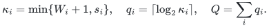
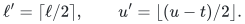
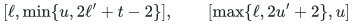
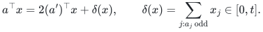

# Exact Boolean optimization by interval and slack compilation

## 1. Compiler theorem

The input has <code class="math">n</code> Boolean variables, signed binary integer equalities, and interval rows <code class="math">\ell_i\le a_i^\top x\le u_i</code>. Let <code class="math">L</code> be its binary length, <code class="math">s_i=&#124;\mathrm{supp}(a_i)&#124;</code>, and <code class="math">W_i=u_i-\ell_i</code>. Normalize one-sided rows against their attainable ranges and handle empty intervals and zero rows directly. Put
<!-- math-display: 972de2e59f303d81dcb6e4b2
\kappa_i=\min\{W_i+1,s_i\},\quad q_i=\lceil\log_2\kappa_i\rceil,\quad Q=\sum_iq_i.
-->

Assume a deterministic Subset Sum backend returns indexed witnesses in time <code class="math">\mathrm{poly}(L')2^{\alpha N}</code>, and, if supplied, writable space <code class="math">\mathrm{poly}(L')2^{\sigma N}</code>. For any integer <code class="math">0\le B\le Q</code>, the compiler gives
<!-- math-display: d10cc014ca3dc9c461ad85d1
T_B\le\mathrm{poly}(L)\left(\prod_i p_i\right)
2^{\alpha n+Q-(1-\alpha)B},\qquad
S_B\le\mathrm{poly}(L)2^{\sigma(n+B)},
-->

where <code class="math">p_i\le2\lceil\log_2(W_i+1)\rceil+1</code>, and <code class="math">p_i=1</code> if <code class="math">W_i+1\le s_i</code>. Exact equalities contribute no slack parameter. Feasibility, indexed witnesses, linear optimization, and explicitly listed polynomial-size lexicographic optimization are supported.

## 2. Signed interval lemma

For a nonzero row with original support <code class="math">s\ge1</code>, stop when the current interval contains at most <code class="math">s</code> integers. Otherwise let <code class="math">t</code> be the number of odd current coefficients, set <code class="math">a'_j=\lfloor a_j/2\rfloor</code>, and put

<!-- math-display: 4ba1528586485df26fc79322
\ell'=\lceil\ell/2\rceil,\qquad u'=\lfloor(u-t)/2\rfloor.
-->

Emit the nonempty intervals

<!-- math-display: 44c54b36a771196f9a13db93
[\ell,\min\{u,2\ell'+t-2\}],\qquad
[\max\{\ell,2u'+2\},u]
-->

using the current coefficient row. Recurse once with <code class="math">a'</code> on <code class="math">[\ell',u']</code> if it is nonempty. For every Boolean assignment, including for signed coefficients,

<!-- math-display: f977bde887a07ce20726ee7d
a^\top x=2(a')^\top x+\delta(x),\qquad
\delta(x)=\sum_{j:a_j\text{ odd}}x_j\in[0,t].
-->

Thus a recursive acceptance has original value between <code class="math">2\ell'\ge\ell</code> and <code class="math">2u'+t\le u</code>. Conversely, if a parent-feasible assignment has rounded sum below <code class="math">\ell'</code>, its original sum is at most <code class="math">2\ell'+t-2</code> and falls in the lower boundary. A rounded sum above <code class="math">u'</code> has original sum at least <code class="math">2u'+2</code> and falls in the upper boundary. When <code class="math">\ell'&gt;u'</code>, these two cases cover every assignment and no recursion is needed. Clipping keeps boundary acceptances inside the parent interval.

The lower boundary has at most <code class="math">2\ell'-\ell+t-1\le t</code> values; the upper has at most <code class="math">u-2u'-1\le t</code> values. When <code class="math">t=0</code>, both are empty. Every emitted interval therefore contains at most <code class="math">s</code> values, or at most <code class="math">W+1</code> if the initial row is already short. A recursive width is at most half its parent's width, so at most two emissions per halving and one terminal emission prove <code class="math">p_i\le2\lceil\log_2(W_i+1)\rceil+1</code>. The depth and all intermediate bit lengths are polynomial in the binary input size. A zero row is checked directly and removed before defining <code class="math">q_i</code>; a reversed interval is infeasible.

This proves exact disjunction for each original Boolean assignment. Boundary overlaps are harmless: they are counted among the catalogue's actual tests, and the construction has only one recursive child. The [complete proof](manuscripts/boolean-linear-optimization-compiler.md#2-signed-short-interval-catalogue) treats the empty-child and negative-floor cases explicitly. The [independent checker](verify/check_interval_compiler.py) also compares full compiled solution sets with the original systems.

## 3. Slack and branch count

Choose <code class="math">0\le b_i\le q_i</code> summing to <code class="math">B</code>. Split each catalogue interval into chunks of at most <code class="math">2^{b_i}</code> values. There are at most <code class="math">2^{q_i-b_i}</code> chunks, so the number of branch tuples is at most
<!-- math-display: c0c667f51df16b6635ad4f06
\left(\prod_i p_i\right)2^{Q-B}.
-->

For a positive-width chunk <code class="math">[l,u]</code>, put <code class="math">w=u-l</code>, <code class="math">q=\lceil\log_2(w+1)\rceil\le b_i</code>. The <code class="math">q</code> weights
<!-- math-display: ea3f8367f7eff3b76c93ae6a
1,2,\ldots,2^{q-2},\quad w-(2^{q-1}-1)
-->

have subset sums exactly <code class="math">0,\ldots,w</code>. For <code class="math">q=1</code>, the initial list is empty. The powers cover the initial interval; the final shift overlaps or abuts it and ends at <code class="math">w</code>. Thus the chunk becomes one equality with at most <code class="math">b_i</code> Boolean slack variables. Different rows use different variables; width zero needs none. This is a witness reduction, not a parsimonious counting reduction.

## 4. Signed radix packing

For a branch with equations <code class="math">c_j^\top y=t_j</code> on <code class="math">N\le n+B</code> variables, use
<!-- math-display: c9e513a8905c5b3b78b246df
R=1+\max_j\left(\sum_k|c_{jk}|+|t_j|\right),\qquad
A_k=\sum_jc_{jk}R^j,\qquad T=\sum_jt_jR^j.
-->

Handle the all-zero system directly; otherwise <code class="math">R\ge2</code>. The packed equation <code class="math">\sum_kA_ky_k=T</code> is equivalent to all branch equations. Indeed <code class="math">d_j=c_j^\top y-t_j</code> satisfies <code class="math">&#124;d_j&#124;&lt;R</code>. Reducing <code class="math">\sum_jd_jR^j=0</code> modulo <code class="math">R</code> forces <code class="math">d_0=0</code>; divide and repeat. This proof permits signed digits.

The packed bit length is polynomial in <code class="math">L</code>. Multiplying the branch bound by the backend cost at <code class="math">n+B</code> proves the time formula. Branches run sequentially with one backend workspace, proving the space formula. A witness is restricted to its original <code class="math">n</code> coordinates.

## 5. Optimization and backend conditions

Binary search over the polynomial-bit objective range uses polynomially many feasibility queries. Completely enumerate the short-target catalogue for the one added threshold row; its cost is polynomial and it adds no slack variables. Fix an optimum as an exact equality before treating the next lexicographic objective.

For a fixed number of interval rows, <code class="math">Q=O(\log n)</code> and <code class="math">\prod_i p_i</code> is polynomial in <code class="math">L</code>, so the backend's separate time and space interfaces transfer up to polynomial factors. A time-only backend supplies no new simultaneous space bound. The refined numerical exponent additionally inherits its full-domain analytic contact premises; scalar exponent verification alone does not prove those premises.

## Complete proof

[Interval compiler, numerical instantiations, and primary source comparison](manuscripts/boolean-linear-optimization-compiler.md). The general signed interval-rounding method is inherited from Nederlof–van Leeuwen–van der Zwaan and Bansal–Garg–Nederlof–Vyas. The manuscript gives the complete support-sized boundary refinement and the short-interval/slack interpolation; it requires no further external theorem for either local step.

**Attribution:** Yilin Liu and GPT-6 Astra Pro.
