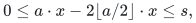

# Verification and scope

[Main proof](../proof.md) · [Source dependencies](../sources.md)

## Executable finite checks

Run the [signed-interval and exchange checker](../../../tools/verify_sensitivity_certificates.py) from the repository root:

~~~sh
python3 tools/verify_sensitivity_certificates.py
~~~

The signed-interval part independently compares the recursive interval catalogue with direct Boolean evaluation.

| Finite domain | Checked quantity |
|---|---:|
| Nonzero coefficient rows in <code class="math">\{-3,\ldots,3\}^3</code> | 342 |
| Row/interval pairs, with interval endpoints in <code class="math">[-10,10]</code> | 79,002 |
| Assignment/interval comparisons | 632,016 |
| Slack widths, including zero, from <code class="math">0</code> through <code class="math">1024</code> | 1,025 |

Every assignment satisfies the original interval exactly when it satisfies at least one generated exact-target or bounded-slack branch. The checker also checks the catalogue count and width bounds and independently enumerates the attainable slack sums. Its matching-exchange section belongs to a different family.

## Proof obligations and backend composition

The signed-floor identity
<!-- math-display: d5f2b6b0e190f94eddc05b9c
0\le a\cdot x-2\lfloor a/2\rfloor\cdot x\le s,
-->

where <code class="math">s</code> is the row support size and <code class="math">x</code> is Boolean, proves both directions of the recursive interval disjunction for arbitrary signed rows. The finite check supplements this inductive argument. The displayed branch formula is an upper bound, not an assertion that every branch is distinct or feasible.

Every packed branch has at most <code class="math">n+B</code> variables and polynomial encoding length. Signed radix packing uses reduction of signed differences modulo the radix; it does not assume an unsigned no-carry representation. Sequential enumeration keeps only one backend workspace live. Fully enumerating an objective-threshold row costs an additional polynomial factor and introduces no extra exponential slack parameter.

The primary theorem is stated in symbolic backend exponents <code class="math">\alpha</code> and <code class="math">\sigma</code>. A time-only backend supplies no new simultaneous space bound. The separate fast-time and low-space operating points therefore remain separate. Each numerical instantiation inherits its backend's constructive interface and any continuous-contact premise, including the distinct baseline and refined premises in the [fast Subset Sum proof](../../subset-sum-fast-deterministic/proof.md). Scalar exponent checks alone do not establish full-domain contact inequalities.

The executable verifies only the finite signed-interval and bounded-slack mechanisms listed above. It does not execute an exponential-time Subset Sum backend or certify its asymptotic exponent.

**Attribution:** Yilin Liu and GPT-6 Astra Pro.
