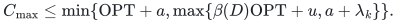
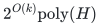
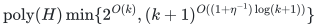

# Scheduling by bottleneck commitments

**Guarantee**

With <code class="math">D_k=3-2/k</code> and <code class="math">\beta(D)=\max\{3/2,2-1/D\}</code>, returns

<!-- math-display: ca36fcd196b3cc1f26a092b2
C_{\max}\le\min\{\mathrm{OPT}+a,\max\{\beta(D)\mathrm{OPT}+u,a+\lambda_k\}\}.
-->

For two sizes, the bound improves to <code class="math">\max\{\alpha_k\mathrm{OPT},a+\lambda_k\}</code>, where <code class="math">\alpha_k=3/2</code> for <code class="math">k\le2</code> and <code class="math">5/3</code> for <code class="math">k\ge3</code>.

**Objective and output**

Commit a computable independent set of largest-job machines, solve the remaining rank-<code class="math">k</code> problem, and recover every original job base.

**Randomness**

Deterministic greedy commitment selection, residual unit search, exact decomposition and additive rounding.

**Time**

For <code class="math">D=D_k</code>, time is

<!-- math-display: e1c54f15b9f9f90f59fbc011
2^{O(k)}\mathrm{poly}(H)
-->

For <code class="math">D=D_k+\eta</code> with rational <code class="math">0&lt;\eta\le1</code>, time is

<!-- math-display: c8150da618f60293cafc87ca
\mathrm{poly}(H)\min\{2^{O(k)},(k+1)^{O((1+\eta^{-1})\log(k+1))}\}
-->

**Space**

Polynomial in the complete binary input and paid oracle workspace; numerical resource multiplicities are not expanded into individual units.

**Parameters**

<code class="math">a</code> is the largest positive size; <code class="math">u</code> is the largest smaller size; <code class="math">h</code> is the required largest-job total; <code class="math">1\le k\le h</code>. For <code class="math">W_p=\sum_{j:p_j&lt;a}p_j f_j(\{p\})</code>, <code class="math">\lambda_k=\min\{z:\mathrm{rank}_M(\{p:W_p\le z\})\ge h-k\}</code>, where <code class="math">M</code> is the rank-<code class="math">h</code> Boolean-cap largest-job matroid. Set <code class="math">\lambda_h=0</code>.

**Model and representation**

Integral job polymatroids with common type sizes, binary ranks, mandatory original bases, and no additional assignment-cost budget. The Boolean-cap rank-loss case is handled by a polynomial <code class="math">3/2</code> branch.

**Lower-bound scope**

No lower bound is claimed for this algorithm.

**Review status**

**Ready for review.** All three canonical commitment manuscripts: original-optimum homogeneous-largest workload and exact two-size bottleneck commitments; full-marginal machine contraction with actual dominated residual bases, order-independent closures and the all-budget greedy profile; and local eligibility/collision padding including exact scalar optimization, its correct grid and approximation scope. The native modules realize both main original-optimum clients, safe absorption and lifting, position contractions and local structural certificates on original complete rank tables.

**Dependencies and scope.** The mathematical bounds pay for rank/SFM, integral decomposition/intersection, LP and the normalized-prefix unit search. Native clients instead stream residual original subsets and exact LP active systems with separately charged finite time and polynomial binary workspace. No capacity or artificial workload multiplier is expanded into individual jobs. All models use common positive type sizes and no assignment/setup budget. Commitment bottlenecks are explicit load terms, with no implicit bound by original optimum; private-cap and original-optimum comparisons remain distinct. Exact two-size recovery admits noninteger size ratios and incurs no smaller-job additive loss. The complete heterogeneous-large padding allocator and specialized public two-size approximation are not implemented. Scalar optimization is only for the stated padding certificate, and full-marginal closure optimality applies only to its absorption rule. No external peer review or proof-assistant verification is claimed.

The [verification note](verify/README.md) identifies executable coverage. This status does not claim external peer review or proof-assistant verification.

**Source**

[Manuscript and proof](proof.md), with [dependencies and verification sources](sources.md).

The commitment term is a load bound, not an approximation ratio. The two-size rank-two result is a full <code class="math">3/2</code> approximation precisely when <code class="math">a+\lambda_2\le3\mathrm{OPT}/2</code>. The <code class="math">k=0</code>, empty-job, and one-size cases have separate routines.

## Further rank reductions and local-size certificates

These companion theorems use the same common-type job-polymatroid model
with mandatory original bases and no assignment or setup budget.

**[Full-marginal machine contraction](machine-contraction.md)**

A polynomial greedy pass computes a bottleneck <code class="math">\beta_k</code> and contracts every job polymatroid to residual large-job rank at most <code class="math">k</code>. Every residual guarantee <code class="math">\alpha\mathrm{OPT}_F+e</code> becomes <code class="math">\max\{\beta_k,\alpha\mathrm{OPT}+e\}</code>, because <code class="math">\mathrm{OPT}_F\le\mathrm{OPT}</code>. Machines may absorb multiple large units and original <code class="math">h</code> may exceed <code class="math">q</code>.

**Homogeneous-large residual scheduling**

Returns <code class="math">\min\{\mathrm{OPT}+a,\max\{\beta_k,(2-1/(3+\eta))\mathrm{OPT}+u\}\}</code> in <code class="math">\mathrm{poly}(H)\min\{2^{O(k)},(k+1)^{O((1+\eta^{-1})\log(k+1))}\}</code> time for rational <code class="math">0&lt;\eta\le1</code>. With exactly two positive sizes, the residual term improves to <code class="math">5\mathrm{OPT}/3</code> in <code class="math">2^{O(k)}\mathrm{poly}(H)</code> time.

**Zero residual large rank**

With exactly two positive sizes, <code class="math">\max\{\beta_0,\mathrm{OPT}\}</code>; with arbitrary smaller sizes, <code class="math">\max\{\beta_0,\mathrm{OPT}+u\}</code>. The original additive candidate <code class="math">\mathrm{OPT}+a</code> may also be retained.

**[Eligibility padding and collision thresholds](eligibility-padding.md)**

Given an aggregate-independent commitment <code class="math">F_0</code> of size <code class="math">h-k</code>, returns <code class="math">\min\{\mathrm{OPT}+a_+,\max\{\beta_D(F_0)\mathrm{OPT}+u,B(F_0)\}\}</code>. Here <code class="math">\beta_D=\max\{1+a_+/C_2,1+E_D/a_+\}</code>, <code class="math">E_D=((D-1)A+H_{\mathrm{width}})/D</code>, and <code class="math">B(F_0)=\max_{p\in F_0}(W_p+a_p)</code>.

**Eligibility-sensitive hard-target bound**

If <code class="math">\mathrm{OPT}&lt;C_2</code>, the preceding construction gives <code class="math">\max\{\mathrm{OPT}+E_D+u,B(F_0)\}</code>. The exact scalar refinement can replace <code class="math">E_D</code> by its smaller optimized padding certificate <code class="math">C_\star</code>.

For eligibility padding, <code class="math">a_+</code> is the largest attained type size, <code class="math">C_2</code> is
the minimum possible load of two large units on one machine, and
<code class="math">a_+/\infty=0</code>. On the nonloops of the contracted large-recipient
matroid, <code class="math">A=\max_p a_p</code> and <code class="math">H_{\mathrm{width}}=\max_p(a_p-\ell_p)</code>, where <code class="math">[\ell_p,a_p]</code>
is the range of large sizes eligible at <code class="math">p</code>. With <code class="math">D=D_k=3-2/k</code> the
time is <code class="math">2^{O(k)}\mathrm{poly}(H)</code>; with <code class="math">D=D_k+\eta</code>, <code class="math">0&lt;\eta\le1</code>, it has the same
rank-quasipolynomial alternative as the table above. Boolean-rank loss
is handled by the separate additive collision branch. Every bottleneck
is a load certificate; no promise that it is small compared with <code class="math">\mathrm{OPT}</code>
is implicit.

The [native commitment and contraction backends](reference/README.md) implement both original-optimum main clients, safe machine absorption and exact structural certificates. Their [realization proof](reference-realization.md) and [original-input checks](verify/README.md) distinguish numerical-count execution from the fast theorem's paid primitives.

**Attribution.** icekylinx · GPT-6 Astra Pro
