# Scheduling with local eligibility widths and collision thresholds

This theorem refines [bottleneck commitments](proof.md) using two
computable features of common-type processing sizes: the size range
eligible at each machine, and the smallest load of two large units
that can occur together. It retains every original integral job base,
binary capacities, a supplied residual rank budget, and an explicit
largest-small-job rounding loss. The proof does not select a large type
at any machine before the final aggregate decomposition.

The model has no assignment or setup budget. The per-machine intervals
below describe eligibility for types with common sizes; they do not
represent arbitrary processing times depending on the receiving machine.
The principal bound is Theorem (I19), with its exact parameter definitions
in (I6), (I7), and (I18).

## 1. Model and notation

There are q machines P. Every positive-rank job type j has positive
rational size p_j and an integral polymatroid rank f_j. A schedule
chooses an integer base of every f_j. Fix a nonempty set of the
largest types, called large, and write

<!-- math-display: 6ff63d3469d4aff81cf87677
a_- =\min_{j\text{ large}}p_j,\qquad
 a_+ =\max_{j\text{ large}}p_j,\qquad
 h=\sum_{j\text{ large}}f_j(P)>0.
 \tag{I1}
-->
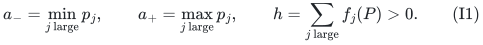

These are attained sizes. Every remaining size is at most u<a_-;
if there are no remaining types, put u=0. Unlike the preceding
near-equal theorem, this note imposes no global bound on a_+/a_-.
The approximation quality will state when the local information
is useful. Let f_b=sum_large f_j and let M be its coordinate-one
cap, the matroid of feasible sets of distinct large recipients.

For a machine that can receive a large unit, define

<!-- math-display: cb28ef0841b61b39783fa044
\ell_p=\min\{p_j:j\text{ large},\ f_j(\{p\})\ge1\},\qquad
 a_p=\max\{p_j:j\text{ large},\ f_j(\{p\})\ge1\}.
 \tag{I2}
-->
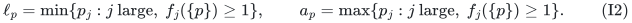

Thus every large type eventually assigned to p has size in
[ell_p,a_p]. These definitions concern eligibility, not a preliminary
choice of assigned type. Set

<!-- math-display: 5dd3e6ad3e17821345ad0a84
W_p=\sum_{j\text{ small}}p_j f_j(\{p\}),\qquad C_p=W_p+a_p
 \tag{I3}
-->
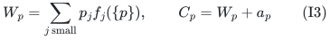

on the nonloops of M. Committed positions will be charged by C_p.

## 2. Lemma: the smallest possible two-large-unit collision

At p, form the multiset containing min{2,f_j({p})} copies of p_j
for every large type j. If it has at least two entries, let c_p
be the sum of its two smallest entries; otherwise let c_p=infinity.
Define

<!-- math-display: 9c7d2fdee342dcbc07b5f801
C_2=\min_p c_p.
 \tag{I4}
-->
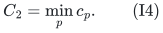

This takes polynomial work on the explicit types and singleton
rank queries, without capacity expansion. It is the minimum possible
load of two large units on one machine. Indeed, every such pair
obeys the singleton capacities used in its definition. Conversely,
the selected one- or two-unit count at p is independent in each
corresponding type polymatroid and can be extended to a base, so
that pair can occur in an assignment of the large types alone.
Only the lower-bound direction is needed below.

Consequently every schedule of makespan T<C_2 has at most one
large unit at each machine. If r_M(P)<h, every schedule must have
a large collision, so

<!-- math-display: 0b86b6183d09d088abcfcc16
\mathrm{OPT}\ge C_2,
 \qquad
 C_{\max}\le\mathrm{OPT}+a_+
       \le(1+a_+/C_2)\mathrm{OPT}.
 \tag{I5}
-->

The final inequality uses the public additive algorithm. Rank loss
cannot occur when C_2=infinity: in that case f_b({p})<=1 everywhere,
so f_b itself is a matroid rank and its one-cap preserves rank h.

Always C_2>=2a_-. When C_2 is finite, C_2<=2a_+. If C_2=infinity,
every feasible assignment already has distinct large recipients,
for every target T. The proof below then needs no separate easy
branch and no automatic coefficient-three-halves floor.

## 3. Commit any independent set and remove contracted loops

Assume M has rank h. Choose a budget 1<=k<=h and any M-independent
set F0 of size h-k. Put

<!-- math-display: 8bf08bd3d923ac9b9f794a5a
B(F_0)=\max_{p\in F_0}C_p,
 \tag{I6}
-->
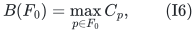

with maximum zero for F0 empty. Let Q consist of the nonloops of
M/F0, and let N be that contraction restricted to Q. Then N has
rank k. Ground elements outside Q and F0 will not receive large
units in this branch.

For these residual machines define

<!-- math-display: 6803d10dd056c01082fc164d
A=\max_{p\in Q}a_p,\qquad
 H=\max_{p\in Q}(a_p-\ell_p),\qquad
 L=A-H.
 \tag{I7}
-->
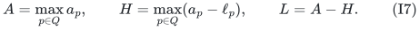

The letter H in (I7) means an eligibility width; input encoding
length will be denoted by mathcal H below. Since Q is nonempty,
these maxima exist. Moreover

<!-- math-display: 73cdc5e9c36903b0ae3940c5
0<a_-\le L\le A\le a_+.
 \tag{I8}
-->
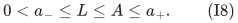

To see the first inequality, each width is at most A-a_-.
The extrema, differences, and L lie on the original rational
size grid. All these quantities are fixed before target search.

One convenient canonical F0 is the first h-k elements of a
minimum-bottleneck greedy basis sorted by C_p. It minimizes (I6).
The theorem is valid for every supplied independent F0; it does
not assert that this canonical choice jointly optimizes B, A and H.

## 4. Exact unit quotas by choosing the workload grid

Put D_k=3-2/k. Choose any rational D>=D_k and write D=A_D/B_D
in positive integers. Let g be a common original job-size quantum,
so every p_j/g is integral, and choose

<!-- math-display: c905bfc64be820a9919c8c1f
\Delta=g/A_D,\qquad K=L/\Delta,\qquad
                       b=K/D=(L/g)B_D\in\mathbb Z_{>0}.
 \tag{I9}
-->

Both K and b are integers of polynomial bit length. Every original
schedule load, a_+, C_2 when finite, and L are on this Delta-grid.
For a grid target T put c=T/Delta. Define the small-workload rank

<!-- math-display: 89c4711353c88d9771dedcd4
F(S)=\sum_{j\text{ small}}(p_j/\Delta)f_j(S)
 \tag{I10}
-->
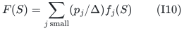

and cap its coordinates by c. If the cap lowers total rank, T is
infeasible. Otherwise call the capped rank g_T and its complement
dual f_T:

<!-- math-display: 3b32c1cc4306edf05d6b4a3b
f_T(S)=c|S|+g_T(P\setminus S)-g_T(P).
 \tag{I11}
-->
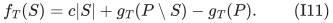

This is the exact workload dual proved in the
[workload scheduling manuscript](../many-size-scheduling/proof.md).
The algorithm only invokes it for T>=a_+ and T<C_2, or for every
T>=a_+ when C_2=infinity.

## 5. Lemma: commitment and private padding preserve the quota promise

Suppose the original integer instance has a schedule of target T
in the interval of Section 4. Its large receiving set I* is an
M-basis. Its dual small-workload vector z* belongs to B(f_T).
At any p in I*, the original small workload is at most T minus
the size of its assigned large unit. Thus

<!-- math-display: 2e8b375fcc4c7bbe042637ea
z^*_p\ge\ell_p/\Delta.
 \tag{I12}
-->
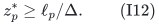

Since I* spans M, I*\F0 spans M/F0. It contains an N-basis J*.
Restricting z* to J* preserves recipient-polymatroid feasibility.
This contracts only the player matroid; the resource rank is
restricted to Q, not contracted by F0.

Add the nonnegative integer private capacities

<!-- math-display: 44553ad9df9c94175f0e0f23
d_p=(L-\ell_p)_+/\Delta\quad(p\in Q),
 \qquad
       \widehat f_T(S)=f_T(S)+\sum_{p\in S}d_p\quad(S\subseteq Q).
 \tag{I13}
-->
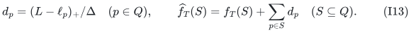

The maximum of two original-grid quantities is still on that grid,
so these capacities are integral. The sum with a modular rank is
again an integral polymatroid. On every p in J*, the original
promise ell_p/Delta plus d_p is at least K. Therefore the uniform
unit-core instance (N,widehat f_T) has an integer K-quota basis.

Run the [exact unit-quota algorithm](../../manuscripts/allocation-and-scheduling/unit-quota-three-transfer-and-discrete-time-gate.md)
with output quota b. Its strict criterion is

<!-- math-display: a15d6a716e8754d972eb4c67
(3-2/k)b<K+1+(k-1)/k.
-->
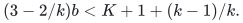

It holds because D>=D_k and Db=K: the left side is at most K,
whereas the right side is strictly larger than K. The algorithm
returns an N-basis J with b units at each member in widehat f_T.
It may prune a larger returned count to exactly b.

## 6. Lemma: withdrawing private capacities preserves global feasibility

For completeness, if y belongs to P(f+d), where d is any
nonnegative modular capacity vector, then

<!-- math-display: 5e31bca16d3767ccb4e42438
(y-d)_+\in P(f).
 \tag{I14}
-->
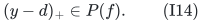

For a subset S, let E={p in S:y_p>d_p}. The left side on S is
y(E)-d(E)<=f(E)<=f(S). This proves every rank inequality, so
there is no need to select a particular decomposition of y into
original and private parts.

Apply (I14) to the returned b-quota vector. Its residual original
dual count at p in J is

<!-- math-display: f305b9fc02dbf3b550c82c51
z_p=(b-d_p)_+.
 \tag{I15}
-->
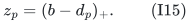

Set every other original dual coordinate to zero, including F0.
Restriction and zero extension preserve feasibility in P(f_T).
Extend this vector to an integer f_T-base and complement it to a
capped small-workload base. Extra dual units only reduce the
small workload.

## 7. The residual load bound uses eligibility width

The full large receiving set F0 union J is an M-basis. Decompose
its indicator into original large-type bases. The assigned large
size at any p is at most a_p; no type was fixed earlier.

Before rounding small jobs, a residual large recipient p has load
at most T+a_p-Delta z_p. If ell_p>=L, its private capacity is zero,
so this load is at most

`T+a_p-L/D <= T+A-L/D`.

If ell_p<L, then Delta z_p>=L/D-(L-ell_p), even if the latter
quantity is negative. Thus its load is at most

`T+(a_p-ell_p)+(1-1/D)L <= T+H+(1-1/D)L`.

The two bounds agree because L=A-H. Define

<!-- math-display: afdeaef9b4b4a033c922c37b
E_D=A-L/D
             ={(D-1)A+H\over D}\ge0.
 \tag{I16}
-->
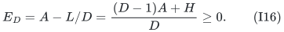

Every residual large recipient has load at most T+E_D before
small-job rounding. Machines with no large unit have small workload
at most T. Decompose the workload base into the weighted small
polymatroids and round the resulting fractional original small jobs.
The [per-machine rounding lemma](../many-size-scheduling/proof.md#2-the-per-machine-form-of-the-public-rounding-lemma)
adds at most u. Its pair-ground integral-intersection construction
restores a base of every original smaller job type.

Every committed p receives at most a_p in large load and at most
W_p in actual integral small load, by the original singleton ranks.
Its final bound is C_p with no additional u. Hence this branch returns

<!-- math-display: 296746cf2433c2466c31cf2e
C_{\max}\le\max\{T+E_D+u,\ B(F_0)\}.
 \tag{I17}
-->

For the same F0, E_D<=a_+-a_-/D, because A<=a_+ and L>=a_-.
Thus this proof also yields the uniform-minimum-size hard-target bound.

## 8. Why L=A-H is the best universal padding scale in this argument

More generally use any positive scale L0 and private capacities
(L0-ell_p)_+/Delta, with an exact b=L0/(D Delta). The same two
cases give the valid common overhead

`max{A-L0/D, H+(1-1/D)L0}`.

For D>1 the first expression decreases and the second increases
with L0. They meet exactly at L0=A-H, yielding (I16). For D=1,
the second is the constant H, and L0=A-H is again a minimizer.
This proves optimality only for this two-extrema upper bound. It
does not rule out exploiting the complete list of pairs (a_p,ell_p),
the precise final type assignment, or additional resource structure.

### 8.1. Optional exact scalar optimization over all eligibility pairs

For an arbitrary positive padding scale L0, the actual guaranteed
dual workload on p is

<!-- math-display: adbac2c57cd5647704a65700
w_p(L_0)=\max\{0,\min\{L_0/D,
                              \ell_p-(1-1/D)L_0\}\}.
 \tag{I16a}
-->
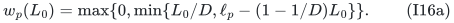

The sharper common overhead is C(L0)=max_p(a_p-w_p(L0)). It is
possible to minimize this one-dimensional bound in polynomial time.
For D>1 and 0<=C<A, let

`H_active(C)=max_{p:a_p>C}(a_p-ell_p)`.

Machines with a_p<=C impose no constraint. Every other machine
requires both linear terms in (I16a) to be at least a_p-C. A common
L0 exists precisely when

<!-- math-display: 55f49c55495610088c5b3dac
D(A-C)\le L_0\le {D(C-H_{\rm active}(C))\over D-1},
 \quad\text{equivalently}\quad
 D C\ge(D-1)A+H_{\rm active}(C).
 \tag{I16b}
-->
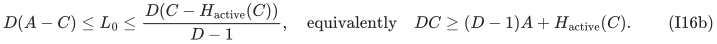

These implications also prove that the right endpoint is positive
whenever the displayed criterion holds. The active set is defined
using a strict comparison: a machine with a_p=C has no positive
dual requirement and is omitted.

Sort the distinct a_p values. On each interval [a_i,a_(i+1)),
including an initial left endpoint zero, H_active is constant.
The first feasible candidate in that interval is the maximum of
its left endpoint and `((D-1)A+H_active)/D`, if this maximum is
strictly below the right endpoint. Right endpoints are tested as
the next interval's left endpoint, with the changed active set.
At least one candidate below A exists: take a sufficiently small
positive L0, which gives every machine positive guaranteed dual
workload. Choose the least candidate C_* and take

`L0=D(A-C_*)>0`.

For D=1, formula (I16a) becomes min(L0,ell_p); its optimum overhead
is H, already attained by the simple scale L=A-H.

All candidates C_* lie on the grid g/A_D: they are either original
eligibility sizes or the displayed linear balances. Hence L0 lies
on g/B_D. For this optional optimization, replace (I9)'s quantum by

<!-- math-display: 7ee91fa6da36f4ee2dc99f57
\Delta={g\over A_D B_D}.
 \tag{I16c}
-->
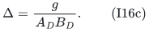

Then K=L0/Delta, b=K/D and every private capacity are integral, and
Db=K holds exactly. All subsequent arguments apply with E_D
replaced by C_*<=E_D, with the same bit complexity and growth slack.

This optional improvement concerns the hard-target load certificate.
It should not automatically be advertised as a smaller unconditional
coefficient. In fact, for 1<=D<=3, if C_*<E_D then a machine attaining
the global width H must have a_p<=C_*: otherwise its width stays
active and (I16b) forces C_*>=E_D. Such a positive-width machine
can receive two distinct eligible large sizes, of summed load
2a_p-H<=2E_D-H. Thus C_2<=2E_D-H. Direct algebra gives
E_D(2E_D-H)<=A^2 for 1<=D<=3, and A<=a_+. Therefore the easy
coefficient a_+/C_2 already dominates E_D/a_+ in this case.
For these exact D values, the optional scalar improvement cannot
by itself reduce the unconditional maximum in (I18), although it
can sharpen its conditional additive statement.

## 9. Theorem: target search and the unconditional guarantee

If C_2 is finite, use the ordinary additive algorithm at targets
T>=C_2. Its guarantee is T+a_+, which is at most
(1+a_+/C_2)T. Below a_+, reject the target, since that attained
positive-rank type must be scheduled.

Write a_+/infinity=0 and define

<!-- math-display: 946f61d7cde8c7de12654e5f
\beta_D(F_0)=
 \max\left\{1+{a_+\over C_2},\ 1+{E_D\over a_+}\right\}.
 \tag{I18}
-->
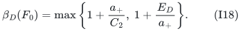

For C_2=infinity the first term is simply one, and the hard-target
construction applies for every T>=a_+. Every successful target
routine returns an actual schedule of load at most
max{beta_D(F0) T+u,B(F0)}. A failure in the construction proves
original integer infeasibility at that target: a feasible schedule
would give the explicit padded K-quota promise above. The easy
LP branch likewise fails only on a genuinely infeasible target.

Use a Delta-grid one-sided target search. A zero lower target is
infeasible because a_+>0. An arbitrary feasible schedule supplies
a finite upper target V; if desired enlarge it to include C_2
when finite. A target at or above V is promised feasible, so its
routine succeeds. Failures are below OPT. At adjacent grid endpoints,
the successful upper target is at most OPT because every original
schedule load, and hence OPT, lies on the grid. Monotonicity of
the routine's success choices is unnecessary. The saved schedule
satisfies

<!-- math-display: 05e1be4ac514908370d7cfa1
\boxed{
 C_{\max}\le
       \max\{\beta_D(F_0)\,\mathrm{OPT}+u,\ B(F_0)\}.
 }
 \tag{I19}
-->
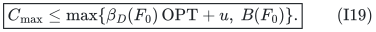

Running the ordinary additive algorithm too allows the stronger
minimum with OPT+a_+, and therefore with 2OPT. Rank loss in M
is handled separately by (I5), without calling a contracted unit
instance of the wrong rank.

If OPT<C_2, the successful target in this search is also below C_2,
so the sharper additive comparison

`max{OPT+E_D+u,B(F0)}`

holds for the constructed branch. This conditional additive form
must not be asserted when the easy branch may be necessary.

## 10. Running time and finite-rank coefficients

For D=D_k, the unit theorem takes

`2^{O(k)} poly(mathcal H)`

time. All singleton queries, caps, duals, private additions, matroid
operations, decompositions and rounding have polynomial encoding
length and cost. No individual capacity units are expanded. The
dependence on the input's explicit type count is polynomial.

For D=D_k+eta with rational 0<eta<=1, the exact equality Db=K gives
the same positive-slack lower bound as in [bottleneck commitments, Section 4](proof.md#4-arbitrarily-many-smaller-sizes): its normalized growth slack exceeds eta/2. Consequently
the running time is

`poly(mathcal H) min{2^{O(k)},
 (k+1)^{O((1+eta^{-1}) log(k+1))}}`.

For a request eta>1 one may run the theorem with eta0=1. The resulting
overhead and approximation coefficient are no larger than those for the
requested D, and the displayed time bound changes only by absolute
constants in its exponent.

No assumption that the original small-job size u is below an
eta-dependent numerical quantum is needed. The actual +u loss
remains in (I19). Rank-one N can be solved exactly; the formula
D_1=1 is consistent with the argument.

Choosing the canonical greedy F0 for each k up to a budget K0 and
returning the best actual schedule costs the same type of bound
with K0. The resulting comparison is the minimum of the corresponding
(I19) bounds. This does not optimize over all independent F0 sets.

## 11. Corollaries and model scope

With no commitments, A=a_+ and put omega=H/a_+. Then

<!-- math-display: 6e89dad76a529db5ff31fe76
\beta_D=
       \max\left\{1+a_+/C_2,
                       2-{1-\omega\over D}\right\}.
 \tag{I20}
-->
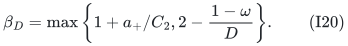

If every machine is eligible for at most one **large size**,
omega=0. This permits many different large sizes globally. Whenever
C_2>=3a_+/2, the rank-quasipolynomial choice D=3+eta gives

`C_max <= (2-1/(3+eta)) OPT + u`.

In particular, the global spread a_+/a_- can be arbitrarily large
when the smallest large units cannot collide on their eligible
machines. The conditions concern local eligibility and capacities,
not a restriction to two possible processing times.

If C_2=infinity, the easy-branch floor disappears. For residual
machines, in fact H=0 automatically: two different eligible large
types at one machine would themselves give a finite collision.
For residual rank k=1, E_1=0, so the guarantee is
max{OPT+u,B(F0)}. This is a bottleneck-sensitive statement and is
not an unrestricted approximation scheme for variable h.

The near-equal-size bound follows directly from C_2>=2a_- and
E_D<=a_+-a_-/D. Local eligibility and collision data can improve either
term separately.
For D near three and H/a_+ small, its hard-target loss depends on
the within-machine ambiguity rather than the global size spread.

## 12. Dependencies and the XP comparison

The public general job-polymatroid baseline remains the largest-job
additive rounding, and hence factor two, in Bamas et al.,
[arXiv:2307.08453v1, Theorem 23](https://arxiv.org/html/2307.08453v1).
Its public two-value scheduling theorem has a different size scope.
The exact integral quota criterion and rank-dependent search are proved
in the [unit-quota theorem](../../manuscripts/allocation-and-scheduling/unit-quota-three-transfer-and-discrete-time-gate.md),
using the [normalized recipient-polymatroid construction](../recipient-polymatroid/proof.md).
Workload aggregation, compressed decomposition, and per-machine upper
rounding are specified in the [workload manuscript](../many-size-scheduling/proof.md).

There is also a stronger-quality elementary XP comparison for a
fixed committed F0. At a target T<C_2, enumerate the k residual
receiving machines and their large types. Typed completion on F0
is tested by polymatroid/matroid intersection, and the residual
small-workload constraints are tested by submodular minimization
or the corresponding fractional scheduling LP. A successful guess
gives max{T+u,B(F0)}. A witnessing guess exists: restrict each
large type outside F0 to the machines receiving that type in an
optimal target-T schedule. F0 stays aggregate-independent because
all its type options are retained; the restricted aggregate matroid
still has the optimal full basis, so F0 extends to a full basis.
Its k outside positions retain their optimal types and hence their
small-workload promise. The enumeration costs (qt)^{O(k)} times
polynomial input work. The easy collision branch still applies
outside the hard-target domain. Thus the gain in this note is a
polynomial input degree independent of k, at the stated quality
tradeoff. Polynomial consequences at fixed k=1 or k=2 alone are
not claimed as numerical breakthroughs.

The parameterized bound has a polynomial input degree independent of k.
The scalar refinement optimizes only its stated padding certificate;
choosing an independent commitment that jointly minimizes all parameters
is not part of the theorem. Every branch retains its explicit workload
rounding loss and commitment load.

**Attribution:** icekylinx and GPT-6 Astra Pro.
