# Scheduling by bottleneck commitments and a reduced search rank

The private-slack parameter can be replaced by a target-independent
bottleneck tradeoff. Commit some large-job machines using their original
singleton bounds on smaller workload. Contract these machines only in
the player matroid, run the unit allocation search on the remaining
rank, and extend its dual vector with zero at the committed machines.
Those machines need no private dual allocation: their final original
job constraints already bound their load.

This gives a guarantee against the original integer optimum, without
a cap threshold in the comparator. It strengthens the earlier
private-slack guarantee where the commitment term is small. It does
not give an unconditional improvement of the public polynomial
approximation factor when that term is large.

## 1. Model and a computable bottleneck profile

There are q machines. Job type j has positive rational size p_j and
an integral polymatroid rank f_j on the machines. A schedule chooses
an integer base of every job polymatroid. Ranks and multiplicities are
binary encoded, with paid value-oracle and submodular-minimization
operations. Let a be the largest positive size, let f_b aggregate
the a-sized types, and put h=f_b(P)>0. Zero-rank types are removed.

Let M be the unit-box restriction of f_b. First assume r_M(P)=h.
The smaller Boolean-rank case is handled in Section 6. Define

<!-- math-display: 25a4b7877ce8a8530c0364db
W_p=\sum_{j:p_j<a}p_j f_j(\{p\}),\qquad
 u=\max_{j:p_j<a,\ f_j(P)>0}p_j.
 \tag{B1}
-->
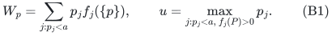

The one-size case is polynomially solvable and is handled separately.
For an integer budget 1<=k<=h, define

<!-- math-display: 0a55798a555b399d25255617
\lambda_k=
 \min\{z:r_M(\{p:W_p\le z\})\ge h-k\},
 \tag{B2}
-->
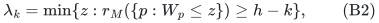

with lambda_h=0 and an empty commitment when k=h. Sorting W_p and
running matroid greedy constructs an independent set F0 of exactly
h-k machines with maximum W_p at most lambda_k. All these choices
are independent of the trial makespan T.

This profile is computed in polynomial oracle time. It quantifies how
much singleton small-workload exposure is necessary to preselect h-k
independent recipients of largest jobs. It is a sufficient workload
bound and may overestimate what a schedule actually assigns there.

## 2. The contraction promise does not require private units

Fix a hard target a<=T<2a and form the capped smaller-workload dual f
used in the previously reviewed workload construction. A target-feasible
schedule gives an M-basis I* and at least K=a/Delta dual workload
units at each member, for the chosen exact workload unit Delta.

Contract F0 in M and restrict f to Q=P minus F0. The contraction has
rank k. Since I* spans M, its image spans M/F0; there is a basis
J* of the contraction contained in I* minus F0. Restricting the old
dual allocation to J* preserves its K units per member and feasibility
in the restricted recipient polymatroid.

Run the rank-k unit algorithm on this residual instance. It returns
a contraction basis J and a feasible dual vector y on Q supplying
the output quota b to J, or soundly rejects the K-unit promise.

Regard y as a vector on all machines by setting it to **zero on F0**.
It is still feasible in P(f): for any set S,

<!-- math-display: d2953e72acdadcf7f112bffa
y(S)=y(S\cap Q)\le f(S\cap Q)\le f(S).
 \tag{B3}
-->
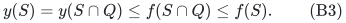

Extend this vector to an integral base of f. No positive preassignment
at F0 has to be combined with the residual resource vector. Thus no
private-coordinate condition, resource contraction, or capacity
subtraction is needed. The selected largest-job set F0 union J is
an M-basis by the matroid contraction identity.

## 3. Committed machines have a separate final load bound

After complementing the dual base, decomposing the smaller-workload
base, and rounding all smaller job types integrally, every original
type j is still a base of f_j. In particular, at every committed
machine p, its final count satisfies x_j(p)<=f_j({p}). Therefore

<!-- math-display: 7faa519ff7d0e191e9a4ef6d
\text{load}(p)\le a+\sum_{j:p_j<a}p_j f_j(\{p\})
                \le a+\lambda_k\qquad(p\in F0).
 \tag{B4}
-->
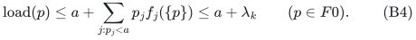

There is **no extra +u in (B4)**. It bounds the final original-type
integer bases directly, rather than their fractional precursors.
The per-machine rounding loss is still paid at the other machines,
whose desired load bounds come from the dual quota.

## 4. Arbitrarily many smaller sizes

Let D>=D_k=3-2/k be rational. Write D=A/B, choose an original quantum
g dividing all p_j, and use Delta=g/A. Then K=a/Delta and b=K/D
are integers. Targets are taken on the Delta-grid, which contains
every original integral schedule load.

At rank k the unit-core condition

<!-- math-display: 038952bed99f66a21d29ea8f
(3-2/k)b<K+1+(k-1)/k
 \tag{B5}
-->
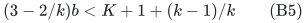

holds because its left side is at most Db=K. With D=D_k+eta,
0<eta<=1, its relative growth slack is greater than eta/2, using
the coefficient 2b-1. These are the same quota calculations as in
the reviewed finite-rank workload refinement.

On noncommitted selected machines, reconstruction and rounding give
load at most T+(1-1/D)a+u. On nonselected machines the load is at
most T+u. Together with (B4), the hard-target output bound is

<!-- math-display: 8925a2f2f45124a19ff73fbc
\max\{T+(1-1/D)a+u,\ a+\lambda_k\}.
 \tag{B6}
-->
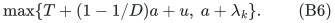

For T>=2a, the public additive rounding algorithm on all jobs has
bound T+a<=3T/2. Write beta(D)=max{3/2,2-1/D}. The optimized theorem is

<!-- math-display: a3beb9b17bb7cdbebed16012
\boxed{
 C_{\max}\le
 \min\left\{\mathrm{OPT}+a,
       \max\{\beta(D)\,\mathrm{OPT}+u,\ a+\lambda_k\}\right\}.
 }
 \tag{B7}
-->
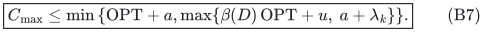

The first term is obtained by also solving the full original assignment relaxation and applying additive-largest-job rounding; its makespan is at most OPT+a. Return the better actual schedule. For D=D_k the new construction
takes `2^{O(k)} poly(H)` time. For D=D_k+eta it takes

<!-- math-display: 9315fd2d49b4036cfe286e9f
\mathrm{poly}(H)
 \min\{2^{O(k)},(k+1)^{O((1+\eta^{-1})\log(k+1))}\}.
 \tag{B8}
-->
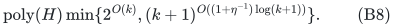

Space is polynomial, in addition to oracle workspace. Artificial
workload units and large binary capacities are not expanded.
The commitment term has the units of load, not a ratio.

For exact D_k, beta is 3/2 at k=1,2, then 11/7 at k=3, 8/5 at
k=4, and (5k-4)/(3k-2) at every k>=2. A fixed small k can handle
arbitrarily many largest units; its effectiveness depends on lambda_k.

## 5. Exactly two sizes: no additive rounding loss

Suppose all smaller jobs have size u<a, with aggregate rank f_s.
Then W_p=u f_s({p}). Use the integral small-count dual directly,
with c=floor(T/u), K=c-floor((T-a)/u), and exact rank-k quota

<!-- math-display: 6b9cf1c453c8d80ce43c5a9b
b_k(K)=\left\lfloor\frac{kK+2k-2}{3k-2}\right\rfloor.
 \tag{B9}
-->
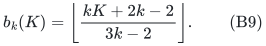

The contraction promise and zero extension are unchanged. Original
small counts are already integral, so no workload rounding occurs.
At noncommitted selected machines the exact target load is at most
`a+(c-b_k(K))u`; at nonselected machines it is at most T. At F0,
the load is bounded by a+lambda_k, with lambda in workload units.

The unit quota gives a uniform hard-target coefficient 3/2 for
k=1,2 and 5/3 for k>=3. The easy branch is at most 3/2. Consequently

<!-- math-display: 9b4996d406d101a0eb81aca6
\boxed{
 C_{\max}\le
 \max\{\alpha_k\,\mathrm{OPT},\ a+\lambda_k\},\qquad
 \alpha_k=\begin{cases}3/2,&k\le2,\\5/3,&k\ge3.
 \end{cases}
 }
 \tag{B10}
-->
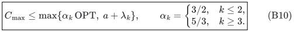

The time is `2^{O(k)} poly(H)`. One may additionally return the
better schedule from the public polynomial `(7/4+epsilon)` algorithm
for two-size job polymatroids, paying its precision dependence.

For example, k=2 gives a polynomial procedure with bound
`max(3 OPT/2, a+lambda_2)`. It is a full 3/2 approximation whenever
the second term is at most 3 OPT/2. It is not a uniform 3/2 theorem
on unrestricted instances. Arbitrary job polymatroids are supported.

## 6. Target search, rank loss and exceptional cases

Every target failure is genuine original infeasibility: T<a, loss
of a necessary capped total rank, infeasibility of the assignment
relaxation in the easy branch, or failure of the retained full-K
unit promise. There is no rank-budget rejection. F0 has exactly
h-k elements and the residual rank is exactly k.

A target-feasible schedule must therefore produce success. A success
may occur below OPT and is saved with its actual schedule. Grid
binary search keeps a failed lower and successful upper endpoint.
Since OPT is on the grid, adjacency implies that the final successful
target is at most OPT. Substituting it into the monotone output bounds
proves (B7) and (B10). The upper endpoint max{V,2a}, for arbitrary
feasible schedule load V, is an explicit successful endpoint. The
number of trials is polynomial in the grid range's binary length.

If the large Boolean rank is less than h, every target below 2a is
infeasible, so OPT>=2a. Restrict additive target search to T>=2a and
obtain a polynomial 3/2 approximation. The lambda profile is then
unnecessary and is not assigned an invented finite value.

If k>=h, take k=h and F0 empty; the commitment term is absent and
the earlier h-parameter results are recovered. A budget k=0 can be
handled separately by committing a full bottleneck basis and omitting
the core; no expression containing 1/k is used. The one-size and
empty-job cases retain their polynomial exact routines.

## 7. Relation to the private-slack comparator

The older cap requires enough machines with `W_p <= T-a/D`, giving
a capped comparison target. The present proof does not supply them
with b dual units. It allows their load to reach the independently
bounded a+lambda_k. This is why the original OPT can be retained.

If OPT<2a and the old private rank condition holds at OPT, then

<!-- math-display: 2b57aceda40475fab4755155
a+\lambda_k\le\mathrm{OPT}+(1-1/D)a
              \le(2-1/D)\mathrm{OPT}.
-->
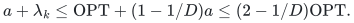

For OPT>=2a, the separate public additive algorithm has load at most
OPT+a<=3 OPT/2 regardless of lambda_k. Thus returning its schedule
as an additional candidate recovers the old easy-branch guarantee too.
This is the OPT+a term already included in (B7).

Thus the combined algorithm recovers that full-OPT guarantee. It can also be useful
when the cap fails, because only the final commitment load needs to
be small enough. This is not a claim that arbitrary positive recipient
preassignments preserve independence; the extension here is by zero.

## 8. Referenced primitives

The workload, decomposition, polymatroid intersection and additive
rounding primitives are those checked in
[Bamas et al., arXiv:2307.08453v1](https://arxiv.org/html/2307.08453v1)
and in the accompanying workload notes and audits. The finite-rank
unit search is the internally derived allocation result. The public
general two-approximation and two-size `(7/4+epsilon)` guarantees
retain their polynomial-time distinction.

This manuscript claims the bottleneck commitment proof and its parameterized
consequences. Publication priority has not been exhaustively established.
The full derivation passed the reviews in
[Scheduling by bottleneck commitments and a reduced search rank](proof.md),
[Scheduling by bottleneck commitments and a reduced search rank](proof.md), and
[Scheduling by bottleneck commitments and a reduced search rank](proof.md). They cover the
zero-extension argument, original singleton accounting, quota formulas
and target search. A comparison sentence was qualified to distinguish
the hard private-rank condition from the automatic easy branch. These
are internal mathematical reviews, not formal or external verification.

---

**Attribution:** Yilin Liu and GPT-6 Astra Pro.
