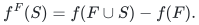
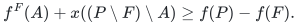

# Native commitment, contraction and eligibility interfaces

The [reference modules](reference/README.md) implement the original-optimum
commitment clients of the [main proof](proof.md), the complete preprocessing
of [safe machine contraction](machine-contraction.md), and the local
certificates of [eligibility padding](eligibility-padding.md). Inputs retain
original physical machine IDs, original mandatory job bases and positive
common type sizes. There is no assignment-cost or setup budget in this model.
All counts and capacities remain binary numbers.

## 1. Full-marginal absorption and all threshold closures

`Absorption` validates a common original ground of complete job-rank tables.
It repeatedly selects the minimum current total marginal workload, breaking
ties by original machine ID. At that step it records every original type's
rank increment on the selected machine. Greedy polymatroid feasibility makes
these records a restricted base on every prefix. Submodularity makes each
remaining machine's marginal nonincreasing as the prefix grows.

The stored bottleneck is the maximum marginal seen so far, rather than the
most recent marginal. Thus decreases in individual marginal loads cannot
make the recorded threshold decrease. At any threshold, the longest prefix
whose bottleneck is at most that threshold is precisely the full-marginal
closure: the next greedy minimum is too large, while every earlier step was
legal. Comparing two arbitrary legal absorption orders by prefix inclusion
proves that their final closed sets coincide. The canonical proof establishes
both this order independence and monotonicity in the threshold.

`for_budget` locates the first prefix whose actual residual distinguished
rank is at most the requested binary budget, then extends through the entire
bottleneck plateau. It does not enumerate the numerical rank budget. This
returns the smallest threshold among these closures, including threshold zero
and zero-cost initial machines. It does not optimize arbitrary partial
preassignments to machines.

## 2. Actual contracted bases, dominated recovery and lifting

On a closure, the reference retains the original remaining IDs and explicitly
constructs each contracted rank:

<!-- math-display: ec2152790191224e9272b750
f^F(S)=f(F\cup S)-f(F).
-->

`dominated` accepts a supplied original integer schedule and computes an
integer contracted base inside its remaining-coordinate box. For a contracted
rank and that box, it evaluates the usual box-restricted rank on successive
prefixes and returns its greedy differences. The canonical contraction lemma
proves that the maximum boxed total is the entire contracted rank:

<!-- math-display: 472c1f78d4b5dbcd8fb07401
f^F(A)+x((P\setminus F)\setminus A)\ge f(P)-f(F).
-->

Hence the constructed base is coordinatewise no larger than the original
remaining assignment. Nonnegative sizes imply that its load at each remaining
machine cannot increase. This is an actual producer for the original-optimum
comparison, rather than merely an existence assertion about the optimum.

`lift` validates every supplied residual type base and combines it with the
recorded committed rows. The canonical submodularity argument proves that any
restricted base and any contracted base combine to an original base. The
implementation additionally checks all original inequalities and totals.
Its output therefore has makespan bounded by the maximum of the closure's
recorded bottleneck and the supplied residual makespan.

## 3. Position commitments keep resource ranks intact

`position_commitment` is a distinct operation. It greedily selects an
independent set of the required size in an ordinary player matroid, ordered
by the supplied nonnegative singleton exposure. For each exposure threshold,
matroid greedy reaches that threshold set's rank. Therefore the largest
selected exposure is minimal among independent commitments of that size.
It contracts only the player matroid and removes its resulting loops while
retaining original IDs.

Every original player basis spans this contraction, so its remaining members
contain a residual basis. This transfers the target promise. It does not
contract the recipient workload resource or allocate private quota to the
committed machines. The distinction from full-marginal machine removal in
Sections 1–2 is essential.

## 4. Original-optimum many-size commitment client

`CommitmentBackend` fixes its bottleneck position set before target search.
For a hard target it reuses the native full-machine workload construction and
[exact reconstruction](../many-size-scheduling/reference-realization.md).
Its workload quantum is engineered from the divisor numerator so that both
the full quota and its divided weak quota are integers.

The reference streams residual original player subsets and tests completion
to the original largest-job basis together with all original dual inequalities.
A full target supplies a full-quota basis of that contraction and hence a
weak-quota candidate. Exhaustion is therefore a sound original rejection.
This explicit subset enumeration has a separate cost; it does not implement
the fast normalized-prefix unit search.

The dual lower vector puts quota only on that residual basis and **zero** on
all position commitments. Zero extension preserves feasibility in the original
full-machine dual. The common workload routine completes the vector, complements
it, decomposes the binary-scaled workload, and restores every original smaller
job base by joint upper-prefix rounding. It keeps the selected largest basis
fixed and decomposes it into its original equal-largest-size types.

At each committed machine the final integer counts obey the original singleton
ranks. Its load is bounded directly by the largest size plus the commitment
exposure; there is no additional small-job rounding term there. The other
machines retain the main proof's quota and additive-rounding estimate. This
proves the original-optimum bound of the main workload commitment theorem.

## 5. Exact integer two-size client and target optimization

The separate `two-size` mode forms the small **count** dual with the exact
floor capacity and floor-difference quota from the main proof. It does not
assume that the largest size is an integer multiple of the smaller size.
The residual weak quota is the exact finite-rank floor formula. Commitments
again get zero dual lower quota.

In this mode all small scaling multipliers are one. The decomposition already
returns integer original type bases. Although reconstruction calls the common
upper-prefix routine, all these prefix values are integral. Its full-machine
small count caps are tight because their sum equals the original mandatory
small total. The final small count on every machine is consequently unchanged;
all smaller types have the same size, so no additive rounding loss is incurred.
This gives the main proof's exact two-size commitment guarantee.

The high-target branch uses the original all-job fractional LP and joint upper
rounding. Boolean-rank loss only rejects the hard regime, where a full target
would assign at most one largest unit per machine. One-size systems use exact
capped bases; empty and zero-rank systems keep their original zero totals.

Both clients keep actual outputs in an original-load-grid search. Only genuine
original failures raise the lower endpoint; there is no private-cap rejection
in this adapter. Adjacent endpoints place the saved upper target at most the
original optimum. The optional default fallback is an actual original all-job
LP/additive-rounding schedule; returning the better output preserves its
separate additive-largest-job bound. The external specialized two-size
polynomial approximation is not implemented by these modules.

## 6. Local eligibility and exact scalar padding certificates

`eligibility` reads original singleton ranks. It retains the minimum and
maximum eligible large sizes and the small singleton workload at each original
machine. To find the smallest possible large collision, it retains at most two
copies of each eligible type's size, independent of its numerical capacity.
The minimum pair can occur in full bases because each original type's selected
one- or two-unit vector is independent and extends to a base. Conversely every
actual collision obeys these singleton capacities. Its returned threshold is
therefore exact; `None` denotes an impossible collision.

The same routine constructs the Boolean recipient matroid by unit-box
restriction of the sum of original large ranks. It does not identify the
original total with its capped rank when the cap loses rank.

`padding_scale` implements the optional exact one-dimensional optimization in
the eligibility manuscript. It scans intervals between maximum eligible sizes.
Within each interval the active set is constant and the feasibility inequality
is linear. At an endpoint, machines with maximum size equal to that endpoint
are removed from the active set, exactly as its strict definition requires.
The first feasible interval candidate is the minimum attainable overhead.
For coefficient one the direct width solution applies. The returned positive
scale realizes the computed overhead in the original piecewise expression.

This optimizes the scalar padding certificate, not the joint choice of a
commitment set or an original schedule. The full heterogeneous-large padding
allocator is not implemented here. Its proof remains separate, including the
collision branch and the caveat about unconditional approximation coefficients.

## 7. Representation costs and independent evidence

After rank validation, the full absorption order uses `O(q**2*m)` original
rank lookups and exact operations, and stores `O(q*m)` count records. Complete
table validation and construction of contracted or Boolean rank tables have
explicit subset costs, polynomial in the supplied complete-table size. Boxed
greedy recovery similarly enumerates subsets of the remaining original ground.
No loop depends on a count or rank budget's numerical magnitude. The scalar
padding scan uses polynomially many comparisons and rational operations in the
number of eligibility pairs. Actual integer, rational and original-ID encodings
are charged throughout.

The workload clients reuse the streamed active-system LP solver with its
explicit combinatorial factor. The residual selector enumerates combinations
of original machines. These costs differ from the theorem's paid polynomial
LP/intersection primitives and rank-parameter local search. Only the current
candidate and active system are stored; capacities and workload multipliers
are not expanded, and full solution or vertex families are not retained.

Three independent checkers compare arbitrary legal absorption orders, original
job base schedules, original optimum loads, all feasible player commitments,
and piecewise-affine scalar envelopes. They include a target feasible under
position commitment but rejected by the stricter private-cap method, noninteger
size ratios, decreasing marginal loads, entire bottleneck plateaus, exact active
set endpoints and 100-digit capacities. These finite checks support the explicit
proofs; they are not proof-assistant verification or external peer review.

**Attribution:** Yilin Liu and GPT-6 Astra Pro.
