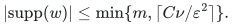
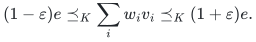

# Sparsification from self-concordant barriers

An exact cone-order sandwich for a finite sum of cone elements, with a support bound linear in the self-concordant barrier parameter. This is an existence theorem; the available construction has a separate randomized oracle model.

[Complete LaTeX manuscript](manuscripts/self_concordant_sparsification.tex) · [Proof and dependency map](proof.md) · [Primary sources](sources.md) · [Verification scope](verify/README.md)

**Guarantee**

For a sum e of m vectors belonging to a proper cone K, nonnegative reweighting preserves every dual-cone measurement between (1-epsilon) and (1+epsilon) times its original value, even when e lies on the boundary.

**Objective and output**

Select and reweight original summands, never substitute artificial vectors. Retain at most min(m, ceil(C nu/epsilon^2)) nonzero weights for a universal C. Both cone inequalities must hold simultaneously.

**Randomness**

The sparsity conclusion is an unconditional existence theorem. Construction is randomized polynomial time only in the ideal strong separation-oracle model with a supplied valid upper bound on nu. No deterministic algorithm or general bit-complexity bound is asserted.

**Time**

Existence needs no running-time assumption. The partial-coloring construction runs in randomized polynomial time in the ideal strong separation-oracle model and given a valid parameter upper bound; this is not a Turing bit-complexity bound for arbitrary cones.

**Space**

The theorem measures retained nonzero weights. No implementation workspace bound or bit representation for arbitrary cone oracles is claimed.

**Parameters**

nu is the real logarithmic-homogeneity parameter of a standard self-concordant barrier on K; m is the number of input vectors; 0 < epsilon < 1. All asymptotic constants are universal.

**Model and representation**

A finite-dimensional proper closed convex pointed full-dimensional cone, with a standard nu-logarithmically homogeneous self-concordant barrier. Summands and their total may be boundary points. The optional algorithm assumes access to an ideal strong separation oracle.

**Lower-bound scope**

The O(nu/epsilon^2) order is worst-case sharp for a family of positive-semidefinite cones via standard graph cut-sparsifier lower bounds in their stated parameter range. There is no matching lower bound asserted for every cone, nor a claim to improve the specialized numerical constant 4.

**Review status**

**Ready for review.** The cone-order sparsification theorem and its boundary-sum proof have been checked against the imported geometric statements. The manuscript separates existence, dual/face/lift consequences, and a conditional randomized separation-oracle construction.

**Dependencies and scope.** Reis--Rothvoss Lemma 18 and Theorems 7 and 22 are essential published inputs; the directional barrier inequality and duality are standard cited results. The two supplied research-session audits identified no substantive proof gap. They are not external peer review or formal verification. No general Turing bit-complexity bound, deterministic construction, or exhaustive historical-priority claim is made.

The [verification note](verify/README.md) identifies executable coverage. This status does not claim external peer review or proof-assistant verification.

**Source**

[Complete proof in LaTeX](manuscripts/self_concordant_sparsification.tex), [proof reading map](proof.md), [attributed dependencies and comparison](sources.md). Curated by Yilin Liu and GPT-6 Astra Pro.

## Main theorem

Let K be a proper cone admitting a standard nu-logarithmically homogeneous self-concordant barrier. For any finite v_1,...,v_m in K, write e for their sum. For 0 < epsilon < 1 there are w_i >= 0 with

<!-- math-display: fdd4bb07a02aba58dc191657
\lvert\mathrm{supp}(w)\rvert\le\min\{m,\lceil C\nu/\varepsilon^2\rceil\}.
-->

The simultaneous cone-order inequalities are:

<!-- math-display: a1fcec6f55d7145af5ae4d4a
(1-\varepsilon)e\preceq_K\sum_i w_i v_i\preceq_K(1+\varepsilon)e.
-->

The barrier need not be pairwise-self-concordant. The bound does not require e in the interior. See [Theorem 1.1 and its complete proof](manuscripts/self_concordant_sparsification.tex).

## Consequences

The same linear-in-parameter support bound holds for dual cones, faces, and closed cones obtained by linear lifts, under the precise hypotheses in the manuscript. For the nuclear-norm epigraph on n-by-k matrices with n >= k, the support is O((k+1)/epsilon^2), independent of n.

The additional contribution is the zero extension of exp(-barrier), convex along every cone direction, and the uniform boundary-sum positivity argument. The separate-convexity lemma, symmetrization, and partial coloring are due to Reis and Rothvoss; the general quadratic baseline and stronger pairwise-barrier special case are due to Saunderson. See [sources](sources.md) for attribution and claim limits.

The complete manuscript is an English research draft, not external peer-reviewed or proof-assistant-verified.
